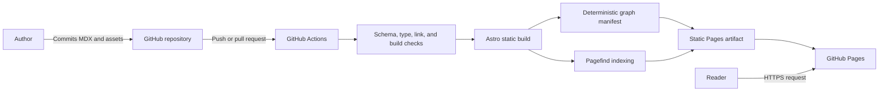

Atlas v0.6.0

# Public Personal Knowledge Garden and Living Portfolio Architecture

## Document Status

- **Status:** Approved architecture for implementation
- **Date:** 2026-07-21
- **Audience:** Senior engineers implementing and maintaining the platform
- **Decision record:** `docs/decisions/0001-public-personal-knowledge-garden-and-knowledge-graph.md`
- **Related documents:** `02_FolderStructure.md`, `03_ImplementationGuide.md`, `04_ComponentRegistry.md`, `05_ContentModel.md`, `06_CodingStandards.md`, `07_MilestonePlan.md`, `08_TestStrategy.md`, and `09_DeploymentGuide.md`

## 1. Purpose

The product is a **Public Personal Knowledge Garden + Living Portfolio**, with a **Knowledge Graph as a public discovery layer**. It publishes reviewed knowledge across engineering, artificial intelligence, music, reading and literature, and philosophy and life while presenting professional and creative work as a living portfolio.

The platform will be implemented as a statically generated Astro site. Public content will live in the repository, be validated and resolved into deterministic routes and a graph manifest at build time, and be published to GitHub Pages. The architecture favors durable URLs, portable content, explicit semantic relationships, minimal route-local browser JavaScript, and clear ownership boundaries over runtime complexity.

## 2. Requirements Review

### 2.1 Confirmed requirements

- Use Astro as the site and static-generation framework.
- Use TypeScript for application logic and content contracts.
- Use Tailwind for styling.
- Use MDX for renderable knowledge and portfolio content.
- Deploy through GitHub Pages as a project site under `/engineering-lab/`.
- Lead with cross-domain knowledge discovery; use profile and professional or creative project content to support a living portfolio.
- Model four initial content types: articles, notes, projects, and series.
- Classify published entries with controlled domains and connect them with validated typed semantic relationships.
- Include build-time full-text search with Pagefind in the initial release.
- Include a build-time Knowledge Graph manifest, `/graph/` discovery route, accessible semantic fallback, and lazy Cytoscape.js visual enhancement.
- Preserve future one-way publishing/export boundaries for Obsidian and NotebookLM without implementing either integration.
- Produce reusable layouts and components rather than page-specific duplication.
- Keep every implementation milestone in a buildable, reviewable state.

### 2.2 Repository findings

The repository currently contains a product statement but no application, content model, design system, package configuration, or legacy behavior to preserve. The implementation can establish conventions deliberately without migration constraints.

### 2.3 Constraints implied by GitHub Pages

- Production output must be static files.
- The platform cannot depend on server-side rendering, server endpoints, runtime secrets, authentication, or a private content store.
- All public assets and internal links must work beneath the `/engineering-lab/` base path.
- Features such as comments, analytics, forms, or remote personalization require explicitly approved third-party services and are outside the initial architecture.
- Content committed to the repository and deployed through Pages must be treated as public.

### 2.4 Non-goals for the initial platform

- A browser-based content management system.
- User accounts, private notes, or role-based access.
- Obsidian synchronization, vault publication, or bidirectional authoring.
- NotebookLM runtime integration or use as a canonical content source.
- Runtime databases or search services.
- Comments, reactions, newsletters, or contact-form processing.
- A client-rendered single-page application.
- Replacing predictable navigation, topics, search, or series with graph-only navigation.
- A general-purpose component library for use outside this repository.
- Localization before a concrete multilingual requirement exists.

## 3. Architecture Principles

1. **Content is the durable asset.** MDX and metadata must remain understandable and portable independently of the presentation layer.
2. **Validate early.** Invalid metadata, duplicate identifiers, broken references, invalid graph edges, prerequisite cycles, and broken internal links must fail automated checks before deployment.
3. **Static by default.** Generate HTML at build time and add browser JavaScript only for interactions that cannot be delivered with HTML and CSS.
4. **Stable URLs over convenient reorganizations.** Published slugs are public contracts and must not change casually.
5. **Progressive enhancement.** Navigation, content, and semantic graph connections remain usable if optional browser JavaScript, including search or graph enhancement, does not execute.
6. **Accessible by construction.** Semantic HTML, keyboard operation, visible focus, sufficient contrast, reduced-motion support, and meaningful alternative text are implementation requirements.
7. **Base-path safety.** Routes and assets must never assume deployment at the domain root.
8. **Cumulative, buildable delivery.** Every milestone must end with a successful production build and a usable increment.
9. **Explicit knowledge relationships.** Tags classify, domains group, series order, and typed connections express meaning; one mechanism must not silently replace another.

## 4. System Context

The repository is the system of record for public content. Astro transforms validated content and page templates into static HTML and a deterministic public graph manifest. Pagefind indexes generated HTML, not source MDX, while the graph resolver emits only production-visible nodes and typed edges. GitHub Actions is the only production build and deployment authority.

## 5. Build-Time Architecture

The production pipeline has six logical stages:

1. **Install:** Restore exact dependencies from the committed lockfile using the repository's pinned Node.js LTS version.
2. **Validate:** Check formatting, TypeScript, Astro templates, content schemas, content references, and internal links.
3. **Generate:** Resolve graph nodes/edges and render routes, collection pages, topic pages, graph endpoints, metadata, sitemap, and feed artifacts with Astro.
4. **Index:** Run Pagefind against the completed static output and add its generated search assets to that output.
5. **Verify:** Confirm the deployment artifact includes expected entry points, deterministic graph manifest, Pagefind index, and base-path-correct assets.
6. **Publish:** Upload and deploy the immutable static artifact through the GitHub Pages deployment action.

Local and CI builds must use the same commands and dependency lockfile. Pull requests run all validation and artifact-generation stages but do not publish to production.

## 6. Content Architecture

Astro content collections are the boundary between authored content and application code. Collection schemas are strict, reject unknown or malformed required data, and provide typed values to routes, layouts, and components.

### 6.1 Shared content contract

All renderable entries share these concepts, with required or optional status determined by collection:

| Field | Purpose |
| --- | --- |
| `title` | Human-readable page title. |
| `description` | Concise summary for listings, search, and metadata. |
| `publishedAt` | Original publication date. |
| `updatedAt` | Date of the latest substantive revision, when applicable. |
| `draft` | Excludes unfinished content from production routes, feeds, and search. |
| `tags` | Normalized, lowercase taxonomy terms used for discovery. |
| `domains` | One or more controlled broad knowledge domains used for navigation and graph filtering. |
| `connections` | Optional typed semantic relationships to stable content references. |
| `image` | Optional social or listing image with required alternative text where rendered as content. |
| `canonicalUrl` | Optional canonical source when this site republishes content. |

Collection schemas may add fields but must not redefine shared fields with conflicting meaning. Dates are stored in an unambiguous ISO format and converted to typed date values during loading.

### 6.2 Collections

| Collection | Source | Responsibility | Collection-specific metadata |
| --- | --- | --- | --- |
| `articles` | MDX | Long-form, evergreen personal knowledge with a durable thesis, explanation, or tutorial structure. | Optional series membership, series order, featured state, and table-of-contents control. |
| `notes` | MDX | Short, focused observations, concepts, references, decisions, and working knowledge that may evolve. | Knowledge maturity and optional related-entry references. |
| `projects` | MDX | Professional or creative portfolio case studies explaining context, role, decisions, outcomes, and lessons. | Status, role, demonstrated skills, optional tools, time period, repository URL, live URL, and featured state. |
| `series` | MDX | Landing pages and narrative context for ordered learning paths. | Ordered typed references to article and note entries. |

Separate collections are preferred over one collection with a `type` discriminator because their metadata, routes, layouts, and lifecycle rules differ. Shared schema fragments may remove duplication without weakening collection-specific validation.

### 6.3 Identifiers, slugs, and references

- A content entry's stable identifier derives from its path within its collection.
- Files and directories use lowercase kebab-case.
- Route slugs are derived consistently from identifiers; arbitrary one-off slug logic is prohibited.
- Moving published content requires an explicit compatibility decision because GitHub Pages does not provide application-level redirects.
- Series use ordered references containing both collection type and entry identifier so articles and notes can participate in one sequence.
- Graph node IDs use `<collection>:<entry-id>` and remain stable while the content identifier remains stable.
- Build validation must reject missing references, draft-only targets, duplicate series positions, self-references, duplicate semantic edges, prerequisite cycles, and duplicate resolved URLs.
- Cross-links in prose use base-path-aware site URLs or resolved content references rather than fragile relative traversal.

### 6.4 Taxonomy

Tags are the detailed flat taxonomy. They are normalized to lowercase kebab-case and rendered as human-readable labels by a centralized formatter. Build validation must reject duplicates after normalization.

Domains are a controlled broad taxonomy defined in typed configuration. Initial domains are `engineering`, `artificial-intelligence`, `music`, `reading-literature`, and `philosophy-life`. Every published entry declares at least one domain. Domains are graph filters, not graph nodes or content collections.

Topic pages are derived from tags and are not a fifth initial content collection. If tags or domains later require authored descriptions, aliases, ownership, or hierarchy, the team may promote the relevant taxonomy through an architecture decision and migration plan.

### 6.5 Knowledge Graph

Every production-visible content entry is a graph node. The approved edge types are `prerequisite`, `explains`, `extends`, `contrasts`, `applies-to`, `derived-from`, and `related`.

- Directed edges preserve source-to-target semantics.
- `related` is authored once and resolved as symmetric traversal; reverse duplicate declarations fail validation.
- `prerequisite` edges must form a directed acyclic graph.
- Tags and domains support filtering but do not become nodes in the initial graph.
- Series remains the canonical authored order for learning paths and is not replaced by prerequisite edges.
- The manifest is deterministic and contains no generated timestamp or environment-specific ordering.
- Isolated valid nodes remain discoverable; connection count is a governance signal rather than a fabricated edge requirement.

### 6.6 Content lifecycle

- Draft entries are visible in local development when explicitly enabled but are absent from production output.
- Published content requires a title, description, publication date, and at least one tag.
- A substantive correction updates `updatedAt`; minor spelling or formatting fixes do not need to change it.
- Removed public content requires a documented replacement, retirement page, or external redirect strategy before deletion.
- Archived knowledge remains addressable unless legal, security, or factual risk requires removal.

## 7. Rendering and Layout Architecture

Layouts own page structure and metadata placement. Components own reusable interface or content fragments. Routes load data and select a layout; they should not reproduce layout markup or embed collection-specific presentation rules.

### 7.1 Reusable layouts

| Layout | Responsibility |
| --- | --- |
| `SiteLayout` | Document shell, global metadata defaults, skip link, registered header/footer composition, collapsible left-sidebar grid, main landmark, and shared assets. |
| `ListingLayout` | Collection indexes, topic indexes, result counts, optional filters, pagination region, and empty states. |
| `KnowledgeLayout` | Article and note title block, dates, tags, reading structure, table of contents, related content, and MDX body. |
| `ProjectLayout` | Project summary, role, skills and tools, external links, case-study body, and related projects. |
| `SeriesLayout` | Series introduction, ordered entry list, progress context, and series body. |

All specialized layouts compose `SiteLayout`. Articles and notes deliberately share `KnowledgeLayout`; differences should be represented by typed props and small components rather than near-duplicate layouts.

### 7.2 Reusable component groups

| Group | Components and responsibilities |
| --- | --- |
| Site chrome | Search topbar and collapsible sidebar composed by `Header`; icon-based primary/mobile navigation; sidebar footer; skip link; and persistent site identity. Resume is the first navigation item and the default home view. |
| Metadata | Document head, canonical URL, Open Graph data, structured data, publication dates, and content status. |
| Discovery | Search form/results, collection navigation, tag list, topic links, pagination, and related-content list. |
| Content | Prose wrapper, table of contents, heading anchors, code block treatment, callout, figure, and external-link treatment. |
| Cards and summaries | Article summary, note summary, project summary, series summary, and consistent empty states. |
| Series navigation | Ordered entry list plus previous/next entry navigation. |
| Project facts | Status, role, period, demonstrated skills, optional tools, repository link, and live-site link. |
| Graph discovery | Graph shell, search/filter controls, selected-node details, semantic connection list, and visual graph enhancement. |

Components should remain presentational where practical. Collection queries and route generation belong in route or domain utility modules, not visual components. MDX may expose a small, documented set of content components; arbitrary application internals must not become part of the authoring contract.

### 7.3 Browser JavaScript policy

- Astro components render static HTML by default.
- No client UI framework is introduced for the initial architecture.
- Pagefind's search UI may load browser JavaScript on the search experience only.
- Cytoscape.js may be lazy-loaded by the graph controller on `/graph/` only; it is the approved focused graph engine, not a UI framework.
- The header may use a minimal isolated script to persist desktop sidebar collapse state and open/close the mobile sidebar overlay; navigation links remain ordinary crawlable anchors.
- Graph browser code consumes the static manifest and must not import Astro collections or build-time content modules.
- A client directive requires a documented interaction need and must not be added solely for developer convenience.

## 8. Routing Strategy

Astro file-based routes provide static pages. Dynamic route templates enumerate collection entries with `getStaticPaths` during the build. The public route model is:

| Logical route | Purpose |
| --- | --- |
| `/` | Resume-first default view. `src/pages/index.astro` embeds the standalone public HTML resume inside `SiteLayout`; global search remains available in the topbar and knowledge discovery continues through the sidebar destinations. |
| `/articles/` | Article index. |
| `/articles/<slug>/` | Article detail. |
| `/notes/` | Note index. |
| `/notes/<slug>/` | Note detail. |
| `/projects/` | Project index. |
| `/projects/<slug>/` | Project case study. |
| `/series/` | Series index. |
| `/series/<slug>/` | Series landing page. |
| `/topics/` | Alphabetical or grouped topic index derived from tags. |
| `/topics/<tag>/` | Cross-collection entries for one normalized tag. |
| `/search/` | Pagefind search interface with shareable query state where feasible. |
| `/graph/` | Accessible graph discovery page with selected-node neighborhood, filters, textual details, and progressive visual enhancement. |
| `/graph/graph.json` | Deterministic static public graph manifest generated from production-visible content. |
| `/about/` | Professional profile and context for the knowledge platform. |
| `/404.html` | Static not-found page compatible with GitHub Pages. |

These are logical routes. Production URLs include Astro's configured `/engineering-lab/` base. Implementations must use Astro URL helpers, the configured base, or centralized link utilities instead of hard-coded root-relative paths.

The standalone resume artifact under `/resume/SuDuyHien_Resume_Updated.html` remains directly printable and shareable, but `/` is its canonical in-application presentation. The resume is a public profile artifact, not a fifth collection, graph node, or replacement source for knowledge entries.

Pagination is introduced only when collection size justifies it. When introduced, pagination URLs must be deterministic and index pages must retain useful non-JavaScript navigation.

## 9. Search, Graph, and Discovery

Pagefind is a post-build subsystem, not a runtime service.

- Pagefind indexes final HTML after Astro finishes rendering.
- Articles, notes, projects, and series are searchable; global navigation, repeated footer text, and decorative UI are excluded from the index.
- Indexed metadata includes collection type, normalized tags, title, description, and publication date where supported.
- The search page supports text queries first. Collection and tag filtering may be layered on the same index without creating a separate search data store.
- Search result URLs must preserve the project-site base path.
- Search failure must not block access to collection indexes, series navigation, or topic pages.
- Draft content must never enter the production index.

Discovery also includes collection indexes, topic pages, related-content links, series ordering, sitemap generation, and an RSS feed for newly published knowledge. Search is not the only path to content.

The Knowledge Graph adds semantic exploration without replacing those paths. Its default visual scope is an ego graph around a selected node rather than an unbounded all-node rendering. Users may search nodes and filter by domain, collection, and relationship type. The selected node and filters may be shareable query state, while canonical metadata remains `/graph/`.

The graph page always exposes semantic connection lists, textual node details, and direct content links. Visual rendering, layout, animation, or pointer interaction is never the sole means of understanding or navigating relationships.

## 10. Styling Architecture

Tailwind supplies design tokens and utility classes. The implementation should establish a restrained, readable visual system appropriate for technical content rather than treating each page as an independent design surface.

- Define semantic tokens for color, typography, spacing, borders, focus, and content width.
- Keep global CSS limited to token definitions, document defaults, typography behavior, and cases utilities cannot express clearly.
- Keep component styling with the component; avoid route-specific global selectors.
- Use a dedicated prose treatment for MDX with explicit styles for headings, links, lists, tables, code, quotations, figures, and callouts.
- Do not construct class names dynamically in ways Tailwind cannot discover at build time.
- Meet WCAG 2.2 AA contrast and interaction requirements in every supported theme.
- Respect `prefers-reduced-motion`; motion must clarify state or hierarchy rather than decorate routine navigation.

## 11. SEO and Document Metadata

`SiteLayout` provides defaults while content layouts supply entry-specific values.

- Every indexable route has a unique title, description, canonical URL, and social-sharing metadata.
- Canonical and asset URLs use the configured production `site` and `base` values.
- Structured data reflects the actual content type: article-like entries, project/creative work, profile, and breadcrumb data as appropriate.
- Draft, diagnostic, and intentionally duplicate pages are excluded from indexing.
- The build emits a sitemap and RSS feed using production URLs.
- Heading order, landmark structure, link text, and image alternative text remain meaningful without CSS.
- The graph page uses a canonical `/graph/` URL; manifest and query-state variants do not become indexable duplicate pages.

## 12. Deployment Architecture

### 12.1 Environments

| Environment | Trigger | Behavior |
| --- | --- | --- |
| Local development | Developer command | Fast feedback, draft visibility when enabled, and local base-path testing. |
| Pull request | Pull request update | Clean install, all validation, production build, Pagefind indexing, and artifact verification without deployment. |
| Production | Push to the protected default branch or approved manual dispatch | Repeats validation and deploys the generated artifact to GitHub Pages. |

### 12.2 GitHub Pages configuration

- Configure Astro's production `site` as the GitHub Pages origin and `base` as `/engineering-lab/`.
- Use GitHub's Pages artifact and deployment actions rather than committing generated output to a publication branch.
- Grant the workflow only the permissions required to read repository contents, write the Pages deployment, and obtain the deployment identity token.
- Serialize production deployments so an older build cannot overwrite a newer release.
- Protect the production environment and default branch according to repository policy.
- Keep build output immutable; do not modify files after the artifact is uploaded.
- Verify that graph HTML, manifest, controller, and Cytoscape.js assets originate from the same immutable build.
- A future custom domain requires an explicit configuration change and full base-path regression check.

### 12.3 Release and rollback

The default branch is the release source. A failed validation cannot deploy. Rollback is performed by reverting the offending change and running the same pipeline, preserving a traceable relationship between source commit and deployed artifact.

## 13. Coding Conventions

### 13.1 TypeScript and Astro

- Enable strict TypeScript settings and Astro's strictest practical type-checking preset.
- Avoid `any`; narrow `unknown` values at boundaries.
- Type component props, content-query results, utility inputs, and return values.
- Prefer pure functions for sorting, grouping, URL creation, and metadata transformation.
- Keep route files focused on data loading and layout composition.
- Keep browser code isolated from build-time modules.
- Keep graph resolution deterministic at build time and graph rendering isolated to the graph browser controller.
- Use path aliases only for stable top-level boundaries; use relative imports within a small local feature.
- Export the smallest necessary public surface from each module.

### 13.2 Naming

- Astro components and layouts: `PascalCase.astro`.
- TypeScript modules and utilities: lowercase kebab-case filenames with camelCase symbols.
- Content files, route segments, and asset directories: lowercase kebab-case.
- Types and interfaces: PascalCase; functions and variables: camelCase; true constants: uppercase snake case only when they are module-level invariants.
- Boolean names should read as predicates, such as `isDraft` or `hasSeries`.

### 13.3 Components and layouts

- Give every component one primary responsibility.
- Prefer composition over mode-heavy components with many boolean props.
- Do not query entire content collections from leaf presentation components.
- Avoid duplicated page shells; specialized layouts must compose the common site layout.
- Use semantic elements before adding ARIA. ARIA supplements native semantics and does not replace them.
- Icon-only controls require accessible names and visible focus behavior.
- Graph controls require keyboard operation, textual state, reduced-motion behavior, and a semantic nonvisual equivalent.

### 13.4 Tailwind and CSS

- Use semantic design tokens instead of scattering raw color values.
- Keep utility ordering consistent through the repository formatter.
- Extract a component when a repeated class group represents repeated behavior or structure, not merely to shorten markup.
- Avoid `!important`, arbitrary z-index escalation, and unbounded global selectors.
- Verify responsive behavior at content-driven breakpoints, including long titles, code blocks, tables, and navigation labels.

### 13.5 MDX and content

- Keep one top-level page title in frontmatter; the MDX body begins below that level.
- Use sentence-case headings and descriptive link text.
- Add language identifiers to fenced code examples.
- Store content-specific images near their entry; store shared brand assets separately.
- Provide captions and alternative text according to the information conveyed by an image.
- Use exposed MDX components consistently; do not embed route logic or browser-dependent behavior in content.
- Treat published entry identifiers and URLs as stable API contracts.

### 13.6 Dependencies and repository hygiene

- Use a pinned Node.js LTS release and npm with a committed lockfile.
- Add a dependency only when the platform or standard library cannot satisfy the requirement clearly and maintainably.
- Pin automation actions to stable major versions or immutable references according to repository security policy.
- Keep generated build and Pagefind output out of source control.
- Changes to architecture, content contracts, routes, or deployment behavior must update the relevant planning document or add an architecture decision record.
- Cytoscape.js is the only approved graph visualization dependency; adding graph plugins requires dependency, bundle, accessibility, and performance review.

## 14. Quality Gates

A change is eligible to merge only when the checks relevant to its scope pass. The final baseline will include:

- Formatting and lint checks.
- Strict TypeScript and Astro diagnostics.
- Content schema and cross-reference validation.
- Production Astro build using the project-site base path.
- Pagefind index generation and basic index verification.
- Internal-link and asset-link validation against generated output.
- Automated accessibility checks for representative page types.
- Unit tests for nontrivial pure utilities such as URL generation, taxonomy normalization, sorting, and series resolution.
- Unit tests for graph resolution, edge normalization, duplicate detection, and prerequisite-cycle detection.
- Smoke checks for the home page, each collection route, topics, search, graph, and the not-found page.
- Graph manifest parity, accessibility fallback, keyboard, reduced-motion, route-local JavaScript, and performance validation.

Performance budgets should be enforced on representative pages. Initial targets are minimal client JavaScript outside search, no avoidable layout shift, optimized responsive images, and Lighthouse scores of at least 90 for performance and 100 for accessibility, best practices, and SEO under the agreed CI profile.

## 15. Security and Privacy

- Never place secrets, private notes, unpublished credentials, or confidential URLs in content or client bundles.
- Never expose a future Obsidian vault, integration metadata, or NotebookLM source package through the graph manifest.
- Treat MDX as trusted repository code: only reviewed contributors may modify it.
- Keep dependencies and GitHub Actions current through automated update tooling and review.
- Restrict third-party scripts. Analytics or embeds require a privacy and performance review before adoption.
- Use secure external links and apply appropriate relationship attributes when opening a new browsing context.
- Production builds must not expose draft content, source maps containing sensitive data, or local environment values.

## 16. Architectural Decisions

| Decision | Choice | Consequence |
| --- | --- | --- |
| Product identity | Public Personal Knowledge Garden + Living Portfolio | Supports professional and personal knowledge while retaining public editorial governance. |
| Rendering | Astro static site generation | Excellent Pages compatibility and low runtime complexity; no server features. |
| Source of truth | Git-tracked MDX and metadata | Reviewable history and portability; authoring requires repository workflow. |
| Content model | Four separate typed collections | Strong contracts and clear routes; shared schema fragments are needed. |
| Taxonomy | Controlled broad domains plus flat tags and generated topic pages | Supports cross-domain filtering without adding another collection. |
| Knowledge relationships | Typed explicit connections plus ordered series | Semantic graph discovery is deterministic and validated; authors must curate edges. |
| Search | Pagefind over generated HTML | No hosted search service; indexing becomes a required post-build stage. |
| Graph engine | Lazy route-local Cytoscape.js on `/graph/` | Uses a proven graph engine while preserving static fallback and browser isolation. |
| Client architecture | Static Astro components with Pagefind, graph, and minimal navigation enhancement | Small browser payload; rich interactions remain deliberate and route-local. |
| Hosting | GitHub Pages project site | Simple, auditable deployment; all paths must honor `/engineering-lab/`. |
| Package management | Pinned Node.js LTS and npm lockfile | Reproducible local and CI installs with minimal contributor setup. |
| Future authoring/AI | No Obsidian or NotebookLM integration in baseline | Canonical schema stays tool-neutral; future adapters remain one-way and replaceable. |

## 17. Evolution Rules

The architecture may evolve when content scale or reader needs provide evidence for change. Material changes require a short architecture decision record covering context, alternatives, decision, migration, and consequences.

Likely future decision points include a formal taxonomy collection, multilingual routing, a one-way Obsidian publishing adapter, a curated NotebookLM export, custom-domain migration, privacy-respecting analytics, or an external interactive service. None should compromise static readability, stable content identifiers, public/private separation, or repository-based validation without an explicit replacement strategy.

## 18. Definition of Architecture Compliance

An implementation conforms to this architecture when:

- All public pages are statically generated and deploy successfully beneath `/engineering-lab/`.
- The four collections are schema-validated and drafts are absent from production.
- Published entries have controlled domains; typed connections and graph node IDs validate deterministically.
- Routes, layouts, and components follow the ownership boundaries defined above.
- Pagefind indexes the final public artifact and search is not required for basic navigation.
- `/graph/` provides accessible static relationship discovery and lazy visual enhancement from the same verified graph manifest.
- Invalid, duplicate, self, draft-only, or cyclic prerequisite connections cannot reach production.
- Content URLs and references are stable and validated.
- The automated pipeline can reproduce, verify, and deploy the site from a clean checkout.
- Every milestone ends with a passing production build and a usable cumulative release.