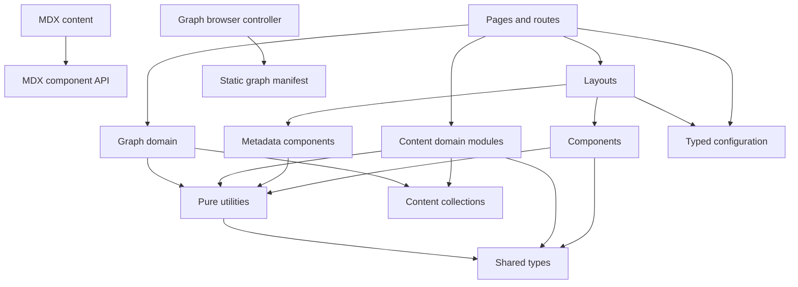

Atlas v0.6.0

# Public Personal Knowledge Garden and Living Portfolio Folder Structure

## Document Status

- **Status:** Approved folder contract for implementation
- **Date:** 2026-07-21
- **Audience:** Senior engineers and AI coding agents implementing the platform
- **Source of truth:** `01_Architecture.md`
- **Decision record:** `docs/decisions/0001-public-personal-knowledge-garden-and-knowledge-graph.md`
- **Related documents:** `03_ImplementationGuide.md`, `04_ComponentRegistry.md`, `05_ContentModel.md`, `06_CodingStandards.md`, `07_MilestonePlan.md`, `08_TestStrategy.md`, `09_DeploymentGuide.md`, and `docs/TechnicalDesignSpecification.md`

## 1. Purpose

This document defines the physical repository structure, ownership boundaries, dependency direction, and placement rules for the Public Personal Knowledge Garden and Living Portfolio. It translates the approved architecture into a stable file organization without changing its content model, routing model, rendering strategy, or deployment strategy.

The implementation must follow this structure. A new top-level folder, a renamed route folder, or a moved architectural responsibility requires an approved update to this document and, when the change is architectural, an architecture decision record.

## 2. Structural Principles

1. Routes load data and choose layouts.
2. Layouts compose page regions and own page-level metadata placement.
3. Components render reusable interface and content fragments.
4. Collection access and content relationships remain outside presentation components.
5. Utilities are pure and do not import routes, layouts, components, or Astro collection APIs.
6. Shared types define contracts but do not perform runtime work.
7. Authored content and content-specific assets remain colocated.
8. Browser code remains local to the interactive feature that owns it.
9. Generated output never becomes authored source.
10. Tests are organized by quality concern rather than mirroring every source folder.

## 3. Canonical Repository Tree

Names in angle brackets represent repeatable authored entries or test files, not literal files that must be created during initial scaffolding.

```text
engineering-lab/
├── .github/
│   └── workflows/
│       ├── ci.yml
│       └── deploy-pages.yml
├── docs/
│   ├── TechnicalDesignSpecification.md
│   └── decisions/
│       ├── 0001-public-personal-knowledge-garden-and-knowledge-graph.md
│       └── <future-decision-number>-<decision-title>.md
├── public/
│   └── <passthrough-static-files>
├── scripts/
│   ├── validate-content.ts
│   └── verify-build.ts
├── src/
│   ├── assets/
│   │   └── shared/
│   │       └── <shared-optimized-assets>
│   ├── components/
│   │   ├── cards/
│   │   │   ├── ArticleSummary.astro
│   │   │   ├── NoteSummary.astro
│   │   │   ├── ProjectSummary.astro
│   │   │   └── SeriesSummary.astro
│   │   ├── content/
│   │   │   ├── ExternalLink.astro
│   │   │   ├── HeadingAnchor.astro
│   │   │   ├── Prose.astro
│   │   │   └── TableOfContents.astro
│   │   ├── discovery/
│   │   │   ├── Breadcrumbs.astro
│   │   │   ├── CollectionNavigation.astro
│   │   │   ├── EmptyState.astro
│   │   │   ├── Pagination.astro
│   │   │   ├── RelatedContentList.astro
│   │   │   ├── SearchForm.astro
│   │   │   ├── SearchResults.astro
│   │   │   ├── TagList.astro
│   │   │   ├── TopicLink.astro
│   │   │   └── pagefind-search.ts
│   │   ├── graph/
│   │   │   ├── ConnectionList.astro
│   │   │   ├── GraphControls.astro
│   │   │   ├── GraphExplorer.astro
│   │   │   ├── GraphNodeDetails.astro
│   │   │   └── graph-explorer.ts
│   │   ├── mdx/
│   │   │   ├── Callout.astro
│   │   │   ├── Figure.astro
│   │   │   └── index.ts
│   │   ├── metadata/
│   │   │   ├── ContentStatus.astro
│   │   │   ├── DocumentHead.astro
│   │   │   ├── PublicationDates.astro
│   │   │   └── StructuredData.astro
│   │   ├── project/
│   │   │   └── ProjectFacts.astro
│   │   ├── series/
│   │   │   ├── SeriesEntryList.astro
│   │   │   └── SeriesNavigation.astro
│   │   └── site/
│   │       ├── Footer.astro
│   │       ├── Header.astro
│   │       ├── MobileNavigation.astro
│   │       ├── PrimaryNavigation.astro
│   │       ├── SiteIdentity.astro
│   │       └── SkipLink.astro
│   ├── config/
│   │   ├── domains.ts
│   │   ├── navigation.ts
│   │   └── site.ts
│   ├── content/
│   │   ├── articles/
│   │   │   ├── <article-slug>.mdx
│   │   │   └── <article-slug>/
│   │   │       └── <article-assets>
│   │   ├── notes/
│   │   │   ├── <note-slug>.mdx
│   │   │   └── <note-slug>/
│   │   │       └── <note-assets>
│   │   ├── projects/
│   │   │   ├── <project-slug>.mdx
│   │   │   └── <project-slug>/
│   │   │       └── <project-assets>
│   │   └── series/
│   │       ├── <series-slug>.mdx
│   │       └── <series-slug>/
│   │           └── <series-assets>
│   ├── layouts/
│   │   ├── KnowledgeLayout.astro
│   │   ├── ListingLayout.astro
│   │   ├── ProjectLayout.astro
│   │   ├── SeriesLayout.astro
│   │   └── SiteLayout.astro
│   ├── lib/
│   │   └── content/
│   │       ├── graph.ts
│   │       ├── queries.ts
│   │       ├── references.ts
│   │       ├── series.ts
│   │       └── sort.ts
│   ├── pages/
│   │   ├── articles/
│   │   │   ├── [...slug].astro
│   │   │   └── index.astro
│   │   ├── graph/
│   │   │   ├── graph.json.ts
│   │   │   └── index.astro
│   │   ├── notes/
│   │   │   ├── [...slug].astro
│   │   │   └── index.astro
│   │   ├── projects/
│   │   │   ├── [...slug].astro
│   │   │   └── index.astro
│   │   ├── search/
│   │   │   └── index.astro
│   │   ├── series/
│   │   │   ├── [...slug].astro
│   │   │   └── index.astro
│   │   ├── topics/
│   │   │   ├── [tag].astro
│   │   │   └── index.astro
│   │   ├── 404.astro
│   │   ├── about.astro
│   │   ├── index.astro
│   │   └── rss.xml.ts
│   ├── styles/
│   │   ├── global.css
│   │   └── prose.css
│   ├── types/
│   │   ├── content.ts
│   │   ├── graph.ts
│   │   ├── navigation.ts
│   │   ├── search.ts
│   │   ├── seo.ts
│   │   └── site.ts
│   ├── utils/
│   │   ├── date.ts
│   │   ├── reading-time.ts
│   │   ├── seo.ts
│   │   ├── slug.ts
│   │   ├── tag.ts
│   │   └── url.ts
│   └── content.config.ts
├── tests/
│   ├── accessibility/
│   │   └── <page-type>.test.ts
│   ├── fixtures/
│   │   └── content/
│   ├── smoke/
│   │   └── <route-group>.test.ts
│   └── unit/
│       └── <utility-or-domain>.test.ts
├── 01_Architecture.md
├── 02_FolderStructure.md
├── 03_ImplementationGuide.md
├── 04_ComponentRegistry.md
├── 05_ContentModel.md
├── 06_CodingStandards.md
├── 07_MilestonePlan.md
├── 08_TestStrategy.md
├── 09_DeploymentGuide.md
├── astro.config.mjs
├── package-lock.json
├── package.json
└── tsconfig.json
```

Tool-specific configuration files may be added at the repository root only when the corresponding approved tool cannot be configured through an existing canonical file. They do not create new architectural layers.

## 4. Top-Level Responsibilities

| Path | Responsibility | May depend on | Must not contain |
| --- | --- | --- | --- |
| `.github/workflows/` | Continuous integration and GitHub Pages deployment orchestration. | Package scripts and generated artifact contract. | Application behavior or duplicated validation logic. |
| `docs/` | Implementation specification and approved architecture decision records. | Approved root planning documents. | Application source or generated reports. |
| `public/` | Files copied byte-for-byte to output. | Nothing. | Content images that should be optimized or fingerprinted. |
| `scripts/` | Repository-level content and artifact validation commands. | Public source contracts and build output. | Page rendering or reusable browser logic. |
| `src/` | All application, authored content, and build-time domain source. | Approved package dependencies. | Generated build output. |
| `tests/` | Automated unit, smoke, accessibility, and fixture assets. | Public source contracts and built site behavior. | Production source modules whose only consumer is the application. |
| Root Markdown files | Approved architecture, folder, roadmap, and milestone contracts. | Each other through references only. | Implementation source. |
| Root configuration | Package, TypeScript, Astro, and tool configuration. | Repository source layout. | Domain behavior. |

## 5. Source Folder Responsibilities

### 5.1 `src/assets/`

Contains assets imported by Astro and processed, optimized, or fingerprinted during the build. `shared/` is reserved for assets reused across multiple entries or site regions, such as brand imagery and default social images.

Content-specific assets do not belong here. They remain beside the owning MDX entry under `src/content/<collection>/<slug>/`.

### 5.2 `src/components/`

Contains reusable presentation and interaction units. Grouping is by responsibility, not by route.

| Folder | Ownership |
| --- | --- |
| `cards/` | Collection entry summaries used by home, listing, topic, and related-content views. |
| `content/` | Rendered prose structure and reusable reading aids. |
| `discovery/` | Navigation through collections, tags, related entries, pagination, breadcrumbs, and Pagefind search. |
| `graph/` | Static graph shell, filters, selected-node details, semantic connection fallback, and route-local Cytoscape.js controller. |
| `mdx/` | The deliberately small component API available to MDX authors. `index.ts` is its only barrel export. |
| `metadata/` | Document metadata, structured data, dates, and visible status treatment. |
| `project/` | Project-specific fact presentation. |
| `series/` | Ordered series entry and previous/next navigation presentation. |
| `site/` | Global site chrome and identity. |

Leaf components may import types, configuration, pure utilities, and lower-level presentational components. They must not import route files, layouts, or collection query modules. `pagefind-search.ts` and `graph-explorer.ts` are colocated with their owning UI features because they are browser-only behavior. Graph browser code consumes the static manifest and must not import build-time content modules.

### 5.3 `src/config/`

Contains typed, reviewed site configuration rather than environment-specific secrets.

- `site.ts` owns site identity, production origin inputs, default metadata, and public profile links.
- `navigation.ts` owns ordered global navigation items.
- `domains.ts` owns the controlled broad domain values and display labels.

Configuration modules may depend on shared types. They must not import layouts, components, routes, collections, or browser APIs.

### 5.4 `src/content/`

Contains the four approved MDX collections: `articles`, `notes`, `projects`, and `series`. No fifth collection may be added without architecture approval.

Each entry uses a lowercase kebab-case MDX filename. Optional entry-specific assets use a neighboring folder with the same slug:

```text
articles/
├── designing-static-search.mdx
└── designing-static-search/
    ├── index-diagram.png
    └── search-flow.png
```

The MDX filename is the stable identifier source. The neighboring asset folder does not create a route or collection entry. Content must not import application routes, layouts, collection query modules, or arbitrary internal components. It may use the approved `components/mdx/` authoring API.

### 5.5 `src/layouts/`

Contains exactly the five approved page layouts:

- `SiteLayout.astro`
- `ListingLayout.astro`
- `KnowledgeLayout.astro`
- `ProjectLayout.astro`
- `SeriesLayout.astro`

Specialized layouts compose `SiteLayout`. Layouts may depend on components, shared types, configuration, and pure utilities. They receive already selected and resolved content through typed props; they do not perform broad collection queries.

### 5.6 `src/lib/content/`

Owns build-time domain operations that require Astro content collection values.

- `queries.ts` retrieves production-visible entries and collection-specific subsets.
- `references.ts` resolves and validates typed cross-content references.
- `series.ts` creates ordered series membership and previous/next relationships.
- `sort.ts` applies deterministic content ordering.
- `graph.ts` resolves typed semantic connections, validates graph invariants, detects prerequisite cycles, and constructs the deterministic public graph manifest.

These modules may import Astro collection APIs, shared types, and pure utilities. They must not import routes, layouts, components, or browser-only code.

### 5.7 `src/pages/`

Owns the approved public route topology. Each route file loads the minimum required data, derives route props, and composes an approved layout. Reusable markup and domain logic do not belong in route files.

Catch-all detail routes support stable identifiers containing path segments without requiring a future route redesign. Generated URLs remain consistent with the logical routes approved in `01_Architecture.md`.

### 5.8 `src/styles/`

- `global.css` owns Tailwind entry directives, semantic design tokens, document defaults, focus treatment, and truly global rules.
- `prose.css` owns MDX typography for headings, lists, tables, code, quotations, figures, and callouts.

Route-specific global styles are prohibited. Component-specific styles remain with the owning component when utilities are insufficient.

### 5.9 `src/types/`

Contains contracts shared across multiple architectural areas.

- `content.ts` defines normalized content, references, summaries, tags, and series relationships.
- `graph.ts` defines domains, connection types, graph references, normalized nodes/edges, manifest, and graph query state.
- `navigation.ts` defines navigation items and breadcrumbs.
- `search.ts` defines Pagefind-facing result and filter shapes owned by the application.
- `seo.ts` defines document metadata and structured-data inputs.
- `site.ts` defines public site configuration.

Types used by only one module stay local to that module. `src/types/` must not import runtime modules.

### 5.10 `src/utils/`

Contains pure, deterministic transformations:

- `date.ts` formats and compares approved date values.
- `reading-time.ts` calculates reading-duration metadata from text.
- `seo.ts` combines validated metadata values into SEO inputs.
- `slug.ts` normalizes identifiers and route slugs.
- `tag.ts` normalizes, labels, groups, and compares tags.
- `url.ts` constructs base-path-safe internal and canonical URLs.

Utilities may import shared types and configuration values only when those values are explicit inputs or immutable public configuration. They must not access collections, the file system, browser globals, or rendered components.

### 5.11 `src/content.config.ts`

This is the single collection registration and schema boundary. It defines the shared schema fragment and the separate schemas for articles, notes, projects, and series. It may import schema helpers and shared type-level contracts, but it must not import pages, layouts, or components.

## 6. Route-to-File Mapping

| Logical route | Owning file | Route kind | Primary layout |
| --- | --- | --- | --- |
| `/` | `src/pages/index.astro` | Static | `SiteLayout` |
| `/articles/` | `src/pages/articles/index.astro` | Static index | `ListingLayout` |
| `/articles/<slug>/` | `src/pages/articles/[...slug].astro` | Generated from `articles` | `KnowledgeLayout` |
| `/notes/` | `src/pages/notes/index.astro` | Static index | `ListingLayout` |
| `/notes/<slug>/` | `src/pages/notes/[...slug].astro` | Generated from `notes` | `KnowledgeLayout` |
| `/projects/` | `src/pages/projects/index.astro` | Static index | `ListingLayout` |
| `/projects/<slug>/` | `src/pages/projects/[...slug].astro` | Generated from `projects` | `ProjectLayout` |
| `/series/` | `src/pages/series/index.astro` | Static index | `ListingLayout` |
| `/series/<slug>/` | `src/pages/series/[...slug].astro` | Generated from `series` | `SeriesLayout` |
| `/topics/` | `src/pages/topics/index.astro` | Generated taxonomy index | `ListingLayout` |
| `/topics/<tag>/` | `src/pages/topics/[tag].astro` | Generated from normalized tags | `ListingLayout` |
| `/search/` | `src/pages/search/index.astro` | Static shell with targeted enhancement | `SiteLayout` |
| `/graph/` | `src/pages/graph/index.astro` | Static semantic graph shell with targeted enhancement | `SiteLayout` |
| `/graph/graph.json` | `src/pages/graph/graph.json.ts` | Deterministic build-time graph manifest endpoint | Not applicable |
| `/about/` | `src/pages/about.astro` | Static | `SiteLayout` |
| `/404.html` | `src/pages/404.astro` | Static special page | `SiteLayout` |
| `/rss.xml` | `src/pages/rss.xml.ts` | Build-time generated endpoint | Not applicable |

Production paths include the configured `/engineering-lab/` base. The source route tree must not duplicate that base directory.

## 7. Dependency Direction



Allowed dependencies point downward in the diagram. The following imports are prohibited:

- Components importing layouts, pages, or collection query modules.
- Layouts importing pages or performing broad collection retrieval.
- Utilities importing Astro collections, components, layouts, routes, browser globals, or file-system APIs.
- Shared types importing runtime modules.
- Content importing routes, layouts, domain modules, or non-approved internal components.
- Build-time modules importing browser-only search behavior.
- Build-time modules importing graph browser behavior, or graph browser behavior importing content collections.

Circular imports are not permitted. A cycle must be removed by moving the shared contract downward, passing data through props, or extracting a pure utility; it must not be hidden through dynamic imports.

## 8. Public APIs and Barrel Rules

- Astro components and layouts expose typed props and documented slots through their files.
- `src/components/mdx/index.ts` is the only approved component barrel because it defines the MDX authoring contract.
- Other component groups use direct file imports to keep dependencies visible.
- `src/lib/content/` modules export named domain functions; no catch-all content barrel is permitted.
- `src/utils/` modules export named pure functions; no default utility exports are permitted.
- Shared type modules export named interfaces, type aliases, and enums only when an enum is justified by runtime use.
- Route files are entry points and expose no reusable public API.

## 9. Test Structure

| Folder | Scope | Representative responsibility |
| --- | --- | --- |
| `tests/unit/` | Pure utilities and content-domain functions. | Slugs, base-path URLs, tags, dates, sorting, reference resolution, series ordering, graph edge normalization, and prerequisite cycles. |
| `tests/smoke/` | Generated site behavior. | Required routes, navigation, metadata, search/graph assets, RSS, and 404 output. |
| `tests/accessibility/` | Representative rendered page types. | Keyboard access, landmarks, names, focus, contrast, and automated WCAG checks. |
| `tests/fixtures/content/` | Minimal valid and invalid content samples. | Schema failures, broken references, duplicate positions, drafts, and missing assets. |

Tests may use public module contracts or generated output. They must not force production modules to expose internal implementation details solely for testing.

## 10. Workflow and Script Ownership

### 10.1 `.github/workflows/ci.yml`

Runs clean installation, formatting and lint checks, type and Astro diagnostics, content validation, tests, production build, Pagefind indexing, link validation, accessibility checks, and artifact verification for pull requests and non-deployment branch updates.

### 10.2 `.github/workflows/deploy-pages.yml`

Repeats the production quality gates for the protected default branch, uploads the immutable generated artifact, and deploys it with GitHub Pages actions. It does not contain application-specific validation logic; it invokes package scripts.

### 10.3 `scripts/validate-content.ts`

Owns validation that spans entries or collections and therefore cannot be expressed by an isolated schema: duplicate resolved URLs, invalid series positions, missing references, graph connection integrity, duplicate/symmetric edges, prerequisite cycles, controlled domains, self-references, duplicate normalized tags, and required asset relationships.

### 10.4 `scripts/verify-build.ts`

Owns post-build assertions against generated output: required route files, Pagefind assets, graph manifest/controller/Cytoscape artifact parity, base-path-safe references, RSS and sitemap presence, and absence of draft content.

## 11. Generated and Ignored Paths

The following paths are generated and must not be committed:

| Path | Producer | Purpose |
| --- | --- | --- |
| `node_modules/` | npm | Installed dependencies. |
| `.astro/` | Astro | Local type and build cache. |
| `dist/` | Astro and Pagefind | Final static site and search index. |
| `coverage/` | Test tooling | Local and CI coverage reports. |
| `test-results/` | Test tooling | Failure artifacts and machine-readable results. |

Pagefind and graph endpoints write into the completed `dist/` artifact. There is no source-controlled Pagefind index or generated graph manifest under `public/` or `src/`.

## 12. Placement Decision Rules

When adding a file, apply these questions in order:

1. Is it authored content? Place it in the matching approved collection.
2. Is it an asset owned by one entry? Place it in that entry's neighboring asset folder.
3. Is it a public file that must bypass processing? Place it in `public/`.
4. Does it define a URL entry point? Place it in the approved `src/pages/` route subtree.
5. Does it compose a whole page? Place it in `src/layouts/`.
6. Does it render a reusable fragment? Place it in the matching `src/components/` responsibility group.
7. Does it retrieve or relate collection data? Place it in `src/lib/content/`.
8. Is it a pure transformation? Place it in `src/utils/`.
9. Is it a shared compile-time contract? Place it in `src/types/`.
10. Is it repository-level validation or artifact inspection? Place it in `scripts/`.

If none applies, the implementer must stop and request a design clarification rather than create a miscellaneous folder.

## 13. Prohibited Structures

The following structures violate the approved boundaries:

- `src/components/pages/` or route-specific copies of shared components.
- A generic `src/helpers/`, `src/common/`, `src/misc/`, or `src/shared/` dumping ground.
- Collection queries inside cards, site chrome, or MDX components.
- Pagefind generated files committed beneath `public/`.
- Generated graph manifest files committed beneath `public/` or `src/`.
- Content split across an unapproved collection or external runtime data store.
- A second global stylesheet owned by an individual route.
- Duplicate layout shells for articles and notes.
- A source folder named after `/engineering-lab/`; the base path is configuration, not source topology.
- Generated HTML, search indexes, reports, or dependency folders in version control.

## 14. Folder Contract Compliance

An implementation complies with this document when:

- Every source file has one clear owner described above.
- The route tree matches the approved logical route model.
- The four content collections are the only collection roots.
- The five layouts remain the only page layout layer.
- Graph source has one build-time owner, one browser owner, and no collection or manifest duplication.
- Components do not own collection retrieval or route generation.
- Content-domain logic and pure utilities remain separated.
- Content assets, shared processed assets, and passthrough public files use their designated locations.
- Generated and test output remains ignored.
- Dependency direction is acyclic and follows the approved downward flow.