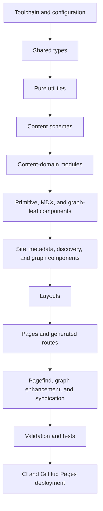
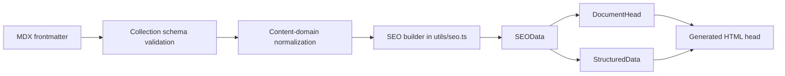
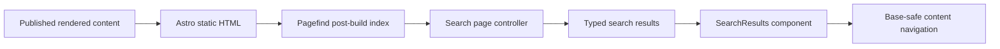
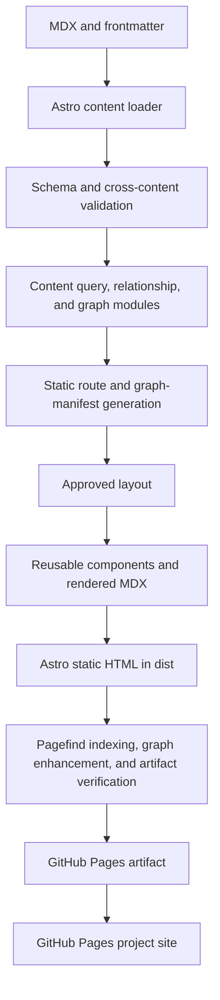
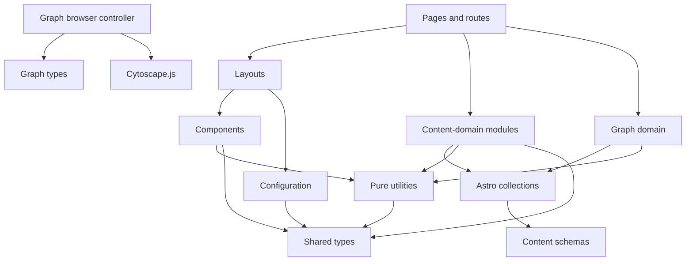

Atlas v0.6.0

# Public Personal Knowledge Garden and Living Portfolio Implementation Guide

## Document Status

- **Status:** Implementation blueprint for engineering review
- **Date:** 2026-07-21
- **Audience:** Senior software engineers and AI coding agents
- **Authoritative inputs:** `01_Architecture.md` and `02_FolderStructure.md`
- **Content domain source:** `05_ContentModel.md`
- **Coding standards:** `06_CodingStandards.md`
- **Quality strategy:** `08_TestStrategy.md`
- **Deployment and operations:** `09_DeploymentGuide.md`
- **Decision record:** `docs/decisions/0001-public-personal-knowledge-garden-and-knowledge-graph.md`
- **Purpose:** Define how to implement the approved design without making new architectural decisions

## Document Authority

This guide is subordinate to `01_Architecture.md` and `02_FolderStructure.md`. If this guide appears to conflict with either source, implementation must stop and the conflict must be reported. Engineers must not resolve such a conflict by changing routes, layouts, collections, dependencies, rendering mode, deployment topology, or folder ownership.

This document is an implementation blueprint. It does not replace the architecture, define milestone scope, or authorize a different coding standard. It converts approved responsibilities into concrete implementation contracts, dependency order, validation behavior, and completion criteria.

## 1. Implementation Philosophy

### 1.1 Architecture-first development

Every implementation task begins by identifying the owning architectural element and its approved folder. The engineer must trace the task to a route, layout, component, content-domain module, utility, schema, script, or workflow already named in the source documents. If no owner exists, the task is ambiguous and must be reported rather than placed in a new miscellaneous abstraction.

Architecture compliance is evaluated before convenience. A locally simpler implementation is not acceptable when it introduces server rendering, root-relative URLs, collection queries in components, duplicated layouts, a fifth collection, an unapproved framework, or graph data outside the canonical content domain.

### 1.2 Component-first implementation

Reusable rendering behavior is implemented and verified as a focused component before a page consumes it. Components receive resolved, typed data through props and slots. They do not discover their own route context or query entire collections. Page-specific composition remains in routes and approved layouts; repeated interface behavior moves into the existing component responsibility group.

### 1.3 Static-first rendering

Astro produces complete HTML at build time. Navigation, content, metadata, topic browsing, series traversal, project facts, collection listings, and semantic graph connections must work without client-side JavaScript. Browser code is permitted only for Pagefind search, lazy Cytoscape.js graph visualization, and the minimum interaction needed for mobile navigation.

### 1.4 Progressive enhancement

Enhanced features begin with a functional static baseline. The search route works before Pagefind initializes. The graph route provides semantic connection lists, node details, and direct links before Cytoscape.js initializes. Mobile navigation remains understandable and operable if its enhancement fails. Enhancement failure must not prevent access to content or global navigation.

### 1.5 Composition over inheritance

Specialized layouts compose `SiteLayout`. Pages compose layouts. Layouts compose components. Larger components compose smaller responsibility-focused components. No class inheritance hierarchy or layout duplication is introduced to specialize behavior.

### 1.6 Separation of concerns

- Routes own route parameters, build-time data loading, not-found decisions, and layout selection.
- Layouts own page composition, page-level regions, and metadata placement.
- Components own reusable semantic rendering and localized interaction.
- `src/lib/content/` owns Astro collection retrieval and content relationships.
- `src/lib/content/graph.ts` owns graph resolution, validation, cycle detection, and deterministic manifest construction.
- `src/utils/` owns pure transformations.
- `src/types/` owns shared compile-time contracts.
- `src/content.config.ts` owns runtime content schemas.
- Repository scripts own cross-entry and post-build validation.

### 1.7 Pure utility functions

Utilities produce the same output for the same explicit input. They do not query collections, read files, access the DOM, inspect environment state, mutate arguments, or depend on current time implicitly. Time, locale, base path, and site origin are explicit inputs or immutable typed configuration.

### 1.8 Thin route philosophy

A route performs four operations only: read route inputs, call content-domain modules, derive typed view data, and select an approved layout. Reusable markup, metadata algorithms, tag normalization, URL construction, sorting, and relationship resolution must not be implemented directly in route files.

## 2. Build Order



| Order | Implementation surface | Reason for placement |
| --- | --- | --- |
| 1 | Root package, Astro, TypeScript, Tailwind, MDX, site/base configuration | Establishes static output, `/engineering-lab/` behavior, and executable checks before feature work. |
| 2 | `src/types/` and `src/config/` | Gives every later layer stable contracts, controlled domains, and public configuration. |
| 3 | `src/utils/` | Supplies dependency-light URL, slug, tag, date, reading-time, and SEO transformations. |
| 4 | `src/content.config.ts` plus minimal fixtures | Establishes the four validated content boundaries, domains, and typed connection shape before any consumer assumes content shape. |
| 5 | `src/lib/content/` | Centralizes queries, sorting, references, series, graph validation, and deterministic manifest resolution before presentation consumes them. |
| 6 | Primitive content, MDX, graph-leaf, card, project, and series components | Builds reusable semantic units against typed props without route coupling. |
| 7 | Site chrome, discovery, graph, and metadata components | Composes primitives and establishes navigation, graph fallback, and document metadata contracts. |
| 8 | Five approved layouts | Composes verified components into stable page structures. |
| 9 | Static pages, indexes, generated detail/topic routes, and graph endpoints | Keeps routes thin because their dependencies and view contracts already exist. |
| 10 | Pagefind, Cytoscape.js graph controller, RSS, sitemap integration, and post-build verification | Operates on complete generated HTML, deterministic graph data, and finalized production URLs. |
| 11 | Unit, smoke, link, accessibility, and performance checks | Converts all approved behavior into executable release gates. Tests should also be added alongside each earlier step. |
| 12 | CI and deployment workflows | Invokes stable package scripts and deploys the same verified artifact produced locally. |

This order minimizes reverse dependencies. Types and pure utilities cannot depend on presentation. Content and graph relationships are resolved before layouts receive data. Components are testable without pages. Routes become adapters rather than owners of behavior. Pagefind and graph visualization are enhanced only after representative final HTML and graph endpoints exist.

Every step must leave `npm run check` and `npm run build` passing. Tests relevant to a step are implemented with that step; the testing phase completes cross-cutting coverage rather than postponing all verification.

## 3. Layout Implementation Guide

### 3.1 `SiteLayout.astro`

| Concern | Specification |
| --- | --- |
| Purpose | Render the document shell and global site regions for every HTML page. |
| Responsibilities | Declare the HTML document, language, viewport, global styles, skip link, header, primary/mobile navigation, main landmark, footer, shared assets, and metadata components. |
| Required props | `seo: SEOData`; optional body class or page-kind value must be a constrained local type rather than arbitrary styling input. |
| Slots | Required default slot for page content; optional named slots only for approved page-level regions such as content before or after the main body. |
| Children | `DocumentHead`, `StructuredData`, `SkipLink`, `Header`, `PrimaryNavigation`, `MobileNavigation`, `SiteIdentity`, and `Footer`. Header may compose navigation children rather than duplicate them. |
| Dependencies | Typed site/navigation configuration, metadata components, site components, global styles, URL/SEO utilities, and shared types. |
| SEO responsibilities | Place unique title, description, canonical, robots, Open Graph, Twitter Card, and structured-data output supplied through `SEOData`; provide site defaults without overriding entry metadata. |
| Accessibility responsibilities | Set document language; provide one main landmark with a stable skip target; ensure landmark order, visible focus, semantic header/nav/footer, and reduced-motion styles. |
| Error handling | Fail the build for missing required SEO data or invalid canonical construction. Render optional social metadata only when its validated inputs exist. |
| Definition of Done | Every HTML route composes this shell directly or through a specialized layout; no duplicate document shell exists; base-path tests, metadata tests, keyboard navigation, and no-JavaScript navigation pass. |

### 3.2 `ListingLayout.astro`

| Concern | Specification |
| --- | --- |
| Purpose | Provide a consistent structure for collection and topic indexes. |
| Responsibilities | Render page heading and description, breadcrumbs when applicable, result count, collection navigation, optional filter region, listing region, pagination region, and empty state. |
| Required props | `seo: SEOData`, `title`, `description`, `itemCount`; optional `breadcrumbs`, `pagination`, and active collection/topic context. |
| Slots | Required default slot for summary cards; optional `filters` and `intro` slots; pagination uses a typed prop or named region, not duplicated route markup. |
| Children | `SiteLayout`, `Breadcrumbs`, `CollectionNavigation`, `EmptyState`, and `Pagination`; summary card children arrive through the default slot. |
| Dependencies | Site layout, discovery components, navigation/pagination types, and formatting utilities. No collection query dependency. |
| SEO responsibilities | Pass unique index metadata to `SiteLayout`; set canonical to the deterministic index or pagination URL; topic pages include the normalized topic in title and description. |
| Accessibility responsibilities | One visible page heading; announce result count as normal text; use semantic lists for entries; preserve keyboard access to filters and pagination; empty state must remain descriptive. |
| Error handling | Render `EmptyState` for a valid empty result set. Invalid topic parameters are rejected by the route, not handled inside the layout. |
| Definition of Done | Article, note, project, series, and topic listings share the layout without duplicated shells; empty and populated states, long titles, and narrow viewports pass. |

### 3.3 `KnowledgeLayout.astro`

| Concern | Specification |
| --- | --- |
| Purpose | Render article and note detail pages through one shared reading structure. |
| Responsibilities | Render entry title, description, collection label, publication/update dates, status, domains/tags, optional reading time, optional table of contents, MDX body, related content, semantic connections, and series navigation when resolved. |
| Required props | `entry: ArticleViewModel | NoteViewModel`, `seo: SEOData`; optional resolved `headings`, `relatedContent`, `connections`, and `seriesContext`. |
| Slots | Required default slot for rendered MDX; optional named slot for approved content preamble only if props cannot express it consistently. |
| Children | `SiteLayout`, `PublicationDates`, `ContentStatus`, `TagList`, `Prose`, `TableOfContents`, `RelatedContentList`, `ConnectionList`, and `SeriesNavigation`. |
| Dependencies | Site layout, metadata/content/discovery/series components, shared content types, and display-only utilities. It does not query collections. |
| SEO responsibilities | Pass article-like metadata, canonical override, dates, social image, breadcrumbs, and article structured-data input to the site shell. |
| Accessibility responsibilities | Keep one page H1; body headings begin at H2; table of contents labels its navigation; dates use semantic machine-readable values; code and tables remain keyboard/viewport accessible. |
| Error handling | Omit optional regions when their resolved data is absent. A missing entry or broken relationship must have failed in the route or validation stage before layout rendering. |
| Definition of Done | Both article and note fixtures render without conditional layout duplication; TOC on/off, series/no-series, related/empty, dates, tags, and long-form responsive behavior pass. |

### 3.4 `ProjectLayout.astro`

| Concern | Specification |
| --- | --- |
| Purpose | Render a project case study and its professional context. |
| Responsibilities | Render title, description, status, role, period, demonstrated skills, optional tools, repository/live links, dates, domains/tags, project body, related projects, and semantic connections. |
| Required props | `project: ProjectViewModel`, `seo: SEOData`; optional `relatedProjects`, `connections`, and extracted `headings`. |
| Slots | Required default slot for rendered MDX. |
| Children | `SiteLayout`, `ProjectFacts`, `PublicationDates`, `TagList`, `Prose`, `TableOfContents`, `RelatedContentList`, and `ConnectionList`. |
| Dependencies | Site layout, project/content/discovery/metadata components, project types, URL/date utilities. No collection query dependency. |
| SEO responsibilities | Provide project-specific title, description, canonical, social metadata, breadcrumbs, and appropriate project/creative-work structured data. |
| Accessibility responsibilities | Present project facts as a semantic definition list or equivalent; external actions have descriptive labels; missing optional links do not leave empty controls. |
| Error handling | Suppress optional repository/live links when absent. Invalid URLs, periods, or required facts fail schema validation. |
| Definition of Done | Complete and minimal project fixtures render correctly; external links, facts, prose, related projects, metadata, keyboard behavior, and responsive layout pass. |

### 3.5 `SeriesLayout.astro`

| Concern | Specification |
| --- | --- |
| Purpose | Render a series landing page and its ordered learning path. |
| Responsibilities | Render series title, description, dates/tags, introductory MDX, ordered entries, entry types, and progress context that does not require user accounts or persistence. |
| Required props | `series: SeriesViewModel`, `seo: SEOData`, `resolvedEntries` in validated order, and optional resolved `connections`. |
| Slots | Required default slot for rendered series MDX introduction. |
| Children | `SiteLayout`, `PublicationDates`, `TagList`, `Prose`, `SeriesEntryList`, and optional `ConnectionList`. Detail-entry previous/next navigation remains in `KnowledgeLayout`. |
| Dependencies | Site layout, series/content/metadata components, shared series types, and URL/date utilities. No direct collection query. |
| SEO responsibilities | Provide unique series metadata, canonical, breadcrumbs, social data, and collection/list structured data where semantically accurate. |
| Accessibility responsibilities | Use an ordered list for sequence; identify article versus note without color alone; preserve descriptive link text and logical heading order. |
| Error handling | Empty, duplicated, self-referencing, or unresolved series entries fail validation; the layout never silently removes invalid entries. |
| Definition of Done | Mixed article/note series renders in validated order; metadata, sequence semantics, links, narrow layouts, and no-JavaScript operation pass. |

## 4. Component Implementation Guide

### 4.1 Card and summary components

All card components are reusable static Astro components. They emit one semantic summary item suitable for a parent list. They receive a normalized summary view model, never a raw collection query, and emit no browser events.

| Component | Purpose and output | Props and slots | Dependencies | Responsive and accessibility requirements | Definition of Done |
| --- | --- | --- | --- | --- | --- |
| `ArticleSummary.astro` | Render article title, description, date, tags, and destination link. | `article: ArticleSummary`; optional context variant constrained to approved listing contexts; no slot. | `PublicationDates`, `TagList`, URL/date utilities. | Entire card must not become an invalid nested link; title link is descriptive; metadata wraps without clipping. | Works on home, article, topic, and related lists; draft data cannot reach it; long title and empty optional metadata tests pass. |
| `NoteSummary.astro` | Render concise note identity, description, maturity/status, date, tags, and link. | `note: NoteSummary`; no slot. | `ContentStatus`, `PublicationDates`, `TagList`, URL/date utilities. | Status is conveyed in text, not color alone; compact presentation retains readable target size. | Works in recent notes, note index, topics, and related lists with no route assumptions. |
| `ProjectSummary.astro` | Render project title, description, status, role/period summary, demonstrated skills, and detail link. | `project: ProjectSummary`; optional featured presentation flag only if defined as a visual variant; no slot. | `ContentStatus`, tag/list primitives, URL/date utilities. | Skills wrap; status text is explicit; external destination is not substituted for the internal case-study link. | Works on home, project index, topics, and related lists; optional period/status combinations pass. |
| `SeriesSummary.astro` | Render series title, description, entry count, tags, and series link. | `series: SeriesSummary`; no slot. | `TagList`, URL utility. | Entry count has readable text; sequence is not implied solely through decoration. | Works on home, series index, and topics; zero-entry series is impossible after validation. |

### 4.2 Content components

| Component | Purpose and output | Props, slots, events | Dependencies | Responsive and accessibility requirements | Definition of Done |
| --- | --- | --- | --- | --- | --- |
| `ExternalLink.astro` | Render a consistently secure, identifiable external anchor. | Required `href`; default slot for descriptive label; optional accessible external-context text. No custom events. | URL classification utility only. | Must not force a new tab by default. If a new context is explicitly required, announce it and apply secure relationship attributes. | Correctly distinguishes allowed external URLs, preserves label semantics, and has focus/hover states. |
| `HeadingAnchor.astro` | Add a stable copyable fragment target to an already identified content heading. | Required heading `id` and accessible label; slot for heading content only when used as the heading wrapper. No events beyond native link activation. | Slug/URL utilities. | Fragment control appears on focus as well as hover; heading text remains the primary accessible name; target offset supports fixed header. | Stable fragments work under the Pages base path and do not duplicate heading IDs. |
| `Prose.astro` | Apply the approved MDX reading container and prose semantics. | Default slot only; optional constrained width variant. No events. | `prose.css`. | Handles long words, code, tables, figures, lists, and narrow viewports without content loss. | All representative MDX fixtures render with correct spacing, overflow behavior, and heading hierarchy. |
| `TableOfContents.astro` | Render nested in-page navigation from Astro-extracted headings. | `headings`; optional label and depth limit consistent with content policy. No custom events. | Heading types and slug utility. | Uses labeled `nav`; nested lists reflect heading depth; links are keyboard accessible; empty TOC renders nothing. | Correct for normal, skipped-depth, duplicate-text, and disabled-TOC fixtures. |

### 4.3 Discovery components and search controller

| Component/module | Purpose and output | Props, slots, events | Dependencies | Responsive and accessibility requirements | Definition of Done |
| --- | --- | --- | --- | --- | --- |
| `Breadcrumbs.astro` | Render hierarchical route context. | `items: Breadcrumb[]`; no slot. Native link events only. | URL utility and navigation types. | Labeled breadcrumb navigation; ordered list; current item uses `aria-current="page"` and is not an unnecessary link. | Home suppresses breadcrumbs; detail/topic trails use base-safe URLs and valid structured-data input. |
| `CollectionNavigation.astro` | Render links among articles, notes, projects, and series. | `items: NavigationItem[]`, optional active collection; no slot. | Navigation config/types and URL utility. | Active item is identified semantically; horizontal overflow or wrapping never hides links. | Reusable on all listings with one configuration source and no hard-coded route copies. |
| `EmptyState.astro` | Explain a valid result set with no entries and provide a recovery path. | Required message; optional action link; optional default slot for approved supplemental text. | URL utility when an action exists. | Uses normal text, not an alert unless the state results from an actual error; action is keyboard accessible. | Listings and related-content regions can use it without route-specific markup. |
| `Pagination.astro` | Render deterministic previous/next and page-number navigation when pagination is enabled. | `pagination: PaginationData`; no slot. | Navigation types and URL utility. | Labeled navigation; current page identified; disabled destinations are not focusable fake links; targets meet size requirements. | Canonical URLs, first/last pages, and narrow layouts pass; component renders nothing for one page. |
| `RelatedContentList.astro` | Render resolved related entries across approved content types. | `items: ContentSummary[]`; optional heading; no slot. | Summary cards selected by discriminated collection type. | Semantic section and list; heading does not disrupt page hierarchy; entry type is conveyed in text. | Handles mixed types and empty input without querying collections. |
| `SearchForm.astro` | Render the search input, submit behavior, status target, and non-JavaScript fallback context. | Initial query, action URL, input label, and result/status target IDs; optional help slot. Emits native `input` and `submit` events consumed by the controller. | Search types and URL utility. | Explicit label, search landmark, visible submit control, no focus stealing, and query remains editable at all widths. | Form navigates to `/search/?q=...` without enhancement and binds to Pagefind when available. |
| `SearchResults.astro` | Provide result count/status, filter region, results list, and no-results/error states. | Initial `SearchQueryState`; slots or containers for controller-managed results; custom application events are not required. | Search result types, `EmptyState`, and summary/link presentation. | Dynamic status uses restrained live-region behavior; result updates do not move focus automatically; filters have labels. | Loading, results, no-results, and index-failure states are distinguishable and keyboard tested. |
| `TagList.astro` | Render normalized tags as topic links or noninteractive labels according to context. | `tags: Tag[]`, presentation mode; no slot. | Tag and URL utilities. | Uses a semantic list; text labels do not depend on color; links have adequate target spacing. | Deduplicated, deterministic tags work in layouts and cards with base-safe topic URLs. |
| `TopicLink.astro` | Render one normalized topic destination and optional count. | `tag: Tag`, optional count; no slot. | Tag and URL utilities. | Accessible name includes the topic, while count remains understandable to assistive technology. | Works in topic index, tag lists, and filters without duplicating URL logic. |
| `pagefind-search.ts` | Own the browser-only Pagefind import, query synchronization, result mapping, and UI state updates for the search page. | Receives DOM references or stable selectors and initial `SearchQueryState`; handles form input/submit and URL history updates. Output is sanitized result view data rendered into owned containers. | Pagefind browser API and search types only; must not import build-time collection modules. | Debounced updates must not trap focus or over-announce; browser history and back/forward restore state; failure preserves static navigation. | Loaded only on search, produces no errors when index is unavailable, preserves base paths, and passes query/history/keyboard tests. |

### 4.4 MDX authoring components

| Component/module | Purpose and output | Props, slots, events | Dependencies | Responsive and accessibility requirements | Definition of Done |
| --- | --- | --- | --- | --- | --- |
| `Callout.astro` | Render authored supporting information with a constrained semantic tone. | Required supported `variant`; optional title; default slot. No events. | Local presentation types only. | Variant meaning appears in visible text/icon semantics, not color alone; callout does not use alert roles for ordinary content. | All approved variants render in MDX, print/read clearly, and meet contrast requirements. |
| `Figure.astro` | Render an image or visual with caption and validated alternative-text behavior. | Required image source and caption; alternative text required unless explicitly decorative; optional attribution. No events. | Astro image handling and asset types. | Uses `figure`/`figcaption`; responsive dimensions prevent layout shift; alt and caption are not redundant. | Local entry assets are optimized; missing assets fail build; narrow and large viewport rendering pass. |
| `components/mdx/index.ts` | Define the only public component map available to MDX content. | Named exports of `Callout` and `Figure`; no runtime events. | Approved MDX components only. | Prevents arbitrary application internals from entering authored content. | Exports exactly the approved authoring surface and introduces no application barrel imports. |

### 4.5 Metadata components

| Component | Purpose and output | Props, slots, events | Dependencies | Responsive and accessibility requirements | Definition of Done |
| --- | --- | --- | --- | --- | --- |
| `ContentStatus.astro` | Render visible draft/maturity/project status when appropriate. | Typed status and optional label override from approved formatter; no slot or events. | Content types. | Meaning is textually available and not color-only. Draft is never rendered in production because drafts are excluded upstream. | All allowed statuses render consistently; unknown values cannot compile or validate. |
| `DocumentHead.astro` | Emit title, description, canonical, robots, Open Graph, Twitter Card, and required head links. | `seo: SEOData`; no slot or events. | SEO/URL utilities, site config, SEO types. | Document title remains concise and unique; metadata adds no inaccessible visible UI. | Representative routes have one canonical, one title, valid absolute social URLs, and no duplicate tags. |
| `PublicationDates.astro` | Render published and substantive-update dates. | `publishedAt`, optional `updatedAt`, optional compact mode; no slot or events. | Date utility. | Uses semantic `time` elements with machine-readable dates and unambiguous visible labels. | Same-day, absent-update, and different-update cases are correct and locale-stable. |
| `StructuredData.astro` | Serialize validated structured data into the document head. | `data: StructuredDataInput | StructuredDataInput[]`; no slot or events. | SEO types and safe serialization utility within `seo.ts`. | Output is nonvisual and must not contain untrusted executable markup. | Generated JSON is valid, escapes unsafe characters, matches visible content, and passes schema validation checks. |

### 4.6 Project and series components

| Component | Purpose and output | Props, slots, events | Dependencies | Responsive and accessibility requirements | Definition of Done |
| --- | --- | --- | --- | --- | --- |
| `ProjectFacts.astro` | Render status, role, period, demonstrated skills, optional tools, repository, and live-site facts. | `facts: ProjectFacts`; no slot. Native external-link activation only. | `ExternalLink`, date/URL utilities, project types. | Uses a definition list or equivalent; missing optional values leave no empty rows; long skill/tool names wrap. | Full and minimal professional or creative project records render semantically with secure external links. |
| `SeriesEntryList.astro` | Render the complete ordered article/note sequence on a series page. | `entries: ResolvedSeriesEntry[]`, optional current entry ID; no slot. | Article/note summary primitives, URL utility, series types. | Ordered list; entry type and current state conveyed textually; sequence numbers are meaningful. | Mixed collection sequence renders exactly in validated order with no missing destination. |
| `SeriesNavigation.astro` | Render previous/next navigation on an article or note belonging to a series. | `series`, optional previous and next entries; no slot. | URL utility and series types. | Links use descriptive entry titles, not only “Previous” and “Next”; region has an accessible label. | First, middle, last, and no-series cases render correctly and preserve base paths. |

### 4.7 Site components

| Component | Purpose and output | Props, slots, events | Dependencies | Responsive and accessibility requirements | Definition of Done |
| --- | --- | --- | --- | --- | --- |
| `Footer.astro` | Render site-level secondary navigation, profile links, and copyright/context. | Typed navigation/social items; optional compact text slot only if needed. Native link events. | Site config, navigation types, `ExternalLink`. | Semantic footer; links have descriptive names and wrap cleanly. | Appears once per page through `SiteLayout`; no route-specific footer content. |
| `Header.astro` | Compose site identity and desktop/mobile navigation regions. | Navigation data and current path; slots only for its approved child regions if composition requires. | `SiteIdentity`, `PrimaryNavigation`, `MobileNavigation`. | Semantic header; does not duplicate navigation landmarks without distinct labels; stable dimensions avoid layout shift. | Works at all breakpoints, current route is represented correctly, and navigation remains usable without script. |
| `MobileNavigation.astro` | Provide the compact navigation presentation and minimal enhancement where required. | Items and current path; no arbitrary content slot. Handles native toggle/click and Escape behavior if scripted. | Navigation types, URL utility; isolated local browser script only if native behavior is insufficient. | Keyboard open/close, Escape, focus visibility, and state announcement; no focus trap for a nonmodal menu. | No-JavaScript fallback exposes navigation; resize and history navigation do not leave invalid state. |
| `PrimaryNavigation.astro` | Render the persistent primary navigation. | `items: NavigationItem[]`, current path; no slot. Native link events. | Navigation config/types and URL utility. | Labeled nav; active item uses `aria-current`; links remain visible and reachable. | One configuration drives all destinations; root and nested active-state tests pass under base path. |
| `SiteIdentity.astro` | Render the platform name and home destination as the persistent brand signal. | Site name, optional concise descriptor; no slot. | Site config and URL utility. | Link has a stable accessible name; image identity, if later supplied, has correct alt treatment. | Links to the configured base-path home and remains legible at all header sizes. |
| `SkipLink.astro` | Let keyboard users bypass repeated navigation. | Target ID and label with stable defaults; no slot or custom events. | No domain dependency. | First focusable control; becomes visible on focus; target exists and receives an understandable focus position. | Verified on every layout and at desktop/mobile sizes. |

### 4.8 Graph components and controller

| Component/module | Purpose and output | Props, slots, events | Dependencies | Responsive and accessibility requirements | Definition of Done |
| --- | --- | --- | --- | --- | --- |
| `ConnectionList.astro` | Render grouped typed semantic relationships and direct target links for entry-local discovery and graph fallback. | `connections: ResolvedConnection[]`; optional heading and selected node ID; no slot. Native link events only. | Graph/content types and URL utility. | Uses labeled sections/lists; relationship direction and context are textual; empty input renders nothing; no color-only edge meaning. | All seven relationship types, incoming/outgoing/symmetric labels, empty input, long context, and base-safe links pass without browser code. |
| `GraphControls.astro` | Render graph node search and domain, collection, and relationship filters. | Controlled domain/collection/relationship options and initial `GraphQueryState`; no arbitrary slot. Native form/input/change events consumed by the controller. | Graph types and controlled domain configuration. | Every control has a visible label; keyboard order is logical; filters remain usable at narrow widths; visual graph is not required to understand state. | Static controls and initial state render deterministically; controller binding, reset behavior, query state, labels, and reflow pass. |
| `GraphNodeDetails.astro` | Render selected node title, collection/domain metadata, description, content link, and semantic connection list. | Optional selected `GraphNode`; resolved incoming/outgoing connections; empty-state text. | `ConnectionList`, graph types, and URL utility. | Selection changes do not steal focus; details use a named region and textual relationship labels; no selection has a useful prompt. | No-selection, isolated-node, mixed-edge, long-content, keyboard, and base-path cases pass. |
| `GraphExplorer.astro` | Compose the static graph discovery shell, visual mount point, controls, node details, and always-available semantic fallback. | `manifestUrl`, initial graph query state, domains, collections, relationship types, static node/connection fallback data. | `GraphControls`, `GraphNodeDetails`, `ConnectionList`, and graph types. | Provides list/text discovery independent of canvas; visual region has instructions and accessible name; stable responsive dimensions prevent layout shift. | Complete static fallback works without JavaScript; enhanced/list states, empty corpus, isolated nodes, narrow viewport, and reduced motion pass. |
| `graph-explorer.ts` | Lazy-load Cytoscape.js, fetch the same-build manifest, render selected-node neighborhoods, apply filters, synchronize URL/history, and coordinate selected-node details. | Not an Astro prop API; receives stable DOM references, manifest URL, and initial `GraphQueryState`. | Cytoscape.js and graph types only; must not import Astro collections or build-time graph modules. | Keyboard-selectable node controls outside the canvas remain authoritative; no focus trap/theft; animations respect reduced motion; manifest/engine failure preserves semantic fallback. | Loads only on `/graph/`; validates manifest version, preserves base paths/history, defaults to bounded ego graph, handles empty/error/isolated states, and meets bundle/performance/accessibility budgets. |

## 5. Page Implementation Guide

All HTML pages are statically generated. “Loading behavior” therefore describes build-time retrieval plus optional browser enhancement, not runtime server fetching.

| Page/file | Purpose and content source | Layout and expected components | Metadata and SEO | Error and loading behavior | Definition of Done |
| --- | --- | --- | --- | --- | --- |
| `/` — `src/pages/index.astro` | Knowledge-first home using featured articles, recent notes, selected series, and selected projects from content queries. | `SiteLayout`; `SearchForm`, collection navigation, and the four summary card types as data permits. | Site-configured home title/description/canonical and website/profile structured data. | Build fails on query/contract errors; valid empty sections are omitted, not shown as broken placeholders. Static HTML first. | Home is useful without JS, links are base-safe, no drafts appear, and metadata/accessibility checks pass. |
| `/articles/` — `articles/index.astro` | List all production-visible articles in deterministic order. | `ListingLayout`, `ArticleSummary`, `CollectionNavigation`, optional `Pagination`. | Unique article-index metadata and canonical index/pagination URL. | Empty collection renders `EmptyState`; query failure fails build. | All published articles appear once; ordering, tags, dates, empty state, and pagination policy pass. |
| `/articles/<slug>/` — `articles/[...slug].astro` | Render one article loaded by generated collection identifier. | `KnowledgeLayout` with content, metadata, discovery, and optional series components. | Frontmatter through metadata builder; article structured data; canonical override honored. | `getStaticPaths` excludes drafts. Missing requested production path resolves to static 404; broken references fail validation. | Every published article builds at a stable slug and passes MDX, SEO, series, related-content, and link checks. |
| `/notes/` — `notes/index.astro` | List all production-visible notes. | `ListingLayout`, `NoteSummary`, collection navigation, optional pagination. | Unique note-index metadata and canonical. | Valid empty state; no runtime loading. | All published notes appear once with maturity/status and deterministic ordering. |
| `/notes/<slug>/` — `notes/[...slug].astro` | Render one note. | `KnowledgeLayout`, `ContentStatus`, `PublicationDates`, `TagList`, prose, related entries, optional series navigation. | Frontmatter through metadata builder; article-like structured data appropriate to a note. | Drafts excluded; missing path uses 404; broken related/series references fail build. | Stable route, correct note presentation, no article-only assumptions, and all checks pass. |
| `/projects/` — `projects/index.astro` | List production-visible project case studies. | `ListingLayout`, `ProjectSummary`, collection navigation, optional pagination. | Unique project-index metadata and canonical. | Empty state is valid; schema/query errors fail build. | Featured and regular project ordering is deterministic and no drafts appear. |
| `/projects/<slug>/` — `projects/[...slug].astro` | Render one project case study. | `ProjectLayout`, `ProjectFacts`, prose, dates, tags, TOC, related projects. | Frontmatter through metadata builder; project/creative-work structured data and optional social image. | Drafts excluded; invalid URLs/assets fail build; missing route uses 404. | Full/minimal projects render with secure links, stable slug, complete SEO, and responsive facts. |
| `/series/` — `series/index.astro` | List production-visible learning series. | `ListingLayout`, `SeriesSummary`, collection navigation. | Unique series-index metadata and canonical. | Empty state allowed; invalid series has already failed content validation. | Every published valid series appears once with accurate entry count. |
| `/series/<slug>/` — `series/[...slug].astro` | Render one series introduction and resolved ordered sequence. | `SeriesLayout`, `SeriesEntryList`, prose, dates, tags. | Frontmatter through metadata builder; collection/list structured data when accurate. | Missing, empty, duplicate, or unresolved sequence fails validation/build; missing route uses 404. | Mixed article/note order matches schema, all links resolve, and SEO/accessibility pass. |
| `/topics/` — `topics/index.astro` | List all normalized tags derived from production-visible entries. | `ListingLayout`, `TopicLink`, collection navigation as appropriate. | Unique topic-index metadata and canonical. | No topics renders `EmptyState`; normalization collision fails validation. | Tags are deduplicated, alphabetized/grouped deterministically, counted accurately, and base-safe. |
| `/topics/<tag>/` — `topics/[tag].astro` | List cross-collection entries for one normalized tag. | `ListingLayout`, discriminated summary cards, `Breadcrumbs`, `TagList`, optional pagination. | Title/description include human-readable topic; canonical uses normalized tag. | Only known production tags generate paths; unknown path uses 404. No client loading. | Mixed entries render once, drafts are absent, metadata is unique, and invalid tag variants do not duplicate routes. |
| `/search/` — `search/index.astro` | Provide Pagefind search and fallback discovery links. | `SiteLayout`, `SearchForm`, `SearchResults`, collection navigation. | Unique search title/description/canonical; query parameter does not create alternate canonical pages; structured data only if accurate. | Static shell renders immediately. Controller loads Pagefind on this route only. Index failure shows a useful state and preserves navigation. | Direct query URL, typing, submit, back/forward, no results, failure, keyboard, and base-path result links pass. |
| `/graph/` — `graph/index.astro` | Provide public semantic relationship discovery from the deterministic graph model. | `SiteLayout`, `GraphExplorer`, `GraphControls`, `GraphNodeDetails`, and `ConnectionList`. | Unique graph title/description with canonical `/graph/`; query-selected node/filters do not create alternate canonical pages. | Static semantic fallback renders immediately. Controller lazily loads manifest/Cytoscape.js. Manifest or engine failure preserves list/details/direct links. | Direct selected-node URL, filters, history, keyboard, reduced motion, no-script fallback, isolated/empty graph, and base-safe content navigation pass. |
| `/graph/graph.json` — `graph/graph.json.ts` | Emit the deterministic public graph manifest from production-visible content. | No layout; build-time endpoint serializer. | No indexable HTML metadata; response belongs to `/graph/` and is excluded from sitemap/search documents. | Invalid graph fails build; output has a stable schema version and no generated timestamp or draft/private node. | Nodes/edges sort deterministically, graph IDs/URLs validate, symmetric related traversal is normalized, and manifest matches static graph fallback. |
| `/about/` — `about.astro` | Present professional profile and explain the platform. Content is route-owned static copy and site configuration unless later approved as content. | `SiteLayout`, prose/content primitives, external-link treatment. | Unique profile metadata, canonical, and person/profile structured data matching visible content. | No runtime loading; invalid configured links fail validation. | Page is accessible, base-safe, complete without JS, and does not become an unapproved collection. |
| `/404.html` — `404.astro` | Provide GitHub Pages-compatible recovery from unknown paths. | `SiteLayout`, `EmptyState`, primary recovery links, optional search link. | Clear not-found title; noindex; canonical omitted unless a policy explicitly requires it. | Always builds as `404.html`; does not attempt runtime route discovery. | Deployed artifact contains `404.html`; links include base path and keyboard/metadata checks pass. |
| `/rss.xml` — `rss.xml.ts` | Generate a feed of newly published knowledge using production-visible articles and notes. | No layout; build-time endpoint serializer. | Absolute production URLs, valid feed title/description, publication dates, and canonical entry URLs. | Invalid content or URL construction fails build; drafts are excluded. | Feed validates, is deterministic, contains no drafts, and works under project-site production URLs. |

Sitemap generation is configured through the approved Astro integration rather than a page file. It includes canonical production routes, excludes drafts and intentional non-index pages, and uses the configured site origin and base.

## 6. Content Collection Implementation

### 6.1 Shared schema behavior

`src/content.config.ts` defines one reusable shared schema fragment and four separate collection schemas. Schema output is the runtime source of truth; TypeScript types should be inferred from Astro collection definitions where practical rather than manually duplicating schema fields.

| Shared field | Implementation rule |
| --- | --- |
| `title` | Required nonempty trimmed string; rendered as the only page H1 by the layout. |
| `description` | Required concise nonempty string suitable for listings and metadata. |
| `publishedAt` | Required ISO date input transformed to a typed date value. |
| `updatedAt` | Optional ISO date; cannot precede `publishedAt`. |
| `draft` | Boolean with a default of `false`; production queries exclude true values before route generation. |
| `tags` | Required for published content; normalized lowercase kebab-case values, deduplicated after normalization. |
| `domains` | Required nonempty controlled domain list for published content; values come from typed domain configuration and are deduplicated. |
| `connections` | Optional typed semantic connection list; targets use stable collection/ID references and optional concise context. |
| `image` | Optional local image reference with alternative-text contract; existence is resolved at build time. |
| `canonicalUrl` | Optional valid absolute HTTPS URL for republished content. |

Unknown or malformed required fields fail schema parsing. Cross-entry rules that cannot be validated in one schema are enforced by `scripts/validate-content.ts`, `src/lib/content/references.ts`, and `src/lib/content/graph.ts`.

### 6.2 Articles

- **Schema responsibility:** Shared fields plus optional featured state, table-of-contents control, series reference, and series order.
- **Slug generation:** Derive from the stable path identifier beneath `src/content/articles/` using `slug.ts`; preserve nested segments; reject duplicate resolved URLs.
- **Validation:** Require series reference and positive series order together when either exists. Cross-check denormalized article membership against the owning series ordered list. Validate domains and typed connections; reject duplicate positions and self-reference.
- **Relationships:** May belong to one approved series, declare typed semantic connections, and participate in resolved related content. Series collection order is validated against article membership metadata rather than silently overriding conflicts.
- **Assets:** Entry-specific images live in the neighboring same-slug folder and are imported through Astro's image pipeline.
- **Draft handling:** Available only in explicitly enabled local development views; excluded from routes, topics, related content, RSS, sitemap, and Pagefind in production.
- **Publishing workflow:** Create MDX and assets, complete frontmatter, run content validation and build, review generated route/metadata/accessibility, then merge through the protected workflow.

### 6.3 Notes

- **Schema responsibility:** Shared fields plus required constrained knowledge-maturity value; semantic relationships use shared typed connections.
- **Slug generation:** Derive from the stable path identifier beneath `src/content/notes/` with the same normalization and collision rules as articles.
- **Validation:** Reject unknown maturity/domain/connection values, missing related targets, self-references, duplicate references/edges, and references to drafts in production-visible notes.
- **Relationships:** May appear in a series through a typed series entry and declare approved shared typed semantic connections. Derived related-content summaries do not create a second authored relationship field.
- **Assets:** Colocated in the neighboring note slug folder and validated at build time.
- **Draft handling:** Same exclusion policy as articles.
- **Publishing workflow:** Same validated pull-request flow, with explicit maturity review and related-link verification.

### 6.4 Projects

- **Schema responsibility:** Shared fields plus constrained project status, required role, nonempty demonstrated skills list, optional tools list, typed time period, optional repository URL, optional live URL, and optional featured state.
- **Slug generation:** Derive from the stable path identifier beneath `src/content/projects/`; reject collision with any project route.
- **Validation:** Validate status, role, chronological period, unique normalized skills/tools, domains/connections, HTTPS external URLs, and local images. Optional lists/URLs must be omitted rather than represented by empty values.
- **Relationships:** Related projects are resolved from typed connections and deterministic shared taxonomy according to the content model; resolution remains centralized in content-domain modules and never in cards/layouts.
- **Assets:** Case-study images remain in the neighboring project slug folder and use Astro image optimization.
- **Draft handling:** Draft projects are absent from production home, index, topics, related lists, sitemap, Pagefind, and generated detail routes.
- **Publishing workflow:** Validate facts and outcomes, verify external links, inspect full/minimal fact rendering, then follow the common review/build flow.

### 6.5 Series

- **Schema responsibility:** Shared fields plus a required nonempty ordered array of discriminated article/note references.
- **Slug generation:** Derive from the stable path identifier beneath `src/content/series/`; enforce unique series routes.
- **Validation:** Reject empty lists, duplicate entries, unresolved targets, invalid domains/connections, draft targets in a published series, self-reference, duplicate positions, and mismatch with entry-side membership/order metadata.
- **Relationships:** `src/lib/content/series.ts` resolves each typed reference, preserves declared order, and derives previous/current/next context for knowledge entries.
- **Assets:** Series-specific images remain in the neighboring series slug folder.
- **Draft handling:** A draft series has no production route or search/sitemap entry. Its draft membership does not expose draft entries elsewhere.
- **Publishing workflow:** Validate the complete sequence and every destination before publication; review order, entry type labels, previous/next behavior, and structured data.

### 6.6 Collection publishing invariants

- Published slugs are URL contracts and are not renamed without an approved compatibility plan.
- A substantive revision updates `updatedAt`; copy-only fixes need not do so.
- Content removal requires a replacement, retirement page, or external redirect decision before deletion.
- Content files may use only the public MDX component map.
- Production-visible entries require title, description, publication date, and at least one valid tag.
- Production-visible entries require at least one controlled domain; graph connections remain optional but every declared edge must validate.

## 7. Utility Implementation Guide

### 7.1 Pure utilities in `src/utils/`

| Module | Purpose | Input | Output | Error handling and purity | Consumers and high-level use |
| --- | --- | --- | --- | --- | --- |
| `slug.ts` | Normalize collection identifiers and topic values into stable path segments. | Validated identifier or tag text plus explicit policy options if needed. | Normalized slug or path segments. | No file/collection access; reject empty, unsafe, or noncanonical values rather than guessing. | Content validation and route generation call it before constructing URLs. |
| `date.ts` | Compare and format typed publication/project dates consistently. | Typed date, explicit locale/format intent, or two dates for ordering. | Display string, machine date, or comparison number. | Never calls current time implicitly; invalid values should be impossible after schema validation and otherwise throw a clear boundary error. | Metadata, dates component, sorting, project facts, RSS. |
| `reading-time.ts` | Estimate reading duration from renderable text. | Plain content text and explicit words-per-minute configuration if varied. | Positive duration view value and accessible label. | Pure calculation; empty text returns the documented minimum/zero policy consistently. | Article/note route preparation before `KnowledgeLayout`. |
| `seo.ts` | Combine validated content/site values into normalized SEO and structured-data inputs. | Site config, route identity, content metadata, breadcrumbs, and content kind. | `SEOData` and safe structured-data input. | No rendering or collection queries; reject impossible canonical/metadata combinations before output. | Routes and layouts supply results to metadata components. |
| `url.ts` | Construct base-path-safe internal URLs and absolute canonical/asset URLs. | Logical route/segments, configured base, and optional production origin. | Normalized relative site URL or absolute URL. | Prevent path traversal, duplicate slashes, and accidental loss of `/engineering-lab/`; no browser globals. | Every internal link, canonical, RSS, sitemap, navigation, search result normalization. |
| `tag.ts` | Normalize, label, deduplicate, group, and sort tags. | Raw validated tag strings or `Tag` values. | Canonical tags, labels, counts, or deterministic ordering. | Reject normalization collisions during validation; no content retrieval. | Schemas/scripts, topic routes, tag components, filters, related-content inputs. |

Pure utilities use named exports and explicit inputs. A high-level usage flow is: route/domain input is validated, a utility transforms it, and the caller passes the immutable result onward. Utilities never repair invalid content silently.

### 7.2 Collection-aware domain modules in `src/lib/content/`

These modules are not general utilities. They may use Astro collection APIs at build time and return normalized view data.

| Module | Purpose | Input | Output | Error handling | Consumers |
| --- | --- | --- | --- | --- | --- |
| `queries.ts` | Retrieve production-visible collections, entries, featured subsets, and tag subsets. | Collection name and typed query options. | Typed entries or normalized summaries with drafts filtered according to environment. | Unknown IDs and invalid options produce explicit build-time errors; valid empty lists are returned as empty. | Home, indexes, detail routes, topics, RSS. |
| `sort.ts` | Apply approved deterministic ordering to collection entries and summaries. | Typed entries plus an explicit approved ordering mode. | New sorted array without mutation. | Missing required sort data is a validation failure; ties use stable identifiers. | Queries, listings, home sections, RSS. |
| `references.ts` | Resolve typed cross-content references and validate relationship integrity. | Content references and loaded collection maps. | Resolved entries/summaries or a structured validation failure. | Never drops missing targets silently; reports source, field, and target. | Related content, validation script, series resolver. |
| `series.ts` | Resolve ordered series entries and derive membership/previous/next context. | Validated series entry plus article/note maps. | `SeriesViewModel`, ordered resolved entries, and per-entry navigation context. | Reject duplicates, gaps/mismatches, drafts in published series, and unresolved targets. | Series detail route and knowledge detail routes. |
| `graph.ts` | Resolve domains and typed connections, normalize symmetric traversal, detect prerequisite cycles, derive neighborhoods, and build the deterministic public manifest. | Production-visible entries, controlled domain configuration, and resolved content maps. | `GraphManifest`, per-entry `ResolvedConnection[]`, node lookup, and structured validation failures. | Reject unknown domains/types, missing/draft/self targets, duplicate/reverse-duplicate related edges, prerequisite cycles, unstable IDs/order, and manifest collisions. | Graph routes, entry-detail routes, validation script, and artifact verification. |

## 8. Shared Types

Runtime collection field types are inferred from `content.config.ts`. Shared types represent contracts exchanged across multiple modules. Single-component props remain local to avoid turning `src/types/` into a dumping ground.

### 8.1 `src/types/content.ts`

| Type/interface | Fields and purpose | Relationships and consumers |
| --- | --- | --- |
| `ContentCollectionName` | Discriminated value limited to `articles`, `notes`, `projects`, or `series`. | Used by references, summaries, search metadata, and content queries. |
| `Tag` | Canonical `slug` and human-readable `label`; optional derived `count` only in a topic view model. | Produced by tag utility; consumed by tag/topic components and search metadata. |
| `ContentImage` | Build-resolved image source, alternative text, dimensions/metadata as provided by Astro, and optional caption where the owner requires it. | Derived from schema; consumed by layouts, `Figure`, and SEO builder. |
| `ContentReference` | Discriminated collection name and stable entry identifier. | Schema/domain boundary for related entries and series. |
| `BaseContentViewModel` | Stable ID, graph node ID, collection, title, description, slug, URL, published/updated dates, domains, tags, optional image/canonical, and production-safe status. | Common layout/card/search/graph input; created by content-domain modules. |
| `ArticleViewModel` | Base content plus featured, TOC, reading-time, and optional resolved series context. | `KnowledgeLayout`, article route, article summary derivation. |
| `NoteViewModel` | Base content plus maturity, related references, reading-time, and optional series context. | `KnowledgeLayout`, note route, note summary derivation. |
| `ProjectPeriod` | Typed start and optional end/present representation with validated chronology. | Project schema/domain and `ProjectFacts`. |
| `ProjectFacts` | Status, role, period, demonstrated skills, optional tools, and optional repository/live URLs. | Project layout and facts component. |
| `ProjectViewModel` | Base content plus `ProjectFacts` and featured state. | Project route/layout and summary derivation. |
| `SeriesEntryReference` | Ordered discriminated reference to an article or note. | Series schema and resolver. |
| `ResolvedSeriesEntry` | Position, entry type, ID, title, description, and base-safe URL. | `SeriesEntryList`, `SeriesNavigation`, and series view model. |
| `SeriesContext` | Series identity plus optional previous/current/next resolved entries. | Article/note routes and `KnowledgeLayout`. |
| `SeriesViewModel` | Base content plus ordered resolved entries. | Series route/layout and summary derivation. |
| `ContentSummary` | Discriminated union of article, note, project, and series summaries with only card-required fields. | Listing routes, related lists, topic pages, and cards. |

### 8.2 `src/types/navigation.ts`

| Type/interface | Fields and purpose | Consumers |
| --- | --- | --- |
| `NavigationItem` | Label, base-safe logical destination, optional match rule, and optional external flag only where navigation policy permits. | Navigation config and site/collection navigation components. |
| `Breadcrumb` | Label, URL for ancestors, and current-page marker for the terminal item. | Routes, SEO builder, `Breadcrumbs`, structured data. |
| `PaginationData` | Current page, total pages, deterministic current URL, optional previous/next URLs, and page links. | Listing routes, SEO builder, `Pagination`. |

### 8.3 `src/types/graph.ts`

| Type/interface | Fields and purpose | Consumers |
| --- | --- | --- |
| `KnowledgeDomain` | Literal union of controlled domain slugs from configuration. | Schemas, content view models, graph filters, manifest validation. |
| `ConnectionType` | Literal union of the seven approved relationship types. | Schemas, graph resolver, controls, connection list. |
| `ContentConnection` | Authored type, target collection/ID, and optional editorial context. | Shared collection schema and graph resolver boundary. |
| `ResolvedConnection` | Deterministic source/target node IDs, direction/type/context, and resolved target summary. | Entry layouts, `ConnectionList`, graph node details. |
| `GraphNode` | Public node ID, collection/entry ID, title, description, URL, domains, and tags. | Manifest endpoint, explorer, node details, controller. |
| `GraphEdge` | Deterministic source/target/type/context edge representation. | Manifest endpoint and graph controller. |
| `GraphManifest` | Schema version plus sorted readonly nodes and edges. | Graph endpoint, static route fallback, browser controller, artifact verification. |
| `GraphQueryState` | Optional selected node and domain/collection/relationship filters. | Graph route, controls, explorer, browser history synchronization. |

### 8.4 `src/types/search.ts`

| Type/interface | Fields and purpose | Consumers |
| --- | --- | --- |
| `SearchDocumentMetadata` | Collection, tags, title, description, and optional publication date encoded into Pagefind metadata. | Generated HTML attributes and search result mapping. |
| `SearchResult` | Result URL, title, excerpt, collection, tags, optional date, and score/order information required only by the UI. | `pagefind-search.ts` and `SearchResults`. |
| `SearchQueryState` | Query text, selected collection/tags when filters are enabled, status, result count, and current results. | Search route, form/results components, controller, URL synchronization. |

### 8.5 `src/types/seo.ts`

| Type/interface | Fields and purpose | Consumers |
| --- | --- | --- |
| `SEOData` | Title, description, absolute canonical, robots directive, Open Graph data, Twitter Card data, and structured-data inputs. | `SiteLayout`, `DocumentHead`, `StructuredData`. |
| `OpenGraphData` | Type, title, description, absolute URL, optional image and article dates/tags. | SEO builder and `DocumentHead`. |
| `TwitterCardData` | Card type, title, description, and optional image. | SEO builder and `DocumentHead`. |
| `StructuredDataInput` | A constrained serializable object representing only schema types approved for visible page content. | SEO builder and `StructuredData`. |

### 8.6 `src/types/site.ts`

| Type/interface | Fields and purpose | Consumers |
| --- | --- | --- |
| `SiteConfig` | Site name, description, author/profile identity, language, production origin, base path, default social image, and public social links. | Astro config inputs, SEO/URL utilities, layouts, site components, RSS/sitemap. |
| `SocialLink` | Service label, validated HTTPS URL, and accessible display label. | Site config, footer/about page, external-link component. |

### 8.7 Type ownership and versioning

- Shared contracts use named exports and additive changes where possible.
- Removing or renaming a field requires updating all consumers in one buildable change.
- Published content schema changes require a content migration in the same change or a backward-compatible transitional parser explicitly approved by the architect.
- Do not create separate hand-written `Article`, `Note`, `Project`, or `Series` schema copies. Derive raw data types from Astro and transform them into the named view models above.
- A type used by only one component remains beside that component.

## 9. Metadata Pipeline



1. **Frontmatter:** Authors provide collection-specific metadata using the approved schema fields.
2. **Content validation:** Astro validates isolated fields; cross-entry scripts validate relationships, uniqueness, chronology, URLs, and assets.
3. **Normalization:** Content-domain modules derive stable slug, base-safe route URL, tags, summaries, and resolved relationships.
4. **Metadata builder:** `seo.ts` combines normalized content, site config, route kind, breadcrumbs, and canonical override into `SEOData`.
5. **SEO components:** `DocumentHead` renders standard/meta/link tags. It does not invent content values.
6. **Structured data:** `StructuredData` serializes only validated page-matching inputs and escapes unsafe characters.
7. **Generated HTML:** Build verification checks uniqueness, absolute canonical/social URLs, expected robots behavior, and visible-data consistency.

No route manually assembles Open Graph or canonical strings. A canonical frontmatter override replaces only the canonical source; it does not change the route's base-safe internal URL.

## 10. Search and Graph Pipelines

### 10.1 Search Pipeline



| Stage | Responsibility |
| --- | --- |
| Published content | Production queries exclude drafts and provide normalized collection/tag metadata. |
| Static HTML | Page layouts mark indexable main content and Pagefind metadata; repeated site chrome and decorative content are excluded. |
| Pagefind index | Runs after Astro has completed `dist/`; indexes the reader-visible artifact and writes generated assets into that artifact. |
| Search controller | Loads only on `/search/`, reads `q` and approved filters from the URL, queries Pagefind, maps results into application search types, and updates history/state. |
| Search results | Render count, excerpts, metadata, filters, no-results, and failure states without taking focus unexpectedly. |
| Navigation | Result URLs are normalized through the base-path policy and lead to statically generated content pages. |

Pagefind failure is nonfatal to site navigation but fatal to a production artifact verification step when search is expected. The deployed release must not silently omit the search index.

### 10.2 Knowledge Graph Pipeline

```mermaid
flowchart LR
    A[Published entries with domains and connections] --> B[Graph resolver and validation]
    B --> C[Deterministic GraphManifest]
    C --> D[Static semantic graph HTML]
    C --> E[/graph/graph.json]
    E --> F[Lazy graph-explorer controller]
    F --> G[Cytoscape selected-node neighborhood]
    D --> H[Accessible direct content navigation]
    G --> H
```

1. Production queries exclude drafts before graph resolution.
2. The graph domain validates controlled domains, node IDs, edge types, target visibility, duplicates, symmetric `related` semantics, and prerequisite acyclicity.
3. Nodes and edges sort by stable identifiers; no generated timestamp enters the manifest.
4. The graph page renders semantic fallback from the same normalized graph data.
5. The manifest endpoint serializes that same model.
6. The browser controller lazy-loads Cytoscape.js, fetches and validates the manifest schema version, and renders a bounded selected-node neighborhood.
7. Query state selects or filters nodes but canonical SEO remains `/graph/`.

Manifest or Cytoscape failure is nonfatal to semantic graph discovery but fatal to production artifact verification when the graph feature is expected.

## 11. Rendering Pipeline



- MDX is trusted reviewed repository source and may use only approved MDX components.
- Astro's content loader parses and types collection entries.
- Cross-content validation completes before public route generation.
- Routes resolve data and render one of the approved layouts.
- Layouts and components emit complete static HTML.
- Pagefind enriches the finished artifact without changing content routes.
- Cytoscape.js enhances only `/graph/`; semantic graph output remains static and graph data comes from the same build.
- GitHub Actions deploys the immutable verified artifact beneath `/engineering-lab/`.

## 12. Dependency Rules



### 12.1 Allowed dependencies

- Pages may import approved layouts, content-domain modules, config, types, and pure utilities.
- Layouts may import components, config, types, and pure display utilities.
- Components may import lower-level components, types, config where required, and pure utilities.
- Content-domain modules may import Astro collection APIs, types, schemas through Astro's public access pattern, and pure utilities.
- Pure utilities may import types and immutable config only when configuration is an explicit part of the contract.
- Shared types import no runtime modules.
- MDX imports only the approved MDX component map and local assets.
- Browser-only search code imports Pagefind's browser API and search types, never build-time content modules.
- Browser-only graph code imports Cytoscape.js and graph types, never Astro collections or build-time graph modules.

### 12.2 Forbidden dependencies

- Components must not import routes, layouts, or collection query modules.
- Layouts must not import routes or perform broad collection retrieval.
- Utilities must not import Astro collections, layouts, components, routes, DOM APIs, or file-system APIs.
- Shared types must not import runtime values.
- Content must not import routes, layouts, domain modules, or arbitrary internal components.
- Build-time modules must not import `pagefind-search.ts`.
- Build-time modules must not import `graph-explorer.ts`; graph browser code must not import `src/lib/content/graph.ts`.
- Workflows must not duplicate validation logic implemented by package scripts.
- No dynamic import may be used to conceal a dependency cycle.

A detected cycle blocks completion. Resolve it by passing data through props, moving a shared contract downward, or extracting a pure transformation into an approved existing module.

## 13. Error Handling Strategy

| Failure | Detection point | Required implementation response |
| --- | --- | --- |
| Missing content entry | Static path generation or reference resolution | Unknown public path uses `404.html`; an internal required reference fails the build with source collection, source ID, field, and target ID. |
| Invalid schema | Astro collection loading | Fail `npm run check`/build with collection, entry, field, expected rule, and actual category of value; do not coerce ambiguous data. |
| Missing asset | Astro image resolution or content validation | Fail the build and identify owning entry and missing path. Never render a broken placeholder silently. |
| Broken reference | `references.ts`, `series.ts`, or validation script | Fail validation. Missing, draft-only, self, duplicate, or mismatched series targets are explicit errors. |
| Invalid graph | `graph.ts` or validation script | Fail validation with source node, edge type, target, and rule for unknown domain/type, missing/draft/self target, duplicate edge, or prerequisite cycle. |
| Duplicate URL/tag/series position | Cross-content validation | Fail before route generation and report every colliding source when practical. |
| Unknown route | GitHub Pages static lookup | Serve generated `404.html` with noindex and base-safe recovery links. |
| Build failure | Local/CI package script | Stop the pipeline; preserve diagnostic output; do not upload or deploy a partial artifact. |
| Search index failure | Pagefind command or `verify-build.ts` | Fail production build/deployment. At runtime, display a search-unavailable state while preserving collection/topic navigation. |
| Graph manifest failure | Graph endpoint or `verify-build.ts` | Fail production build/deployment. At runtime, preserve static semantic connections when visual engine or manifest fetch fails. |
| Broken generated link | Post-build link validation | Fail CI with source page and destination. External transient failures should be reported according to a separately configured retry policy, not ignored. |

User-facing pages do not expose stack traces or internal paths. Build-time errors should be specific enough for an engineer or AI agent to identify the source without guessing.

## 14. Performance Guidelines

### 14.1 Images

- Import content and shared images through Astro's asset pipeline for dimensions, responsive variants, format optimization, and fingerprinting.
- Reserve intrinsic dimensions or aspect ratio to prevent layout shift.
- Eager-load only the primary above-the-fold image when evidence supports it; lazy-load below-the-fold content images.
- Do not place optimizable content images in `public/`.
- Social images use absolute production URLs and an output format accepted by crawlers.

### 14.2 Fonts

- Prefer a small, deliberate font set with locally hosted, subset files when custom typography is implemented.
- Preload only the font file required for initial above-the-fold text.
- Use `font-display: swap` or an approved equivalent and choose fallback metrics that minimize layout shift.
- Avoid loading unused weights, styles, or third-party font scripts.

### 14.3 Hydration and client JavaScript

- Do not add a client UI framework.
- Use no client directive for static components.
- Load Pagefind controller code only on `/search/`.
- Load the graph controller and Cytoscape.js only on `/graph/` after the static shell is available.
- Use minimal local enhancement for mobile navigation only if native HTML/CSS cannot satisfy the behavior.
- Do not ship collection data to the browser for filtering when static topic/index routes or Pagefind metadata satisfy the requirement.
- Ship only normalized public graph manifest fields; never ship raw frontmatter, drafts, private integration data, or full MDX bodies.

### 14.4 Bundles, caching, and loading

- Keep feature scripts isolated so Astro/Vite can emit route-specific assets.
- Keep Cytoscape.js and graph code out of non-graph route bundles; default to a bounded ego graph rather than rendering the entire corpus.
- Reject shared browser bundles created only for convenience.
- Fingerprinted assets receive long-lived immutable caching from Pages/CDN behavior; HTML remains deploy-versioned through the immutable artifact.
- Use native lazy loading for noncritical images and media; do not lazy-load essential text or primary navigation.
- Keep third-party scripts absent unless architecture approval is obtained.

### 14.5 Static generation and budgets

- All content and route data is resolved at build time.
- Representative pages must meet the architecture target: Lighthouse performance at least 90 and accessibility, best practices, and SEO at 100 under the agreed CI profile.
- Avoidable layout shift is a release defect.
- Client JavaScript outside search, graph, and necessary mobile navigation should remain zero.
- Establish graph manifest and compressed graph-route JavaScript baselines; unexplained growth blocks release review.

## 15. Accessibility Guidelines

| Area | Implementation requirement |
| --- | --- |
| Semantic HTML | Use native landmarks, headings, lists, links, buttons, tables, figures, and time elements before ARIA. Exactly one main landmark and one content H1 per page. |
| Keyboard support | Every interactive element is reachable and operable in logical order. No positive `tabindex`; no keyboard-only traps; mobile menu supports Escape when scripted. |
| ARIA | Add only when native semantics cannot express state or relationship. Names, states, and targets must remain valid after responsive changes. |
| Focus | Visible high-contrast focus indicator; skip link first; route loads begin naturally without scripted focus; search updates do not steal focus. |
| Heading hierarchy | Layout renders H1; MDX begins at H2; components receive or calculate heading levels without skipping for visual style. |
| Tables | Use captions where needed, header cells with correct scope, and an overflow treatment that preserves keyboard/content access on narrow screens. |
| Code blocks | Preserve language labeling, readable contrast, horizontal scrolling, and copy behavior only if later implemented accessibly without hiding code. |
| Images and figures | Informative images have contextual alt text; decorative images use empty alt; captions do not redundantly repeat alt. |
| Contrast | Meet WCAG 2.2 AA for text, controls, states, borders needed for understanding, focus, and every supported theme. |
| Reduced motion | Respect `prefers-reduced-motion`; motion communicates state or hierarchy only and has a nonanimated equivalent. |
| Dynamic search | Use a restrained status live region for result count/state; do not announce every keystroke excessively; errors and no-results remain visible text. |
| Dynamic graph | Keep semantic connection lists and node details authoritative; controls are labeled and keyboard-operable; selection does not steal focus; visual edges are not color-only; animations respect reduced motion. |

Automated checks supplement, not replace, manual keyboard, screen-reader spot checks, zoom/reflow checks, and content review.

## 16. SEO Implementation

| SEO element | Implementation |
| --- | --- |
| Title | Route supplies a unique content/index title to `seo.ts`; builder appends or combines site identity consistently without duplicate branding. |
| Description | Use validated entry description or explicit route description; never derive an uncontrolled body excerpt for primary metadata. |
| Canonical URL | Construct an absolute URL from production origin and `/engineering-lab/` base. Honor valid `canonicalUrl` for republished entries. Query variants do not create new canonicals. |
| Open Graph | Render type, title, description, canonical URL, site name, and optional absolute image; article-like pages include valid dates/tags where supported. |
| Twitter Card | Derive from the same normalized SEO input; use summary-large-image only when a valid image exists, otherwise use the appropriate text card. |
| Structured data | Generate only types matching visible content: website/profile, article-like knowledge, project/creative work, breadcrumbs, and series list where accurate. |
| RSS | Generate `/rss.xml` from production-visible articles and notes with absolute base-safe links, valid dates, and no drafts. |
| Sitemap | Generate during Astro build from canonical public routes; exclude drafts, search query variants, and intentional noindex pages. |
| Robots | Public indexable pages default to index/follow. `404.html`, drafts if locally rendered, diagnostics, and intentional duplicates are noindex. A static robots file, when added, must use the production sitemap URL and must not attempt security through disallow rules. |
| Graph | `/graph/` is indexable with unique metadata and canonical `/graph/`; manifest and query-state variants do not become separate sitemap or canonical pages. |

Build verification must check duplicate titles/canonicals, missing descriptions, invalid absolute URLs, absent required structured data, RSS validity, and sitemap/base-path correctness on representative routes.

## 17. Build Verification

Every independently buildable increment must pass the same baseline. A check may initially contain fewer test cases, but its command and failure behavior should exist as soon as the corresponding capability exists.

| Gate | Required behavior |
| --- | --- |
| Dependency installation | `npm install` succeeds for local setup; CI uses clean lockfile restoration with `npm ci`. The committed lockfile remains unchanged unless dependencies intentionally change. |
| Static analysis | `npm run check` runs formatting/lint policy, strict TypeScript, and Astro diagnostics with no project-controlled warnings. |
| Content validation | `npm run validate:content` validates schemas, domains, tags, URLs, assets, relationships, graph edges/cycles, series order, drafts, and duplicate resolved routes. |
| Unit verification | Unit tests cover changed pure utilities and content-domain logic. |
| Production build | `npm run build` performs Astro static generation followed by Pagefind indexing against `dist/`. |
| Artifact verification | `npm run verify:build` checks required pages, `404.html`, RSS, sitemap, Pagefind assets, graph page/manifest/controller/Cytoscape parity, base-path references, and absence of draft output. |
| Broken links | Generated internal/asset links are checked against `dist/`; failures report source and destination. |
| Accessibility | Representative changed page types pass automated checks plus required manual keyboard/reflow review. |
| Smoke behavior | Home, collection indexes/details, topics, search, graph static/enhanced states, about, RSS, and 404 scenarios relevant to the increment pass. |
| Performance/SEO | Representative Lighthouse checks meet approved budgets by release hardening; regressions are investigated rather than hidden by threshold changes. |
| Warning policy | New warnings from project source, configuration, content, or build tooling block completion. External deprecations require a tracked resolution and must not be silently suppressed. |

The package-level build command must produce the same deployable artifact locally and in CI. A workflow-specific build variant is prohibited.

## 18. AI Implementation Rules

AI coding agents must follow these rules exactly:

1. Read `01_Architecture.md`, `02_FolderStructure.md`, and this guide before editing implementation files.
2. Never redesign the architecture or reinterpret an explicit constraint for convenience.
3. Never rename, move, merge, or add architectural folders without approval.
4. Never rename the five approved layouts.
5. Never rename or restructure approved routes.
6. Never add a fifth content collection.
7. Never introduce another framework, runtime service, database, CMS, or hosted search provider.
8. Never change static generation to server rendering or client-only rendering.
9. Never remove or bypass the `/engineering-lab/` base-path requirement.
10. Never create duplicate utilities, components, schemas, metadata builders, or collection query paths.
11. Search existing modules and reuse the owning component or utility before creating a file.
12. Create files only in locations authorized by `02_FolderStructure.md`.
13. Keep routes thin: load, resolve, derive view data, and select a layout.
14. Keep collection retrieval and relationship resolution out of components and layouts.
15. Keep components focused, typed, reusable where planned, and independent of route discovery.
16. Prefer composition over inheritance and props/slots over hidden global state.
17. Keep utilities pure, deterministic, nonmutating, and free of browser/file/collection access.
18. Keep shared types free of runtime dependencies and avoid duplicating schema types manually.
19. Expose only `Callout` and `Figure` through the approved MDX component map unless an architecture update approves another authoring primitive.
20. Keep browser JavaScript limited to Pagefind search, route-local Cytoscape.js graph enhancement, and the minimum mobile-navigation enhancement.
21. Do not hard-code root-relative internal URLs; use the approved URL utility and configured base.
22. Do not silently coerce invalid content, discard broken references, or hide build errors.
23. Do not publish drafts through routes, topics, related content, RSS, sitemap, Pagefind, or the Knowledge Graph.
24. Do not publish private or future-integration metadata through graph nodes, edges, or manifest output.
25. Do not commit generated output, Pagefind assets, graph manifests, caches, coverage, or dependencies.
26. Add or update focused tests with each behavior change.
27. Run `npm run check`, content validation, focused tests, and `npm run build` after each completed task.
28. Run artifact/link/accessibility checks when the task touches their surface.
29. Treat warnings introduced by the task as failures; do not suppress them without a documented approved reason.
30. Update applicable implementation documentation when a public contract changes.
31. Stop and report ambiguity, conflict, or a missing owner instead of inventing a new design.

## 19. Definition of Done

A feature or implementation task is complete only when all applicable statements are true:

- The approved architecture and static rendering model are preserved.
- The approved folder structure, route names, layout names, and collection names are unchanged.
- Ownership and dependency direction comply with this guide and contain no cycles.
- TypeScript and Astro contracts are strict, with no introduced `any` or unresolved diagnostics.
- Collection data and cross-references pass schema and cross-entry validation.
- Domains, typed connections, graph node IDs, symmetric edges, prerequisite acyclicity, and deterministic manifest pass validation.
- URLs, assets, canonicals, RSS, sitemap, and search results preserve `/engineering-lab/`.
- Routes are thin; reusable rendering is in the approved component; domain logic is outside Astro components.
- Utilities are pure and no equivalent logic is duplicated.
- Complete static HTML and semantic graph discovery work without client JavaScript except for explicitly enhanced behavior.
- Search enhancement fails gracefully in the browser and Pagefind generation is verified in the production artifact.
- Graph enhancement fails gracefully, remains keyboard/text accessible, and graph manifest/Cytoscape artifact parity is verified.
- Keyboard, semantic HTML, focus, heading, contrast, reflow, and reduced-motion requirements pass for the changed surface.
- SEO title, description, canonical, social metadata, robots behavior, and applicable structured data are complete.
- Focused unit/smoke/accessibility tests are added or updated and pass.
- `npm install` or lockfile-clean `npm ci`, `npm run check`, content validation, `npm run build`, artifact verification, and link checks pass without new warnings.
- No draft leakage, dead code, unused files, generated source artifacts, or unexplained dependencies remain.
- Relevant documentation is updated, and any ambiguity or architecture conflict has been resolved by approval rather than assumption.