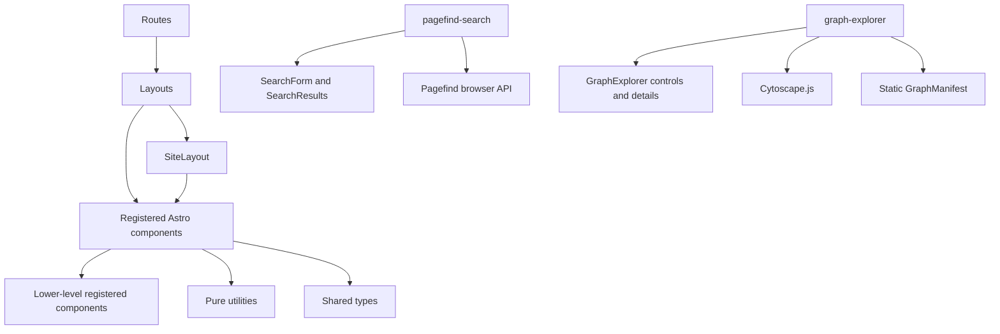
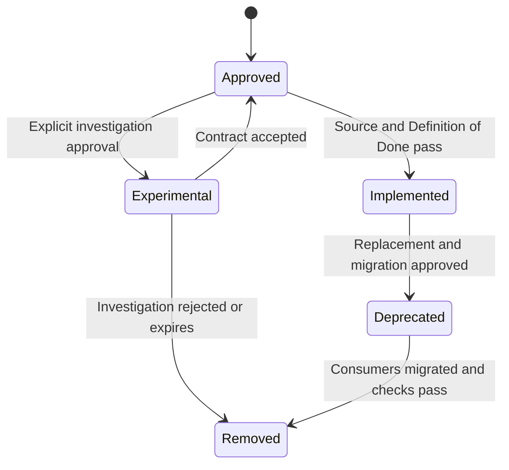

Atlas v0.6.0

# Public Personal Knowledge Garden and Living Portfolio Component Registry

## Document Status

- **Status:** Authoritative approved component catalog
- **Date:** 2026-07-21
- **Audience:** Senior software engineers, reviewers, and AI coding agents
- **Authoritative inputs:** `01_Architecture.md`, `02_FolderStructure.md`, and `03_ImplementationGuide.md`
- **Content domain source:** `05_ContentModel.md`
- **Coding standards:** `06_CodingStandards.md`
- **Quality strategy:** `08_TestStrategy.md`
- **Deployment and operations:** `09_DeploymentGuide.md`
- **Decision record:** `docs/decisions/0001-public-personal-knowledge-garden-and-knowledge-graph.md`
- **Registered inventory:** 5 layouts, 36 Astro components, and 2 browser components

## Registry Authority

This document is the single source of truth for reusable presentation components, layouts, MDX authoring components, metadata components, and browser components. It catalogs the closed component set already approved by the architecture and folder contract. It does not authorize new routes, folders, layouts, collections, frameworks, or runtime services.

The repository currently contains planning documents only. Every registry item therefore has lifecycle status **Approved** and implementation state **Not implemented**. `07_MilestonePlan.md` assigns every registered item to exactly one dependency milestone. Those assignments govern implementation sequence; lifecycle status changes to **Implemented** only after the assigned milestone passes its Definition of Done.

`src/components/mdx/index.ts` is the approved MDX export surface, not a component. It is documented in the taxonomy and ownership sections but is not counted as a registry component. Route files, utilities, content-domain modules, schemas, and configuration are also outside the component inventory.

## 1. Registry Overview

### Purpose

The registry enables an engineer or AI coding agent to answer these questions before creating or modifying presentation code:

1. Does the required component already exist in the approved design?
2. Which architectural layer and folder own it?
3. Which consumers may use it?
4. Which dependencies, props, slots, and events form its public contract?
5. Does it require browser execution?
6. What accessibility, SEO, responsive, and completion requirements apply?

The registry prevents duplicate components, hidden ownership changes, accidental hydration, inconsistent public APIs, and component growth outside approved boundaries.

### Scope

Included:

- The five approved layouts under `src/layouts/`.
- Every approved `.astro` component under `src/components/`.
- The approved browser-only Pagefind and Knowledge Graph controllers under their owning feature folders.
- The public MDX component export boundary.

Excluded:

- Routes, because routes are entry points rather than reusable components.
- Utilities and content-domain modules, because they own transformations and data access rather than rendering.
- Shared types and configuration, because they are dependencies of components.
- MDX content, tests, scripts, generated output, and GitHub Actions workflows.

### Ownership

Each registry item has exactly one subsystem owner and one folder. “Owner” describes architectural accountability; “maintainer” describes the engineering role responsible for implementation and review. A consumer does not gain ownership by importing a component.

### Relationship to authoritative documents

| Source | Registry relationship |
| --- | --- |
| `01_Architecture.md` | Defines the rendering model, five layouts, component responsibility groups, static-first policy, accessibility, SEO, and dependency boundaries. |
| `02_FolderStructure.md` | Defines exact filenames, folders, ownership boundaries, route consumers, import direction, and the single MDX barrel. |
| `03_ImplementationGuide.md` | Defines props, slots, events, dependencies, behavior, responsive/accessibility requirements, build order, and Definition of Done. |
| `04_ComponentRegistry.md` | Catalogs those approved contracts exactly once and governs component lifecycle and duplication control. |

If this registry conflicts with an authoritative input, implementation stops and the conflict is reported. The registry must not silently reinterpret the approved design.

## 2. Component Taxonomy

Every registered item belongs to exactly one category.

| Category | Folder | Count | Responsibility |
| --- | --- | ---: | --- |
| Layouts | `src/layouts/` | 5 | Compose complete page structures, place metadata, and coordinate approved reusable regions. |
| Site components | `src/components/site/` | 6 | Render global site identity, header, navigation, footer, and keyboard bypass behavior. |
| Card components | `src/components/cards/` | 4 | Render collection-specific summaries for home, listings, topics, and related content. |
| Content components | `src/components/content/` | 4 | Render prose structure, heading links, external links, and reading navigation. |
| Discovery components | `src/components/discovery/` | 9 | Render breadcrumbs, collection/topic navigation, pagination, related content, search UI, tags, and empty states. |
| Graph components | `src/components/graph/` | 4 | Render semantic connections, graph controls, selected-node details, and the accessible graph discovery shell. |
| Metadata components | `src/components/metadata/` | 4 | Render document metadata, structured data, publication dates, and visible status. |
| Project components | `src/components/project/` | 1 | Render project-specific facts. |
| Series components | `src/components/series/` | 2 | Render ordered series entries and previous/next series navigation. |
| MDX components | `src/components/mdx/` | 2 | Provide the deliberately small reusable authoring API available inside MDX. |
| Browser components | `src/components/discovery/` and `src/components/graph/` | 2 | Bind Pagefind or lazy Cytoscape.js plus URL state to their static feature shells without introducing a client UI framework. |

### MDX public export surface

`src/components/mdx/index.ts` is the only approved component barrel. It exports `Callout.astro` and `Figure.astro` by name. It may not expose site, discovery, metadata, project, series, card, layout, route, or browser internals. All other consumers use direct component-file imports.

## 3. Component Registry

### 3.1 Site components

#### `SiteIdentity.astro`

| Field | Registry value |
| --- | --- |
| Component Name | `SiteIdentity` |
| Category | Site component |
| Purpose | Render the persistent platform name, optional concise descriptor, and home destination. |
| Owner | Site Chrome Owner |
| Consumers | `Header` |
| Dependencies | Typed site configuration and base-path-safe URL utility. |
| Reusable | Yes; global header identity only. |
| Hydration Required | No. |
| Props | Site name; optional concise descriptor. |
| Slots | None. |
| Events | Native home-link activation only. |
| Accessibility Requirements | Stable accessible link name; image identity, if later supplied through an approved extension, uses correct alternative-text treatment. |
| SEO Responsibilities | Indirectly reinforces visible site identity; emits no head metadata. |
| Definition of Done | Links to configured base-path home, remains legible at all header sizes, and passes focus, contrast, and long-name checks. |
| Milestone | M7 - Site, Discovery, and Metadata Components. |
| Current Status | Approved; not implemented. |
| Future Extension Points | Localized descriptor or approved image identity without changing ownership or home-link behavior. |

#### `PrimaryNavigation.astro`

| Field | Registry value |
| --- | --- |
| Component Name | `PrimaryNavigation` |
| Category | Site component |
| Purpose | Render persistent primary navigation from one typed configuration source. |
| Owner | Site Chrome Owner |
| Consumers | `Header` |
| Dependencies | Navigation configuration, `NavigationItem` types, and URL utility. |
| Reusable | Yes; global desktop/persistent navigation. |
| Hydration Required | No. |
| Props | `items: NavigationItem[]`; current path. |
| Slots | None. |
| Events | Native link activation only. |
| Accessibility Requirements | Labeled navigation landmark; active item uses `aria-current`; links remain visible, reachable, and keyboard operable. |
| SEO Responsibilities | Emits crawlable base-safe internal links; no head metadata. |
| Definition of Done | One configuration drives all destinations; root/nested active states, focus, wrapping, and `/engineering-lab/` paths pass. |
| Milestone | M7 - Site, Discovery, and Metadata Components. |
| Current Status | Approved; not implemented. |
| Future Extension Points | Additional approved navigation items and localized labels through configuration only. |

#### `MobileNavigation.astro`

| Field | Registry value |
| --- | --- |
| Component Name | `MobileNavigation` |
| Category | Site component |
| Purpose | Render compact global navigation with the minimum interaction required for small viewports. |
| Owner | Site Chrome Owner |
| Consumers | `Header` |
| Dependencies | Navigation types and URL utility; isolated local browser script only when native behavior is insufficient. |
| Reusable | Yes; global small-viewport navigation. |
| Hydration Required | No framework hydration; optional minimal local enhancement. |
| Props | Navigation items; current path. |
| Slots | None. |
| Events | Native toggle/click; Escape handling when scripted. |
| Accessibility Requirements | Operable without script; keyboard open/close, Escape, visible focus, announced state, no nonmodal focus trap, and valid resize behavior. |
| SEO Responsibilities | Emits crawlable global links in the static HTML. |
| Definition of Done | No-JavaScript fallback exposes navigation; responsive, history, keyboard, focus, and active-state checks pass. |
| Milestone | M7 - Site, Discovery, and Metadata Components. |
| Current Status | Approved; not implemented. |
| Future Extension Points | Native disclosure refinement; no client framework or alternate navigation source. |

#### `Header.astro`

| Field | Registry value |
| --- | --- |
| Component Name | `Header` |
| Category | Site component |
| Purpose | Compose site identity and desktop/mobile global navigation regions. |
| Owner | Site Chrome Owner |
| Consumers | `SiteLayout` |
| Dependencies | `SiteIdentity`, `PrimaryNavigation`, and `MobileNavigation`. |
| Reusable | Yes; one global header per HTML page. |
| Hydration Required | No; child mobile navigation may use minimal local enhancement. |
| Props | Navigation data; current path. |
| Slots | Approved child-region slots only if composition requires them; no arbitrary page content. |
| Events | No component event API; child native navigation events only. |
| Accessibility Requirements | Semantic header; distinct labels for multiple navigation landmarks; stable dimensions; logical focus order. |
| SEO Responsibilities | Presents visible site identity and crawlable navigation; emits no document metadata. |
| Definition of Done | Appears once through `SiteLayout`; works at all breakpoints; no duplicate landmark ambiguity or layout shift; navigation works without script. |
| Milestone | M7 - Site, Discovery, and Metadata Components. |
| Current Status | Approved; not implemented. |
| Future Extension Points | Approved global action region only if it composes existing components and preserves landmark clarity. |

#### `Footer.astro`

| Field | Registry value |
| --- | --- |
| Component Name | `Footer` |
| Category | Site component |
| Purpose | Render site-level secondary navigation, profile links, and ownership/context text. |
| Owner | Site Chrome Owner |
| Consumers | `SiteLayout` |
| Dependencies | Site configuration, navigation types, and `ExternalLink`. |
| Reusable | Yes; one global footer per HTML page. |
| Hydration Required | No. |
| Props | Typed navigation and social items. |
| Slots | Optional compact text slot only when required by approved content. |
| Events | Native link activation only. |
| Accessibility Requirements | Semantic footer; descriptive link names; predictable order; labels and long URLs wrap without loss. |
| SEO Responsibilities | Emits crawlable secondary/internal profile links; no head metadata. |
| Definition of Done | Appears once through `SiteLayout`, contains no route-specific logic, and passes link, focus, contrast, and responsive checks. |
| Milestone | M7 - Site, Discovery, and Metadata Components. |
| Current Status | Approved; not implemented. |
| Future Extension Points | Approved social/profile links through typed configuration. |

#### `SkipLink.astro`

| Field | Registry value |
| --- | --- |
| Component Name | `SkipLink` |
| Category | Site component |
| Purpose | Let keyboard users bypass repeated site navigation and reach the main content. |
| Owner | Site Chrome Owner |
| Consumers | `SiteLayout` |
| Dependencies | None. |
| Reusable | Yes; required in every HTML page shell. |
| Hydration Required | No. |
| Props | Target ID and label with stable defaults. |
| Slots | None. |
| Events | Native fragment-link activation only. |
| Accessibility Requirements | First focusable control; visible on focus; target always exists and receives an understandable scroll/focus position. |
| SEO Responsibilities | None. |
| Definition of Done | Verified on every layout at desktop/mobile sizes with keyboard and zoom/reflow checks. |
| Milestone | M7 - Site, Discovery, and Metadata Components. |
| Current Status | Approved; not implemented. |
| Future Extension Points | Localized label through props; target contract remains stable. |

### 3.2 Card components

#### `ArticleSummary.astro`

| Field | Registry value |
| --- | --- |
| Component Name | `ArticleSummary` |
| Category | Card component |
| Purpose | Render an article title, description, date, tags, and internal destination as one semantic summary item. |
| Owner | Collection Summary Owner |
| Consumers | Home; article index; topic pages; `RelatedContentList`. |
| Dependencies | `PublicationDates`, `TagList`, URL utility, and date utility. |
| Reusable | Yes. |
| Hydration Required | No. |
| Props | `article: ArticleSummary`; optional constrained listing-context variant. |
| Slots | None. |
| Events | Native link activation only. |
| Accessibility Requirements | Descriptive title link; no invalid nested interactive card; metadata and long titles reflow without clipping. |
| SEO Responsibilities | Emits semantic crawlable summary links; does not emit head metadata. |
| Definition of Done | Works in every approved consumer; no draft input; long-title, optional metadata, responsive, focus, and link checks pass. |
| Milestone | M6 - Summary and Domain Components. |
| Current Status | Approved; not implemented. |
| Future Extension Points | Approved visual context variants using the same semantic and prop contract. |

#### `NoteSummary.astro`

| Field | Registry value |
| --- | --- |
| Component Name | `NoteSummary` |
| Category | Card component |
| Purpose | Render concise note identity, description, maturity/status, date, tags, and destination. |
| Owner | Collection Summary Owner |
| Consumers | Home recent notes; note index; topic pages; `RelatedContentList`. |
| Dependencies | `ContentStatus`, `PublicationDates`, `TagList`, URL utility, and date utility. |
| Reusable | Yes. |
| Hydration Required | No. |
| Props | `note: NoteSummary`. |
| Slots | None. |
| Events | Native link activation only. |
| Accessibility Requirements | Status conveyed in text rather than color alone; compact presentation preserves target size and readable reflow. |
| SEO Responsibilities | Emits semantic crawlable note links; no head metadata. |
| Definition of Done | Works in every approved consumer without route assumptions; maturity, optional metadata, focus, and responsive checks pass. |
| Milestone | M6 - Summary and Domain Components. |
| Current Status | Approved; not implemented. |
| Future Extension Points | Additional approved maturity labels through the shared type/formatter, not local card logic. |

#### `ProjectSummary.astro`

| Field | Registry value |
| --- | --- |
| Component Name | `ProjectSummary` |
| Category | Card component |
| Purpose | Render project title, description, status, role/period summary, demonstrated skills, and internal case-study link. |
| Owner | Collection Summary Owner |
| Consumers | Home project highlights; project index; topic pages; `RelatedContentList`. |
| Dependencies | `ContentStatus`, shared tag/list presentation, URL utility, and date utility. |
| Reusable | Yes. |
| Hydration Required | No. |
| Props | `project: ProjectSummary`; optional approved featured visual variant. |
| Slots | None. |
| Events | Native internal-link activation only. |
| Accessibility Requirements | Skills wrap; status is textually explicit; internal case-study link is not replaced by an external action. |
| SEO Responsibilities | Emits crawlable project-detail link; no head metadata. |
| Definition of Done | Full/minimal status and period combinations, long skills/tools, focus, responsive behavior, and all approved consumers pass. |
| Milestone | M6 - Summary and Domain Components. |
| Current Status | Approved; not implemented. |
| Future Extension Points | Approved featured styling without adding alternate project card components. |

#### `SeriesSummary.astro`

| Field | Registry value |
| --- | --- |
| Component Name | `SeriesSummary` |
| Category | Card component |
| Purpose | Render series title, description, validated entry count, tags, and internal destination. |
| Owner | Collection Summary Owner |
| Consumers | Home selected series; series index; topic pages. |
| Dependencies | `TagList` and URL utility. |
| Reusable | Yes. |
| Hydration Required | No. |
| Props | `series: SeriesSummary`. |
| Slots | None. |
| Events | Native link activation only. |
| Accessibility Requirements | Entry count is readable text; sequence meaning does not depend on decoration. |
| SEO Responsibilities | Emits crawlable series-detail link; no head metadata. |
| Definition of Done | Accurate nonzero entry count, long-title/reflow, focus, and every approved consumer pass. |
| Milestone | M6 - Summary and Domain Components. |
| Current Status | Approved; not implemented. |
| Future Extension Points | Approved series status text derived from the same summary view model. |

### 3.3 Content components

#### `ExternalLink.astro`

| Field | Registry value |
| --- | --- |
| Component Name | `ExternalLink` |
| Category | Content component |
| Purpose | Render external anchors consistently with secure relationship and context behavior. |
| Owner | Content Presentation Owner |
| Consumers | `Footer`, `ProjectFacts`, about page, and approved MDX/content presentation. |
| Dependencies | URL classification utility. |
| Reusable | Yes. |
| Hydration Required | No. |
| Props | Required `href`; optional accessible external-context text and explicitly approved new-context behavior. |
| Slots | Required default slot for descriptive link text. |
| Events | Native link activation only. |
| Accessibility Requirements | Descriptive label; no forced new tab by default; announce new browsing context when explicitly used. |
| SEO Responsibilities | Applies appropriate relationship attributes; preserves crawlable meaningful anchor text. |
| Definition of Done | Correctly distinguishes valid external URLs, preserves label semantics, and passes secure-link, focus, hover, and keyboard checks. |
| Milestone | M5 - Leaf and MDX Components. |
| Current Status | Approved; not implemented. |
| Future Extension Points | Approved external-link icon or service label without changing anchor semantics. |

#### `HeadingAnchor.astro`

| Field | Registry value |
| --- | --- |
| Component Name | `HeadingAnchor` |
| Category | Content component |
| Purpose | Add a stable copyable fragment destination to an identified content heading. |
| Owner | Content Presentation Owner |
| Consumers | Rendered MDX heading pipeline within `Prose`/knowledge content. |
| Dependencies | Slug utility and URL utility. |
| Reusable | Yes; content headings only. |
| Hydration Required | No. |
| Props | Required heading ID and accessible label. |
| Slots | Heading content only when used as the approved heading wrapper. |
| Events | Native fragment-link activation only. |
| Accessibility Requirements | Anchor visible on focus as well as hover; heading remains primary accessible name; fixed-header target offset is preserved. |
| SEO Responsibilities | Produces stable crawlable fragment identifiers; no head metadata. |
| Definition of Done | Duplicate IDs are impossible; fragments work beneath the Pages base; keyboard, focus, copy, and target-offset checks pass. |
| Milestone | M5 - Leaf and MDX Components. |
| Current Status | Approved; not implemented. |
| Future Extension Points | Optional copy-feedback enhancement only if accessible and statically functional without it. |

#### `Prose.astro`

| Field | Registry value |
| --- | --- |
| Component Name | `Prose` |
| Category | Content component |
| Purpose | Provide the approved semantic reading container and MDX typography scope. |
| Owner | Content Presentation Owner |
| Consumers | `KnowledgeLayout`, `ProjectLayout`, `SeriesLayout`, and about page. |
| Dependencies | `prose.css`. |
| Reusable | Yes. |
| Hydration Required | No. |
| Props | Optional constrained content-width variant. |
| Slots | Required default slot for rendered prose/MDX. |
| Events | None. |
| Accessibility Requirements | Long words, code, tables, figures, lists, headings, and narrow viewports remain readable without content loss. |
| SEO Responsibilities | Preserves semantic document structure and visible content indexed by search/crawlers. |
| Definition of Done | Representative MDX fixtures pass hierarchy, typography, overflow, zoom/reflow, print/readability, and contrast checks. |
| Milestone | M5 - Leaf and MDX Components. |
| Current Status | Approved; not implemented. |
| Future Extension Points | Approved width or reading-density variants using semantic tokens, not duplicate prose components. |

#### `TableOfContents.astro`

| Field | Registry value |
| --- | --- |
| Component Name | `TableOfContents` |
| Category | Content component |
| Purpose | Render nested in-page navigation from Astro-extracted headings. |
| Owner | Content Presentation Owner |
| Consumers | `KnowledgeLayout` and `ProjectLayout`. |
| Dependencies | Heading types and slug utility. |
| Reusable | Yes. |
| Hydration Required | No. |
| Props | Heading list; optional label; approved depth limit. |
| Slots | None. |
| Events | Native fragment-link activation only. |
| Accessibility Requirements | Labeled navigation; nested lists reflect heading depth; empty input renders nothing; links are keyboard accessible. |
| SEO Responsibilities | Exposes semantic internal section navigation; no head metadata. |
| Definition of Done | Normal, skipped-depth, duplicate-text, disabled, and empty fixtures generate valid links and hierarchy. |
| Milestone | M5 - Leaf and MDX Components. |
| Current Status | Approved; not implemented. |
| Future Extension Points | Approved depth/compact presentation through props; no client-only scroll spy in current architecture. |

### 3.4 Discovery components

#### `Breadcrumbs.astro`

| Field | Registry value |
| --- | --- |
| Component Name | `Breadcrumbs` |
| Category | Discovery component |
| Purpose | Render hierarchical route context from route-provided breadcrumb data. |
| Owner | Discovery Experience Owner |
| Consumers | `ListingLayout` where applicable and detail-page metadata/view composition. |
| Dependencies | `Breadcrumb` types and URL utility. |
| Reusable | Yes. |
| Hydration Required | No. |
| Props | `items: Breadcrumb[]`. |
| Slots | None. |
| Events | Native link activation only. |
| Accessibility Requirements | Labeled breadcrumb navigation; ordered list; current item uses `aria-current="page"` and is not an unnecessary link. |
| SEO Responsibilities | Supplies visible breadcrumb semantics and validated input for breadcrumb structured data; does not emit head data itself. |
| Definition of Done | Home suppression, detail/topic trails, base-safe links, current-state semantics, and structured-data consistency pass. |
| Milestone | M7 - Site, Discovery, and Metadata Components. |
| Current Status | Approved; not implemented. |
| Future Extension Points | Localized labels and approved path compression while preserving full accessible context. |

#### `CollectionNavigation.astro`

| Field | Registry value |
| --- | --- |
| Component Name | `CollectionNavigation` |
| Category | Discovery component |
| Purpose | Render navigation among articles, notes, projects, and series from one typed source. |
| Owner | Discovery Experience Owner |
| Consumers | `ListingLayout`, home discovery regions, and search fallback navigation. |
| Dependencies | Navigation configuration/types and URL utility. |
| Reusable | Yes. |
| Hydration Required | No. |
| Props | `items: NavigationItem[]`; optional active collection. |
| Slots | None. |
| Events | Native link activation only. |
| Accessibility Requirements | Active item is semantic; wrapping/overflow never hides destinations; navigation region has an appropriate label. |
| SEO Responsibilities | Emits crawlable collection links; no head metadata. |
| Definition of Done | All collection destinations come from one source; active, focus, narrow viewport, and base-path checks pass. |
| Milestone | M7 - Site, Discovery, and Metadata Components. |
| Current Status | Approved; not implemented. |
| Future Extension Points | Approved collection counts or labels using existing typed navigation data. |

#### `EmptyState.astro`

| Field | Registry value |
| --- | --- |
| Component Name | `EmptyState` |
| Category | Discovery component |
| Purpose | Explain a valid empty result set and offer an optional recovery destination. |
| Owner | Discovery Experience Owner |
| Consumers | `ListingLayout`, `SearchResults`, `RelatedContentList`, and 404 recovery composition. |
| Dependencies | URL utility when an action exists. |
| Reusable | Yes. |
| Hydration Required | No. |
| Props | Required message; optional action link. |
| Slots | Optional default slot for approved supplemental text. |
| Events | Native action-link activation only. |
| Accessibility Requirements | Ordinary empty states use normal text, not alert semantics; action is descriptive and keyboard accessible. |
| SEO Responsibilities | Recovery links remain crawlable; no metadata responsibility. |
| Definition of Done | Listing, related-content, search, and 404 contexts render without route-specific markup or false error announcements. |
| Milestone | M7 - Site, Discovery, and Metadata Components. |
| Current Status | Approved; not implemented. |
| Future Extension Points | Constrained informational variants without embedding domain-specific behavior. |

#### `Pagination.astro`

| Field | Registry value |
| --- | --- |
| Component Name | `Pagination` |
| Category | Discovery component |
| Purpose | Render deterministic previous/next and page-number navigation when pagination is enabled. |
| Owner | Discovery Experience Owner |
| Consumers | `ListingLayout`. |
| Dependencies | `PaginationData`, navigation types, and URL utility. |
| Reusable | Yes; valid only after pagination is introduced by approved collection scale needs. |
| Hydration Required | No. |
| Props | `pagination: PaginationData`. |
| Slots | None. |
| Events | Native link activation only. |
| Accessibility Requirements | Labeled navigation; current page identified; disabled destinations are not fake focusable links; target sizes are adequate. |
| SEO Responsibilities | Emits deterministic crawlable page URLs and supports canonical strategy supplied by the listing route/layout. |
| Definition of Done | First, middle, last, single-page, canonical, narrow viewport, focus, and base-path cases pass. |
| Milestone | M7 - Site, Discovery, and Metadata Components. |
| Current Status | Approved; not implemented. |
| Future Extension Points | Windowed page ranges using the same `PaginationData` contract. |

#### `RelatedContentList.astro`

| Field | Registry value |
| --- | --- |
| Component Name | `RelatedContentList` |
| Category | Discovery component |
| Purpose | Render resolved related entries across approved content types. |
| Owner | Discovery Experience Owner |
| Consumers | `KnowledgeLayout` and `ProjectLayout`. |
| Dependencies | `ContentSummary` discriminated union and the four summary card components. |
| Reusable | Yes. |
| Hydration Required | No. |
| Props | `items: ContentSummary[]`; optional heading. |
| Slots | None. |
| Events | Child native link activation only. |
| Accessibility Requirements | Semantic section/list; heading preserves hierarchy; content type is conveyed in text; empty input does not create an empty landmark. |
| SEO Responsibilities | Adds crawlable contextual internal links; no head metadata. |
| Definition of Done | Mixed types, empty input, heading hierarchy, draft exclusion, card selection, and no-query ownership checks pass. |
| Milestone | M7 - Site, Discovery, and Metadata Components. |
| Current Status | Approved; not implemented. |
| Future Extension Points | Approved relationship reason labels from resolved view data, never component-side inference. |

#### `SearchForm.astro`

| Field | Registry value |
| --- | --- |
| Component Name | `SearchForm` |
| Category | Discovery component |
| Purpose | Render the static search input, submit behavior, status target, and non-JavaScript query path. |
| Owner | Search Experience Owner |
| Consumers | Home search entry and `/search/` page. |
| Dependencies | Search types and URL utility. |
| Reusable | Yes; home and search contexts. |
| Hydration Required | No; browser controller may progressively bind on `/search/`. |
| Props | Initial query; action URL; input label; result/status target IDs. |
| Slots | Optional help slot. |
| Events | Native `input` and `submit`, consumed by `pagefind-search.ts` where enhanced. |
| Accessibility Requirements | Explicit label; search landmark; visible submit control; no focus stealing; query remains editable at all widths. |
| SEO Responsibilities | Static form action uses base-safe search URL; no head metadata. |
| Definition of Done | Submitting without JavaScript reaches `/search/?q=...`; Pagefind binding, focus, label, reflow, and base-path checks pass. |
| Milestone | M7 - Site, Discovery, and Metadata Components. |
| Current Status | Approved; not implemented. |
| Future Extension Points | Approved collection/tag filters using the existing query-state contract. |

#### `SearchResults.astro`

| Field | Registry value |
| --- | --- |
| Component Name | `SearchResults` |
| Category | Discovery component |
| Purpose | Provide result status/count, filter region, result list, and no-results/error states. |
| Owner | Search Experience Owner |
| Consumers | `/search/` page. |
| Dependencies | Search result types, `EmptyState`, and approved summary/link presentation. |
| Reusable | No; approved for the search page only. |
| Hydration Required | No framework hydration; DOM is progressively updated by the browser controller. |
| Props | Initial `SearchQueryState`. |
| Slots | Controller-owned result/filter containers where required by the static contract. |
| Events | No custom application event API. |
| Accessibility Requirements | Restrained live status; updates do not move focus; filters are labeled; loading, no-results, results, and errors are distinguishable. |
| SEO Responsibilities | Result links remain crawlable only when present in static/generated content; search result state is not a canonical page variant. |
| Definition of Done | Loading, results, no-results, index-failure, query history, keyboard, and base-safe navigation checks pass. |
| Milestone | M7 - Site, Discovery, and Metadata Components. |
| Current Status | Approved; not implemented. |
| Future Extension Points | Approved filters and result metadata using Pagefind's existing index, not a second search store. |

#### `TagList.astro`

| Field | Registry value |
| --- | --- |
| Component Name | `TagList` |
| Category | Discovery component |
| Purpose | Render normalized tags as topic links or noninteractive labels according to context. |
| Owner | Discovery Experience Owner |
| Consumers | Summary cards; `KnowledgeLayout`; `ProjectLayout`; `SeriesLayout`; topic/search presentation. |
| Dependencies | `Tag` types, tag utility, and URL utility. |
| Reusable | Yes. |
| Hydration Required | No. |
| Props | `tags: Tag[]`; constrained presentation mode. |
| Slots | None. |
| Events | Native link activation in linked mode. |
| Accessibility Requirements | Semantic list; labels are not color-dependent; links have adequate spacing and descriptive text. |
| SEO Responsibilities | Emits crawlable base-safe topic links in linked mode. |
| Definition of Done | Deduplication, deterministic order, label formatting, link/nonlink modes, narrow layout, and base-path checks pass. |
| Milestone | M5 - Leaf and MDX Components. |
| Current Status | Approved; not implemented. |
| Future Extension Points | Approved compact display or counts through typed props, not a duplicate tag component. |

#### `TopicLink.astro`

| Field | Registry value |
| --- | --- |
| Component Name | `TopicLink` |
| Category | Discovery component |
| Purpose | Render one normalized topic destination with an optional derived entry count. |
| Owner | Discovery Experience Owner |
| Consumers | Topic index, `TagList` where composition is selected, and approved search filters. |
| Dependencies | `Tag` types, tag utility, and URL utility. |
| Reusable | Yes. |
| Hydration Required | No. |
| Props | `tag: Tag`; optional count. |
| Slots | None. |
| Events | Native link activation only. |
| Accessibility Requirements | Accessible name includes the topic; optional count remains understandable to assistive technology. |
| SEO Responsibilities | Emits canonical base-safe topic destination. |
| Definition of Done | Topic index, tag contexts, optional count, long labels, focus, and base-path checks pass without duplicate URL logic. |
| Milestone | M7 - Site, Discovery, and Metadata Components. |
| Current Status | Approved; not implemented. |
| Future Extension Points | Approved count/label presentation using existing tag data. |

### 3.5 Metadata components

#### `ContentStatus.astro`

| Field | Registry value |
| --- | --- |
| Component Name | `ContentStatus` |
| Category | Metadata component |
| Purpose | Render visible note maturity or project/content status when appropriate. |
| Owner | Metadata Pipeline Owner |
| Consumers | `KnowledgeLayout`, summary cards, and `ProjectLayout`/project summaries where status is visible. |
| Dependencies | Shared content status types and approved formatter. |
| Reusable | Yes. |
| Hydration Required | No. |
| Props | Typed status; optional approved label override. |
| Slots | None. |
| Events | None. |
| Accessibility Requirements | Status meaning is visible text and never color-only; unknown values cannot render. |
| SEO Responsibilities | Visible status must remain consistent with metadata when metadata includes lifecycle state; emits no head tags. |
| Definition of Done | Every allowed status is consistent across consumers; unknown values fail type/schema checks; contrast and text checks pass. |
| Milestone | M5 - Leaf and MDX Components. |
| Current Status | Approved; not implemented. |
| Future Extension Points | Additional architecturally approved status values through shared schema/type/formatter changes. |

#### `DocumentHead.astro`

| Field | Registry value |
| --- | --- |
| Component Name | `DocumentHead` |
| Category | Metadata component |
| Purpose | Emit title, description, canonical, robots, Open Graph, Twitter Card, and required head links. |
| Owner | Metadata Pipeline Owner |
| Consumers | `SiteLayout`. |
| Dependencies | `SEOData`, SEO utility, URL utility, and typed site configuration. |
| Reusable | Yes; one instance per HTML document. |
| Hydration Required | No. |
| Props | `seo: SEOData`. |
| Slots | None. |
| Events | None. |
| Accessibility Requirements | Concise unique document title; no visible inaccessible UI; metadata values match visible page content. |
| SEO Responsibilities | Primary owner of standard head metadata except structured-data serialization. |
| Definition of Done | Representative routes have one title/canonical, valid absolute social URLs, correct robots behavior, and no duplicate/conflicting tags. |
| Milestone | M7 - Site, Discovery, and Metadata Components. |
| Current Status | Approved; not implemented. |
| Future Extension Points | Additional approved link/meta standards through `SEOData`, not route-specific head markup. |

#### `PublicationDates.astro`

| Field | Registry value |
| --- | --- |
| Component Name | `PublicationDates` |
| Category | Metadata component |
| Purpose | Render original publication and latest substantive revision dates consistently. |
| Owner | Metadata Pipeline Owner |
| Consumers | `KnowledgeLayout`, `ProjectLayout`, `SeriesLayout`, article/note summaries, and RSS-visible view preparation where applicable. |
| Dependencies | Date utility. |
| Reusable | Yes. |
| Hydration Required | No. |
| Props | `publishedAt`; optional `updatedAt`; optional compact mode. |
| Slots | None. |
| Events | None. |
| Accessibility Requirements | Semantic `time` values with machine-readable dates and unambiguous visible labels. |
| SEO Responsibilities | Visible dates must match structured-data and feed dates; emits no head metadata itself. |
| Definition of Done | Same-day, absent-update, later-update, locale stability, compact/full, and machine-date checks pass. |
| Milestone | M5 - Leaf and MDX Components. |
| Current Status | Approved; not implemented. |
| Future Extension Points | Localized display formatting through the date utility while preserving machine values. |

#### `StructuredData.astro`

| Field | Registry value |
| --- | --- |
| Component Name | `StructuredData` |
| Category | Metadata component |
| Purpose | Safely serialize validated structured-data inputs into the document head. |
| Owner | Metadata Pipeline Owner |
| Consumers | `SiteLayout`. |
| Dependencies | `StructuredDataInput` types and safe serialization behavior in SEO utility. |
| Reusable | Yes; one component may serialize one or more approved inputs per document. |
| Hydration Required | No. |
| Props | `data: StructuredDataInput | StructuredDataInput[]`. |
| Slots | None. |
| Events | None. |
| Accessibility Requirements | Nonvisual output must exactly reflect visible content and contain no untrusted executable markup. |
| SEO Responsibilities | Primary owner of JSON-LD serialization for approved schema types. |
| Definition of Done | Output is valid JSON, safely escaped, page-accurate, nonduplicated, and passes structured-data validation. |
| Milestone | M7 - Site, Discovery, and Metadata Components. |
| Current Status | Approved; not implemented. |
| Future Extension Points | Additional architecture-approved schema types represented by constrained shared inputs. |

### 3.6 Project component

#### `ProjectFacts.astro`

| Field | Registry value |
| --- | --- |
| Component Name | `ProjectFacts` |
| Category | Project component |
| Purpose | Render project status, role, period, demonstrated skills, optional tools, repository, and live-site facts. |
| Owner | Project Presentation Owner |
| Consumers | `ProjectLayout`. |
| Dependencies | `ExternalLink`, project types, date utility, and URL utility. |
| Reusable | Yes; project detail pages. |
| Hydration Required | No. |
| Props | `facts: ProjectFacts`. |
| Slots | None. |
| Events | Native external-link activation only. |
| Accessibility Requirements | Semantic definition list or equivalent; omitted values leave no empty rows; long skills/tools reflow; external actions are descriptive. |
| SEO Responsibilities | Visible project facts must match project structured data; emits no head metadata. |
| Definition of Done | Full/minimal records, secure links, chronology, long values, semantics, contrast, and responsive checks pass. |
| Milestone | M6 - Summary and Domain Components. |
| Current Status | Approved; not implemented. |
| Future Extension Points | Additional architecture-approved project facts through `ProjectFacts`, not new one-off components. |

### 3.7 Series components

#### `SeriesEntryList.astro`

| Field | Registry value |
| --- | --- |
| Component Name | `SeriesEntryList` |
| Category | Series component |
| Purpose | Render the complete validated article/note sequence on a series landing page. |
| Owner | Series Presentation Owner |
| Consumers | `SeriesLayout`. |
| Dependencies | `ResolvedSeriesEntry`, article/note summary primitives, and URL utility. |
| Reusable | Yes; series detail pages. |
| Hydration Required | No. |
| Props | `entries: ResolvedSeriesEntry[]`; optional current entry ID. |
| Slots | None. |
| Events | Native entry-link activation only. |
| Accessibility Requirements | Ordered list; type and current state are textual; sequence numbers are meaningful; links use descriptive titles. |
| SEO Responsibilities | Emits crawlable ordered internal links and visible sequence matching structured data. |
| Definition of Done | Mixed article/note sequence renders exactly in validated order with no missing link; semantic, focus, reflow, and base-path checks pass. |
| Milestone | M6 - Summary and Domain Components. |
| Current Status | Approved; not implemented. |
| Future Extension Points | Approved per-entry progress context without persistence or user accounts. |

#### `SeriesNavigation.astro`

| Field | Registry value |
| --- | --- |
| Component Name | `SeriesNavigation` |
| Category | Series component |
| Purpose | Render previous and next series destinations on an article or note. |
| Owner | Series Presentation Owner |
| Consumers | `KnowledgeLayout`. |
| Dependencies | `SeriesContext`, resolved entry types, and URL utility. |
| Reusable | Yes; article/note details with resolved series membership. |
| Hydration Required | No. |
| Props | Series identity; optional previous entry; optional next entry. |
| Slots | None. |
| Events | Native link activation only. |
| Accessibility Requirements | Labeled region; links include descriptive entry titles rather than only “Previous” or “Next”; missing direction creates no empty link. |
| SEO Responsibilities | Adds crawlable sequential internal links; emits no head metadata. |
| Definition of Done | First, middle, last, and no-series cases preserve base paths, semantics, focus, and exact resolved order. |
| Milestone | M6 - Summary and Domain Components. |
| Current Status | Approved; not implemented. |
| Future Extension Points | Approved series-position text derived from existing context. |

### 3.8 MDX components

#### `Callout.astro`

| Field | Registry value |
| --- | --- |
| Component Name | `Callout` |
| Category | MDX component |
| Purpose | Render authored supporting information using a constrained semantic tone. |
| Owner | MDX Authoring Owner |
| Consumers | MDX entries through `src/components/mdx/index.ts`. |
| Dependencies | Local constrained presentation type only. |
| Reusable | Yes; public MDX authoring API. |
| Hydration Required | No. |
| Props | Required supported variant; optional title. |
| Slots | Required default slot for callout content. |
| Events | None. |
| Accessibility Requirements | Meaning appears in text/icon semantics, not color alone; ordinary callouts do not misuse alert roles; contrast meets WCAG 2.2 AA. |
| SEO Responsibilities | Preserves authored semantic content for indexing; no head metadata. |
| Definition of Done | Every approved variant renders in MDX, print/read views, narrow widths, and contrast/semantic checks. |
| Milestone | M5 - Leaf and MDX Components. |
| Current Status | Approved; not implemented. |
| Future Extension Points | New variants only after content need, schema/type review, and registry approval; no arbitrary style variants. |

#### `Figure.astro`

| Field | Registry value |
| --- | --- |
| Component Name | `Figure` |
| Category | MDX component |
| Purpose | Render an optimized authored visual with caption, alternative text, and optional attribution. |
| Owner | MDX Authoring Owner |
| Consumers | MDX entries through `src/components/mdx/index.ts`. |
| Dependencies | Astro image handling and content asset types. |
| Reusable | Yes; public MDX authoring API. |
| Hydration Required | No. |
| Props | Required image source and caption; alternative text unless explicitly decorative; optional attribution. |
| Slots | None. |
| Events | None. |
| Accessibility Requirements | Semantic `figure`/`figcaption`; alt and caption are not redundant; responsive dimensions prevent layout shift. |
| SEO Responsibilities | Provides indexable caption and meaningful image semantics; image metadata may feed approved social metadata upstream, but this component emits no head tags. |
| Definition of Done | Local assets are optimized; missing assets fail build; informative/decorative cases, captions, attribution, responsive sizes, and layout-shift checks pass. |
| Milestone | M5 - Leaf and MDX Components. |
| Current Status | Approved; not implemented. |
| Future Extension Points | Approved attribution or source-link formatting within the same figure contract. |

### 3.9 Graph components

#### `ConnectionList.astro`

| Field | Registry value |
| --- | --- |
| Component Name | `ConnectionList` |
| Category | Graph component |
| Purpose | Render grouped typed semantic relationships with direction, optional editorial context, and direct content links. |
| Owner | Knowledge Graph Owner |
| Consumers | `KnowledgeLayout`, `ProjectLayout`, `SeriesLayout`, `GraphNodeDetails`, and `GraphExplorer`. |
| Dependencies | `ResolvedConnection` graph types and URL utility. |
| Reusable | Yes; entry-local and graph fallback discovery. |
| Hydration Required | No. |
| Props | `connections: ResolvedConnection[]`; optional heading and selected node ID. |
| Slots | None. |
| Events | Native content-link activation only. |
| Accessibility Requirements | Uses labeled semantic sections/lists; direction/type/context are textual; empty input renders nothing; relationship meaning never depends on edge color. |
| SEO Responsibilities | Emits crawlable contextual internal links; no head metadata or graph JSON. |
| Definition of Done | All seven relationship types, incoming/outgoing/symmetric labels, empty/isolated input, long context, ordering, and base-safe links pass without browser code. |
| Milestone | M5 - Leaf and MDX Components. |
| Current Status | Approved; not implemented. |
| Future Extension Points | Approved relationship grouping or context presentation using the same resolved connection contract. |

#### `GraphControls.astro`

| Field | Registry value |
| --- | --- |
| Component Name | `GraphControls` |
| Category | Graph component |
| Purpose | Render graph node search and domain, collection, and relationship-type filters. |
| Owner | Knowledge Graph Owner |
| Consumers | `GraphExplorer`; bound by `graph-explorer`. |
| Dependencies | `GraphQueryState`, graph type options, and controlled domain configuration. |
| Reusable | No; owned by the graph discovery route. |
| Hydration Required | No framework hydration; native controls are progressively bound by the graph controller. |
| Props | Domain, collection, and relationship options plus initial `GraphQueryState`. |
| Slots | None. |
| Events | Native `input`, `change`, and reset/submit behavior consumed by the controller. |
| Accessibility Requirements | Every control has a visible label; keyboard order and grouping are logical; filter state is textual; controls reflow without hiding options. |
| SEO Responsibilities | Query/filter state does not create alternate canonical pages; component emits no head metadata. |
| Definition of Done | Initial/query state, reset, all filters, labels, keyboard, long options, narrow viewport, and no-JavaScript form behavior pass. |
| Milestone | M7 - Site, Discovery, and Metadata Components. |
| Current Status | Approved; not implemented. |
| Future Extension Points | Approved additional filters derived from the existing public manifest without adding another data store. |

#### `GraphNodeDetails.astro`

| Field | Registry value |
| --- | --- |
| Component Name | `GraphNodeDetails` |
| Category | Graph component |
| Purpose | Render selected node identity, collection/domains, description, direct content destination, and semantic connections. |
| Owner | Knowledge Graph Owner |
| Consumers | `GraphExplorer`; updated by `graph-explorer`. |
| Dependencies | `ConnectionList`, graph types, and URL utility. |
| Reusable | No; graph discovery details region only. |
| Hydration Required | No framework hydration; owned region may be progressively updated by the controller. |
| Props | Optional selected `GraphNode`, resolved incoming/outgoing connections, and no-selection prompt. |
| Slots | None. |
| Events | Native content-link activation only. |
| Accessibility Requirements | Named details region; selection changes do not move focus automatically; no-selection and isolated-node states are understandable; every relationship is textual. |
| SEO Responsibilities | Emits crawlable selected/fallback content links; no query-specific head metadata. |
| Definition of Done | No selection, isolated node, all edge directions/types, long content/domains, controller updates, keyboard, and base-path cases pass. |
| Milestone | M7 - Site, Discovery, and Metadata Components. |
| Current Status | Approved; not implemented. |
| Future Extension Points | Approved node metadata derived from `GraphNode` without exposing raw frontmatter or full MDX. |

#### `GraphExplorer.astro`

| Field | Registry value |
| --- | --- |
| Component Name | `GraphExplorer` |
| Category | Graph component |
| Purpose | Compose the static graph shell, visual mount, controls, selected-node details, and always-available semantic fallback. |
| Owner | Knowledge Graph Owner |
| Consumers | `/graph/` route. |
| Dependencies | `GraphControls`, `GraphNodeDetails`, `ConnectionList`, and graph types. |
| Reusable | No; canonical graph page shell only. |
| Hydration Required | No framework hydration; browser controller enhances the owned mount point. |
| Props | Manifest URL, initial query state, graph filter options, and static selected/fallback node and connection data. |
| Slots | None. |
| Events | Child native events; no custom application event bus. |
| Accessibility Requirements | Semantic list/details remains authoritative; visual region has instructions and an accessible name; stable responsive dimensions; reduced-motion fallback; no canvas-only information. |
| SEO Responsibilities | Static fallback provides crawlable graph-to-content links; route supplies one canonical `/graph/`. |
| Definition of Done | Complete no-JavaScript fallback, enhanced/list states, empty corpus, isolated nodes, visual failure, narrow viewport, stable layout, and reduced-motion behavior pass. |
| Milestone | M7 - Site, Discovery, and Metadata Components. |
| Current Status | Approved; not implemented. |
| Future Extension Points | Approved view modes that preserve the same manifest, fallback, and canonical route. |

### 3.10 Browser components

#### `pagefind-search.ts`

| Field | Registry value |
| --- | --- |
| Component Name | `pagefind-search` browser controller |
| Category | Browser component |
| Purpose | Bind Pagefind, search form/results DOM, query/filter URL state, browser history, and result mapping on `/search/`. |
| Owner | Search Experience Owner |
| Consumers | `/search/` page; binds `SearchForm` and `SearchResults`. |
| Dependencies | Pagefind browser API and search types only. It must not import build-time collection modules. |
| Reusable | No; owned exclusively by the search experience. |
| Hydration Required | Browser execution required on `/search/`; no UI-framework hydration. |
| Props | Not an Astro prop API; receives stable DOM references/selectors and initial `SearchQueryState`. |
| Slots | None. |
| Events | Handles form `input`/`submit`, browser history updates, and `popstate`; emits no cross-application event bus. |
| Accessibility Requirements | Debounced updates do not trap or move focus; status announcements are restrained; back/forward restores state; failure preserves static navigation. |
| SEO Responsibilities | Normalizes result URLs to approved base-safe destinations; query state does not create alternate canonical metadata. |
| Definition of Done | Loads only on search; Pagefind success/failure, direct query, back/forward, no-results, base paths, keyboard, and no-console-error checks pass. |
| Milestone | M10 - Search, Syndication, and Artifact Pipeline. |
| Current Status | Approved; not implemented. |
| Future Extension Points | Approved collection/tag filters using Pagefind metadata and the existing URL/query-state contract. |

#### `graph-explorer.ts`

| Field | Registry value |
| --- | --- |
| Component Name | `graph-explorer` browser controller |
| Category | Browser component |
| Purpose | Lazy-load Cytoscape.js, fetch the same-build graph manifest, render bounded selected-node neighborhoods, apply filters, and synchronize URL/history/details state on `/graph/`. |
| Owner | Knowledge Graph Owner |
| Consumers | `/graph/` page; binds `GraphExplorer`, `GraphControls`, and `GraphNodeDetails`. |
| Dependencies | Cytoscape.js and graph types only; it must not import Astro collections or `src/lib/content/graph.ts`. |
| Reusable | No; owned exclusively by the graph discovery experience. |
| Hydration Required | Browser execution required for visual enhancement on `/graph/`; no UI-framework hydration. |
| Props | Not an Astro prop API; receives stable DOM references, manifest URL, and initial `GraphQueryState`. |
| Slots | None. |
| Events | Handles controls, node selection, URL history, and `popstate`; emits no global event bus. |
| Accessibility Requirements | Semantic list/details remains authoritative; no focus trap/theft; selected state is textual; animation respects reduced motion; failure leaves static navigation intact. |
| SEO Responsibilities | Query state never creates alternate canonical metadata; normalized content URLs remain base-safe. |
| Definition of Done | Loads only on graph; validates manifest version, lazy-loads Cytoscape.js, bounds default ego graph, handles empty/isolated/error/history/filter states, and meets route-local bundle/accessibility/performance budgets. |
| Milestone | M10 - Search, Graph, Syndication, and Artifact Pipeline. |
| Current Status | Approved; not implemented. |
| Future Extension Points | Approved layouts or graph filters after dependency, bundle, accessibility, and performance review. |

## 4. Layout Registry

Layouts appear only in this section and are not duplicated in Section 3.

### `SiteLayout.astro`

| Field | Registry value |
| --- | --- |
| Component Name | `SiteLayout` |
| Category | Layout |
| Purpose | Render the common HTML document shell and global page regions. |
| Owner | Layout System Owner |
| Responsibilities | Document/language/viewport, global styles, metadata placement, skip link, header/navigation, one main landmark, footer, and shared assets. |
| Consumers | Every HTML route directly or through a specialized layout. |
| Dependencies | Site and metadata components, typed site/navigation configuration, global styles, URL/SEO utilities, and shared types. |
| Reusable | Yes; universal page shell. |
| Hydration Required | No. |
| Props | Required `seo: SEOData`; optional constrained page-kind/body-class value. |
| Slots | Required default page-content slot; only approved page-level named regions. |
| Events | None; child native events only. |
| Children | `DocumentHead`, `StructuredData`, `SkipLink`, `Header` (`SiteIdentity`, `PrimaryNavigation`, `MobileNavigation`), main slot, and `Footer`. |
| Accessibility Requirements | Document language, one main landmark, stable skip target, semantic landmarks, logical order, visible focus, and reduced-motion support. |
| SEO Responsibilities | Own metadata placement and site defaults; never override validated entry-specific metadata. |
| Definition of Done | Every HTML route composes it; no duplicate shell; metadata, base-path, keyboard, no-JavaScript, and landmark checks pass. |
| Milestone | M8 - Layout System. |
| Current Status | Approved; not implemented. |
| Future Extension Points | Approved page-level regions through named slots without weakening the common shell. |

### `ListingLayout.astro`

| Field | Registry value |
| --- | --- |
| Component Name | `ListingLayout` |
| Category | Layout |
| Purpose | Render collection and topic index structure consistently. |
| Owner | Layout System Owner |
| Responsibilities | Heading/description, optional breadcrumbs, count, collection navigation, optional filters/intro, summary list, pagination, and empty state. |
| Consumers | Article, note, project, series, topic index, and topic detail routes. |
| Dependencies | `SiteLayout`, `Breadcrumbs`, `CollectionNavigation`, `EmptyState`, `Pagination`, navigation/pagination types, and formatting utilities. |
| Reusable | Yes; all approved listing routes. |
| Hydration Required | No. |
| Props | `seo: SEOData`, title, description, item count; optional breadcrumbs, pagination, and active collection/topic context. |
| Slots | Required default summary-card slot; optional `filters` and `intro`. |
| Events | None; child native events only. |
| Children | `SiteLayout`, optional `Breadcrumbs`, `CollectionNavigation`, intro/filter slots, summary-card slot, conditional `EmptyState`, optional `Pagination`. |
| Accessibility Requirements | One page heading; semantic result count/list; keyboard-accessible filters/pagination; descriptive empty state. |
| SEO Responsibilities | Supplies unique index/topic metadata and deterministic canonical/pagination URL to `SiteLayout`. |
| Definition of Done | All approved listings share it; populated/empty, long-title, filter/pagination, responsive, and metadata cases pass. |
| Milestone | M8 - Layout System. |
| Current Status | Approved; not implemented. |
| Future Extension Points | Pagination and approved static/Pagefind-backed filters through existing slots and typed props. |

### `KnowledgeLayout.astro`

| Field | Registry value |
| --- | --- |
| Component Name | `KnowledgeLayout` |
| Category | Layout |
| Purpose | Render both article and note detail pages through one reading structure. |
| Owner | Layout System Owner |
| Responsibilities | Entry title/description/type, dates/status/tags, reading structure, optional TOC, MDX body, related entries, and optional series navigation. |
| Consumers | Article and note detail routes. |
| Dependencies | `SiteLayout`, `PublicationDates`, `ContentStatus`, `TagList`, `Prose`, `TableOfContents`, `RelatedContentList`, `ConnectionList`, `SeriesNavigation`, content/graph types, and display utilities. |
| Reusable | Yes; shared by two collections. |
| Hydration Required | No. |
| Props | `entry: ArticleViewModel | NoteViewModel`, `seo: SEOData`; optional headings, related entries, semantic connections, and series context. |
| Slots | Required default rendered-MDX slot; optional approved content preamble slot only when typed props cannot express it. |
| Events | None; child native events only. |
| Children | `SiteLayout`, metadata components, `TagList`, optional `TableOfContents`, `Prose`/MDX components, optional `RelatedContentList`, optional `ConnectionList`, and optional `SeriesNavigation`. |
| Accessibility Requirements | One H1; MDX starts at H2; labeled TOC; semantic dates; readable code/tables; valid heading hierarchy. |
| SEO Responsibilities | Supplies article-like metadata, canonical override, dates, social image, breadcrumbs, and structured-data input. |
| Definition of Done | Article/note fixtures render without duplicate layouts; TOC, related, series, date, tag, responsive, SEO, and accessibility cases pass. |
| Milestone | M8 - Layout System. |
| Current Status | Approved; not implemented. |
| Future Extension Points | Approved reading aids through existing regions without splitting article/note layouts. |

### `ProjectLayout.astro`

| Field | Registry value |
| --- | --- |
| Component Name | `ProjectLayout` |
| Category | Layout |
| Purpose | Render project case studies and professional context. |
| Owner | Layout System Owner |
| Responsibilities | Project summary, facts, links, dates/tags, optional TOC, MDX case study, and related projects. |
| Consumers | Project detail route. |
| Dependencies | `SiteLayout`, `ProjectFacts`, `PublicationDates`, `TagList`, `Prose`, `TableOfContents`, `RelatedContentList`, `ConnectionList`, project/graph types, URL/date utilities. |
| Reusable | No; one approved project-detail route family. |
| Hydration Required | No. |
| Props | `project: ProjectViewModel`, `seo: SEOData`; optional related projects, semantic connections, and headings. |
| Slots | Required default rendered-MDX slot. |
| Events | None; child native link events only. |
| Children | `SiteLayout`, `ProjectFacts`, metadata/tag components, optional `TableOfContents`, `Prose`, optional `RelatedContentList`, and optional `ConnectionList`. |
| Accessibility Requirements | Semantic project facts; descriptive external actions; no empty controls; valid headings, tables, code, and responsive facts. |
| SEO Responsibilities | Supplies project title/description/canonical/social/breadcrumb data and project/creative-work structured-data input. |
| Definition of Done | Full/minimal project fixtures, links, facts, prose, related content, metadata, keyboard, and responsive checks pass. |
| Milestone | M8 - Layout System. |
| Current Status | Approved; not implemented. |
| Future Extension Points | Additional approved project facts through `ProjectFacts`, not layout duplication. |

### `SeriesLayout.astro`

| Field | Registry value |
| --- | --- |
| Component Name | `SeriesLayout` |
| Category | Layout |
| Purpose | Render a series introduction and ordered learning path. |
| Owner | Layout System Owner |
| Responsibilities | Series title/description/dates/tags, introductory MDX, ordered entries, entry types, and nonpersistent progress context. |
| Consumers | Series detail route. |
| Dependencies | `SiteLayout`, `PublicationDates`, `TagList`, `Prose`, `SeriesEntryList`, `ConnectionList`, series/graph types, URL/date utilities. |
| Reusable | No; one approved series-detail route family. |
| Hydration Required | No. |
| Props | `series: SeriesViewModel`, `seo: SEOData`, validated ordered resolved entries, and optional semantic connections. |
| Slots | Required default rendered-series-introduction slot. |
| Events | None; child native events only. |
| Children | `SiteLayout`, publication/tag components, `Prose`/MDX introduction, `SeriesEntryList`, and optional `ConnectionList`. |
| Accessibility Requirements | Ordered sequence; article/note type is textual; descriptive links; logical heading hierarchy. |
| SEO Responsibilities | Supplies unique series metadata, canonical, breadcrumbs, social data, and accurate collection/list structured data. |
| Definition of Done | Mixed article/note sequence, metadata, semantic order, links, responsive behavior, and no-JavaScript checks pass. |
| Milestone | M8 - Layout System. |
| Current Status | Approved; not implemented. |
| Future Extension Points | Nonpersistent progress context derived from validated series data. |

## 5. Component Hierarchy

The trees show ownership/composition, not route data loading. Optional children are marked `(optional)`; route-provided card slots are marked by category rather than creating new components.

### Site layout

```text
SiteLayout
├── DocumentHead
├── StructuredData
├── SkipLink
├── Header
│   ├── SiteIdentity
│   ├── PrimaryNavigation
│   └── MobileNavigation
├── Main (default page-content slot)
└── Footer
    └── ExternalLink (for external profile links)
```

### Listing layout

```text
ListingLayout
└── SiteLayout
    └── Main
        ├── Breadcrumbs (optional)
        ├── CollectionNavigation
        ├── Intro slot (optional)
        ├── Filters slot (optional)
        ├── Default listing slot
        │   └── ArticleSummary | NoteSummary | ProjectSummary | SeriesSummary | TopicLink
        │       ├── ContentStatus (where applicable)
        │       ├── PublicationDates (where applicable)
        │       └── TagList (where applicable)
        ├── EmptyState (conditional)
        └── Pagination (optional)
```

### Knowledge layout

```text
KnowledgeLayout
└── SiteLayout
    └── Main
        ├── ContentStatus (when applicable)
        ├── PublicationDates
        ├── TagList
        ├── TableOfContents (optional)
        ├── Prose
        │   └── Rendered MDX
        │       ├── HeadingAnchor (through heading rendering)
        │       ├── ExternalLink (where authored/normalized)
        │       ├── Callout (optional)
        │       └── Figure (optional)
        ├── RelatedContentList (optional)
        │   └── ArticleSummary | NoteSummary | ProjectSummary | SeriesSummary
        ├── ConnectionList (optional)
        └── SeriesNavigation (optional)
```

### Project layout

```text
ProjectLayout
└── SiteLayout
    └── Main
        ├── ProjectFacts
        │   └── ExternalLink (optional repository/live links)
        ├── PublicationDates
        ├── TagList
        ├── TableOfContents (optional)
        ├── Prose
        │   └── Rendered MDX
        │       ├── HeadingAnchor (through heading rendering)
        │       ├── ExternalLink (where authored/normalized)
        │       ├── Callout (optional)
        │       └── Figure (optional)
        └── RelatedContentList (optional)
            └── ProjectSummary
        └── ConnectionList (optional)
```

### Series layout

```text
SeriesLayout
└── SiteLayout
    └── Main
        ├── PublicationDates
        ├── TagList
        ├── Prose
        │   └── Rendered MDX introduction
        │       ├── ExternalLink (where authored/normalized)
        │       ├── Callout (optional)
        │       └── Figure (optional)
        └── SeriesEntryList
            └── ArticleSummary | NoteSummary primitives
        └── ConnectionList (optional)
```

### Search composition

Search uses `SiteLayout` directly; it is not a sixth layout.

```text
SiteLayout
└── Main (/search/)
    ├── SearchForm
    ├── SearchResults
    │   └── EmptyState (no results or unavailable index)
    └── CollectionNavigation (fallback discovery)

pagefind-search browser controller
├── binds SearchForm events
├── queries Pagefind
├── maps typed result state
└── updates SearchResults-owned containers
```

### Graph composition

The graph route uses `SiteLayout` directly; it does not introduce a sixth layout.

```text
SiteLayout
└── Main (/graph/)
    └── GraphExplorer
        ├── GraphControls
        ├── Visual mount point (progressive enhancement)
        ├── GraphNodeDetails
        │   └── ConnectionList
        └── ConnectionList (static fallback)

graph-explorer browser controller
├── binds GraphControls and selection events
├── fetches the same-build GraphManifest
├── lazy-loads Cytoscape.js
├── renders a bounded selected-node neighborhood
└── updates GraphNodeDetails without replacing semantic fallback
```

## 6. Dependency Matrix

This matrix lists direct component dependencies. Types, configuration, CSS, and utilities are named where they are part of the approved direct contract. “Used by” names direct or primary consumers, not every transitive page.

| Registry item | Depends on | Used by |
| --- | --- | --- |
| `SiteLayout` | Metadata/site components, config, URL/SEO utilities, shared types | All HTML routes; four specialized layouts |
| `ListingLayout` | `SiteLayout`, breadcrumbs/collection/empty/pagination components | Collection and topic routes |
| `KnowledgeLayout` | `SiteLayout`, content/metadata/discovery/graph/series components | Article and note detail routes |
| `ProjectLayout` | `SiteLayout`, project/content/metadata/discovery/graph components | Project detail route |
| `SeriesLayout` | `SiteLayout`, series/content/metadata/graph components | Series detail route |
| `SiteIdentity` | Site config, URL utility | `Header` |
| `PrimaryNavigation` | Navigation config/types, URL utility | `Header` |
| `MobileNavigation` | Navigation types, URL utility | `Header` |
| `Header` | `SiteIdentity`, `PrimaryNavigation`, `MobileNavigation` | `SiteLayout` |
| `Footer` | `ExternalLink`, site config, navigation types | `SiteLayout` |
| `SkipLink` | None | `SiteLayout` |
| `ArticleSummary` | `PublicationDates`, `TagList`, date/URL utilities | Home, listings, topics, related content, series primitives |
| `NoteSummary` | `ContentStatus`, `PublicationDates`, `TagList`, date/URL utilities | Home, listings, topics, related content, series primitives |
| `ProjectSummary` | `ContentStatus`, tag/list presentation, date/URL utilities | Home, listings, topics, related content |
| `SeriesSummary` | `TagList`, URL utility | Home, listings, topics |
| `ExternalLink` | URL utility | Footer, project facts, about, content/MDX presentation |
| `HeadingAnchor` | Slug/URL utilities | Rendered content headings |
| `Prose` | `prose.css` | Knowledge/project/series layouts, about |
| `TableOfContents` | Heading types, slug utility | Knowledge/project layouts |
| `Breadcrumbs` | Navigation types, URL utility | Listing/detail composition |
| `CollectionNavigation` | Navigation config/types, URL utility | Listing layout, home, search fallback |
| `EmptyState` | URL utility when actionable | Listing layout, search results, related content, 404 |
| `Pagination` | Pagination/navigation types, URL utility | Listing layout |
| `RelatedContentList` | Four summary cards, content summary type | Knowledge/project layouts |
| `SearchForm` | Search types, URL utility | Home, search page/browser controller |
| `SearchResults` | `EmptyState`, search types, summary/link presentation | Search page/browser controller |
| `TagList` | Tag types, tag/URL utilities | Cards, knowledge/project/series layouts, topics/search |
| `TopicLink` | Tag types, tag/URL utilities | Topic index, tag/filter contexts |
| `ContentStatus` | Content types, formatter | Cards and knowledge/project presentation |
| `DocumentHead` | SEO types, SEO/URL utilities, site config | `SiteLayout` |
| `PublicationDates` | Date utility | Cards and knowledge/project/series layouts |
| `StructuredData` | SEO types, safe SEO serialization | `SiteLayout` |
| `ProjectFacts` | `ExternalLink`, project types, date/URL utilities | `ProjectLayout` |
| `SeriesEntryList` | Article/note summary primitives, series types, URL utility | `SeriesLayout` |
| `SeriesNavigation` | Series types, URL utility | `KnowledgeLayout` |
| `Callout` | Local presentation type | MDX content through MDX public map |
| `Figure` | Astro image handling, asset types | MDX content through MDX public map |
| `ConnectionList` | Graph types, URL utility | Entry layouts, graph node details, graph explorer |
| `GraphControls` | Graph query/types, domain config | `GraphExplorer`, graph controller |
| `GraphNodeDetails` | `ConnectionList`, graph types, URL utility | `GraphExplorer`, graph controller |
| `GraphExplorer` | `GraphControls`, `GraphNodeDetails`, `ConnectionList`, graph types | Graph route/controller |
| `pagefind-search` | Pagefind browser API, search types | Search page; binds `SearchForm`/`SearchResults` |
| `graph-explorer` | Cytoscape.js, graph types | Graph page; binds graph components |



No dependency may point from a component to a route, from a leaf component to a layout, or from browser code into build-time collection/graph modules. Cycles block implementation.

## 7. Reuse Matrix

Legend: `R` = required in the route family; `O` = optional or data-dependent; `-` = not an approved consumer. “Listings” covers article, note, project, series, topic index/detail routes. Global `SiteLayout` children are shown as required for all HTML route families.

| Registry item | Home | Listings | Article/Note | Project | Series | Search | Graph | About/404 |
| --- | :---: | :---: | :---: | :---: | :---: | :---: | :---: | :---: |
| `SiteLayout` | R | R | R | R | R | R | R | R |
| `ListingLayout` | - | R | - | - | - | - | - | - |
| `KnowledgeLayout` | - | - | R | - | - | - | - | - |
| `ProjectLayout` | - | - | - | R | - | - | - | - |
| `SeriesLayout` | - | - | - | - | R | - | - | - |
| `SiteIdentity` | R | R | R | R | R | R | R | R |
| `PrimaryNavigation` | R | R | R | R | R | R | R | R |
| `MobileNavigation` | R | R | R | R | R | R | R | R |
| `Header` | R | R | R | R | R | R | R | R |
| `Footer` | R | R | R | R | R | R | R | R |
| `SkipLink` | R | R | R | R | R | R | R | R |
| `ArticleSummary` | O | O | O | - | O | O | - | - |
| `NoteSummary` | O | O | O | - | O | O | - | - |
| `ProjectSummary` | O | O | O | O | - | O | - | - |
| `SeriesSummary` | O | O | O | - | O | O | - | - |
| `ExternalLink` | O | O | O | O | O | - | - | O |
| `HeadingAnchor` | - | - | O | O | O | - | - | O |
| `Prose` | - | - | R | R | R | - | - | O |
| `TableOfContents` | - | - | O | O | - | - | - | - |
| `Breadcrumbs` | - | O | O | O | O | - | - | - |
| `CollectionNavigation` | O | R | - | - | - | O | - | O |
| `EmptyState` | O | O | O | O | O | O | O | O |
| `Pagination` | - | O | - | - | - | - | - | - |
| `RelatedContentList` | - | - | O | O | - | - | - | - |
| `SearchForm` | R | - | - | - | - | R | - | - |
| `SearchResults` | - | - | - | - | - | R | - | - |
| `TagList` | O | O | R | R | R | O | O | - |
| `TopicLink` | - | O | - | - | - | O | - | - |
| `ContentStatus` | O | O | O | O | - | O | - | - |
| `DocumentHead` | R | R | R | R | R | R | R | R |
| `PublicationDates` | O | O | R | R | R | O | - | - |
| `StructuredData` | R | R | R | R | R | O | O | O |
| `ProjectFacts` | - | - | - | R | - | - | - | - |
| `SeriesEntryList` | - | - | - | - | R | - | - | - |
| `SeriesNavigation` | - | - | O | - | - | - | - | - |
| `Callout` | - | - | O | O | O | - | - | O |
| `Figure` | - | - | O | O | O | - | - | O |
| `ConnectionList` | - | - | O | O | O | - | R | - |
| `GraphControls` | - | - | - | - | - | - | R | - |
| `GraphNodeDetails` | - | - | - | - | - | - | R | - |
| `GraphExplorer` | - | - | - | - | - | - | R | - |
| `pagefind-search` | - | - | - | - | - | R | - | - |
| `graph-explorer` | - | - | - | - | - | - | R | - |

The matrix authorizes reuse only in the listed architectural contexts. It does not require optional data-dependent components to render when their input is absent.

## 8. Component Ownership

| Registry item | Folder/file | Owner | Maintainer | Layer | Public API |
| --- | --- | --- | --- | --- | --- |
| `SiteLayout` | `src/layouts/SiteLayout.astro` | Layout System Owner | Frontend Platform Maintainer | Layout | Direct typed layout import |
| `ListingLayout` | `src/layouts/ListingLayout.astro` | Layout System Owner | Frontend Platform Maintainer | Layout | Direct typed layout import |
| `KnowledgeLayout` | `src/layouts/KnowledgeLayout.astro` | Layout System Owner | Frontend Platform Maintainer | Layout | Direct typed layout import |
| `ProjectLayout` | `src/layouts/ProjectLayout.astro` | Layout System Owner | Frontend Platform Maintainer | Layout | Direct typed layout import |
| `SeriesLayout` | `src/layouts/SeriesLayout.astro` | Layout System Owner | Frontend Platform Maintainer | Layout | Direct typed layout import |
| `SiteIdentity` | `src/components/site/SiteIdentity.astro` | Site Chrome Owner | Frontend UI Maintainer | Site | Direct typed component import |
| `PrimaryNavigation` | `src/components/site/PrimaryNavigation.astro` | Site Chrome Owner | Frontend UI Maintainer | Site | Direct typed component import |
| `MobileNavigation` | `src/components/site/MobileNavigation.astro` | Site Chrome Owner | Frontend UI Maintainer | Site | Direct typed component import |
| `Header` | `src/components/site/Header.astro` | Site Chrome Owner | Frontend UI Maintainer | Site | Direct typed component import |
| `Footer` | `src/components/site/Footer.astro` | Site Chrome Owner | Frontend UI Maintainer | Site | Direct typed component import |
| `SkipLink` | `src/components/site/SkipLink.astro` | Site Chrome Owner | Frontend UI Maintainer | Site | Direct typed component import |
| `ArticleSummary` | `src/components/cards/ArticleSummary.astro` | Collection Summary Owner | Content UI Maintainer | Card | Direct typed component import |
| `NoteSummary` | `src/components/cards/NoteSummary.astro` | Collection Summary Owner | Content UI Maintainer | Card | Direct typed component import |
| `ProjectSummary` | `src/components/cards/ProjectSummary.astro` | Collection Summary Owner | Content UI Maintainer | Card | Direct typed component import |
| `SeriesSummary` | `src/components/cards/SeriesSummary.astro` | Collection Summary Owner | Content UI Maintainer | Card | Direct typed component import |
| `ExternalLink` | `src/components/content/ExternalLink.astro` | Content Presentation Owner | Content UI Maintainer | Content | Direct typed component import |
| `HeadingAnchor` | `src/components/content/HeadingAnchor.astro` | Content Presentation Owner | Content UI Maintainer | Content | Direct typed component import |
| `Prose` | `src/components/content/Prose.astro` | Content Presentation Owner | Content UI Maintainer | Content | Direct typed component import |
| `TableOfContents` | `src/components/content/TableOfContents.astro` | Content Presentation Owner | Content UI Maintainer | Content | Direct typed component import |
| `Breadcrumbs` | `src/components/discovery/Breadcrumbs.astro` | Discovery Experience Owner | Discovery UI Maintainer | Discovery | Direct typed component import |
| `CollectionNavigation` | `src/components/discovery/CollectionNavigation.astro` | Discovery Experience Owner | Discovery UI Maintainer | Discovery | Direct typed component import |
| `EmptyState` | `src/components/discovery/EmptyState.astro` | Discovery Experience Owner | Discovery UI Maintainer | Discovery | Direct typed component import |
| `Pagination` | `src/components/discovery/Pagination.astro` | Discovery Experience Owner | Discovery UI Maintainer | Discovery | Direct typed component import |
| `RelatedContentList` | `src/components/discovery/RelatedContentList.astro` | Discovery Experience Owner | Discovery UI Maintainer | Discovery | Direct typed component import |
| `SearchForm` | `src/components/discovery/SearchForm.astro` | Search Experience Owner | Search UI Maintainer | Discovery | Direct typed component import |
| `SearchResults` | `src/components/discovery/SearchResults.astro` | Search Experience Owner | Search UI Maintainer | Discovery | Direct typed component import |
| `TagList` | `src/components/discovery/TagList.astro` | Discovery Experience Owner | Discovery UI Maintainer | Discovery | Direct typed component import |
| `TopicLink` | `src/components/discovery/TopicLink.astro` | Discovery Experience Owner | Discovery UI Maintainer | Discovery | Direct typed component import |
| `ContentStatus` | `src/components/metadata/ContentStatus.astro` | Metadata Pipeline Owner | Metadata/SEO Maintainer | Metadata | Direct typed component import |
| `DocumentHead` | `src/components/metadata/DocumentHead.astro` | Metadata Pipeline Owner | Metadata/SEO Maintainer | Metadata | Direct typed component import |
| `PublicationDates` | `src/components/metadata/PublicationDates.astro` | Metadata Pipeline Owner | Metadata/SEO Maintainer | Metadata | Direct typed component import |
| `StructuredData` | `src/components/metadata/StructuredData.astro` | Metadata Pipeline Owner | Metadata/SEO Maintainer | Metadata | Direct typed component import |
| `ProjectFacts` | `src/components/project/ProjectFacts.astro` | Project Presentation Owner | Portfolio UI Maintainer | Project | Direct typed component import |
| `SeriesEntryList` | `src/components/series/SeriesEntryList.astro` | Series Presentation Owner | Knowledge UI Maintainer | Series | Direct typed component import |
| `SeriesNavigation` | `src/components/series/SeriesNavigation.astro` | Series Presentation Owner | Knowledge UI Maintainer | Series | Direct typed component import |
| `Callout` | `src/components/mdx/Callout.astro` | MDX Authoring Owner | Content Platform Maintainer | MDX | Named export through `src/components/mdx/index.ts` |
| `Figure` | `src/components/mdx/Figure.astro` | MDX Authoring Owner | Content Platform Maintainer | MDX | Named export through `src/components/mdx/index.ts` |
| `ConnectionList` | `src/components/graph/ConnectionList.astro` | Knowledge Graph Owner | Knowledge Graph Maintainer | Graph | Direct typed component import |
| `GraphControls` | `src/components/graph/GraphControls.astro` | Knowledge Graph Owner | Knowledge Graph Maintainer | Graph | Direct typed component import |
| `GraphNodeDetails` | `src/components/graph/GraphNodeDetails.astro` | Knowledge Graph Owner | Knowledge Graph Maintainer | Graph | Direct typed component import |
| `GraphExplorer` | `src/components/graph/GraphExplorer.astro` | Knowledge Graph Owner | Knowledge Graph Maintainer | Graph | Direct typed component import |
| `pagefind-search` | `src/components/discovery/pagefind-search.ts` | Search Experience Owner | Search UI Maintainer | Browser | Search-page initializer contract; no barrel export |
| `graph-explorer` | `src/components/graph/graph-explorer.ts` | Knowledge Graph Owner | Knowledge Graph Maintainer | Browser | Graph-page initializer contract; no barrel export |

Supporting public API module:

| Module | Folder/file | Owner | Maintainer | Layer | Public API |
| --- | --- | --- | --- | --- | --- |
| MDX component map | `src/components/mdx/index.ts` | MDX Authoring Owner | Content Platform Maintainer | MDX export boundary | Named exports of `Callout` and `Figure` only |

Ownership changes require review of this registry and `02_FolderStructure.md`. Maintainer names are role assignments, not additional owners.

## 9. Component Lifecycle

### Lifecycle states

| State | Meaning | Repository rule |
| --- | --- | --- |
| Approved | Contract exists in approved documents; implementation may not yet exist. | Registry record is complete and source documents authorize the component. |
| Implemented | Source exists and passes its Definition of Done and project quality gates. | Status update must identify validation evidence and current public API. |
| Experimental | Time-bounded implementation investigation that is not available to production consumers. | Requires explicit architect approval, named owner, scope, expiry decision, and no replacement of an approved component. |
| Deprecated | Still available temporarily, but approved consumers must migrate to the named replacement. | Record includes reason, replacement, migration owner, start date, and removal condition. |
| Removed | Source and all consumers are deleted after approved migration. | Record moves to a removal history appendix or version history; name cannot be silently reused for different behavior. |

### State transitions



Rules:

1. Only an approved registry item may become implemented.
2. Implementation does not permit changing the approved name, folder, owner, or API intent.
3. Experimental status is never a shortcut for production use.
4. Deprecation requires an approved replacement or explicit removal rationale; duplicate old/new components are temporary and tracked.
5. Removal requires zero consumers, passing checks, documentation updates, and approval where the source architecture names the component.
6. Lifecycle changes update this registry in the same change as source and consumer changes.

## 10. Naming Rules

| Concern | Rule |
| --- | --- |
| Component names | Use descriptive PascalCase nouns or noun phrases matching the approved registry name exactly. Do not append generic suffixes such as `Widget`, `Container`, `New`, or `V2`. |
| Component files | Astro component filename equals component name plus `.astro`; browser modules remain the approved lowercase kebab-case `pagefind-search.ts` and `graph-explorer.ts`. |
| Layout names/files | Use the five exact approved PascalCase names ending in `Layout.astro`. No sixth layout or alias is permitted. |
| Props type | Define a local `Props` interface when used by one component. Shared domain contracts come from `src/types/`; do not create duplicate component-specific copies. |
| Prop names | Use camelCase nouns; booleans read as predicates such as `isActive` or `hasSeries`; event callbacks, if ever approved, use `onX` names. |
| Slot names | Use lowercase kebab-case semantic region names. Use `default` for primary content. Existing approved names are `intro` and `filters`; avoid visual names such as `left` or `blue`. |
| Events | Prefer native events. Event names follow platform semantics; no global event bus. Custom events require a documented cross-component need and registry update. |
| CSS naming | Prefer Tailwind utilities and semantic design tokens. Component-scoped class hooks use lowercase kebab-case and describe responsibility, not color/position. No route-specific global selectors. |
| Export naming | Named exports only for TypeScript modules. `src/components/mdx/index.ts` is the only component barrel and exports `Callout` and `Figure`. |
| Import naming | Import the registered component using its exact PascalCase name. Use direct component-file imports except the approved MDX public map. Avoid aliases that hide identity. |
| Variants | Use constrained semantic variant names. A variant must not create a second component identity or introduce mode-heavy boolean combinations. |

## 11. Component Creation Policy

The current registry is closed. A new component may be proposed only when all conditions below are satisfied:

1. The behavior is required by an approved architecture capability or an approved architecture change.
2. Registry search confirms no existing component owns the behavior.
3. Extending an existing component through composition or a constrained prop would create an incoherent responsibility or unsafe API.
4. The behavior is reused, independently testable, or sufficiently complex to require an accessibility/interaction boundary.
5. The proposal identifies one category, one folder, one owner, consumers, dependencies, props, slots, events, hydration policy, accessibility rules, SEO responsibility, milestone, and Definition of Done.
6. The proposal preserves static generation, base-path safety, and the approved dependency direction.
7. The registry and, when required, `02_FolderStructure.md` and `03_ImplementationGuide.md` are approved before implementation begins.

### Explicit creation rules

- Do not create duplicate components with different names, styling, or route ownership.
- Prefer reuse of the exact registered component.
- Prefer composition over inheritance and mode-heavy components.
- Keep one primary responsibility per component.
- Keep content retrieval and relationship resolution outside UI components.
- Keep routes and layouts from absorbing reusable leaf markup.
- Do not create wrappers that only rename props or apply one-use spacing.
- Do not create a component solely to shorten a small, single-use semantic fragment.
- Do not create a generic `Container`, `Box`, `Card`, `Wrapper`, or `Section` without a distinct approved responsibility.
- Do not add browser execution to solve a static presentation problem.
- Do not add a second barrel export.

### Maximum dependency depth

The approved hierarchy permits at most three registered component-to-component edges beneath a layout before reaching a leaf; types, configuration, CSS, and pure utilities are not counted as component edges. Any proposal exceeding this depth requires explicit architecture review before registration. Engineers must not hide depth or cycles behind dynamic imports, wrapper components, or barrels.

## 12. Component Review Checklist

Use this checklist for every new implementation and material component change.

### Architecture and ownership

- [ ] The component appears exactly once in this registry.
- [ ] The exact approved name and folder are preserved.
- [ ] The component has one owner and the change has the correct maintainer review.
- [ ] The architecture, route topology, layouts, collections, and static rendering model remain unchanged.
- [ ] Direct and transitive dependencies follow the approved graph and contain no cycle.
- [ ] The component does not query collections, resolve domain relationships, or duplicate route logic.

### Public API and reuse

- [ ] Props are typed, minimal, semantic, and free of dead or overlapping values.
- [ ] Slots match registered names and responsibilities.
- [ ] Native events are preferred; no undocumented custom event or global state exists.
- [ ] Existing components are composed instead of duplicated.
- [ ] Variants are constrained and do not hide a second responsibility.
- [ ] Imports use direct approved paths, except for the MDX public map.

### User experience and quality

- [ ] Semantic HTML and keyboard interaction pass.
- [ ] Accessible names, states, focus, landmarks, headings, contrast, reflow, and reduced-motion behavior pass where applicable.
- [ ] Responsive behavior handles long titles, labels, metadata, skills/tools, graph controls/details, tables, code, and narrow screens.
- [ ] SEO responsibilities are complete and do not duplicate metadata ownership.
- [ ] Internal links and assets preserve `/engineering-lab/`.
- [ ] No unnecessary hydration or client JavaScript is introduced.
- [ ] No duplicated logic, duplicated styles, dead code, dead props, warnings, or generated files remain.
- [ ] Focused unit/smoke/accessibility tests and the component Definition of Done pass.
- [ ] `npm run check`, content validation where relevant, and `npm run build` pass.
- [ ] The registry status and contract remain accurate after the change.

## 13. AI Component Creation Rules

AI coding agents must follow these rules exactly:

1. Read `01_Architecture.md`, `02_FolderStructure.md`, `03_ImplementationGuide.md`, and this registry before component work.
2. Search this registry by responsibility, consumer, dependency, and component name before proposing a component.
3. Treat the 43 registered items as the complete approved inventory.
4. Never duplicate an existing component under a different name, folder, route, or visual treatment.
5. Prefer composing or using an existing component over creating one.
6. Do not extend an existing component when the proposed prop would violate its registered responsibility; stop and report the conflict.
7. Never rename a component, layout, prop contract, folder, or public export without explicit approval and synchronized documentation changes.
8. Never move ownership between categories or folders.
9. Never introduce a sixth layout.
10. Never create a second MDX component barrel or expose internal components to MDX.
11. Never introduce another UI framework, client state framework, browser event bus, runtime service, or hosted search provider.
12. Never add hydration to a component registered as static.
13. Keep browser execution limited to `pagefind-search.ts`, `graph-explorer.ts` with lazy Cytoscape.js, and the approved minimal mobile-navigation enhancement.
14. Keep collection queries, sorting, references, series resolution, and metadata construction outside UI components.
15. Keep components small, focused, typed, semantic, responsive, and accessible.
16. Use the registered props, slots, events, dependencies, consumers, and Definition of Done as implementation constraints.
17. Do not import routes from components, layouts from leaf components, or build-time content modules from browser code.
18. Do not hide dependency cycles or depth through wrappers, barrels, aliases, or dynamic imports.
19. Do not create components for one-use spacing, styling aliases, or markup that has no stable responsibility.
20. Add or update focused tests and run the required build checks after each completed component task.
21. Update this registry in the same change whenever an approved component is added, deprecated, removed, or materially changes public contract.
22. Stop and report ambiguity, missing ownership, source-document conflict, or an unregistered component need instead of inventing a design.

## 14. Future Growth Strategy

Registry growth occurs only through approved architecture needs. Size thresholds change how the catalog is maintained; they do not relax ownership or duplication rules.

### Up to 20 implemented components

- Keep one registry file with full records, hierarchy, dependency, reuse, and ownership matrices.
- Review every component proposal individually against the closed inventory.
- Maintain direct imports and one MDX barrel only.
- Update lifecycle status as components move from Approved to Implemented.

### 21 to 50 implemented components

- Keep this file as the authoritative index and full registry unless navigation becomes objectively difficult.
- Add stable component IDs only if names no longer provide reliable change history; IDs do not replace component names.
- Add automated checks comparing approved component/layout filenames with registry entries.
- Require category-owner review for new components and quarterly duplicate/API audits.
- Keep category counts, ownership, dependencies, and reuse matrices generated or mechanically verified where practical.

### 51 to 100 implemented components

- Split detailed records into category files under an approved documentation folder only after a documentation-structure decision.
- Retain `04_ComponentRegistry.md` as the canonical index, lifecycle policy, category map, and link hub.
- Store one machine-readable registry manifest if automation requires it; Markdown remains the human review surface and both are validated for parity.
- Add dependency-cycle, orphan-component, undocumented-export, and unused-prop checks to CI.
- Establish explicit category maintainers and contract-version notes for shared high-consumer components.

### 101 to 200 implemented components

- Introduce generated dependency/reuse views from the machine-readable registry while keeping ownership and lifecycle decisions reviewed by humans.
- Require design-system-level review for primitives used across multiple categories.
- Track deprecation windows, replacement progress, and consumer counts mechanically.
- Add visual regression coverage for high-reuse components and representative variants.
- Partition documentation by architectural category, never by arbitrary team or route duplication.

### More than 200 implemented components

- Treat registry tooling as a maintained internal product with schema validation, ownership enforcement, dependency analysis, and searchable documentation output.
- Generate catalog pages from source metadata while preserving reviewed contracts in version control.
- Enforce no-unregistered-component and no-undocumented-export policies in CI.
- Use tiered ownership: registry governance, category owners, and component maintainers, while every component still has exactly one architectural owner.
- Schedule regular consolidation reviews to merge accidental variants, remove deprecated components, and keep dependency depth controlled.

At every size, a larger registry is not a goal. The preferred growth strategy is stable reuse, focused composition, evidence-based additions, and removal of obsolete components after migration.