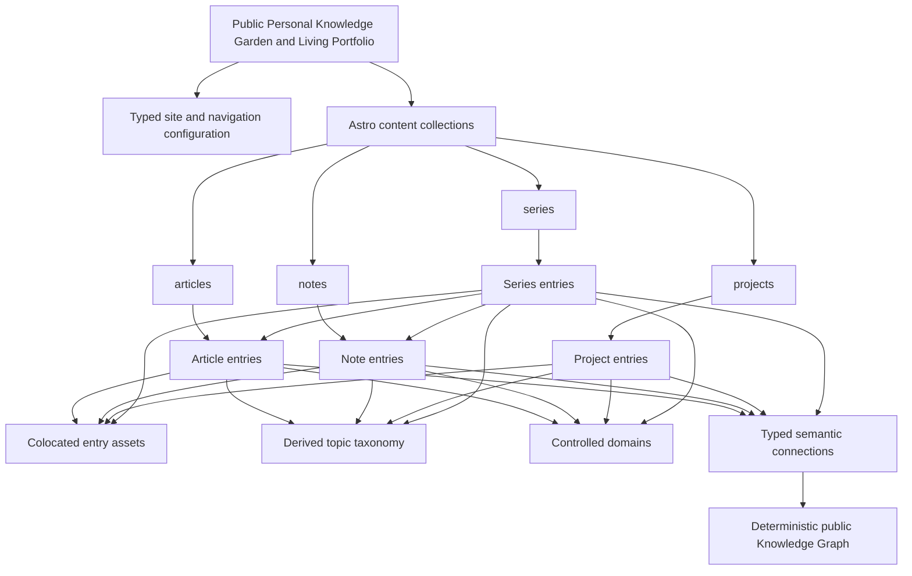
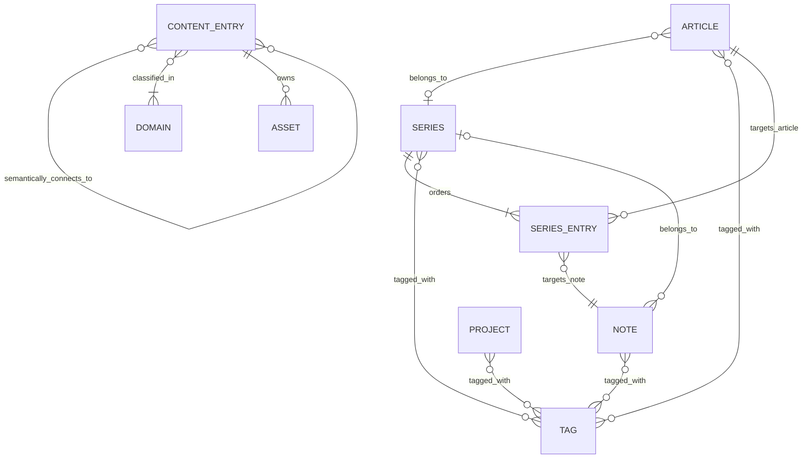
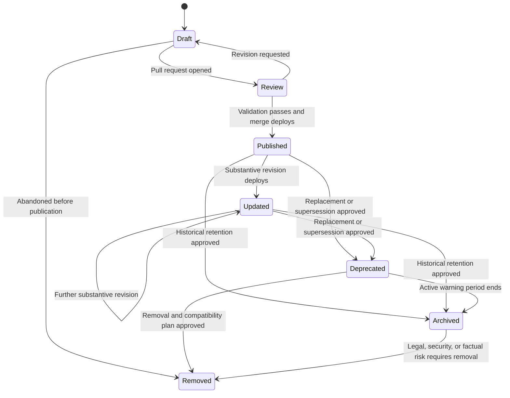

Atlas v0.6.0

# Public Personal Knowledge Garden and Living Portfolio Content Model

## Document Status

- **Status:** Authoritative content domain and information architecture model
- **Date:** 2026-07-21
- **Audience:** Content architects, authors, senior engineers, reviewers, and AI coding agents
- **Authoritative inputs:** `01_Architecture.md`, `02_FolderStructure.md`, `03_ImplementationGuide.md`, and `04_ComponentRegistry.md`
- **Authoring constraints:** `06_CodingStandards.md`
- **Implementation sequence:** `07_MilestonePlan.md`
- **Quality strategy:** `08_TestStrategy.md`
- **Deployment and operations:** `09_DeploymentGuide.md`
- **Decision record:** `docs/decisions/0001-public-personal-knowledge-garden-and-knowledge-graph.md`
- **Approved collections:** `articles`, `notes`, `projects`, and `series`

## Content Model Authority

This document is the single source of truth for content entities, metadata meaning, relationships, taxonomy, lifecycle, assets, search semantics, SEO contribution, and content validation. It defines the conceptual contracts that `src/content.config.ts`, `src/types/content.ts`, `src/lib/content/`, repository validation scripts, routes, metadata builders, and authoring workflows must implement.

This is not an Astro schema implementation, UI specification, or source-code guide. Field names and semantic rules are normative; implementation syntax belongs to the implementation guide and active milestone. If this document conflicts with the architecture or folder contract, implementation stops and the conflict is reported.

No collection beyond `articles`, `notes`, `projects`, and `series` is authorized. Domains, tags, connections, graph nodes/edges, navigation, site configuration, author identity, search metadata, categories, references, patterns, and assets are not additional collections in the approved baseline.

## 1. Purpose

### Goals

The content model must:

- Give every authored entry an explicit, strongly typed identity and metadata contract.
- Make publication, relationships, URLs, search, and SEO deterministic at build time.
- Prevent duplicate facts where one canonical source or a derived value is sufficient.
- Remain understandable to human authors without knowledge of rendering internals.
- Give AI coding and content agents enough precision to validate rather than guess.
- Preserve stable public URLs and relationships as content volume grows.
- Keep authored content portable and independent of presentation components.

### Scope

This document governs:

- The four approved MDX collections and their entry types.
- Shared and collection-specific frontmatter semantics.
- Stable identifiers, slugs, canonical URLs, and reserved paths.
- Tags, collection identity, series membership, related references, and navigation context.
- Controlled domains, typed semantic connections, graph node identity, and deterministic graph discovery.
- Content lifecycle, publication rules, assets, search indexing, and SEO metadata.
- Cross-entry validation, content governance, and schema evolution.

It does not govern component layout, visual design, browser interaction, source-code syntax, or project-management scheduling.

### Relationship to approved documents

| Document | Relationship to the content model |
| --- | --- |
| `01_Architecture.md` | Defines the four collections, shared content concepts, taxonomy model, static routes, search, lifecycle constraints, and SEO expectations. |
| `02_FolderStructure.md` | Defines collection folders, asset colocation, schema ownership, content-domain modules, routes, and validation script locations. |
| `03_ImplementationGuide.md` | Defines implementation responsibilities for schemas, loaders, queries, references, series resolution, metadata, search, and rendering. |
| `04_ComponentRegistry.md` | Defines the approved consumers of normalized content view models; it does not define content semantics. |
| `06_CodingStandards.md` | Defines authoring, naming, typing, accessibility, security, validation, testing, and documentation practices. |
| `07_MilestonePlan.md` | Defines when schemas, content-domain modules, routes, search, and final validation are implemented. |

### Why content modeling is separate from UI

Content is the durable repository asset. Its meaning must remain stable when a card, layout, typography system, or search presentation changes. UI components receive normalized view models; they do not decide what a field means, infer missing metadata, or create relationships. Separating the model from UI ensures that one content entry produces consistent routes, metadata, search records, feeds, and structured data across every consumer.

## 2. Content Architecture Overview

### Information architecture

### Domain layers

| Layer | Ownership | Responsibility |
| --- | --- | --- |
| Site configuration | `src/config/site.ts` | Site identity, author/profile identity, language, production origin/base, default metadata, and social links. Not authored collection content. |
| Navigation configuration | `src/config/navigation.ts` | Ordered global navigation. Not taxonomy and not a content collection. |
| Resume presentation | `public/resume/SuDuyHien_Resume_Updated.html` and colocated image | Standalone printable/shareable visual resume embedded by `/` inside `SiteLayout`. It is a public profile artifact, not authored collection content, a graph node, or a second knowledge source. |
| Collection schemas | `src/content.config.ts` | Shared and collection-specific field validation and typed loading. |
| Authored entries | `src/content/<collection>/` | MDX body, explicit metadata, and colocated entry assets. |
| Content domain | `src/lib/content/` | Production filtering, normalization, sorting, relationships, series context, and view-model construction. |
| Graph domain | `src/lib/content/graph.ts` | Domain/connection validation, prerequisite-cycle detection, resolved neighborhoods, and deterministic manifest construction. |
| Cross-entry validation | `scripts/validate-content.ts` | Global uniqueness, relationships, URL collisions, taxonomy normalization, date rules, and asset integrity. |
| Derived outputs | Routes, metadata, RSS, sitemap, Pagefind | Build-time products generated from validated normalized content. |

### Ownership principles

- Authors own factual prose and explicit frontmatter values.
- Collection schemas own field shape and isolated validation.
- Content-domain modules own relationships and derived properties.
- Site configuration owns author identity and site-wide defaults.
- The home route owns only the base-safe resume embed and application metadata; it does not duplicate resume facts into frontmatter or query collection content.
- Routes and components consume content; they do not redefine it.
- Search and SEO derive from validated content; they do not become alternative content stores.
- The Knowledge Graph derives from the same validated public entries; it does not become an alternative content store.

## 3. Content Collections

Exactly four collections exist.

### Collection overview

| Collection | Purpose | Folder | Source type | URL pattern | Schema owner | Primary consumers |
| --- | --- | --- | --- | --- | --- | --- |
| `articles` | Long-form evergreen engineering writing with a durable thesis, explanation, or tutorial structure. | `src/content/articles/` | MDX | `/articles/<slug>/` | Article schema in `src/content.config.ts` | Article routes/index, topics, series, related content, Pagefind, RSS, sitemap, SEO. |
| `notes` | Short focused observations, references, decisions, and evolving knowledge. | `src/content/notes/` | MDX | `/notes/<slug>/` | Note schema in `src/content.config.ts` | Note routes/index, topics, series, related content, Pagefind, RSS, sitemap, SEO. |
| `projects` | Portfolio case studies describing context, role, decisions, outcomes, and lessons. | `src/content/projects/` | MDX | `/projects/<slug>/` | Project schema in `src/content.config.ts` | Project routes/index, topics, related projects, Pagefind, sitemap, SEO. |
| `series` | Narrative landing pages and ordered learning paths containing articles and notes. | `src/content/series/` | MDX | `/series/<slug>/` | Series schema in `src/content.config.ts` | Series routes/index, topics, knowledge navigation, Pagefind, sitemap, SEO. |

### Shared collection rules

- Entry filenames and nested identifier segments use lowercase kebab-case.
- The stable collection-relative path is the entry identifier and slug source.
- Every published entry has one generated detail route and appears in its collection index.
- Published entries require title, description, publication date, and at least one canonical tag.
- Unknown fields, malformed required fields, duplicate resolved URLs, and normalization collisions fail validation.
- Draft entries are excluded from all production routes and derived outputs.
- Content-specific assets use a neighboring folder with the same slug.
- Collection entries may use only the approved MDX authoring API.

### Naming and slug examples

| Valid source | Stable identifier | Logical URL |
| --- | --- | --- |
| `articles/designing-static-search.mdx` | `designing-static-search` | `/articles/designing-static-search/` |
| `notes/astro/base-paths.mdx` | `astro/base-paths` | `/notes/astro/base-paths/` |
| `projects/engineering-lab.mdx` | `engineering-lab` | `/projects/engineering-lab/` |
| `series/static-knowledge-platforms.mdx` | `static-knowledge-platforms` | `/series/static-knowledge-platforms/` |

Nested path segments are permitted because detail routes use `[...slug].astro`; each segment must be canonical lowercase kebab-case. Moving a file changes its public URL and therefore requires an approved compatibility decision.

### Lifecycle summary

All collections share the repository workflow states Draft, Review, Published, Updated, Deprecated, Archived, and Removed. Only `draft` is a shared frontmatter lifecycle field. Review is a pull-request state; Published and Updated derive from repository/publication facts; deprecation/archive/removal are governance decisions described in Section 9 rather than unapproved generic status fields.

## 4. Content Type Definitions

### 4.1 Shared content entry

Every collection extends the shared entry contract.

| Field | Type | Required | Default | Description and validation |
| --- | --- | :---: | --- | --- |
| `title` | Nonempty string | Yes | None | Human-readable page title and sole source for the page H1. Trimmed; must be meaningful and unique enough within its collection to distinguish the entry. |
| `description` | Nonempty string | Yes | None | Canonical summary used by listings, search, metadata, feeds where applicable, and social previews. This replaces a separate `summary` field. |
| `publishedAt` | ISO date | Yes | None | Original publication date. Parsed to a typed date at load time; must not be future-dated for a published production entry unless an approved scheduled-publication workflow exists. |
| `updatedAt` | ISO date | No | Omitted | Latest substantive revision date. Must be on or after `publishedAt`; minor copy/format fixes do not require it. |
| `draft` | Boolean | No | `false` | When true, excludes the entry from every production route, index, topic, relationship result, search index, RSS, sitemap, and structured-data output. |
| `tags` | Nonempty list of canonical tag strings | Yes for published content | None | Lowercase kebab-case; unique after normalization; deterministic order; no synonyms or duplicates within one entry. |
| `domains` | Nonempty list of controlled domain slugs | Yes for published content | None | Values come from typed configuration: `engineering`, `artificial-intelligence`, `music`, `reading-literature`, or `philosophy-life`; unique after normalization. |
| `connections` | List of typed content connections | No | Omitted; normalized to an immutable empty list | Each item declares one approved relationship type, stable target collection/ID, and optional concise editorial context. Every edge must pass repository-level graph validation. |
| `image` | Local content image metadata | No | Omitted | Optional listing/social image with local source and meaningful alt text when informative. Source must exist and belong to the entry or approved shared assets. |
| `canonicalUrl` | Absolute HTTPS URL | No | Omitted | Original canonical source for republished content. Does not change the internal route URL. |

#### Shared derived properties

These values are never authored as duplicate frontmatter:

| Derived property | Source and rule |
| --- | --- |
| `id` | Stable collection-relative path supplied by the content loader. |
| `collection` | One of the four collection names from the owning collection. |
| `graphNodeId` | `<collection>:<entry-id>`; stable while the content ID remains stable. |
| `slug` | Canonicalized `id`; nested segments preserved. |
| `url` | Collection route prefix plus slug, built with the configured `/engineering-lab/` base. |
| `tagModels` | Canonical tag slug plus human-readable label produced centrally. |
| `domainModels` | Controlled domain slug plus human-readable label produced from typed configuration. |
| `resolvedConnections` | Deterministic incoming/outgoing/symmetric semantic relationships resolved from public entries. |
| `effectiveUpdatedAt` | `updatedAt` when present; otherwise no separate update value. It must not silently equal `publishedAt` in visible “updated” output. |
| `seoData` | Site configuration, route kind, shared fields, collection-specific facts, breadcrumbs, and canonical override. |
| `searchMetadata` | Collection, domains, tags, title, description, and publication date. |
| `breadcrumbs` | Route hierarchy and entry title. |

### 4.2 Article

An Article is a long-form knowledge entry rendered by `KnowledgeLayout`.

| Field | Type | Required | Default | Description and validation |
| --- | --- | :---: | --- | --- |
| Shared fields | Shared content entry | Yes | As above | All shared rules apply. |
| `featured` | Boolean | No | `false` | Eligible for explicitly featured article placements. It does not guarantee display order or placement. |
| `showTableOfContents` | Boolean | No | `true` | Controls whether an extracted table of contents is rendered when qualifying headings exist. |
| `series` | Stable series identifier | Conditional | Omitted | Reverse declaration of membership in one series. Must identify a published series whose ordered entries include this article. |
| `seriesOrder` | Positive integer | Conditional | Omitted | One-based position in the referenced series. Required with `series`; prohibited without it; must match canonical series entry order. |

#### Article relationships and derived properties

- An article may belong to at most one published series.
- `series` and `seriesOrder` are an intentional validated reverse declaration because the approved architecture includes article-side membership. The Series entry list remains the canonical sequence.
- Related content is derived centrally from typed connections, series context, and canonical shared taxonomy; no article-only relationship field is introduced.
- Article connections may target any of the four collections and use any approved relationship type.
- Reading time is computed from renderable body text and is never authored.
- Headings and table-of-contents entries are extracted from the MDX body.
- SEO type is article-like; dates and tags must match visible content.

### 4.3 Note

A Note is a concise, evolving unit of engineering knowledge rendered by `KnowledgeLayout`.

| Field | Type | Required | Default | Description and validation |
| --- | --- | :---: | --- | --- |
| Shared fields | Shared content entry | Yes | As above | All shared rules apply. |
| `maturity` | `'seed' \| 'growing' \| 'evergreen'` | Yes | None | Knowledge maturity, not publication status. `seed` is an early useful observation; `growing` has meaningful development but may evolve; `evergreen` is intentionally maintained and substantially complete. |

#### Note relationships and derived properties

- A note may appear in at most one published series through the canonical `series.entries` list.
- Notes do not duplicate series membership/order in frontmatter because the approved note contract does not define those fields.
- Notes use shared typed `connections`; a `related` connection replaces the former note-only untyped relationship list so relationship metadata has one canonical representation.
- Additional tag/domain-based recommendations may be derived separately without altering explicit connections.
- Reading time, headings, breadcrumbs, search metadata, and article-like SEO data are derived.
- Maturity is visible content metadata and must not be inferred from age, length, or update frequency.

### 4.4 Project

A Project is a professional case study rendered by `ProjectLayout`.

| Field | Type | Required | Default | Description and validation |
| --- | --- | :---: | --- | --- |
| Shared fields | Shared content entry | Yes | As above | All shared rules apply. |
| `status` | `'active' \| 'maintained' \| 'completed' \| 'archived'` | Yes | None | Project lifecycle: active development, ongoing maintenance, completed engagement, or retained historical project. Draft controls publication separately. |
| `role` | Nonempty string | Yes | None | The author's role and responsibility, written as a concise factual label. |
| `skills` | Nonempty list of strings | Yes | None | Capabilities demonstrated by the professional or creative project, trimmed and unique case-insensitively. Examples may include test design, prompt engineering, fingerstyle guitar, arrangement, or vocal technique. |
| `tools` | List of strings | No | Omitted; normalized to an immutable empty list | Technologies, instruments, platforms, libraries, or materials used by the project. Values are trimmed and unique case-insensitively; this is project metadata, not the global tag taxonomy. |
| `period` | Project period object | Yes | None | Contains required `start` in `YYYY-MM` and optional `end` in `YYYY-MM`. Omitted `end` means current; end cannot precede start. |
| `repositoryUrl` | Absolute HTTPS URL | No | Omitted | Public source repository when one exists and may be disclosed. Empty/private URLs are prohibited. |
| `liveUrl` | Absolute HTTPS URL | No | Omitted | Public live project destination when one exists. |
| `featured` | Boolean | No | `false` | Eligible for selected project placements; does not encode order. |

#### Project relationships and derived properties

- Related projects are derived deterministically from typed connections and shared canonical taxonomy, excluding the current project and drafts.
- Projects do not have explicit article/reference relationship fields in the approved baseline.
- Role, period, skills, tools, status, and URLs form `ProjectFacts` for visible output and structured data.
- Project status does not replace `draft`: an archived project may remain published; a draft project is never public regardless of status.
- Project SEO uses project/creative-work semantics matching visible facts.

### 4.5 Series

A Series is a narrative landing page and canonical ordered learning path rendered by `SeriesLayout`.

| Field | Type | Required | Default | Description and validation |
| --- | --- | :---: | --- | --- |
| Shared fields | Shared content entry | Yes | As above | All shared rules apply. |
| `entries` | Nonempty ordered list of series entry references | Yes | None | Each item identifies `collection: 'articles' | 'notes'` and a stable entry `id`. Array order is canonical sequence order. |

#### Series relationships and derived properties

- A series contains articles and notes only; projects and series cannot be series entries.
- Each target must exist, be non-self, unique within the sequence, and production-visible when the series is published.
- An article or note may belong to at most one published series.
- One-based `position` is derived from array order; it is not duplicated in each Series reference.
- Article-side `seriesOrder` must match derived position. Duplicate article-side positions fail validation.
- Resolved entries provide title, description, collection type, URL, and position.
- Previous/current/next context is derived for each member.
- Entry count, progress context, breadcrumbs, search metadata, and list/collection structured data are derived.
- Series may also declare semantic connections; these do not replace or reorder canonical `entries`.

### 4.6 Supporting value objects

These are part of the domain model but are not collections.

| Value object | Fields | Rules |
| --- | --- | --- |
| `ContentReference` | `collection`, `id` | Collection is one of the four approved names; ID is stable and resolvable. Used by typed connection and series boundaries. |
| `KnowledgeDomain` | Controlled domain slug | One of the five approved initial values; values/display labels are owned by typed domain configuration. |
| `ConnectionType` | Relationship literal | One of `prerequisite`, `explains`, `extends`, `contrasts`, `applies-to`, `derived-from`, or `related`. |
| `ContentConnection` | `type`, `target.collection`, `target.id`, optional `context` | Target is stable, resolvable, production-visible, non-self, and unique by source/type/target. Context is concise plain text. |
| `GraphNode` | `id`, collection/entry ID, title, description, URL, domains, tags | Public normalized node only; ID is `<collection>:<entry-id>`; no body, raw frontmatter, draft, or integration metadata. |
| `GraphEdge` | source node ID, target node ID, type, optional context | Deterministic directed edge; `related` resolves symmetric traversal from one authored edge. |
| `GraphManifest` | schema version, sorted nodes, sorted edges | Deterministic static public output; no generated timestamp or environment-specific order. |
| `SeriesEntryReference` | `collection`, `id` | Collection is only `articles` or `notes`; array order is canonical. |
| `ContentImage` | `src`, `alt` | Local source exists; alt describes informative content or is empty only for a genuinely decorative image. Social/listing use must remain meaningful. |
| `ProjectPeriod` | `start`, optional `end` | `YYYY-MM`; end is not earlier than start; omitted end means current. |
| `Tag` | `slug`, `label` | Slug is canonical lowercase kebab-case; label is centrally derived for display. |

## 5. Metadata Standards

### Metadata ownership matrix

| Concept | Authored source | Required? | Consistency rule |
| --- | --- | :---: | --- |
| Title | `title` | Yes | One canonical title feeds H1, listings, search, SEO, feeds, and structured data. No separate SEO title field. |
| Description/summary | `description` | Yes | One canonical concise summary. A second `summary` field is prohibited. |
| Slug | Derived from collection-relative path | Yes, derived | Never authored independently. Published path is stable. |
| Author | `src/config/site.ts` | Site-wide | No per-entry `author` field or author collection in the baseline. |
| Created date | Not modeled | No | Git creation time is not portable content metadata and must not be inferred into public output. |
| Published date | `publishedAt` | Yes | Original public publication date; not replaced by commit time. |
| Updated date | `updatedAt` | No | Substantive revision only; must not precede publication. |
| Generic status | Not modeled | No | Draft, note maturity, and project status have distinct meanings and must not be collapsed. |
| Category | Not modeled | No | Collection identity and tags provide classification. No category field or collection. |
| Tags | `tags` | Yes for published | Controlled flat taxonomy; canonicalized and deduplicated. |
| Domains | `domains` | Yes for published | One or more controlled broad domains; canonicalized from typed configuration and used for graph/search filtering. |
| Semantic connections | `connections` | No | Explicit typed relationships only; graph node/edge IDs and reverse traversal are derived centrally. |
| Reading time | Derived from body | Article/note only | Never authored or manually overridden in baseline. |
| Featured | `featured` | Article/project only | Default false; eligibility only, not rank/order. |
| Draft | `draft` | No | Default false; true excludes all production output. |
| Canonical URL | `canonicalUrl` | No | Valid HTTPS original source; internal URL remains unchanged. |
| Open Graph | Derived | Every indexable page | Uses title, description, canonical, image, collection type, and site config. No OG-specific frontmatter fields. |
| Twitter Card | Derived | Every indexable page | Uses normalized SEO data and image availability. No Twitter-specific frontmatter fields. |
| SEO metadata | Derived | Every indexable page | Built centrally; routes/components may not invent fields. |
| Structured data | Derived | As appropriate | Must match visible content type and facts exactly. Never authored as raw JSON-LD. |

### Text standards

- Titles are concise, specific, and meaningful outside their page context.
- Descriptions explain the entry's substance rather than repeat the title or use promotional boilerplate.
- Role, maturity, status, skills, tools, domains, and relationship context are factual and stable.
- Metadata must not contain Markdown/MDX component syntax unless a field explicitly permits rich text; baseline frontmatter text fields do not.

### Date standards

- Dates use unambiguous schema-supported ISO values.
- Publication and update dates represent editorial events, not filesystem or Git timestamps.
- Project periods use month precision because they describe professional duration, not publication events.
- Sorting uses typed dates and stable identifier tie-breakers.

### Defaults and omission

- Explicit boolean defaults are `draft: false`, `featured: false`, and `showTableOfContents: true`.
- Optional empty lists/strings/objects are omitted in authored frontmatter.
- Loaders may normalize an omitted optional list to an immutable empty list for consumers.
- A default must not fabricate factual metadata.

## 6. Relationships

### Entity relationship model

`CONTENT_ENTRY` represents any of the four collection entry types. A Series entry targets exactly one Article or Note; the two target branches are mutually exclusive.

### Relationship matrix

| Source | Relationship | Target | Cardinality | Source of truth | Validation |
| --- | --- | --- | --- | --- | --- |
| Article | Series membership | Series | Zero or one | `series.entries` order, cross-checked with article `series`/`seriesOrder` | Target exists, includes article, order matches, no second series. |
| Note | Series membership | Series | Zero or one | `series.entries` | Target exists, note appears once, no second published series. |
| Series | Ordered members | Articles/Notes | One or more | `entries` array | Targets exist, are unique, published with series, and not series/project types. |
| Any entry | Typed semantic connection | Any approved content entry | Zero or more | Shared `connections` | Approved type, resolvable, unique, non-self, production-visible; prerequisite graph acyclic. |
| Any entry | Domain classification | Controlled domain | One or more | `domains` | Known typed value, deduplicated, public-filter safe. |
| Project | Related projects | Projects | Derived zero or more | Typed connections and shared taxonomy | Deterministic, excludes self/drafts, stable tie-break. |
| Article | Related content | Approved content | Derived zero or more | Typed connections, series context, and shared taxonomy | Deterministic, excludes self/drafts, does not duplicate series navigation. |
| Any entry | Topic membership | Tag/topic route | One or more | `tags` | Canonical tag exists after normalization; topic route generated. |
| Any entry | Owns asset | Colocated asset | Zero or more | Entry asset folder/body/frontmatter | Asset exists, path belongs to entry or approved shared assets, no orphaned required asset. |

### Relationship rules

- References always use stable collection name plus stable ID, never a title or rendered URL as identity.
- Build validation resolves relationships before route generation.
- A missing, draft-only, self, duplicate, ambiguous, or type-invalid reference fails publication.
- Explicit relationships are not silently replaced by tag similarity.
- Directed connection meaning is read from source to target. `related` is authored once and exposed for traversal from both nodes; an authored reverse duplicate fails validation.
- `prerequisite` edges must remain acyclic. Series order remains canonical and is not inferred from graph layout.
- Derived relationships use documented deterministic sorting and never mutate authored metadata.
- No relationship is inferred from filesystem proximity except entry ownership of its same-slug asset folder.

## 7. URL Strategy

### Canonical logical routes

| Content/taxonomy | Logical URL |
| --- | --- |
| Resume-first home | `/` |
| Standalone resume artifact | `/resume/SuDuyHien_Resume_Updated.html` |
| Article index/detail | `/articles/`, `/articles/<slug>/` |
| Note index/detail | `/notes/`, `/notes/<slug>/` |
| Project index/detail | `/projects/`, `/projects/<slug>/` |
| Series index/detail | `/series/`, `/series/<slug>/` |
| Topic index/detail | `/topics/`, `/topics/<tag>/` |
| Search | `/search/` |
| Knowledge Graph | `/graph/` |
| Graph manifest | `/graph/graph.json` |
| Profile | `/about/` |
| Feed | `/rss.xml` |
| Not found | `/404.html` |

Production URLs include `/engineering-lab/`. Source content and routes never duplicate that base segment.

`/` is the canonical in-application resume presentation and embeds the standalone artifact without converting it to MDX. `/about/` remains the living professional profile and platform context page. Neither surface is a collection, participates as an authored graph node, or changes the four-collection contract.

### Slug generation

- Derive slug from the collection-relative path without the `.mdx` extension.
- Preserve approved nested segments.
- Normalize every segment to lowercase kebab-case.
- Reject empty segments, traversal, unsafe characters, duplicate slashes, reserved collisions, and duplicate resolved URLs.
- Do not provide arbitrary per-entry slug overrides in baseline frontmatter.

### Canonical rules

- Internal canonical URLs combine production origin, `/engineering-lab/`, collection prefix, and stable slug.
- `canonicalUrl` overrides the canonical source only when republishing from a valid external HTTPS source.
- Search and graph query/filter/selected-node states, pagination variants where applicable, and fragments do not create independent canonical content identities unless an approved SEO policy says otherwise.
- Canonical URLs and visible internal URLs are separate concepts; an external canonical does not alter navigation.

### Reserved paths

The route prefixes and files listed above are reserved, as are `/`, `/sitemap-index.xml` or integration-generated sitemap paths, Pagefind output paths, graph manifest/controller paths, and static asset/build paths. Content slugs must not resolve to a URL owned by another route or generated subsystem.

### URL stability and redirects

- A published content URL is a public contract.
- GitHub Pages does not provide application-level redirects.
- A rename/move/removal requires an explicit decision among retaining the original entry, publishing a static retirement/replacement page, or configuring an approved external redirect mechanism.
- Never delete or move public content merely to reorganize folders.
- Redirect/retirement behavior must preserve canonical and sitemap correctness and be tested under the project base.

## 8. Taxonomy

### Approved taxonomy dimensions

| Dimension | Model | Purpose |
| --- | --- | --- |
| Collection | Four fixed collection names | Primary content kind, URL prefix, index, layout family, and search filter. |
| Tags | Flat controlled string taxonomy | Cross-collection topics, topic routes, related-content input, and search facets. |
| Domains | Controlled broad taxonomy | Cross-domain grouping, graph/search filters, and high-level personal-knowledge navigation. |
| Connections | Typed semantic edge taxonomy | Explicit prerequisite, explanation, extension, contrast, application, provenance, and related meaning. |
| Series | Authored collection of ordered article/note references | Curated sequence and previous/next learning navigation. |
| Note maturity | Constrained note field | Editorial maturity of evolving knowledge; not navigation hierarchy. |
| Project status | Constrained project field | Project lifecycle fact; not a global category. |
| Skills/tools | Project-specific lists | Demonstrated capabilities and technologies/instruments/materials; not automatically global tags or domains. |

### Categories

Categories are not modeled. Collection identity provides primary content classification and tags provide topical classification. Do not add `category`, category pages, or a category collection. A future category model requires evidence that tags and collections cannot satisfy navigation, then an architecture/schema/URL migration decision.

### Tags

- Tags are lowercase kebab-case canonical terms.
- Display labels are generated centrally; authors do not maintain separate labels.
- Reuse an existing tag before introducing a new term.
- Prefer durable, specific concepts across the approved domains over project phases, temporary campaigns, or generic words.
- Avoid synonyms, plural/singular variants, acronyms and expanded duplicates, spelling variants, and near-identical scope terms.
- Adding a tag requires checking existing taxonomy, intended topic-page value, cross-entry applicability, and normalization collision.
- Renaming/merging a published tag changes a public topic URL and requires a migration/compatibility decision.

### Domains

- Initial domains are `engineering`, `artificial-intelligence`, `music`, `reading-literature`, and `philosophy-life`.
- Every published entry declares at least one domain; multiple domains are allowed only when each is materially represented.
- Domains are owned by `src/config/domains.ts`, not authored as free-form labels.
- Domains are broad and intentionally few. Specific concepts remain tags or content nodes.
- Domains are graph filters, not graph nodes and not URL-bearing content collections in the baseline.
- Adding, renaming, merging, or removing a domain requires content-model review, migration of all entries, graph/search/filter validation, and documentation approval.

### Semantic connections

- Use `prerequisite` when the target knowledge should be understood before the source.
- Use `explains` when the source clarifies the target.
- Use `extends` when the source develops the target further.
- Use `contrasts` when the source intentionally compares differences with the target.
- Use `applies-to` when the source demonstrates use in the target context/project.
- Use `derived-from` when the source is based on the target's ideas or evidence.
- Use `related` only when a meaningful connection exists but no more precise approved type applies.
- Connection context is optional concise editorial explanation, not duplicated body content.
- Do not create edges merely to avoid an isolated node. A valid isolated entry is preferable to a misleading graph.

### Series

- Series is both a collection and an ordered navigation construct.
- It is not a tag substitute: use a series only when order and narrative progression matter.
- A series must contain at least one article/note and should provide introductory MDX explaining the path's purpose.
- Series nesting and series-as-entry are prohibited.

### Navigation hierarchy

- Global navigation is typed application configuration, not content metadata.
- Collection indexes are the first browse layer.
- Topic pages provide cross-collection browse paths.
- Series provides curated sequential navigation.
- Related content provides contextual lateral navigation.
- Content frontmatter does not set global navigation position.

### Cross-linking

- Use descriptive link text and stable base-safe URLs/resolved references.
- Link to the canonical internal route rather than duplicate pages or asset paths.
- Prefer explicit prose links when the relationship matters to the narrative.
- Do not depend on tag-derived related content to replace necessary contextual links.

## 9. Content Lifecycle

### Lifecycle states

### State definitions

| State | Representation | Entry behavior | Transition requirements |
| --- | --- | --- | --- |
| Draft | `draft: true` | Local visibility only when explicitly enabled; absent from routes, search, graph, feeds, sitemap, and every production output. | Required fields may still be incomplete locally, but schema-valid fixtures/workflows must not leak it. |
| Review | Pull request/workflow state | Not a frontmatter value. Production remains unchanged until merge. | Content, schema, relationships, links, assets, accessibility, SEO, and build checks pass. |
| Published | `draft: false` on protected default branch and deployed | Public route, index, topics, search, graph node/connections, sitemap, metadata, and RSS where applicable. | Required metadata/domains complete; no broken references/connections/assets; review approved. |
| Updated | Published entry with substantive `updatedAt` | Same stable URL; visible update metadata and structured data remain consistent. | Substantive content change; `updatedAt >= publishedAt`; full regression checks. |
| Deprecated | Governance decision with visible authored supersession context | URL remains accessible and points readers to the approved replacement. | Replacement/reason/owner approved; no generic status field is invented. A future typed deprecation field requires schema evolution. |
| Archived | Retained historical content | URL remains addressable unless risk requires removal. Project may use `status: archived`; other content remains in its collection without an unapproved archive field/folder. | Historical value confirmed; stale claims contextualized; search/SEO handling reviewed. |
| Removed | Entry deleted only after explicit compatibility decision | URL requires retirement/replacement/redirect handling where applicable. | Legal/security/factual necessity or approved retirement; references, sitemap, search, and links migrated. |

### Lifecycle invariants

- Review, Published, Updated, Deprecated, Archived, and Removed are workflow/governance states, not one shared `status` field.
- Note maturity and project status do not determine publication state.
- Content remains at its stable route through updates and normal archival.
- No automated inference from Git age, word count, or traffic changes lifecycle state.

## 10. Asset Model

### Asset classes

| Asset | Storage | Naming | Validation and optimization |
| --- | --- | --- | --- |
| Content image/photo | Neighboring entry asset folder | Lowercase kebab-case plus meaningful subject name | Resolve at build; dimensions known; responsive formats/sizes; meaningful alt; no broken source. |
| Diagram | Neighboring entry asset folder | Lowercase kebab-case describing concept, not sequence alone | Prefer accessible bitmap/source format supported by pipeline; explain essential relationships in caption/prose. |
| Shared brand/default image | `src/assets/shared/` | Stable semantic name | Astro processing, fingerprinting, dimensions, and documented consumers. |
| PDF/document attachment | Neighboring entry asset folder when content-owned; `public/` only when byte-for-byte stable passthrough is required | Lowercase kebab-case with purpose/version only when version is meaningful | File exists, public-safe, reasonably sized, linked descriptively, and not a substitute for accessible HTML content. |
| Downloadable code sample | Neighboring entry asset folder | Lowercase kebab-case and conventional language extension | Validate link and safety; primary readable example remains in MDX when practical. |
| Inline code sample | MDX fenced block | Not a separate asset | Language identifier required; readable overflow and contrast. |
| Icon | Shared application asset/component concern, not entry metadata | Semantic name | Decorative icons hidden from assistive technology; meaningful icons have accessible text. No icon collection. |
| Video reference | External HTTPS URL in prose; local poster image may be colocated | Descriptive link/poster name | No hosted video subsystem; provide descriptive context, captions/transcript link when available, and no autoplay dependency. |

### Storage rules

- Entry-specific assets belong to one entry and remain beside it.
- Shared assets must have more than one approved consumer.
- `public/` is reserved for passthrough requirements, not an optimization bypass.
- External assets must use stable HTTPS sources and must not be hotlinked when ownership, privacy, or availability is uncertain.
- Private, licensed-without-permission, secret, or personally sensitive assets are prohibited.

### Accessibility

- Informative images require contextual alt text.
- Decorative images use empty alt and are not referenced as essential content.
- Figure captions add context rather than repeat alt text.
- Complex diagrams require an adjacent prose explanation sufficient to understand the key information.
- PDFs and external media do not replace the accessible HTML summary needed to understand the entry.

## 11. Search Model

Pagefind indexes generated public HTML after Astro rendering. The content model supplies searchable text and metadata; it does not create a parallel search database.

### Indexing model

| Content signal | Index behavior | Priority tier | Filter/facet use |
| --- | --- | --- | --- |
| `title` | Indexed | Highest | Display only |
| `description` | Indexed | High | Display snippet fallback |
| Visible headings | Indexed | High | No baseline facet |
| Visible MDX body | Indexed | Normal | No baseline facet |
| `tags` | Indexed metadata and text | High topical signal | Tag filter/facet |
| `domains` | Indexed metadata and visible labels | High broad-domain signal | Domain filter/facet |
| Collection name | Indexed metadata | Classification signal | Collection filter/facet |
| `publishedAt` | Indexed metadata | No relevance boost by default | Date display and optional deterministic sort |
| Note `maturity` | Optional indexed metadata | No default relevance boost | Future approved filter; not a baseline facet requirement |
| Project `status`/`skills`/`tools` | Visible/indexable where rendered | Normal | Future approved filters; not separate data stores |
| Visible connection labels/context | Indexed when rendered on entry/graph pages | Normal contextual signal | Relationship filter belongs to graph discovery, not Pagefind baseline |
| Series entry titles | Visible and indexable on series page | Normal | Series context only |

Priority tiers describe semantic importance; implementation must use Pagefind-supported mechanisms and must not introduce numeric weighting metadata or another search library without approval.

### Included content

- Published articles, notes, projects, and series.
- Reader-visible title, description, headings, body, facts, domains, tags, connection labels/context, and sequence labels.
- Canonical result URL preserving `/engineering-lab/`.

### Excluded content

- Drafts, diagnostics, test fixtures, and generated error detail.
- Repeated global header/footer/navigation text.
- Decorative labels, hidden duplicate text, raw JSON-LD, and source frontmatter not visible/approved as metadata.
- `404.html`, noindex pages, and search result pages as searchable documents.
- Private or unpublished assets/content.

### Keywords and synonyms

- Canonical tags are the baseline keyword model.
- Titles, descriptions, headings, skills, tools, connection context, and body terminology provide natural query vocabulary.
- No separate `keywords` frontmatter field exists.
- No synonym collection or hidden synonym field exists in baseline. Authors use clear terminology and mention common alternate terms naturally when editorially accurate.
- A future synonym map requires evidence from search analytics/research, a typed configuration owner, validation, and approval; it must not become duplicated metadata on entries.

### Filtering, sorting, and faceting

- Baseline filters/facets are collection, controlled domains, and canonical tags when enabled by the approved search experience.
- Default ordering is Pagefind relevance.
- Optional date ordering uses typed `publishedAt` metadata with stable URL/ID tie-breakers.
- Search state may be shareable through query parameters but does not create canonical content variants.
- Search failure preserves collection indexes, topics, series, and direct links.

### Knowledge Graph discovery model

The graph is a separate public discovery projection over the same validated entries. It is not a search database or fifth collection.

| Graph element | Public fields | Rules |
| --- | --- | --- |
| Node | Node ID, collection/entry ID, title, description, URL, domains, tags | Production-visible only; no body/raw frontmatter/draft/private/integration metadata. |
| Edge | Source node ID, target node ID, approved type, optional context | Deterministic, valid targets, no duplicate/self edge; `related` exposes symmetric traversal; prerequisites acyclic. |
| Manifest | Schema version, sorted nodes, sorted edges | Same build as graph HTML/controller; no generated timestamp; stable serialization. |
| Query state | Optional selected node plus domain/collection/relationship filters | Shareable but not a separate canonical/indexable page. |

The default visual view is a bounded neighborhood around the selected node. Semantic lists and node details are the authoritative accessible fallback. Tags/domains are filters and are not rendered as graph nodes in the baseline.

## 12. SEO Model

### Content-to-SEO mapping

| Content type | Primary schema semantics | Metadata sources |
| --- | --- | --- |
| Article | Article-like knowledge | Title, description, dates, domains, tags, image, canonical, author/site config, breadcrumbs. |
| Note | Article-like knowledge appropriate to a note | Title, description, dates, domains, tags, maturity where visible, image, canonical, author/site config, breadcrumbs. |
| Project | Project/CreativeWork | Title, description, role, status, period, skills, tools, domains, image, URLs, canonical, author/site config, breadcrumbs. |
| Series | CollectionPage/ItemList where accurate | Title, description, dates, domains, tags, image, canonical, ordered resolved entries, breadcrumbs. |
| Graph page | CollectionPage/WebPage | Explicit graph-page title/description, canonical `/graph/`, public connection discovery, and site config. Manifest/query variants are not indexable pages. |

### SEO rules

- `title` and `description` are the one canonical authored source for visible and head metadata.
- Canonicals are absolute and base-safe; external `canonicalUrl` is used only for valid republication.
- Open Graph and Twitter Card values derive from normalized content and site configuration.
- Structured data must match visible facts and must not contain fields unavailable to readers.
- Breadcrumbs derive from route hierarchy, collection label, and entry title.
- Related-content and series links support internal discovery but never replace explicit necessary prose links.
- Semantic connection lists provide crawlable internal links; the visual graph is not required for SEO discovery.
- RSS includes published articles and notes only, with absolute stable URLs and valid dates.
- Sitemap includes public canonical routes and excludes drafts, noindex pages, query variants, and search-result states.
- Robots metadata defaults to index/follow for public content; 404, diagnostics, local drafts, and intentional duplicates are noindex.

### SEO consistency invariants

- Visible title, description, dates, domains, tags, project facts, semantic connections, series order, and structured data agree.
- One route emits one canonical and one primary metadata set.
- A social image must exist, be publicly reachable, have suitable dimensions/format, and correspond to the content.
- A content update does not create a new URL or change `publishedAt`.

## 13. Validation Rules

### Entry-level validation

| Rule | Applies to | Failure condition |
| --- | --- | --- |
| Required metadata | Published entries | Missing/blank title or description, missing publication date, missing/noncanonical domains or tags. |
| Unknown fields | All entries | Frontmatter contains a field outside the collection contract. |
| Date consistency | All entries/projects | Invalid ISO value, update before publication, period end before start, invalid month precision. |
| URL validity | Canonical/project URLs | Non-HTTPS, malformed, placeholder, private, or empty value. |
| Asset validity | Image/attachments | Missing source, invalid ownership/path, missing required alt, unsupported unsafe file. |
| Enum validity | Note/project | Unknown maturity or project status value. |
| Conditional pairs | Articles | Only one of `series` and `seriesOrder` exists, or order is not a positive integer. |
| Connection shape | All entries | Unknown type/domain, malformed target, empty/oversized context, duplicate source/type/target, or authored reverse duplicate `related`. |

### Repository-level validation

| Rule | Required behavior |
| --- | --- |
| Unique identifier | No duplicate collection-relative ID within a collection. |
| Unique resolved URL | No two entries/routes/tags resolve to the same public URL. |
| Canonical tag | Tags normalize without collision or duplicate within an entry. |
| Controlled domain | Every published entry has one or more known deduplicated domains. |
| Relationship integrity | Every explicit reference resolves to the allowed target type and stable ID. |
| No self-reference | No connection may target its source; series cannot contain itself; member cannot be its own related target through explicit data. |
| Graph identity | Every production-visible entry has one unique `<collection>:<entry-id>` node ID. |
| Edge integrity | Directed edges preserve type/direction; `related` is authored once; duplicate or draft-only edges fail. |
| Prerequisite DAG | `prerequisite` edges contain no directed cycle; diagnostics report the cycle path. |
| Manifest determinism | Sorted node/edge output is stable for identical source; no timestamp/environment ordering. |
| Series integrity | Nonempty, ordered, unique, published targets; one published series per member; article reverse membership/order agrees. |
| Draft isolation | Published content cannot expose a draft through series, connection, route, topic, search, graph, RSS, or sitemap. |
| No orphaned public content | Every published entry has a generated detail route, appears in its collection index, and appears on each derived topic route for its tags. |
| Broken links | Generated internal and asset links resolve; source page and destination are reported on failure. |
| Search readiness | Public entry has title, description, collection, domains, tags, URL, and indexable visible body/facts as appropriate. |
| Graph readiness | Every public node serializes safely; every edge resolves; graph static fallback and manifest derive from the same model. |
| SEO readiness | Unique title/description/canonical, valid metadata inputs, and content-appropriate structured data can be generated. |

### Diagnostic standard

Validation errors identify collection, stable ID/source file, field or relationship, expected rule, and offending target/value category. Validators do not silently coerce, drop, infer, or repair ambiguous content.

## 14. AI Authoring Rules

AI content and coding agents must follow these rules exactly:

1. Read `01_Architecture.md`, `02_FolderStructure.md`, `03_ImplementationGuide.md`, `04_ComponentRegistry.md`, this model, `06_CodingStandards.md`, and the active `07_MilestonePlan.md` scope.
2. Use only `articles`, `notes`, `projects`, and `series`; never invent another collection.
3. Select the collection from the content's actual purpose, not from desired layout or URL.
4. Never invent facts, project outcomes, roles, dates, URLs, author identity, skills, tools, status, maturity, domains, connections, tags, or canonical sources.
5. If required factual metadata is unavailable, stop and report the missing fields instead of using placeholders.
6. Never create duplicate slugs or manually override the path-derived slug.
7. Search existing domains/taxonomy before adding a tag; do not create synonyms or spelling variants.
8. Use `description` as the single summary; never add `summary`, SEO-title, keyword, category, or author frontmatter.
9. Use exact field meaning and allowed values; never collapse draft, maturity, and project status into one concept.
10. Validate dates, URLs, assets, conditional fields, and enum values before proposing publication.
11. Validate every connection target, type, direction, context, visibility, uniqueness, symmetric-related rule, and non-self rule.
12. Validate the full prerequisite graph for cycles; never break a cycle by deleting or reversing an edge without editorial approval.
13. Never create orphaned content: confirm collection index, detail route, domains, tags/topics, graph node, and required series/connection resolution.
14. Never expose draft content through a published series, connection, search, graph, feed, sitemap, or link recommendation.
15. Do not infer graph node IDs, reverse traversal, reading time, SEO fields, breadcrumbs, route URLs, series position, or search metadata manually; these are derived.
16. Preserve published URLs and IDs; stop before renaming, moving, deleting, or merging published content.
17. Use only approved MDX components and keep body headings below the frontmatter-owned H1.
18. Provide accessible alt text/captions and descriptive links; do not fabricate inaccessible attachments as substitutes for prose.
19. Do not include secrets, private URLs, confidential details, personal data, unlicensed assets, Obsidian vault metadata, or private NotebookLM source material.
20. Run schema, content, graph, link, build, search, SEO, and accessibility validation required by the active milestone.
21. Report ambiguity or source-document conflict precisely instead of making an information-architecture assumption.

## 15. Future Extensibility

### Approval criteria for a new content type

A new collection or content type may be proposed only when:

- A durable content responsibility cannot be represented by the four current collections, typed configuration, tags, or value objects.
- The type has distinct metadata, lifecycle, route, layout/consumer, search, and SEO needs.
- There is evidence of multiple real entries or a committed near-term content set, not one hypothetical example.
- Ownership, folder, schema, URLs, relationships, migration, validation, search, SEO, accessibility, and milestone impact are documented.
- Architecture, folder structure, implementation guide, component registry when affected, this content model, coding standards, and milestone plan are approved and synchronized before implementation.

### Schema evolution

| Change type | Policy |
| --- | --- |
| Add optional derived-independent field | Requires documented meaning, owner, validation, consumers, default/omission behavior, and migration review. |
| Add required field | Requires migration of every existing entry in the same buildable change or an approved temporary backward-compatible parser with removal milestone. |
| Rename field | Treat as breaking; support explicit migration and remove old field only after all content/consumers pass. Do not accept both indefinitely. |
| Change allowed values | Map every existing value deterministically; reject ambiguous conversion; update visible labels/search/SEO/tests. |
| Change field meaning | Prohibited as silent evolution. Introduce a new field or approved versioned migration. |
| Remove field | Prove zero authored/derived/consumer use, update docs/tests, and preserve published behavior. |
| Change identifier/slug | Public URL migration requiring compatibility/retirement/redirect strategy. |

### Backward compatibility and migrations

- Published IDs, URLs, dates, canonical sources, and relationship targets are stable contracts.
- Migrations are deterministic, reviewable, reversible where practical, and validated against the full content corpus.
- Do not leave mixed old/new representations after the migration milestone exits.
- Record material content-model decisions in an approved ADR under `docs/decisions/`.

### Future Obsidian publishing adapter

- Obsidian is not part of the current implementation or canonical schema.
- A future adapter is one-way: selected private-vault content is transformed into canonical public MDX before normal validation.
- Reviewed wikilinks may map to typed connections; reviewed vault tags may map to controlled domains/tags.
- No `obsidianId`, plugin metadata, vault path, private backlink, or whole-vault synchronization enters the public schema or graph manifest.
- Adapter output is a proposal subject to the same editorial, privacy, schema, graph, link, build, and review gates as human-authored content.

### Future NotebookLM export

- NotebookLM is not a source of truth, runtime dependency, or automated publisher.
- A future export may provide selected public URLs, RSS, Markdown, or a generated knowledge package after validation.
- Private source selection, permissions, retention, and disclosure require explicit review.
- NotebookLM-generated synthesis must return through normal human editorial review before it becomes public content or connections.

### Deprecation policy

- Deprecate a field/type only with a named replacement or removal rationale, migration owner, affected entries/consumers, and removal condition.
- Validators may warn only during an explicitly approved migration window; project-controlled warnings cannot remain at milestone completion.
- Removed field names cannot be reused for different semantics without an architecture decision.

### Expected future decision points

Potential future changes already acknowledged by the architecture include a formal topic collection, multilingual content, remote authoring, custom-domain migration, analytics, or richer search filters. None is authorized by this model. Each must preserve stable content identifiers, static readability, typed validation, and deterministic build output or provide an explicitly approved replacement strategy.

## 16. Content Governance Checklist

### Identity and schema

- [ ] Entry uses one of the four approved collections.
- [ ] Filename/path is canonical lowercase kebab-case and does not collide.
- [ ] Frontmatter contains only fields approved for the collection.
- [ ] Required fields are complete, factual, typed, and nonblank.
- [ ] Published entry has at least one controlled domain and only approved domain values.
- [ ] Optional absent values are omitted rather than represented by placeholders.
- [ ] Draft, maturity, project status, and lifecycle concepts are not conflated.

### Metadata and taxonomy

- [ ] Title is specific and supplies the one page H1.
- [ ] Description is the single canonical summary and is meaningful outside the page.
- [ ] Publication/update dates are accurate, unambiguous, and consistent.
- [ ] Tags reuse canonical existing terms, are deduplicated, and create useful topic membership.
- [ ] Domains accurately represent broad subject scope and do not replace specific tags.
- [ ] Semantic connections use the most precise approved type and optional context adds real meaning.
- [ ] No unapproved category, author, keyword, SEO-title, summary, or status field exists.
- [ ] Featured/table-of-contents/collection-specific fields follow exact defaults and conditional rules.

### Relationships

- [ ] Every explicit reference uses an allowed collection and stable ID.
- [ ] Targets exist, are non-self, unique, and production-visible when required.
- [ ] Directed edge meaning is correct; `related` is authored once; no duplicate/reverse duplicate exists.
- [ ] Prerequisite graph is acyclic and cycle validation passes.
- [ ] Series is nonempty, ordered, and contains articles/notes only.
- [ ] Each series member belongs to no other published series.
- [ ] Article reverse series membership/order matches canonical series order.
- [ ] Derived related content and graph neighborhoods exclude self, drafts, duplicates, and unstable ordering.

### Assets and accessibility

- [ ] Content-specific assets are colocated and named canonically.
- [ ] Every referenced asset exists and is safe for public deployment.
- [ ] Images have dimensions/optimization and correct informative/decorative alt behavior.
- [ ] Figures, diagrams, PDFs, code, and media have accessible context or alternatives.
- [ ] MDX heading hierarchy, link text, tables, and code blocks meet authoring standards.

### URLs, SEO, and search

- [ ] Generated route is unique, stable, reserved-path-safe, and base-path-correct.
- [ ] External canonical is valid, factual, and does not replace internal navigation.
- [ ] Metadata and structured data match visible content.
- [ ] Open Graph/Twitter image and text inputs are complete where applicable.
- [ ] Breadcrumbs, internal links, related content, RSS, sitemap, and robots behavior are correct.
- [ ] Search includes the intended public fields/metadata and excludes drafts/chrome/private content.
- [ ] Graph manifest contains only normalized public node/edge fields and matches static graph fallback.
- [ ] `/graph/` canonical/query behavior and direct content links are correct.
- [ ] Collection/tag facets and result URLs are canonical and deterministic.

### Publication readiness

- [ ] Entry appears in its collection index and all derived topic routes.
- [ ] No orphaned content, broken relationship, missing asset, or broken internal link remains.
- [ ] Schema, cross-content, graph, type, build, search, feed/sitemap, SEO, accessibility, and artifact checks pass.
- [ ] Review confirms factual accuracy, privacy, licensing, and professional disclosure safety.
- [ ] Published URL compatibility has been considered for rename, move, archive, deprecation, or removal.
- [ ] Documentation and any affected schema/model decisions are synchronized.