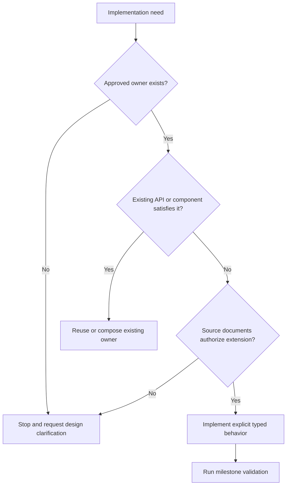

Atlas v0.6.0

# Public Personal Knowledge Garden and Living Portfolio Coding Standards

## Document Status

- **Status:** Authoritative repository coding standard
- **Date:** 2026-07-21
- **Audience:** Human engineers, reviewers, maintainers, and AI coding agents
- **Authoritative inputs:** `01_Architecture.md`, `02_FolderStructure.md`, `03_ImplementationGuide.md`, `04_ComponentRegistry.md`, `05_ContentModel.md`, and `07_MilestonePlan.md`
- **Quality strategy:** `08_TestStrategy.md`
- **Deployment and operations:** `09_DeploymentGuide.md`
- **Decision record:** `docs/decisions/0001-public-personal-knowledge-garden-and-knowledge-graph.md`
- **Applies to:** Production source, content, tests, scripts, configuration, workflows, and technical documentation

## Standards Authority

This document is the single source of truth for how production-quality code is written and reviewed in this repository. It consolidates and operationalizes the coding constraints already approved by the architecture, folder contract, implementation guide, component registry, and milestone plan. It does not change those decisions.

When documents have different roles, precedence is:

1. `01_Architecture.md` decides system boundaries and architectural constraints.
2. `02_FolderStructure.md` decides physical ownership and allowed locations.
3. `03_ImplementationGuide.md` decides implementation contracts and dependency direction.
4. `04_ComponentRegistry.md` decides reusable component/layout identity and public APIs.
5. `05_ContentModel.md` decides content entities, metadata meaning, relationships, taxonomy, lifecycle, assets, search semantics, and content validation.
6. `07_MilestonePlan.md` decides implementation sequence and milestone validation.
7. `06_CodingStandards.md` decides code-level engineering quality within those boundaries.

If this document appears to conflict with a higher-precedence source, implementation stops and the conflict is reported. Engineers must not use a coding preference to redesign architecture, move ownership, rename a route/layout/component, add a collection, or introduce a technology.

## 1. Purpose

### Goals

These standards optimize the repository for:

- Readability by engineers unfamiliar with the latest change.
- Predictable structure and behavior across human- and AI-authored code.
- Strict type safety at content, build-time, component, and browser boundaries.
- Maintainability over a long-lived and growing knowledge base.
- Accessible, semantic, progressively enhanced output.
- Minimal browser cost and deterministic static generation.
- Safe incremental delivery through independently buildable milestones.
- Reviewability: code should make ownership, dependencies, and failure behavior obvious.

### Scope

The standards govern:

- Astro components, layouts, and routes.
- TypeScript types, utilities, content-domain modules, browser modules, scripts, and configuration.
- MDX content, frontmatter, assets, tags, slugs, and cross-links.
- Tailwind usage, global/prose CSS, component-scoped styles, responsive behavior, and design tokens.
- Accessibility, performance, SEO, error handling, testing, documentation, commits, and pull requests.
- AI-assisted implementation and review.

They do not authorize source files outside `02_FolderStructure.md`, unregistered components, additional frameworks, or implementation ahead of the active milestone.

### Relationship to approved documents

| Document | Relationship |
| --- | --- |
| `01_Architecture.md` | Supplies immutable system decisions, quality targets, static rendering policy, coding conventions, security, and deployment constraints. |
| `02_FolderStructure.md` | Supplies canonical file locations, ownership, import direction, public export policy, and prohibited structures. |
| `03_ImplementationGuide.md` | Supplies exact contracts for layouts, components, routes, collections, utilities, shared types, pipelines, and Definitions of Done. |
| `04_ComponentRegistry.md` | Supplies the closed component inventory, ownership, props/slots/events, lifecycle, and creation policy. |
| `05_ContentModel.md` | Supplies authoritative content fields, metadata semantics, relationships, taxonomy, lifecycle, assets, search, SEO, and governance rules. |
| `07_MilestonePlan.md` | Supplies implementation order, current scope, required commands, quality gates, and exit criteria. |

## 2. Engineering Philosophy

### Core principles

| Principle | Standard | Reasoning |
| --- | --- | --- |
| Single responsibility | Every file, module, function, component, and layout has one primary reason to change. | Focused ownership reduces coupling and lets tests describe behavior precisely. |
| Composition first | Build layouts from components and larger components from smaller registered components. Do not use class inheritance. | Composition keeps dependencies explicit and avoids hidden lifecycle behavior. |
| Stateless components | Astro components render solely from typed props, slots, and immutable configuration. | Static output remains deterministic and components remain reusable. |
| Immutable data | Treat props, collection results, configuration, and function inputs as readonly. Return new values instead of mutating callers' data. | Immutable flow prevents order-dependent build defects and makes parallel reasoning safer. |
| Explicit APIs | Public inputs, outputs, errors, side effects, and optional behavior are visible in types and documentation. | Reviewers and AI agents should not infer hidden contracts. |
| Small components | A component owns one registered UI responsibility and delegates approved sub-responsibilities. | Small surfaces improve accessibility review, reuse, and test isolation. |
| Shallow dependencies | Follow the approved downward graph and the registry's maximum component depth. | Shallow graphs reduce cycles, indirect behavior, and change amplification. |
| Deterministic rendering | Equal validated source and configuration must produce equal HTML and metadata. | Reproducible static artifacts are required for CI, Pages, and debugging. |
| Progressive enhancement | Complete content and navigation exist before optional browser behavior runs. | Readers retain access when scripts fail or are unavailable. |
| Build-time first | Resolve content, relationships, metadata, routes, and validation in Astro's build-time environment. | GitHub Pages has no application server and browser bundles should remain minimal. |
| Static first | Emit complete static HTML for every approved route. | Static generation is the approved rendering architecture. |
| Minimal hydration | Do not hydrate static components. Browser code is limited to Pagefind search, lazy route-local Cytoscape.js graph enhancement, and approved minimal mobile-navigation enhancement. | Prevents avoidable JavaScript and framework/runtime coupling. |
| Explicit graph semantics | Treat domains, tags, series order, and typed connections as distinct contracts; validate graph identity, direction, symmetry, and prerequisite acyclicity. | A trustworthy Knowledge Graph requires meaning and deterministic structure rather than visual proximity. |
| Explicit over clever | Prefer clear branches, named transformations, and typed intermediate values over compressed abstractions. | Code is read and modified more often than it is initially written. |
| Fail early | Reject invalid source at schema, type, validation, or build boundaries. | A failed build is safer than corrupted content or silent production degradation. |

### “Server first” interpretation

This project has no runtime application server. “Server first” means **build-time first**: Astro frontmatter, collection loaders, content-domain modules, and repository scripts perform work before static HTML is published. It never authorizes SSR, server endpoints, runtime secrets, server sessions, or a server adapter.

### Decision flow

## 3. Repository Standards

### Folder and file organization

- Use only folders defined by `02_FolderStructure.md`.
- Apply the placement decision rules in that document before creating a file.
- Do not create generic `common`, `shared`, `helpers`, `misc`, `core`, or `components/pages` dumping grounds.
- Keep content-specific assets beside their MDX entry; keep shared processed assets in `src/assets/shared/`; keep byte-for-byte passthrough files in `public/`.
- Keep generated output, Pagefind assets, graph manifests, dependencies, caches, coverage, and test results out of source control.
- Keep route files as entry points, layouts as page composition, components as rendering, `src/lib/content/` as collection-aware domain behavior, and `src/utils/` as pure transformations.
- The only layouts are `SiteLayout`, `ListingLayout`, `KnowledgeLayout`, `ProjectLayout`, and `SeriesLayout`; do not add aliases or another layout.

### Size and complexity guidance

Size thresholds are review triggers, not permission to split code into meaningless wrappers.

| Unit | Target | Review trigger | Required response at trigger |
| --- | ---: | ---: | --- |
| Astro leaf component | Up to 120 logical lines | More than 180 logical lines | Review responsibilities, repeated markup, prop modes, and whether approved child components should be composed. |
| Layout or composed component | Up to 180 logical lines | More than 250 logical lines | Review page regions and move only registered reusable responsibilities to their approved owners. |
| TypeScript utility/domain module | Up to 200 logical lines | More than 300 logical lines | Separate cohesive approved responsibilities without creating a generic helper module. |
| Function | Up to 30 logical lines | More than 50 logical lines | Extract named pure steps when they represent stable behavior; avoid extraction solely to reduce count. |
| Conditional nesting | Up to 2 nested levels | 3 levels | Use guard clauses, discriminated unions, or named pure transformations. |
| Component dependency depth | Up to 3 registered component edges below a layout | More than 3 | Stop for architecture review as required by the registry. |
| Function parameters | Up to 3 positional values | More than 3 | Use one typed readonly parameter object when the values form a coherent contract. |

Generated files, tables of static data, schema declarations, and documentation may exceed line guidance when splitting would reduce clarity. A reviewer must still confirm single responsibility.

### Import order

Separate import groups with one blank line in this order:

1. Astro and approved external package imports.
2. Stable top-level project aliases, when aliases are configured and approved.
3. Relative imports from parent or sibling modules.
4. Style and asset imports.
5. Type-only imports, grouped with their source or in a final type-only group according to formatter policy; use `import type` when no runtime value is needed.

Within a group, use deterministic formatter/linter ordering. Do not manually reorder against the configured tool. Do not use import aliases to hide a registered component's identity.

### Export conventions

- Prefer named exports in TypeScript modules.
- Do not default-export utilities, types, configuration, or content-domain functions.
- Astro components/layouts use their framework file contract and typed props.
- Export the smallest surface needed by approved consumers.
- Do not export internals solely for tests; test through public behavior or move a genuinely reusable pure contract to its approved owner.
- `src/components/mdx/index.ts` is the only component barrel and exports only `Callout` and `Figure`.
- No catch-all utility, content-domain, type, or component barrel is permitted.

### Directory and file naming

- Directories are lowercase kebab-case except framework-reserved route syntax.
- Astro components and layouts are PascalCase `.astro` files.
- TypeScript, browser, utility, configuration, and script files are lowercase kebab-case unless the approved filename explicitly differs.
- Route files follow Astro conventions exactly: `index.astro`, `[tag].astro`, `[...slug].astro`, and `rss.xml.ts`.
- The graph manifest endpoint uses the exact approved `graph.json.ts`; browser modules use exact lowercase `pagefind-search.ts` and `graph-explorer.ts` names.
- Content files and asset directories are lowercase kebab-case and share the same stable slug where colocated.

## 4. Naming Conventions

### Naming matrix

| Element | Standard | Good | Bad |
| --- | --- | --- | --- |
| Folder | Lowercase kebab-case; approved responsibility | `related-content/` only if approved; current folders such as `discovery/` | `Shared/`, `misc/`, `new-components/` |
| Astro component | Exact registered PascalCase noun/noun phrase | `PublicationDates`, `SeriesNavigation` | `DateThing`, `SeriesNavV2`, `CardWidget` |
| Layout | Exact registered PascalCase name ending in `Layout` | `KnowledgeLayout` | `ArticleLayout`, `BasePage`, `Layout2` |
| Utility file | Lowercase kebab-case named for transformation domain | `reading-time.ts`, `url.ts` | `helpers.ts`, `utils2.ts`, `do-stuff.ts` |
| Function | camelCase verb or verb phrase describing result/action | `normalizeTag`, `buildCanonicalUrl`, `sortEntries` | `process`, `handleData`, `doIt` |
| Boolean | camelCase predicate | `isDraft`, `hasSeries`, `canIndex` | `draftFlag`, `series`, `check` |
| Variable | camelCase noun describing value, not type | `publishedEntries`, `canonicalUrl` | `arr`, `data2`, `stringValue` |
| Type/interface | PascalCase noun or contract phrase | `SEOData`, `NavigationItem`, `ProjectViewModel` | `IProject`, `SeoObj`, `DataType` |
| Discriminant | Lowercase literal values with one stable field | `collection: 'articles'` | Multiple booleans such as `isArticle` and `isNote` |
| Enum | Avoid by default; use literal unions or `as const` maps | `type ProjectStatus = ...` | Numeric enum with implicit values |
| Constant | camelCase for ordinary immutable values; UPPER_SNAKE_CASE only for module-level invariants | `defaultDescription`, `MAX_PAGE_SIZE` | Uppercase for every `const` binding |
| Schema | camelCase noun ending in `Schema` | `articleSchema`, `sharedContentSchema` | `ArticleValidatorThing`, `schema1` |
| Collection | Exact lowercase plural approved name | `articles`, `notes`, `projects`, `series` | `posts`, `blog`, `knowledgeItems` |
| CSS token | Semantic lowercase kebab-case custom property | `--color-text-muted`, `--space-content-gap` | `--gray7`, `--left-padding`, `--pretty-blue` |
| CSS class hook | Lowercase kebab-case responsibility | `search-results`, `skip-link` | `blue-box`, `ml-thing`, `component123` |
| MDX file | Stable lowercase kebab-case slug | `designing-static-search.mdx` | `Designing Static Search.mdx`, `post-final-2.mdx` |
| Tag | Normalized lowercase kebab-case | `static-sites`, `type-safety` | `Static Sites`, `typescript_notes`, `tech` |
| Domain | Exact controlled lowercase kebab-case literal | `artificial-intelligence`, `philosophy-life` | `AI`, `personal`, `misc` |
| Connection type | Exact approved lowercase relationship literal | `prerequisite`, `applies-to`, `derived-from` | `uses`, `parent`, `see-also` |
| Graph node ID | Derived `<collection>:<entry-id>` | `notes:playwright/locator` | Authored UUID, title-derived ad hoc ID |

### Hooks naming

React hooks are not part of the approved architecture because React is not installed or allowed. Do not create `useX` modules as a generic abstraction convention. If browser behavior needs shared logic, place a named function in the owning approved browser module or a pure approved utility. A future React approval must update architecture and these standards before any hook exists.

### Acronyms

Use project-established forms in types and component names: `SEOData`, `MDX`, `URL` in prose. Use readable camelCase symbols such as `seoData` and `canonicalUrl`; avoid inconsistent forms such as `SeoDATA` or `canonicalURLString`.

## 5. Astro Component Standards

### Rendering model

- Astro components render at build time to static HTML.
- Component frontmatter may derive presentation values from validated props and pure utilities.
- Components must not fetch runtime data, query entire collections, access browser globals, or depend on route files.
- Collection retrieval belongs to routes and `src/lib/content/`; metadata construction belongs to `src/utils/seo.ts` and metadata components.

### Props

- Define a local `Props` interface for component-specific inputs.
- Use shared types from `src/types/` for cross-layer contracts; do not redeclare them.
- Mark arrays, object views, and configuration readonly when the component does not own mutation.
- Keep required props required. Do not make a prop optional only to avoid updating a consumer.
- Optional props represent a valid absence with documented rendering behavior.
- Use defaults only when the default is universal, deterministic, and approved by the registry contract.
- Avoid boolean combinations that create hidden component modes. Prefer a discriminated semantic variant when the registry authorizes variants.
- Never accept raw unvalidated frontmatter or a whole collection when a normalized view model exists.
- Graph components accept `GraphNode`, `ResolvedConnection`, `GraphManifest`, or `GraphQueryState` contracts; they never accept raw MDX/frontmatter or content collection entries.

### Slots and children

- Use the default slot for a component's primary content.
- Use named slots only for semantic regions approved in the registry/implementation guide, such as `intro` and `filters`.
- Do not name slots by visual position or style.
- Render optional slots conditionally so empty landmarks/wrappers are not emitted.
- Do not use a slot to bypass a typed public API or inject route/domain logic.

### Composition

- Reuse exact registry components before writing markup that duplicates their responsibility.
- A parent coordinates children; it does not copy their logic or styles.
- Specialized layouts compose `SiteLayout`.
- Article and note pages share `KnowledgeLayout`.
- Keep component dependency direction and depth consistent with `04_ComponentRegistry.md`.

### Conditional rendering

- Prefer positive, readable conditions and guard clauses in frontmatter.
- Distinguish valid absence from an error. Valid missing optional data omits the region; invalid required data fails before rendering.
- Do not silently filter broken references or malformed values.
- Do not render disabled anchors, empty controls, empty headings, or empty landmark regions.

### Hydration and browser behavior

- Do not use Astro `client:*` directives in the approved baseline.
- `pagefind-search.ts` is a targeted browser module loaded only on `/search/`; it is not a hydrated component framework island.
- `graph-explorer.ts` is a targeted browser module loaded only on `/graph/`; it lazy-loads Cytoscape.js and is not a hydrated component framework island.
- `MobileNavigation.astro` may include the minimum local script only if native HTML/CSS cannot satisfy approved behavior.
- Complete content, links, forms, semantic graph connections, and fallback navigation must exist before enhancement.

### Error boundaries

Astro static components do not use runtime UI error boundaries in this architecture. Required-data and graph-integrity errors fail validation or build. Optional browser search failure renders the approved `SearchResults` unavailable state; graph manifest/engine failure preserves semantic connection lists and direct links. Do not catch build errors merely to render incomplete HTML.

## 6. React Island Standards

### Current decision

React is **not allowed** in the approved architecture. There is no React integration, React dependency, JSX component layer, React hook layer, or state-management library. Adding React would introduce a new framework and requires an approved architecture decision, folder/registry changes, implementation-guide changes, milestone changes, and an update to this section before implementation.

### Decision matrix

| Scenario | React allowed? | Approved approach |
| --- | :---: | --- |
| Static content, card, metadata, navigation, layout, or MDX rendering | No | Static Astro component. |
| Full-text search | No | `pagefind-search.ts` progressively enhances `SearchForm` and `SearchResults`. |
| Knowledge Graph visualization | No | `graph-explorer.ts` lazy-loads Cytoscape.js to enhance the static `GraphExplorer`; Cytoscape.js is a focused graph engine, not a UI framework. |
| Mobile navigation | No | Native HTML/CSS first; minimal local script if required. |
| Client filtering that Pagefind metadata supports | No | Pagefind query/filter state in the approved browser controller. |
| Runtime form/account/dashboard behavior | No | Outside current architecture; request architecture review. |
| Hypothetical future complex interactive island | Not under current standards | Architecture decision required before selecting any framework. |

### Hydration directives and client-only behavior

- `client:load`, `client:idle`, `client:visible`, `client:media`, `client:only`, and framework islands are prohibited.
- Do not add global client state, context providers, client routers, or an event bus.
- Browser APIs are accessed only in browser-owned modules after environment-safe initialization.
- Browser behavior must cleanly tolerate unavailable DOM targets, unavailable Pagefind/graph manifest, history navigation, reduced motion, engine/script failure, and empty or isolated graph nodes.

## 7. TypeScript Standards

### Strictness

- Use the strictest practical Astro TypeScript preset and all approved strict compiler options.
- No `any` is permitted in production source, tests, scripts, or configuration.
- `any`, implicit `any`, broad unchecked assertions, and `@ts-ignore` are prohibited.
- `@ts-expect-error` is allowed only in a negative type test with a nearby explanation and must fail when the expected error disappears.
- Do not weaken compiler or lint configuration to make a change pass.

### `unknown` versus `any`

- External, parsed, or browser-sourced values begin as `unknown`.
- Narrow `unknown` with schema validation, type guards, discriminants, or platform checks before use.
- `any` disables the contract and is not an acceptable shortcut, including in tests and configuration.

### Readonly and immutable contracts

- Use readonly properties and `ReadonlyArray`/readonly tuples for values consumers must not mutate.
- Do not sort, splice, push into, or rewrite caller-owned arrays/objects.
- Return a new collection after transformation.
- Use `as const` for stable literal maps and tuples, not as a substitute for validating untrusted input.

### Unions and narrowing

- Prefer discriminated unions for content collection, connection type, graph/query state, search state, result type, and valid UI variants.
- Use exhaustive switches where every approved variant needs behavior.
- Assign the unreachable branch to `never` or use an exhaustive assertion so newly added variants fail compilation.
- Do not model mutually exclusive states with multiple independent booleans.

### Type aliases, interfaces, and utility types

- Use interfaces for extensible object-shaped public contracts such as component props and site configuration.
- Use type aliases for unions, intersections, mapped types, tuples, and literal types.
- Use built-in utility types only when they preserve intent. Avoid deeply nested `Pick`, `Omit`, and conditional-type puzzles that obscure the resulting API.
- Name reusable semantic projections explicitly when they cross module boundaries.

### Generics

- Add a generic only when one implementation preserves a meaningful relationship between multiple input/output types.
- Constrain generics to the narrowest useful domain.
- Avoid single-use generics, generic prop bags, and abstractions that merely avoid writing a concrete approved type.
- Prefer readable overloads or discriminated unions when behavior differs by case.

### Inference and annotations

- Allow inference for obvious local constants and return values when it remains precise.
- Explicitly annotate exported function inputs/outputs, public configuration, component props, collection/domain boundaries, and error/result contracts.
- Do not annotate values with broader types than inference provides.

### Enum policy

- Prefer literal unions backed by readonly constant maps.
- A runtime enum requires a demonstrated interoperability need and architecture-level review if it affects public contracts.
- Numeric enums and implicit enum values are prohibited.

### Assertions and non-null values

- Avoid `as` assertions and non-null `!` assertions.
- Narrow through validation or control flow.
- An assertion is acceptable only at a proven platform boundary where TypeScript cannot represent an already-validated invariant; document the invariant and test it.

### Errors and results

- Throw only `Error` instances or approved typed error subclasses in build-time scripts/domain boundaries.
- Include source collection/file, field, expected rule, and target/value category where relevant.
- Use result/discriminated state types for expected browser UI states such as loading, results, empty, and unavailable.
- Never use exceptions for ordinary optional rendering flow.

## 8. Component Standards

### Responsibility and ownership

- A component implements exactly its `04_ComponentRegistry.md` record.
- The registered folder, owner, consumers, dependencies, hydration policy, props, slots, events, accessibility, SEO responsibility, milestone, and Definition of Done are binding.
- Do not create undocumented components, wrappers, variants, or aliases.
- Do not change a component's lifecycle/public API without updating the registry and affected source documents in the same approved change.

### Props design

| Rule | Required behavior |
| --- | --- |
| Minimal | Pass only values required to render the registered responsibility. |
| Semantic | Name props for meaning, not CSS or position. |
| Normalized | Consume view models/resolved values, not raw collection data. |
| Required | Required when rendering cannot be valid without the value. |
| Optional | Optional only when absence is a complete valid state with defined output. |
| Defaults | Use stable universal defaults, never route-specific assumptions. |
| Readonly | Treat objects/arrays as readonly inputs. |
| Events | Prefer native events; no global bus or undocumented custom events. |

### Reuse and composition

- Search the registry before writing component markup.
- Reuse a registered component when its responsibility matches, even if a route needs different surrounding composition.
- Add a constrained variant only when already authorized by the registry.
- Do not expand a component with unrelated boolean modes to avoid creating a properly reviewed architectural owner.
- Do not extract one-use spacing or trivial markup into a component.

### Accessibility and semantics

- Select native elements by meaning before styling.
- A component's semantic output must remain valid in every registered consumer.
- Interactive components require keyboard behavior, focus visibility, accessible names, valid states, target sizing, and no color-only meaning.
- A component must work at 200% zoom and narrow reflow without text loss or incoherent overlap.
- Graph visual output never replaces the semantic connection list or node details; edge direction/type remains available as text and never by color or position alone.

### SEO responsibility

- Only metadata components emit head metadata.
- Content/discovery/site components emit semantic, crawlable visible HTML and base-safe links.
- Visible dates, status, facts, breadcrumbs, and sequence must agree with structured metadata supplied upstream.
- No component creates its own canonical, Open Graph data, or JSON-LD outside the approved metadata pipeline.
- Graph query or selected-node state never creates component-owned canonical metadata.

### Component Definition of Done

A component is complete only when:

- It matches exactly one registry record and assigned milestone.
- Props/slots/events are typed and no dead public API remains.
- It introduces no forbidden dependency or hydration.
- Static, responsive, semantic, accessibility, and SEO responsibilities pass.
- Normal, boundary, optional, long-content, and error/fallback cases are tested as applicable.
- Focused tests, `npm run check`, relevant content validation, and `npm run build` pass without warnings.
- Registry lifecycle status and documentation are synchronized.

## 9. Utility Standards

### Pure-function contract

Every module in `src/utils/` must:

- Produce the same output for the same explicit input.
- Avoid mutation of input and shared state.
- Avoid Astro collections, file system, DOM, browser globals, network, environment reads, implicit locale, and implicit current time.
- Receive variable context such as base, origin, locale, current date, and policy through explicit typed inputs or immutable approved configuration.
- Return a new value with a narrow documented type.

### Input validation

- Utilities operating after schema validation may rely on documented validated invariants.
- Utilities exposed to raw boundaries validate or require a branded/narrowed input type.
- Reject unsafe slugs, paths, URL traversal, impossible metadata combinations, and normalization collisions.
- Do not “repair” ambiguous invalid input silently.

### Return and error behavior

- Use a direct value for total transformations.
- Use `undefined` only for a valid, expected absence that the caller must branch on.
- Use a discriminated result for expected multiple outcomes.
- Throw a descriptive error for violated build-time invariants when recovery is not valid.
- Never return sentinel strings, magic numbers, mixed success/error shapes, or `null` without an established external contract.

### Reuse and duplication

- Search all six approved utility modules before adding behavior.
- New utility files require source-document approval because the folder contract lists the utility inventory.
- Keep collection-aware operations in `src/lib/content/`; do not force them into pure utilities.
- Keep graph resolution, edge normalization, cycle detection, neighborhoods, and manifest construction in `src/lib/content/graph.ts`; do not scatter graph rules across routes or components.
- Keep one canonical implementation for URL, slug, tag, date, reading time, sorting, and SEO behavior.
- Keep one canonical implementation for graph node identity, edge semantics, symmetric traversal, prerequisite-cycle detection, and manifest ordering.

### Testing

- Test normal, boundary, invalid, deterministic, immutability, and base-path cases.
- Test explicit locale/time inputs when relevant.
- Use table-driven cases when they improve coverage readability.
- Do not snapshot simple scalar transformations when direct assertions explain intent better.

## 10. Content Standards

### Organization

- Use only `articles`, `notes`, `projects`, and `series` collections.
- Store one entry in a lowercase kebab-case `.mdx` file.
- Store entry-specific assets in the neighboring folder with the same slug.
- Use only `Callout` and `Figure` from the approved MDX component map.
- Do not embed route logic, browser-dependent behavior, collection queries, or arbitrary application components in content.
- Do not embed Cytoscape configuration, graph layout coordinates, generated node IDs, reverse edges, Obsidian metadata, or NotebookLM metadata in content.

### Frontmatter

- Frontmatter must pass the exact collection schema and cross-entry validation.
- Published entries require title, description, publication date, at least one controlled domain, and at least one normalized tag.
- `domains` uses only the five configured values; `connections` uses only the seven approved relationship types and stable target references.
- Note relationships use shared `connections`; do not reintroduce a note-only related-entry field.
- Project frontmatter uses required `skills` and optional `tools`; do not reintroduce required engineering-only `technologies`.
- Omit absent optional fields; do not use empty strings, placeholder URLs, or sentinel dates.
- Use `draft: true` for unfinished content. Drafts must not appear in any production output.
- Update `updatedAt` only for substantive revisions; it may not precede `publishedAt`.
- Use `canonicalUrl` only for a valid absolute HTTPS canonical source.

### Metadata consistency

- Title, description, image, dates, domains, tags, connections, status, role, project period, skills/tools, and series order must agree across visible output, graph, metadata, structured data, feeds, and search.
- Do not manually duplicate graph node IDs, reverse/symmetric traversal, manifest fields, derived URL, reading time, entry count, related summary, or series-navigation values in frontmatter.
- Descriptions must be concise, meaningful outside the page, and not generic boilerplate.

### Slugs and URLs

- The content identifier/path is the stable slug source.
- Published slugs are public API contracts.
- Do not rename or move published entries without an approved compatibility/retirement decision.
- Use the URL utility for application-generated links and preserve `/engineering-lab/`.
- Avoid fragile relative traversal in prose; use approved base-safe site URLs or resolved content references.

### Tags

- Use lowercase kebab-case canonical tags.
- Prefer specific durable concepts across approved domains over broad or temporary labels.
- Reuse an existing canonical tag before introducing a synonym.
- Reject duplicates after normalization and resolve collisions before publication.
- Tags remain a flat taxonomy until an architecture decision approves a topic collection or hierarchy.

### Domains and connections

- Initial domains are `engineering`, `artificial-intelligence`, `music`, `reading-literature`, and `philosophy-life`.
- Domains are broad controlled configuration values; tags remain specific; neither is a graph node in the baseline.
- Connection types are `prerequisite`, `explains`, `extends`, `contrasts`, `applies-to`, `derived-from`, and `related`.
- Use the most precise type. `related` is the fallback only when no directional type accurately applies.
- Author `related` once; the resolver exposes both traversal directions and rejects reverse duplicates.
- `prerequisite` must remain acyclic. Never suppress a cycle; report the full cycle path for editorial correction.
- Optional connection context is concise plain text explaining why the edge exists, not duplicated article prose.
- Do not add edges to eliminate isolated nodes. Misleading graph density is a content defect.

### Author conventions

The platform currently represents the repository owner's professional and personal public knowledge and does not define a multi-author schema. Do not introduce `author` frontmatter or author routes. Site/profile configuration supplies the author identity for metadata. A multi-author requirement needs an architecture and schema decision first.

### Future integration neutrality

- The public schema is canonical and tool-neutral. Do not add Obsidian IDs, vault paths, plugin fields, wikilink syntax, NotebookLM IDs, prompts, or generated-answer metadata.
- A future Obsidian adapter is one-way and produces canonical MDX before normal validation.
- A future NotebookLM export consumes selected validated public sources; it does not write directly to production.
- AI- or adapter-generated content and connections require normal human editorial review.

### Dates

- Author ISO date values in the exact schema-supported format.
- Treat dates as typed values after collection loading.
- Use `date.ts` for display and comparison; do not format dates ad hoc in routes/components.
- Do not use local ambiguous formats or infer timezone-dependent publication order.

### Markdown and MDX body

- Frontmatter supplies the page H1; the body begins at H2.
- Use sentence-case headings with logical, non-skipped hierarchy.
- Use descriptive link text, not “click here” or raw URLs when a title is available.
- Add language identifiers to fenced code blocks.
- Use semantic Markdown lists, tables, quotations, figures, and callouts.
- Provide contextual alt text for informative images and empty alt for truly decorative images.

## 11. Styling Standards

### Ownership

- `src/styles/global.css` owns Tailwind entry directives, semantic tokens, document defaults, focus treatment, and truly global rules.
- `src/styles/prose.css` owns MDX typography and content overflow behavior.
- Component-specific styles remain with the owning `.astro` component when Tailwind utilities cannot express them clearly.
- Route-specific global styles are prohibited.

### CSS Modules policy

CSS Modules are not part of the approved folder/technology contract and must not be added. Astro scoped styles and Tailwind utilities provide component isolation. Introducing CSS Modules requires an approved standards/folder decision and a demonstrated need not met by current tooling.

### Tailwind usage

- Prefer utilities for local layout and presentation.
- Use semantic design tokens instead of scattering raw colors, spacing, and z-index values.
- Keep class ordering formatter-controlled.
- Do not build class names dynamically in ways Tailwind cannot discover.
- Do not use arbitrary values when an approved token exists.
- Extract a component only for repeated behavior/structure, not to hide a long class list.

### Responsive design

- Design from content constraints, not device names.
- Use stable dimensions, aspect ratios, min/max constraints, and grid tracks for fixed-format controls and media.
- Test long titles, navigation labels, code, tables, tags, project skills/tools, graph controls/details, and search results.
- Text must wrap without clipping or overlap at narrow widths and 200% zoom.
- Do not scale font size directly with viewport width.

### Spacing and typography

- Use the semantic spacing/type scale; do not introduce one-off near-duplicate values.
- Preserve readable line length for prose.
- Reserve display scale for true page-level presentation; keep cards, navigation, sidebars, and metadata compact.
- Letter spacing is zero unless a documented typographic requirement is approved.

### Color and theme readiness

- Use semantic tokens such as text, surface, border, accent, muted, danger, and focus roles.
- Never encode meaning by color alone.
- Meet WCAG 2.2 AA in every implemented theme.
- Dark mode is a future extension, not current scope. Code must be token-based so a future theme does not require component rewrites, but do not add an unapproved toggle or dark palette.

### Prohibited styling

- Avoid inline `style` attributes except for a dynamic value that cannot be represented safely by approved utilities/scoped CSS; such use requires review.
- Do not use `!important`, arbitrary z-index escalation, unbounded global selectors, deep selectors into child internals, or route-specific overrides.
- Do not create decorative gradients, effects, or motion that compromise the approved restrained technical-content design or performance/accessibility constraints.
- Do not encode graph relationship type or direction only through color, line shape, animation, or spatial position.

## 12. Accessibility Standards

WCAG 2.2 AA is the minimum compliance target. Automated checks are necessary but do not replace manual verification.

| Area | Mandatory standard |
| --- | --- |
| Semantic HTML | Use native landmarks/elements before ARIA. Every page has one `main` and one content H1. |
| ARIA | Add only when native semantics cannot express the required name, state, or relationship. Invalid/redundant ARIA is a defect. |
| Keyboard | Every interactive control is reachable and operable in logical order. No positive `tabindex`, keyboard trap, or hover-only action. |
| Focus | Use visible high-contrast focus; `SkipLink` is first; dynamic search does not steal focus; scripted menus restore/preserve sensible focus. |
| Screen readers | Controls have stable accessible names; statuses are restrained and understandable; visual order matches reading order. |
| Headings | Layout owns H1; MDX starts at H2; heading depth reflects structure, not visual size. |
| Links | Link text describes destination; current navigation uses `aria-current`; external/new-context behavior is explicit. |
| Forms | Every input has a visible label; errors/instructions associate programmatically; submit remains available without JavaScript. |
| Images | Informative images have contextual alt text; decorative images use empty alt; figure captions do not duplicate alt. |
| Tables | Use captions where needed, scoped headers, and responsive overflow that preserves content and keyboard access. |
| Code | Maintain readable contrast, language identification, horizontal overflow, and complete selectable content. |
| Color | Meet AA contrast and never communicate state by color alone. |
| Motion | Respect `prefers-reduced-motion`; motion must clarify state and have a nonanimated equivalent. |
| Reflow | No information or controls are lost at 320 CSS px equivalent or 200% zoom, except intrinsically two-dimensional content with accessible overflow. |
| Knowledge Graph | Semantic connection lists and node details remain authoritative; controls are keyboard-operable and labeled; visual selection never steals focus; canvas/visual layout has instructions, stable dimensions, and reduced-motion behavior. |

Accessibility failures block completion in the milestone that introduces them.

## 13. Performance Standards

### Budgets

- Lighthouse targets remain at least 90 performance and 100 accessibility, best practices, and SEO under the agreed CI profile.
- Avoidable layout shift is a release defect.
- Client JavaScript outside search, graph, and necessary mobile-navigation enhancement remains zero.
- Do not increase budgets or suppress regressions to make a build pass.

### Images

- Import optimizable images through Astro's asset pipeline.
- Supply intrinsic dimensions or stable aspect ratio.
- Generate responsive sizes/formats appropriate to rendered use.
- Lazy-load below-the-fold images; do not lazy-load the primary content/navigation needed immediately.
- Keep social images crawler-compatible with absolute production URLs.

### Fonts

- Prefer a small local subset and only required weights/styles.
- Preload only the critical above-the-fold font.
- Use `font-display: swap` or approved equivalent and metric-compatible fallbacks.
- Do not add third-party font scripts.

### JavaScript and code splitting

- Static Astro components ship no framework runtime.
- Keep `pagefind-search.ts` route-local to `/search/`.
- Keep `graph-explorer.ts` and Cytoscape.js route-local and lazy-loaded on `/graph/`.
- Keep optional mobile-navigation code local to its component.
- Do not create a shared browser bundle merely for convenience.
- Do not ship collection data to the browser when static routes or Pagefind metadata satisfy the need.
- Ship only the normalized public `GraphManifest`; never ship raw frontmatter, MDX bodies, drafts, private content, or future-integration metadata.
- Default to a bounded selected-node neighborhood; do not render the full corpus solely because the manifest contains it.

### Caching

- Fingerprinted assets are immutable and suitable for long-lived caching.
- HTML is versioned by immutable deployment artifact and must not be modified after upload.
- Do not cache or persist draft/private data in the public artifact.
- Graph HTML, manifest, controller, and Cytoscape asset must come from the same immutable deployment.

### Static generation

- Resolve all routes, content, relationships, metadata, and feeds at build time.
- Resolve graph nodes/edges, symmetry, neighborhoods, and prerequisite acyclicity at build time.
- Avoid nondeterministic timestamps, random values, network dependencies, or environment-specific ordering in generated output.
- Pagefind indexes completed final HTML after Astro build.
- The graph manifest serializes deterministically after content validation and before artifact verification.

## 14. SEO Standards

### Metadata ownership

- Routes supply explicit route/content inputs to `src/utils/seo.ts`.
- `DocumentHead` emits title, description, canonical, robots, Open Graph, Twitter Card, and required links.
- `StructuredData` safely serializes approved page-matching JSON-LD.
- Components outside metadata ownership do not emit head tags.

### Required behavior

| Element | Standard |
| --- | --- |
| Title | Unique, concise, descriptive, and combined with site identity consistently. |
| Description | Explicit validated description; do not use uncontrolled body excerpts as primary metadata. |
| Canonical | Absolute production URL built with site origin and `/engineering-lab/`; query variants do not create alternate canonicals. |
| Open Graph | Type, title, description, URL, site name, and valid absolute image when available. |
| Twitter Card | Derived from normalized SEO input; image card only when a valid image exists. |
| Structured data | Only schema types matching visible content; safely escaped and validated. |
| Headings | Exactly one page H1 and logical body hierarchy. |
| Internal links | Descriptive, crawlable, stable, and base-safe. |
| RSS | Published articles/notes only; absolute URLs; valid dates; no drafts. |
| Sitemap | Canonical public routes only; no drafts, query variants, or intentional noindex pages. |
| Robots | Public pages index/follow; 404, diagnostics, local drafts, and intentional duplicates noindex. Robots rules are not security controls. |
| Graph | `/graph/` has one unique title/description/canonical; selected/filter query states and `/graph/graph.json` are not separate indexable content pages. |

### Validation

Build checks must reject missing/duplicate titles, canonicals, descriptions, invalid absolute URLs, unsafe structured data, feed/sitemap errors, draft/graph leakage, graph-query canonical duplication, and project-base path defects.

## 15. Documentation Standards

### Comment policy

- Code should explain **what** through names/types/structure; comments explain **why**, constraints, non-obvious invariants, or external behavior.
- Add a short orienting comment before a genuinely complex block when it saves tedious reconstruction.
- Do not narrate assignments, repeat types, restate function names, preserve dead history, or leave commented-out code.
- Remove comments that become false, obvious, or obsolete after refactoring.
- TODO comments require an owner/reference and a concrete missing condition; do not use TODO to bypass the active milestone's Definition of Done.

### Public API documentation

- Registered component APIs live in `04_ComponentRegistry.md`; implementation must match them.
- Shared types, utility/domain exports, configuration, schemas, and scripts need concise documentation when names/types do not fully convey invariants, errors, or side effects.
- Document units, accepted formats, ordering, mutation behavior, and thrown errors at public boundaries.
- Examples must be minimal, valid, and architecture-consistent; do not duplicate full implementation tutorials in source comments.

### README expectations

The repository README should eventually contain only contributor-facing essentials: project purpose, prerequisites, install/check/build/preview commands, content-authoring entry point, deployment overview, and links to the numbered authoritative documents. It must not become a second architecture or coding standard.

### Architecture Decision Records

- Store approved ADRs under `docs/decisions/` using `<decision-number>-<decision-title>.md`.
- Include context, constraints, considered options, decision, consequences, migration, and affected documents.
- Use ADRs for material changes to architecture, technology, rendering, content model, routes, ownership, deployment, or public contracts.
- An ADR proposal does not authorize implementation until approved and source documents are synchronized.

### Component and milestone documentation

- Update registry lifecycle/API records in the same change as an approved component implementation or contract change.
- Update milestone status/evidence when a milestone completes, without changing sequence retrospectively to hide deviations.
- Keep filenames and cross-document references current.

## 16. Error Handling Standards

### Error classes

| Error category | Handling |
| --- | --- |
| Expected valid absence | Represent with optional/discriminated state and render the approved empty/omitted UI. Do not log as an error. |
| Invalid authored content | Fail schema/content validation with entry, field, expected rule, and offending value category. |
| Broken internal reference | Fail the build with source collection/ID, field, and target. Never silently drop it. |
| Missing asset | Fail the build and identify owner/path. Do not ship a broken placeholder. |
| Unknown public route | Serve static `404.html` with noindex and base-safe recovery navigation. |
| Search index unavailable in browser | Render the approved unavailable state and preserve collection/topic navigation. |
| Search index missing at build/deploy | Fail artifact verification and deployment. |
| Graph engine/manifest unavailable in browser | Preserve static semantic connection lists, node details, and direct content links; show a concise unavailable visual state. |
| Invalid or missing graph artifact at build/deploy | Fail validation/artifact verification with node/edge/manifest context; do not deploy partial graph state. |
| Unexpected build/tool error | Preserve cause/context, fail the current command, and do not publish partial output. |

### Logging

- Build/scripts log concise actionable context, not raw secrets or full environment dumps.
- Use severity consistently: errors block the operation; warnings identify approved external issues with a tracked resolution; informational output reports stages/results.
- Project-controlled warnings fail completion and must not be suppressed.
- Browser code must not leave debug logging or expose internal paths/content.

### Recovery and fallback UI

- Recovery must preserve the static content/navigation baseline.
- User messages explain what is unavailable and provide a useful next action without exposing stack traces.
- Do not retry indefinitely, swallow exceptions, or show success after partial failure.
- Do not use catch-all error handling to convert invalid source into incomplete output.

## 17. Testing Expectations

### Test layers

| Test type | Scope | Required focus |
| --- | --- | --- |
| Unit | Pure utilities and content-domain modules | Normal, boundary, invalid, deterministic, immutability, sorting, references, series, graph IDs/edges/cycles/manifest, URL/base, domains/tags, dates, SEO. |
| Component | Registered components and layouts | Props/slots, semantics, optional states, long content, responsive output, accessibility, and no forbidden hydration. |
| Integration | Collection schemas/domain plus route/layout composition | Draft exclusion, cross-references, graph fallback/manifest parity, metadata pipeline, static-path generation, Pagefind metadata, RSS/sitemap. |
| Smoke | Generated site behavior | Home, every route family, topics, search states, graph static/enhanced/failure states, about, RSS, sitemap, 404, project base, direct deep links. |
| Accessibility | Representative page/layout types | Automated WCAG checks plus keyboard, focus, screen-reader spot checks, zoom/reflow, contrast, reduced motion. |
| Build/artifact | Production `dist/` | Required routes/assets, Pagefind, graph manifest/controller/Cytoscape parity, links, base paths, canonicals, no drafts/private data, warning-free build. |
| Performance | Representative production pages | Lighthouse budgets, JavaScript scope, image/font behavior, layout shift, caching characteristics. |

### Test design

- Test externally visible behavior and public contracts, not incidental implementation details.
- Use controlled fixtures; never invent production professional content for tests.
- Keep tests deterministic and independent of network, current time, locale, and execution order unless those are explicit inputs.
- Name tests by condition and expected behavior.
- Prefer direct assertions; use snapshots only when a stable structured output is meaningfully reviewed and small enough to diagnose.
- A bug fix includes a regression test that fails before the fix when practical.
- Do not skip, quarantine, or weaken a failing test without an approved tracked reason.

### Milestone alignment

Tests are added with the behavior's milestone, even when full cross-cutting suites complete in M11. Every milestone runs all earlier regression tests and its required `07_MilestonePlan.md` validation row.

## 18. Pull Request Standards

### Branch naming

Use lowercase kebab-case with one approved category prefix:

| Category | Pattern | Example |
| --- | --- | --- |
| Feature/milestone | `feat/<scope>` | `feat/m5-mdx-components` |
| Fix | `fix/<scope>` | `fix/base-path-canonical` |
| Documentation | `docs/<scope>` | `docs/coding-standards` |
| Maintenance | `chore/<scope>` | `chore/update-astro` |
| Test-only | `test/<scope>` | `test/series-reference-cases` |

Do not encode personal names, ticket noise, dates, or vague labels such as `changes`, `work`, or `temp`.

### Commit messages

Use Conventional Commits format:

`<type>(<optional-scope>): <imperative summary>`

Allowed baseline types are `feat`, `fix`, `docs`, `test`, `refactor`, `perf`, `build`, `ci`, `chore`, and `revert`. Keep the subject concise, imperative, and specific. Use the body for rationale, behavior, validation, and migration. Breaking architectural/public-contract changes require explicit approval and a `BREAKING CHANGE:` footer when applicable.

AI-authored or materially AI-revised commits must include the required Atlas attribution trailer from workspace instructions as the final commit-body trailer.

### Definition of Ready

A pull request is ready for review when:

- It belongs to the active milestone and approved architectural owner.
- Scope, affected contracts, and expected behavior are clear.
- Prerequisite milestones/changes are merged.
- No unresolved architecture, folder, registry, dependency, or content ambiguity remains.
- Required fixtures/test approach are identified.

### PR description

Include:

- Problem and approved milestone scope.
- Implementation summary organized by owner/module.
- Architecture/folder/registry impact, explicitly “none” when unchanged.
- Accessibility, SEO, performance, and content implications.
- Commands run and exact outcomes.
- Screenshots or rendered evidence for visual changes when applicable.
- Risks, limitations, migration/rollback, and follow-up only when genuinely unresolved and approved.

### Required validation

- Run every command in the active milestone's build-validation matrix row.
- Run focused tests for changed behavior and all applicable regression gates.
- Treat warnings as failures.
- Confirm generated output is not committed.
- Confirm documentation and registry status are synchronized.

### Definition of Done

A PR is done only when approved review is complete, required checks pass, comments are resolved, source documents remain consistent, no dead/duplicate code remains, and the milestone acceptance/exit criteria are satisfied. Merge does not waive incomplete milestone requirements.

## 19. AI Coding Rules

AI coding agents must follow these rules exactly:

1. Read the five preceding source documents and this standard before implementation.
2. Identify the active milestone, owning folder/module, and registry record before editing.
3. Never redesign architecture, routes, collections, layouts, rendering, hosting, or deployment.
4. Never invent, rename, move, merge, or repurpose folders.
5. Never create an undocumented or duplicate component; search `04_ComponentRegistry.md` first.
6. Never create a duplicate utility, schema, query path, metadata builder, type, or style owner.
7. Never add React, another UI framework, a client state library, CSS Modules, server runtime, CMS, database, or hosted search. Cytoscape.js is the only approved focused graph engine.
8. Never add a hydration directive or browser script outside approved search, graph, and mobile-navigation behavior.
9. Never weaken TypeScript, use `any`, suppress errors, cast around validation, or broaden a public type for convenience.
10. Never bypass content schemas, domain/connection/graph validation, draft exclusion, or base-path URL construction.
11. Keep routes thin, layouts query-free, components presentation-focused, utilities pure, and browser/build-time modules isolated.
12. Prefer existing explicit abstractions and composition over new layers.
13. Treat props and data as readonly; avoid hidden mutation and nondeterminism.
14. Preserve semantic HTML, keyboard behavior, focus, WCAG contrast, heading hierarchy, reduced motion, responsive reflow, and graph textual fallback.
15. Complete SEO responsibilities through the approved metadata pipeline only.
16. Implement only the current milestone; never skip forward because a later API is convenient.
17. After the first substantive edit, run the cheapest focused validation before continuing.
18. Run every active milestone command before reporting completion; never create no-op checks.
19. Add/update tests with behavior and rerun relevant regressions.
20. Update public API, registry lifecycle, milestone evidence, ADR, and contributor documentation in the same approved change when required.
21. Do not commit generated artifacts, secrets, private content, debug output, caches, dependencies, or test reports.
22. Do not commit unless explicitly authorized; validation remains mandatory.
23. Report exact files changed, validations run, outcomes, and residual risks.
24. If instructions, ownership, types, or source documents conflict, stop and report the precise conflict instead of guessing.

## 20. Code Review Checklist

### Architecture and milestone

- [ ] Change preserves static Astro generation and GitHub Pages project-site behavior.
- [ ] Change belongs to the active milestone and does not implement future scope.
- [ ] Required predecessor outputs exist and dependencies flow forward without cycles.
- [ ] Routes, layouts, collections, component identities, and deployment decisions are unchanged unless explicitly approved.
- [ ] `/engineering-lab/` is preserved in all internal, canonical, feed, sitemap, search, and asset URLs.
- [ ] `/graph/` and `/graph/graph.json` preserve base paths, canonical/query rules, and same-build manifest parity.

### Folder and ownership

- [ ] Every file is in the exact approved folder with one clear owner.
- [ ] No generic, duplicate, generated, or undocumented folder/file exists.
- [ ] Routes are thin; layouts compose; components present; content domain queries; utilities transform purely.
- [ ] Browser modules do not import build-time content modules.
- [ ] `graph-explorer.ts` imports only Cytoscape.js and graph/browser contracts, never `src/lib/content/graph.ts` or Astro collections.
- [ ] No forbidden barrel, alias, reverse dependency, or hidden dynamic-import cycle exists.

### Naming and APIs

- [ ] Names follow the conventions and exact registry names.
- [ ] Public inputs/outputs/errors are explicit, typed, minimal, and documented where necessary.
- [ ] Required props remain required; optional props represent valid absence; no dead/mode-heavy props exist.
- [ ] Named exports expose only the smallest approved surface.
- [ ] No duplicate component, utility, type, schema, metadata, query, or style logic exists.

### Type safety and behavior

- [ ] Strict TypeScript passes with no `any`, unchecked assertion, suppression, or unexplained non-null assertion.
- [ ] External values are `unknown` until validated/narrowed.
- [ ] Data is readonly/nonmutating and rendering is deterministic.
- [ ] Graph nodes/edges are stably sorted; prerequisite-cycle and symmetric-related rules pass.
- [ ] Unions are discriminated and exhaustive where behavior varies.
- [ ] Error behavior distinguishes valid absence, expected state, and invalid invariant.

### Components and styling

- [ ] Component matches exactly one registry contract and uses approved dependencies/consumers.
- [ ] Static HTML is complete before optional enhancement.
- [ ] No React, framework island, unapproved script, CSS Module, or unnecessary hydration exists.
- [ ] Cytoscape.js is lazy and graph-route-local; semantic connection output remains complete without it.
- [ ] Tailwind/scoped CSS uses semantic tokens and no prohibited global/inline/important/z-index pattern.
- [ ] Long content, narrow widths, 200% zoom, and stable layout are verified.

### Accessibility

- [ ] Native semantic elements are used before ARIA.
- [ ] Keyboard operation, focus order/visibility, names, states, labels, errors, and target sizes pass.
- [ ] One main/H1 and logical heading hierarchy are preserved.
- [ ] Contrast, color-independent meaning, reduced motion, tables, code, figures, and reflow pass.
- [ ] Graph controls, selected-node details, connection lists, focus behavior, and visual/fallback parity pass.
- [ ] Automated and applicable manual accessibility checks are documented.

### SEO and performance

- [ ] Metadata uses the approved builder/components and is unique, absolute, safe, and visible-content-consistent.
- [ ] Canonical, Open Graph, Twitter Card, structured data, robots, RSS, sitemap, and internal links are correct where applicable.
- [ ] Images are optimized and dimensioned; fonts/scripts are minimal and route-local where appropriate.
- [ ] No avoidable client JavaScript or layout shift is introduced.
- [ ] Graph manifest and compressed graph-route JavaScript size changes are measured and explained.
- [ ] Applicable Lighthouse budgets pass without threshold changes.

### Content and security

- [ ] Frontmatter/schema, domains, tags, slugs, dates, assets, typed connections, graph cycles, and series rules pass.
- [ ] Draft/private/secret/Obsidian/NotebookLM integration data is absent from every production output and graph manifest.
- [ ] Content uses only approved MDX components and begins body headings at H2.
- [ ] External links are secure and user-facing failures reveal no internal detail.

### Tests and documentation

- [ ] Focused unit/component/integration/smoke/accessibility tests cover normal, boundary, invalid, and regression cases.
- [ ] Tests are deterministic and do not depend on network, implicit time, locale, or order.
- [ ] All milestone validation commands pass without project warnings.
- [ ] Comments explain non-obvious reasons/invariants and contain no stale narration or dead code.
- [ ] Registry, milestone evidence, ADRs, README, and public API documentation are updated where required.
- [ ] PR description records scope, validations, accessibility/SEO/performance impact, and residual risk accurately.