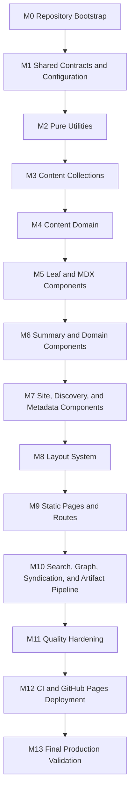
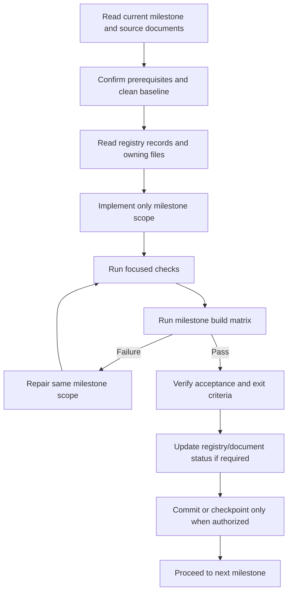

Atlas v0.6.0

# Public Personal Knowledge Garden and Living Portfolio Milestone Plan

## Document Status

- **Status:** Authoritative implementation dependency plan
- **Date:** 2026-07-21
- **Audience:** Senior software engineers and AI coding agents
- **Authoritative inputs:** `01_Architecture.md`, `02_FolderStructure.md`, `03_ImplementationGuide.md`, and `04_ComponentRegistry.md`
- **Content model:** `05_ContentModel.md`
- **Coding standards:** `06_CodingStandards.md`
- **Quality strategy:** `08_TestStrategy.md`
- **Deployment and operations:** `09_DeploymentGuide.md`
- **Decision record:** `docs/decisions/0001-public-personal-knowledge-garden-and-knowledge-graph.md`
- **Execution model:** Sequential, cumulative, static, and buildable after every milestone

## Plan Authority

This document defines implementation sequence, not calendar time, staffing, estimates, sprints, or release dates. It is subordinate to the approved architecture and folder contract. It may refine an approved implementation phase into smaller dependency-safe milestones, but it may not change architectural layers, route names, layout names, component ownership, collection names, rendering mode, or deployment topology.

The approved component phases contain one dependency-order tension: card components listed in implementation-order phase 6 depend on `PublicationDates`, `ContentStatus`, and `TagList`, which are categorized in phase 7. This plan does not reverse architectural layers. It refines the adjacent component phases into a topological sequence: dependency-free leaf components first, card/domain consumers second, then composed site/discovery/metadata components. All component work still follows content-domain modules and precedes layouts and pages.

`06_CodingStandards.md` is the binding code-quality standard. It remains subordinate to the architecture, folder contract, implementation contracts, registry, and this dependency sequence; it does not change milestone order.

## 1. Overview

### Purpose

This plan turns the approved design into a complete, dependency-ordered execution path. An engineer or AI coding agent can start at Milestone 0, implement only the named scope, run the stated checks, and proceed only after measurable exit criteria pass.

### Scope

The plan covers:

- Repository and Astro toolchain bootstrap.
- Shared types, configuration, and pure utilities.
- Four Astro content collections and cross-content domain behavior.
- Every registered component and all five layouts.
- Every approved route, Pagefind search, Knowledge Graph, RSS, sitemap, and robots behavior.
- Unit, smoke, accessibility, link, performance, artifact, CI, and deployment validation.
- Final production verification beneath `/engineering-lab/`.

It does not create product content, define project-management schedules, authorize new dependencies outside approved capabilities, or change the architecture.

### Relationship to source documents

| Document | Role in milestone execution |
| --- | --- |
| `01_Architecture.md` | Defines system boundaries, content model, route topology, rendering/deployment decisions, quality targets, and coding conventions. |
| `02_FolderStructure.md` | Defines every approved file location, ownership boundary, dependency direction, and prohibited structure. |
| `03_ImplementationGuide.md` | Defines build order, implementation contracts, data pipelines, commands, error behavior, and Definitions of Done. |
| `04_ComponentRegistry.md` | Defines the closed component/layout inventory, public contracts, ownership, dependencies, lifecycle, and duplication policy. |
| `05_ContentModel.md` | Defines collection fields, metadata semantics, relationships, taxonomy, lifecycle, assets, search, SEO, and content validation. |
| `06_CodingStandards.md` | Defines code-level engineering quality, naming, type safety, accessibility, performance, testing, review, and AI coding rules within this dependency sequence. |
| `08_TestStrategy.md` | Defines quality gates, test levels, architecture/component/content validation, accessibility, SEO, performance, regression, test data, CI/CD evidence, and coverage expectations. |
| `09_DeploymentGuide.md` | Defines build-to-production flow, environments, CI/CD governance, hosting, configuration, caching, security, observability, rollback, disaster recovery, and operational checklists. |

### Why milestones follow dependencies

Arbitrary feature groups encourage reverse dependencies, temporary duplication, and route-owned logic. These milestones instead establish contracts before consumers: graph/content types before schemas, schemas before graph/domain resolution, components before layouts, layouts before routes, static graph routes before Cytoscape enhancement, and local verification before deployment automation. Each milestone adds one coherent architectural concern and leaves a clean production build for the next milestone.

## 2. Milestone Strategy

| Principle | Execution rule | Reasoning |
| --- | --- | --- |
| Foundation-first | Establish Astro, TypeScript, Tailwind, MDX, npm scripts, strict checking, and the GitHub Pages base before feature source. | Later work must fail quickly against the real build rather than accumulate behind missing infrastructure. |
| Content-first | Establish schemas and content-domain behavior before rendering content routes. | Routes and components consume validated, normalized view data instead of inventing field interpretation. |
| Static-first | Every route emits complete HTML; browser behavior is added only for Pagefind, route-local Cytoscape.js graph enhancement, and minimal mobile navigation. | Preserves GitHub Pages compatibility, progressive enhancement, low JavaScript, and crawlability. |
| Infrastructure before UI | Configuration, types, utilities, schemas, and content-domain modules precede components. | UI receives stable inputs and contains no hidden data access or transformation logic. |
| Utilities before consumers | Pure URL, slug, date, reading-time, tag, and SEO behavior is completed before content and UI consume it. | Prevents duplicated algorithms and base-path defects. |
| Components before routes | Registered components are implemented and verified before routes compose them. | Keeps routes thin and prevents page-specific copies of reusable markup. |
| Layouts before pages | Five approved layouts are completed before route implementation. | Pages select a stable structure rather than becoming de facto layouts. |
| Interactive discovery last | Pagefind and Cytoscape.js are integrated only after representative final HTML, graph endpoints, and route metadata exist. | Search and graph enhancement must reflect public static output, valid URLs, draft exclusion, and deterministic graph data. |
| Verification before automation | Local quality commands and artifact checks are complete before CI/deployment workflows invoke them. | Workflows remain orchestration only and cannot hide workflow-specific behavior. |
| Cumulative builds | Each milestone runs checks against all completed earlier work. | Forward-only dependencies and regression visibility are preserved. |

## 3. Global Dependency Graph

Dependencies flow forward only. A milestone may use outputs from any earlier milestone but may not import or depend on files scheduled later. No cycle, hidden dynamic import, temporary alternate framework, or duplicate implementation is permitted.

## 4. Milestone Overview

| Milestone | Name | Primary concern | Working build produced |
| --- | --- | --- | --- |
| M0 | Repository Bootstrap | Executable static Astro foundation | Minimal approved home bootstrap builds beneath `/engineering-lab/`. |
| M1 | Shared Contracts and Configuration | Stable shared/graph types and typed site/domain configuration | Foundation builds with strict contracts and controlled domains. |
| M2 | Pure Utilities | Deterministic transformations | Foundation builds; utility unit tests pass. |
| M3 | Content Collections | Four strict MDX schemas with domains and typed connections | Valid collection/graph-shape fixtures load; invalid fixtures fail as expected. |
| M4 | Content and Graph Domain | Queries, sorting, references, series, graph validation/manifest, and cross-entry validation | Content/graph domain tests and production build pass. |
| M5 | Leaf, MDX, and Connection Components | Dependency-light rendering primitives | Primitive/MDX/connection components pass focused rendering and accessibility checks. |
| M6 | Summary and Domain Components | Collection cards plus project/series presentation | All phase-6 consumer components build against approved leaves. |
| M7 | Site, Discovery, Graph, and Metadata Components | Global shell children, search/graph static shells, discovery UI, and head components | All 36 Astro components build and check; two browser controllers remain for M10. |
| M8 | Layout System | Five approved page layouts | Representative layout fixtures render through `SiteLayout`. |
| M9 | Static Pages, Routes, and Graph Endpoints | All approved HTML/data routes | Complete static route topology and graph fallback/manifest build without Pagefind/Cytoscape enhancement. |
| M10 | Search, Graph, Syndication, and Artifact Pipeline | Pagefind, Cytoscape.js controller, RSS, sitemap, robots, and post-build verification | Full deployable artifact including search index and interactive graph builds and verifies. |
| M11 | Quality Hardening | Complete automated accessibility, links, smoke, and performance gates | Release candidate passes all local quality gates. |
| M12 | CI and GitHub Pages Deployment | Reproducible CI and immutable Pages release | Protected workflow deploys the verified artifact. |
| M13 | Final Production Validation | End-to-end architecture and production conformance | Production site and rollback path are verified with no open release blockers. |

## 5. Detailed Milestones

### Milestone 0 - Repository Bootstrap

| Field | Plan |
| --- | --- |
| Purpose | Establish the smallest reproducible Astro project that exercises the approved static build, TypeScript, Tailwind, MDX integration, npm lockfile, and GitHub Pages project base. |
| Scope | Toolchain/configuration only. A minimal `src/pages/index.astro` bootstrap shell is permitted solely to prove the static build; its final route composition is delivered in M9. |
| Deliverables | Pinned Node.js LTS declaration; npm package/lockfile; Astro static configuration with production site and `/engineering-lab/` base; strict TypeScript; Tailwind and MDX integration; formatting/lint/check/build/preview script baseline; ignored generated paths. |
| Files created | `package.json`, `package-lock.json`, `astro.config.mjs`, `tsconfig.json`, `.gitignore`, `src/styles/global.css`, and minimal `src/pages/index.astro`. Add a tool-specific root config only when the selected approved checker/formatter requires it. |
| Folders touched | Repository root, `src/styles/`, and `src/pages/`. No component, layout, content, or domain folders are implemented. |
| Components implemented | None. |
| Layouts implemented | None. |
| Utilities implemented | None. |
| Types implemented | None. |
| Dependencies | Astro, TypeScript, Tailwind, MDX integration, Astro checker, formatter/linter support required by approved quality gates. No UI framework. |
| Blocked By | Approved planning documents only. |
| Enables | M1-M13 and executable validation from the first implementation change. |

**Acceptance Criteria**

- Static output mode is explicit.
- Production `site` and `base` resolve to the GitHub Pages project topology and `/engineering-lab/`.
- Strict TypeScript and Astro checking are enabled.
- Generated/cache/dependency paths from `02_FolderStructure.md` are ignored.
- The bootstrap page contains no reusable UI or permanent route-domain logic.

**Definition of Done**

`npm install`, `npm run check`, and `npm run build` pass from a clean checkout with no project-controlled warnings. Preview serves the minimal artifact at the configured base. The lockfile is committed and reproducible.

**Smoke Tests**

- Open the built home entry beneath `/engineering-lab/`.
- Confirm one static HTML entry and base-safe assets.
- Confirm no server adapter or client framework output.

**Regression Tests**

- Clean install followed by build.
- Root-relative URL scan of the bootstrap artifact.
- Generated paths remain untracked.

**Build Validation**

Run `npm install`, `npm run check`, `npm run build`, and a short `npm run preview` verification. Content/search/a11y commands are not yet introduced and must not be represented by false no-op scripts.

**Exit Criteria**

The foundation is reproducible, static, warning-free, base-path-correct, and contains no architecture beyond the approved bootstrap concern.

### Milestone 1 - Shared Contracts and Configuration

| Field | Plan |
| --- | --- |
| Purpose | Define all shared contracts and typed public configuration before runtime/build consumers are implemented. |
| Scope | `src/types/` and `src/config/` only, plus focused compile-time contract fixtures where useful. |
| Deliverables | Shared content, graph, navigation, search, SEO, and site interfaces; controlled domain configuration; typed site identity/origin/base/default metadata/social links; one ordered navigation configuration. |
| Files created | `src/types/content.ts`, `graph.ts`, `navigation.ts`, `search.ts`, `seo.ts`, `site.ts`; `src/config/domains.ts`, `site.ts`, `navigation.ts`. |
| Folders touched | `src/types/`, `src/config/`, and root configuration only if path aliases are approved by the existing folder contract. |
| Components implemented | None. |
| Layouts implemented | None. |
| Utilities implemented | None. |
| Types implemented | Existing shared types plus `KnowledgeDomain`, `ConnectionType`, `ContentConnection`, `ResolvedConnection`, `GraphNode`, `GraphEdge`, `GraphManifest`, and `GraphQueryState`. |
| Dependencies | M0 strict TypeScript and Astro configuration. Shared types import no runtime values. Configuration imports shared types only. |
| Blocked By | M0. |
| Enables | Pure utilities, graph-ready schemas/domain, components, layouts, routes, metadata, search, and graph filtering. |

**Acceptance Criteria**

- All approved shared interfaces from `03_ImplementationGuide.md` Section 8 exist exactly once.
- Raw collection data types are not manually duplicated.
- Site and navigation configuration contain no secrets or browser/runtime dependencies.
- Domain configuration contains exactly the approved initial values and stable labels; graph types are readonly/discriminated and contain no runtime imports.
- Public base/site values align with `astro.config.mjs` without contradictory sources.
- No `any`, circular import, or unused speculative API is introduced.

**Definition of Done**

Strict type/Astro checks and production build pass. Type-only dependency inspection confirms `src/types/` has no runtime imports and configuration has no presentation/content imports.

**Smoke Tests**

- Compile representative valid values for every shared type family.
- Verify invalid collection names and invalid discriminated unions fail type checks.
- Verify invalid domain/connection literals and malformed graph/query states fail type checks.

**Regression Tests**

- M0 clean build remains unchanged.
- Base path and navigation destinations remain approved.

**Build Validation**

Run clean install when dependency metadata changes, `npm run check`, focused type tests if configured, and `npm run build`.

**Exit Criteria**

Every later module has a stable approved contract and no consumer-specific duplicate type is needed.

### Milestone 2 - Pure Utilities

| Field | Plan |
| --- | --- |
| Purpose | Implement deterministic transformations before schemas, content-domain modules, components, or routes consume them. |
| Scope | Six approved utility modules and focused unit tests. |
| Deliverables | Base-safe URL construction; slug normalization; tag normalization/labeling/grouping; date comparison/formatting; reading-time calculation; SEO input construction and safe structured-data serialization support. |
| Files created | `src/utils/url.ts`, `slug.ts`, `tag.ts`, `date.ts`, `reading-time.ts`, `seo.ts`; focused files under `tests/unit/`. |
| Folders touched | `src/utils/`, `tests/unit/`, and test-tool root config only when required. |
| Components implemented | None. |
| Layouts implemented | None. |
| Utilities implemented | All six approved utilities. |
| Types implemented | Utility-local types only; shared contracts remain in M1. |
| Dependencies | M1 shared types/configuration. No Astro collection, route, layout, component, DOM, file-system, or implicit clock access. |
| Blocked By | M1. |
| Enables | Schemas, content-domain modules, metadata, components, routes, RSS, sitemap, and Pagefind URL normalization. |

**Acceptance Criteria**

- Every function is pure, nonmutating, named, and deterministic from explicit input.
- URL tests cover `/engineering-lab/`, canonical origin, duplicate slashes, traversal rejection, fragments, and query values.
- Slug/tag tests cover normalization, empty/unsafe input, collision detection input, and deterministic ordering.
- Date/reading-time/SEO tests cover boundary and absent-optional cases.
- No duplicate helper exists outside `src/utils/`.

**Definition of Done**

Focused utility tests, strict checks, and production build pass without warnings. Coverage includes normal, boundary, and invalid input behavior named in the implementation guide.

**Smoke Tests**

- Construct home, detail, topic, search, RSS, and canonical URL examples under the project base.
- Generate representative SEO data without rendering components.

**Regression Tests**

- M0-M1 checks remain green.
- Utility import graph points only to approved types/config.

**Build Validation**

Run `npm run check`, focused unit tests, and `npm run build`; run clean install if test dependencies change.

**Exit Criteria**

All approved transformations are tested and ready for consumption without route/component-local alternatives.

### Milestone 3 - Content Collections

| Field | Plan |
| --- | --- |
| Purpose | Establish the four strict MDX collection boundaries and isolated schema validation. |
| Scope | `src/content.config.ts`, four approved content roots, and valid/invalid content fixtures. No production portfolio content is invented. |
| Deliverables | Shared schema fragment; article, note, project, and series schemas; date transformation; draft defaults; controlled domains; typed connections; tags; image/canonical contracts; skills/tools project metadata; fixture matrix. |
| Files created | `src/content.config.ts`; `src/content/articles/`, `notes/`, `projects/`, `series/`; schema fixtures under `tests/fixtures/content/`. |
| Folders touched | `src/content/`, `tests/fixtures/content/`, and schema test location under `tests/unit/`. |
| Components implemented | None. |
| Layouts implemented | None. |
| Utilities implemented | None; consumes M2. |
| Types implemented | Schema-inferred raw collection types only; no handwritten duplicates. |
| Dependencies | M1 contracts and M2 slug/tag/date/URL rules where schema boundaries need them. |
| Blocked By | M2. |
| Enables | Content queries, references, series resolution, validation, and generated routes. |

**Acceptance Criteria**

- Exactly four collection roots and four separate schemas exist.
- Published fields and collection-specific fields match the approved contracts.
- Unknown/malformed required data, invalid dates/URLs/statuses/domains/connection shapes, missing domains/tags, obsolete note-only relationship fields, obsolete engineering-only project fields, and invalid series entry shapes fail.
- Draft fixtures validate but are distinguishable for production exclusion.
- Content-specific assets use neighboring same-slug fixture folders.

**Definition of Done**

Valid fixtures pass Astro/schema checks; every invalid fixture fails for the expected field/rule. Strict check and production build pass with no fifth collection or fabricated public content.

**Smoke Tests**

- Load one valid fixture shape for each collection.
- Validate an article/note mixed series reference shape.
- Validate project full/minimal optional fields.
- Validate each approved connection type and controlled domain shape without resolving cross-entry targets yet.

**Regression Tests**

- Date/tag/URL utility tests remain green.
- Duplicate manual raw content types do not appear.

**Build Validation**

Run `npm run check`, schema-focused tests, and `npm run build`. `npm run validate:content` is introduced in M4 when cross-entry modules exist.

**Exit Criteria**

All isolated content contracts are executable and no consumer must infer a frontmatter shape.

### Milestone 4 - Content and Graph Domain

| Field | Plan |
| --- | --- |
| Purpose | Centralize collection access, production filtering, deterministic sorting, cross-reference integrity, series navigation, graph resolution/manifest, and cross-entry validation. |
| Scope | Five approved content-domain modules, repository content validator, and focused domain/graph tests. |
| Deliverables | Existing content-domain behavior plus stable graph node IDs, typed edge resolution, symmetric related traversal, prerequisite-cycle detection, per-entry neighborhoods, deterministic `GraphManifest`, and graph diagnostics. |
| Files created | `src/lib/content/queries.ts`, `sort.ts`, `references.ts`, `series.ts`, `graph.ts`; `scripts/validate-content.ts`; focused `tests/unit/` files. |
| Folders touched | `src/lib/content/`, `scripts/`, `tests/unit/`, and package scripts. |
| Components implemented | None. |
| Layouts implemented | None. |
| Utilities implemented | None; consumes M2. |
| Types implemented | Domain-local result/error types only when not shared. |
| Dependencies | M1 shared contracts, M2 utilities, M3 collection schemas/Astro collection API. No routes, layouts, components, or browser code. |
| Blocked By | M3. |
| Enables | Normalized component/graph props, entry connection lists, graph routes/manifest, layouts, topics, related content, RSS, and search metadata. |

**Acceptance Criteria**

- Queries exclude drafts from every production-visible result.
- Sorting is deterministic with stable ID tie-breakers and does not mutate input.
- Missing, duplicate, self, draft-only, and mismatched references report source/field/target.
- Series preserves declared order and derives first/middle/last navigation correctly.
- Graph validation rejects unknown domains/types, missing/draft/self targets, duplicate/reverse-duplicate related edges, and prerequisite cycles with actionable paths.
- Manifest nodes/edges sort deterministically and expose only approved public fields; identical source produces byte-stable logical data.
- `npm run validate:content` is a real failing command, not a no-op.

**Definition of Done**

Domain/graph unit and fixture tests, content validation, strict checks, and production build pass. The module graph and authored prerequisite graph remain acyclic and no presentation/browser import exists.

**Smoke Tests**

- Query empty and populated fixture collections.
- Resolve mixed article/note series.
- Resolve all seven connection types, incoming/outgoing/symmetric traversal, isolated nodes, and a valid prerequisite DAG.
- Reject a controlled prerequisite cycle and confirm the full cycle is reported.
- Generate topic/tag subsets and related summaries.
- Confirm draft leakage count is zero.

**Regression Tests**

- M2 utility and M3 schema tests remain green.
- Invalid fixture matrix produces expected diagnostics.

**Build Validation**

Run `npm run check`, `npm run validate:content`, focused unit tests, and `npm run build`.

**Exit Criteria**

All collection/graph-aware behavior has one build-time owner and presentation can consume normalized data/manifest without querying collections.

### Milestone 5 - Leaf, MDX, and Connection Components

| Field | Plan |
| --- | --- |
| Purpose | Implement dependency-light semantic leaves needed by card, domain, layout, and MDX composition. |
| Scope | Content/MDX primitives, semantic `ConnectionList`, plus three leaf metadata/discovery prerequisites required by approved consumers. |
| Deliverables | Existing leaves plus static typed semantic connection rendering and graph textual fallback primitive. |
| Files created | `src/components/content/ExternalLink.astro`, `HeadingAnchor.astro`, `Prose.astro`, `TableOfContents.astro`; `src/components/mdx/Callout.astro`, `Figure.astro`, `index.ts`; `src/components/metadata/ContentStatus.astro`, `PublicationDates.astro`; `src/components/discovery/TagList.astro`; `src/components/graph/ConnectionList.astro`; `src/styles/prose.css`; focused tests. |
| Folders touched | `src/components/content/`, `mdx/`, `metadata/`, `discovery/`, `graph/`, `src/styles/`, and relevant tests. |
| Components implemented | `ExternalLink`, `HeadingAnchor`, `Prose`, `TableOfContents`, `Callout`, `Figure`, `ContentStatus`, `PublicationDates`, `TagList`, and `ConnectionList`. |
| Layouts implemented | None. |
| Utilities implemented | None; consumes M2. |
| Types implemented | Component-local props only; shared types from M1. |
| Dependencies | M1 types/config, M2 utilities, M3 image/content types. No content queries, layouts, or routes. |
| Blocked By | M4 establishes normalized contracts; components do not import it directly. |
| Enables | Cards, project/series components, graph details/explorer, entry-local semantic connections, composed discovery, and all five layouts. |

**Acceptance Criteria**

- Every component matches its registry props, slots, events, ownership, hydration, SEO, and accessibility contract.
- `src/components/mdx/index.ts` exports only `Callout` and `Figure`.
- No component queries collections or builds route metadata.
- Prose handles code, tables, figures, headings, long words, and narrow screens.
- All components render static HTML with zero client hydration.
- `ConnectionList` covers all seven relationship types, direction/context, empty/isolated state, deterministic order, and base-safe links without JavaScript.

**Definition of Done**

Focused component/accessibility tests, strict checks, content validation, and production build pass. Registry lifecycle status can change from Approved to Implemented for these ten items only.

**Smoke Tests**

- Render representative MDX containing callout, figure, headings, external link, code, and table.
- Render status/date/tag normal and optional cases.
- Render incoming/outgoing/symmetric semantic connections and an isolated node.
- Verify fragments and links beneath `/engineering-lab/`.

**Regression Tests**

- Utility/schema/domain tests remain green.
- No new barrel or client script appears.

**Build Validation**

Run `npm run check`, `npm run validate:content`, focused component/unit/accessibility checks, and `npm run build`.

**Exit Criteria**

All leaf dependencies required by M6-M8 are implemented once, static, accessible, and registry-conformant.

### Milestone 6 - Summary and Domain Components

| Field | Plan |
| --- | --- |
| Purpose | Implement collection summaries and project/series presentation using completed leaf components and normalized view models. |
| Scope | Four cards, project facts, ordered series list, and series previous/next navigation. |
| Deliverables | Reusable summaries for all collections; semantic project facts; mixed article/note ordered sequence; first/middle/last series navigation. |
| Files created | `src/components/cards/ArticleSummary.astro`, `NoteSummary.astro`, `ProjectSummary.astro`, `SeriesSummary.astro`; `src/components/project/ProjectFacts.astro`; `src/components/series/SeriesEntryList.astro`, `SeriesNavigation.astro`; focused tests. |
| Folders touched | `src/components/cards/`, `project/`, `series/`, and relevant tests. |
| Components implemented | `ArticleSummary`, `NoteSummary`, `ProjectSummary`, `SeriesSummary`, `ProjectFacts`, `SeriesEntryList`, and `SeriesNavigation`. |
| Layouts implemented | None. |
| Utilities implemented | None. |
| Types implemented | Component-local props only. |
| Dependencies | M5 leaf components; M1 view models; M2 URL/date utilities. No content query imports. |
| Blocked By | M5. |
| Enables | Listings, related content, project/series layouts, home sections, and topic pages. |

**Acceptance Criteria**

- Cards receive normalized summaries and contain no raw collection logic.
- Cards avoid nested interactive regions and remain readable with long metadata.
- `ProjectFacts` handles full/minimal records and secure external links.
- Series components preserve resolved order and descriptive previous/next labels.
- Every component matches exactly one registry record and folder.

**Definition of Done**

Focused rendering/accessibility tests, strict checks, content validation, and production build pass. Seven registry lifecycle records are updated to Implemented.

**Smoke Tests**

- Render every card in populated and minimal states.
- Render complete/minimal project facts.
- Render first/middle/last mixed series states.

**Regression Tests**

- M5 leaf/MDX tests remain green.
- Duplicate component/function scan finds no alternate card/facts/navigation implementation.

**Build Validation**

Run `npm run check`, `npm run validate:content`, focused tests, and `npm run build`.

**Exit Criteria**

All approved phase-6 consumer components are complete and no layout/page implementation is required to verify them.

### Milestone 7 - Site, Discovery, Graph, and Metadata Components

| Field | Plan |
| --- | --- |
| Purpose | Complete the static Astro component inventory required by layouts/pages, excluding two browser controllers scheduled after routes. |
| Scope | Global site chrome, remaining discovery/search shell, static graph shell, and document metadata/structured-data components. |
| Deliverables | Existing site/discovery/metadata components plus graph controls, selected-node details, complete static graph explorer, and no-JavaScript semantic fallback. |
| Files created | `src/components/site/SiteIdentity.astro`, `PrimaryNavigation.astro`, `MobileNavigation.astro`, `Header.astro`, `Footer.astro`, `SkipLink.astro`; `src/components/discovery/Breadcrumbs.astro`, `CollectionNavigation.astro`, `EmptyState.astro`, `Pagination.astro`, `RelatedContentList.astro`, `SearchForm.astro`, `SearchResults.astro`, `TopicLink.astro`; `src/components/metadata/DocumentHead.astro`, `StructuredData.astro`; `src/components/graph/GraphControls.astro`, `GraphNodeDetails.astro`, `GraphExplorer.astro`; focused tests. |
| Folders touched | `src/components/site/`, `discovery/`, `graph/`, `metadata/`, and relevant tests. |
| Components implemented | `SiteIdentity`, `PrimaryNavigation`, `MobileNavigation`, `Header`, `Footer`, `SkipLink`, `Breadcrumbs`, `CollectionNavigation`, `EmptyState`, `Pagination`, `RelatedContentList`, `SearchForm`, `SearchResults`, `TopicLink`, `DocumentHead`, `StructuredData`, `GraphControls`, `GraphNodeDetails`, and `GraphExplorer`. |
| Layouts implemented | None. |
| Utilities implemented | None. |
| Types implemented | Component-local props only. |
| Dependencies | M5 leaves, M6 cards, M1 configuration/types, and M2 utilities. Mobile navigation may use minimal local enhancement but no UI framework. |
| Blocked By | M6. |
| Enables | Complete site shell, listing/knowledge/project/series layouts, home, search shell, static graph route, metadata, and static navigation. |

**Acceptance Criteria**

- Site navigation works without JavaScript and preserves active state/base paths.
- Search form submits to `/search/?q=...` without Pagefind.
- Search results provides static loading/result/empty/error containers without controller logic.
- Graph shell provides labeled filters, selected-node details, semantic connections, empty/isolated states, and a stable visual mount without Cytoscape.js.
- Document head emits one valid metadata set; structured data is safely serialized.
- No collection query, route import, hidden global state, or unnecessary hydration exists.

**Definition of Done**

Focused component/accessibility/metadata/graph tests, strict checks, content validation, and production build pass. All 36 Astro component records are now Implemented; both browser controllers remain Approved/not implemented.

**Smoke Tests**

- Keyboard through header, desktop/mobile navigation, skip link, footer, breadcrumbs, and pagination.
- Render populated/empty related and search states.
- Render graph no-selection, isolated-node, mixed-edge, filter, and no-JavaScript fallback states.
- Validate representative head and JSON-LD output.

**Regression Tests**

- M5-M6 component suites remain green.
- Registry-to-folder component inventory still matches exactly.

**Build Validation**

Run `npm run check`, `npm run validate:content`, focused component/metadata/accessibility tests, and `npm run build`.

**Exit Criteria**

Every static component required by layouts exists with one owner and approved dependency direction.

### Milestone 8 - Layout System

| Field | Plan |
| --- | --- |
| Purpose | Compose verified components into the five approved page structures before route implementation. |
| Scope | `SiteLayout`, `ListingLayout`, `KnowledgeLayout`, `ProjectLayout`, and `SeriesLayout`; layout fixtures only. |
| Deliverables | Common document shell; listing structure; shared article/note reading structure; project case-study structure; ordered series structure; entry-local `ConnectionList` integration. |
| Files created | Five approved files under `src/layouts/` plus focused layout fixtures/tests. |
| Folders touched | `src/layouts/` and relevant tests. |
| Components implemented | None; consumes registered components. |
| Layouts implemented | All five approved layouts. |
| Utilities implemented | None. |
| Types implemented | Layout-local props only; shared view models remain M1. |
| Dependencies | M7 complete static component inventory, M1 configuration/types, and M2 display utilities. No broad collection queries. |
| Blocked By | M7. |
| Enables | Every approved HTML page and route. |

**Acceptance Criteria**

- Specialized layouts compose `SiteLayout`; no duplicate HTML shell exists.
- Layout props, slots, children, metadata, accessibility, and errors match the registry.
- Article and note share `KnowledgeLayout` without near-duplicate modes.
- Optional regions disappear cleanly and never leave empty landmarks.
- Layouts receive resolved data and do not query collections.

**Definition of Done**

Representative populated/minimal/empty layout fixtures, metadata checks, keyboard/reflow checks, strict checks, content validation, and production build pass. Five layout registry records are Implemented.

**Smoke Tests**

- Render each layout through `SiteLayout`.
- Exercise knowledge TOC/series/related combinations.
- Exercise project full/minimal skills/tools, mixed series data, and optional semantic connections in each content layout.

**Regression Tests**

- All component suites remain green.
- Dependency scan confirms layouts do not import routes/content queries.

**Build Validation**

Run `npm run check`, `npm run validate:content`, layout/component/accessibility tests, and `npm run build`.

**Exit Criteria**

All page-level structures are stable, accessible, metadata-ready, and route-independent.

### Milestone 9 - Static Pages, Routes, and Graph Endpoints

| Field | Plan |
| --- | --- |
| Purpose | Implement the complete approved HTML route topology as thin static adapters over content-domain modules and layouts. |
| Scope | Home; collection indexes/details; topics; static search shell; static graph shell/manifest endpoint; about; 404. RSS remains M10 with syndication. |
| Deliverables | Existing routes plus canonical `/graph/`, deterministic `/graph/graph.json`, graph query parsing, static semantic fallback, draft exclusion, and base-safe graph/content navigation. |
| Files created | `src/pages/index.astro`, `about.astro`, `404.astro`; article/note/project/series index and `[...slug].astro` pairs; `topics/index.astro`, `topics/[tag].astro`; `search/index.astro`; `graph/index.astro`, `graph/graph.json.ts`. M0 bootstrap home is replaced, not duplicated. |
| Folders touched | Approved `src/pages/` subtrees and route smoke fixtures/tests. |
| Components implemented | None. |
| Layouts implemented | None; consumes all five. |
| Utilities implemented | None. |
| Types implemented | Route-local derived prop types only when necessary. |
| Dependencies | M4 content/graph domain, M8 layouts, M7 graph components, M1 config/types, M2 utilities. No route imports another route. |
| Blocked By | M8. |
| Enables | Final rendered HTML for Pagefind, static graph fallback/manifest for Cytoscape enhancement, RSS/sitemap URLs, full navigation, and end-to-end page checks. |

**Acceptance Criteria**

- Every logical route in `01_Architecture.md` except `/rss.xml` has its approved file and static behavior, including both graph endpoints.
- Dynamic paths enumerate production-visible entries/tags only; drafts generate no public path.
- Routes only read inputs, call domain modules, derive props, and choose layouts.
- Unknown paths use `404.html`; search shell works without browser enhancement.
- Graph shell/details/connections work without Cytoscape.js; manifest has stable schema version/order and contains no draft/private/integration data.
- Canonicals and links preserve `/engineering-lab/`.

**Definition of Done**

All HTML routes build from empty and controlled fixture content; route smoke, metadata, 404, draft-exclusion, base-path, strict, content, and production build checks pass.

**Smoke Tests**

- Home, every collection index, representative details with controlled fixtures, topics, search shell, graph static/manifest/selected-node states, about, and 404.
- Direct deep-link and refresh beneath the project base.
- Search form no-JavaScript submission.

**Regression Tests**

- Layout/component/domain suites remain green.
- Route files contain no duplicated layout/utility/domain logic.

**Build Validation**

Run `npm run check`, `npm run validate:content`, focused route smoke/accessibility tests, `npm run build`, and preview route checks.

**Exit Criteria**

The complete static site, including semantic graph discovery, is navigable and useful without Pagefind, Cytoscape.js, or other client JavaScript.

### Milestone 10 - Search, Graph, Syndication, and Artifact Pipeline

| Field | Plan |
| --- | --- |
| Purpose | Complete post-render discovery and production artifact contracts after final route HTML exists. |
| Scope | Pagefind search, graph controller/Cytoscape.js, RSS, sitemap, robots, post-build verification, and final build composition. |
| Deliverables | Existing M10 artifacts plus lazy selected-node graph enhancement, domain/collection/relationship filters, URL/history synchronization, manifest-version validation, graph bundle/manifest checks, and graceful visual failure. |
| Files created | `src/components/discovery/pagefind-search.ts`, `src/components/graph/graph-explorer.ts`, `src/pages/rss.xml.ts`, `scripts/verify-build.ts`, and `public/robots.txt` when required; update package/Astro configuration and search/graph page bindings without new folders. Add Cytoscape.js as the approved focused dependency. |
| Folders touched | `src/components/discovery/`, `src/components/graph/`, `src/pages/`, `scripts/`, `public/`, root package/configuration, and focused tests. |
| Components implemented | `pagefind-search` and `graph-explorer` browser controllers. |
| Layouts implemented | None. |
| Utilities implemented | None; consumes URL/SEO/date/tag utilities. |
| Types implemented | None; consumes approved search/graph/SEO types. |
| Dependencies | M9 final HTML/routes/graph manifest, Pagefind, Cytoscape.js, sitemap integration, M4 content/graph domain, and M2 URL/SEO utilities. No hosted search or graph service. |
| Blocked By | M9. |
| Enables | Deployable full discovery artifact and complete release verification. |

**Acceptance Criteria**

- `npm run build` performs Astro generation then Pagefind indexing against completed `dist/`.
- Only published reader-visible content is indexed; site chrome/decorative text and drafts are excluded.
- Search controller loads only on `/search/`, preserves query/history/focus/base paths, and fails gracefully at runtime.
- Graph controller/Cytoscape.js load only on `/graph/`, preserve query/history/focus/base paths, default to bounded selected-node neighborhoods, respect reduced motion, and fail back to semantic HTML.
- RSS and sitemap use absolute production URLs and exclude drafts/noindex pages.
- `verify-build.ts` fails on missing required routes, `404.html`, RSS, sitemap, Pagefind assets, graph HTML/manifest/controller/Cytoscape mismatch, base-path defects, draft/private graph output, or nondeterministic manifest shape.

**Definition of Done**

Search and graph success/empty/isolated/failure/history/filter tests, feed/sitemap validation, artifact verification, strict checks, content/graph validation, and full production build pass. All 43 registry records are Implemented.

**Smoke Tests**

- Search direct query, typing, submit, no results, back/forward, result navigation, and simulated index failure.
- Graph direct selected-node query, filters, node selection, back/forward, empty/isolated graph, visual failure, and direct content navigation.
- Parse RSS/sitemap and follow representative links.
- Verify artifact from a clean build.

**Regression Tests**

- No-JavaScript navigation remains functional.
- Search assets never appear in source control.
- Generated graph manifests never appear in source control and graph code/Cytoscape.js do not enter non-graph route bundles.
- Route/component/layout suites remain green.

**Build Validation**

Run clean install when dependencies change, `npm run check`, `npm run validate:content`, focused search/graph tests, `npm run build`, `npm run verify:build`, link checks available at this stage, and preview search/graph/feed checks.

**Exit Criteria**

The locally generated artifact contains all approved public features, same-build graph manifest/enhancement assets, and is ready for complete quality hardening.

### Milestone 11 - Quality Hardening

| Field | Plan |
| --- | --- |
| Purpose | Complete cross-cutting release gates against representative generated output. |
| Scope | Unit, smoke, accessibility, link, performance, SEO, artifact, responsive, and warning enforcement. |
| Deliverables | Complete test suites/configuration; representative fixture coverage; internal/asset link validation; automated accessibility; Lighthouse budgets; no-warning policy; release-candidate report. |
| Files created | Remaining files under `tests/unit/`, `tests/smoke/`, `tests/accessibility/`, and `tests/fixtures/content/`; root tool configs only where required by selected approved test/link/accessibility/performance tooling. |
| Folders touched | `tests/`, root tool configuration, package scripts, and source only for defects proven by tests. |
| Components implemented | None. |
| Layouts implemented | None. |
| Utilities implemented | None. |
| Types implemented | Test-local types only. |
| Dependencies | M10 complete local artifact and all prior focused tests. |
| Blocked By | M10. |
| Enables | CI/deployment orchestration and final release confidence. |

**Acceptance Criteria**

- Unit coverage includes all nontrivial pure/domain behavior.
- Smoke coverage includes home, all route families, topics, search, RSS, sitemap, and 404.
- Accessibility covers every representative layout/page type plus keyboard/reflow manual evidence.
- Generated internal/asset links resolve; SEO metadata has no duplicates/missing required values.
- Lighthouse meets architecture budgets under the agreed deterministic profile.
- New project-controlled warnings fail the quality command.

**Definition of Done**

Every local gate in Section 6 passes from a clean checkout and clean build. No failure is suppressed, threshold weakened, or marked flaky without an approved tracked resolution.

**Smoke Tests**

- Full route-family matrix at desktop and mobile viewport sizes.
- Search with index, feed/sitemap, 404 recovery, navigation, and production base.

**Regression Tests**

- Entire accumulated unit/component/layout/route/search suite.
- Registry/folder inventory parity and no undocumented API/component scan.

**Build Validation**

Run clean `npm ci`, `npm run check`, `npm run validate:content`, all test suites, `npm run build`, `npm run verify:build`, link checks, accessibility checks, Lighthouse, and preview smoke.

**Exit Criteria**

One warning-free local command sequence produces a release candidate satisfying all approved quality targets.

### Milestone 12 - CI and GitHub Pages Deployment

| Field | Plan |
| --- | --- |
| Purpose | Automate the exact verified local pipeline and publish one immutable artifact through GitHub Pages. |
| Scope | Pull-request CI and protected default-branch Pages deployment only. No workflow-specific application logic. |
| Deliverables | CI workflow; Pages deployment workflow; minimal permissions; concurrency; environment protection; artifact upload/deploy; production verification hook; rollback procedure documentation. |
| Files created | `.github/workflows/ci.yml` and `.github/workflows/deploy-pages.yml`. Documentation updates only where deployment operation requires them. |
| Folders touched | `.github/workflows/` and applicable deployment documentation. |
| Components implemented | None. |
| Layouts implemented | None. |
| Utilities implemented | None. |
| Types implemented | None. |
| Dependencies | M11 stable package scripts and quality gates; GitHub Pages project-site configuration. |
| Blocked By | M11. |
| Enables | Auditable production deployment and M13 verification. |

**Acceptance Criteria**

- Pull requests run clean install, all validations, production build, Pagefind, and artifact verification without deployment.
- Protected default branch repeats gates and uploads/deploys the same immutable `dist/` artifact.
- Workflow permissions are minimal; deployments are serialized; older builds cannot overwrite newer releases.
- Generated output is not committed to a publication branch.
- Failed gates cannot upload or deploy.

**Definition of Done**

CI passes from a clean runner, deployment succeeds beneath `/engineering-lab/`, source commit maps to deployed artifact, and documented revert/redeploy rollback is executable.

**Smoke Tests**

- Pull-request run without deployment.
- Approved default-branch deployment.
- Concurrent deployment serialization.
- Intentional failing gate blocks upload/deploy in a controlled test.

**Regression Tests**

- Compare local and CI artifact verification outcomes.
- Confirm no workflow-only build variant or duplicated validation command exists.

**Build Validation**

CI invokes the complete M11 command sequence and Pages artifact/deployment actions. A successful workflow must show zero project warnings and one deployed artifact.

**Exit Criteria**

The protected pipeline reproducibly deploys only a verified immutable artifact and supports traceable rollback.

### Milestone 13 - Final Production Validation

| Field | Plan |
| --- | --- |
| Purpose | Verify end-to-end conformance of source, artifact, deployment, documentation, and rollback without introducing new functionality. |
| Scope | Final clean-room build, production smoke/accessibility/performance/SEO verification, source-document synchronization, and release blocker closure. |
| Deliverables | Final validation evidence; architecture/folder/component/milestone parity result; production URL checks; rollback verification record; completion checklist. |
| Files created | None by default. Only approved documentation corrections or defect fixes in their owning earlier milestone surface. |
| Folders touched | None unless a proven defect requires a scoped repair. |
| Components implemented | None. |
| Layouts implemented | None. |
| Utilities implemented | None. |
| Types implemented | None. |
| Dependencies | Successful M12 production deployment and complete source history. |
| Blocked By | M12. |
| Enables | Project completion and routine content publishing/maintenance. |

**Acceptance Criteria**

- Clean checkout reproduces the deployed artifact behavior.
- Every approved route works beneath `/engineering-lab/`; Pagefind, Knowledge Graph static/enhanced states, manifest, RSS, sitemap, robots, 404, canonicals, and assets are correct.
- Registry has exactly 43 Implemented records and matches files/exports.
- Accessibility, Lighthouse, link, SEO, draft-exclusion, and no-warning gates pass in production profile.
- Architecture, folder structure, implementation guide, registry, and milestone plan are synchronized.

**Definition of Done**

All completion checklist items pass, no unresolved blocker or undocumented deviation exists, and rollback has been verified without weakening the deployment process.

**Smoke Tests**

- Production home, all route families, representative content, topics, search, about, RSS, sitemap, 404, and external links.
- Mobile/desktop keyboard and responsive checks.

**Regression Tests**

- Complete M11 suite against a fresh artifact.
- Production/base-path comparison and registry/source parity.

**Build Validation**

Repeat the clean M11 command sequence, verify the deployed production URL, and compare required artifact characteristics. No new source is added to “fix” a failed check without returning to its owning milestone concern.

**Exit Criteria**

The implementation conforms to all approved documents and production quality gates, with a verified deployment and rollback path.

## 6. Build Validation Matrix

### Command contract

| Command | Required behavior |
| --- | --- |
| `npm install` | Local dependency installation and intentional lockfile update only. |
| `npm ci` | Clean, lockfile-exact installation used from M11 onward and in CI. |
| `npm run check` | Formatting/lint policy, strict TypeScript, and Astro diagnostics with no project warnings. |
| `npm run validate:content` | Schema, domain, connection, graph-cycle/manifest, and cross-entry validation; introduced in M4. |
| `npm run test:unit` | Pure utility/content-domain focused tests; introduced with M2 and expanded cumulatively. |
| `npm run test:smoke` | Built-route behavior; introduced with M9 and completed in M11. |
| `npm run test:a11y` | Representative automated accessibility checks; focused checks begin with components and complete in M11. |
| `npm run build` | Astro static generation including graph endpoints; from M10 also runs Pagefind and packages route-local graph enhancement against `dist/`. |
| `npm run verify:build` | Post-build route/search/graph/base/draft/feed/sitemap verification; introduced in M10. |
| `npm run check:links` | Generated internal/asset link validation; required from M10 and completed in M11. |
| `npm run check:lighthouse` | Deterministic representative performance/accessibility/SEO budgets; required from M11. |
| `npm run preview` | Short local artifact smoke session; never an unattended validation substitute. |

No unavailable command is represented by a passing no-op script. Before introduction, the matrix records it as not applicable; after introduction it is mandatory for every later milestone.

| Milestone | Required commands | Expected output |
| --- | --- | --- |
| M0 | `npm install`; `npm run check`; `npm run build`; preview smoke | Lockfile-exact foundation; zero diagnostics/warnings; static base-safe artifact. |
| M1 | Install if dependencies changed; `check`; `build` | Shared content/graph contracts and site/domain config compile with no runtime type dependency. |
| M2 | `check`; `test:unit`; `build` | Six utility modules pass normal/boundary/error tests. |
| M3 | `check`; schema tests; `build` | Valid domain/connection/content fixtures load; invalid fixtures fail for expected reasons. |
| M4 | `check`; `validate:content`; `test:unit`; `build` | Content/graph domain, prerequisite DAG, manifest determinism, and draft exclusion pass. |
| M5 | M4 commands plus focused component/a11y tests | Ten static leaf/MDX/connection components pass registry contracts. |
| M6 | M5 commands plus summary/domain component tests | Seven consumer components pass with no duplicate logic. |
| M7 | M6 commands plus site/discovery/graph/metadata tests | All 36 Astro components pass; metadata, navigation, and static graph fallback are valid. |
| M8 | M7 commands plus layout fixture/a11y tests | Five layouts compose without query/route dependencies. |
| M9 | `check`; `validate:content`; unit/component/layout tests; `test:smoke`; `build`; preview | All approved HTML/data routes and semantic graph fallback build without Pagefind/Cytoscape.js. |
| M10 | Clean install if needed; all M9 commands; `verify:build`; `check:links` | Pagefind, Cytoscape graph enhancement, graph manifest parity, RSS, sitemap, robots, and artifact checks pass. |
| M11 | `npm ci`; `check`; `validate:content`; all tests; `build`; `verify:build`; links; a11y; Lighthouse; preview | Full release candidate passes every local gate and budget with no warnings. |
| M12 | CI executes complete M11 sequence plus artifact upload/deploy | One verified immutable Pages artifact is deployed; failures cannot publish. |
| M13 | Repeat clean M11 sequence plus production smoke/SEO/a11y/performance verification | Local and production behavior conform; no release blocker remains. |

## 7. Component Delivery Matrix

Every non-layout registry item appears exactly once. Layouts are listed separately in Section 8.

| Component | Milestone | Depends On | Primary consumer |
| --- | --- | --- | --- |
| `ExternalLink` | M5 | URL utility | Footer, project facts, about, content |
| `HeadingAnchor` | M5 | Slug/URL utilities | Rendered knowledge/project headings |
| `Prose` | M5 | Prose styles | Knowledge, project, series layouts; about |
| `TableOfContents` | M5 | Heading types; slug utility | Knowledge and project layouts |
| `Callout` | M5 | Local variant type | MDX content map |
| `Figure` | M5 | Astro image handling; asset types | MDX content map |
| `ContentStatus` | M5 | Content status types | Note/project cards and layouts |
| `PublicationDates` | M5 | Date utility | Cards and content layouts |
| `TagList` | M5 | Tag types; tag/URL utilities | Cards, layouts, topics/search |
| `ConnectionList` | M5 | Graph types; URL utility | Entry layouts and graph fallback/details |
| `ArticleSummary` | M6 | `PublicationDates`, `TagList` | Home, listings, topics, related, series |
| `NoteSummary` | M6 | `ContentStatus`, `PublicationDates`, `TagList` | Home, listings, topics, related, series |
| `ProjectSummary` | M6 | `ContentStatus`, tag/list presentation | Home, listings, topics, related |
| `SeriesSummary` | M6 | `TagList` | Home, listings, topics |
| `ProjectFacts` | M6 | `ExternalLink`; project/date/URL contracts | Project layout |
| `SeriesEntryList` | M6 | Article/note summary primitives; series types | Series layout |
| `SeriesNavigation` | M6 | Series context; URL utility | Knowledge layout |
| `SiteIdentity` | M7 | Site config; URL utility | Header |
| `PrimaryNavigation` | M7 | Navigation config/types; URL utility | Header |
| `MobileNavigation` | M7 | Navigation types; URL utility | Header |
| `Header` | M7 | Site identity and both navigation components | Site layout |
| `Footer` | M7 | `ExternalLink`; site/navigation config | Site layout |
| `SkipLink` | M7 | None | Site layout |
| `Breadcrumbs` | M7 | Breadcrumb types; URL utility | Listing/detail composition |
| `CollectionNavigation` | M7 | Navigation config/types; URL utility | Listing, home, search fallback |
| `EmptyState` | M7 | URL utility when actionable | Listing, search, related, 404 |
| `Pagination` | M7 | Pagination types; URL utility | Listing layout |
| `RelatedContentList` | M7 | Four summary cards; `ContentSummary` | Knowledge/project layouts |
| `SearchForm` | M7 | Search types; URL utility | Home and search page |
| `SearchResults` | M7 | `EmptyState`; search types | Search page/controller |
| `TopicLink` | M7 | Tag types; tag/URL utilities | Topic index and search filters |
| `DocumentHead` | M7 | SEO types/utilities; site config | Site layout |
| `StructuredData` | M7 | Structured-data types; SEO serialization | Site layout |
| `GraphControls` | M7 | Graph query/types; domain config | Graph explorer/controller |
| `GraphNodeDetails` | M7 | `ConnectionList`; graph types; URL utility | Graph explorer/controller |
| `GraphExplorer` | M7 | Graph controls/details/connection list; graph types | Graph page/controller |
| `pagefind-search` | M10 | Pagefind browser API; search types and UI | Search page |
| `graph-explorer` | M10 | Cytoscape.js; graph types and UI | Graph page |

## 8. Layout Delivery Matrix

| Layout | Milestone | Depends On |
| --- | --- | --- |
| `SiteLayout` | M8 | `DocumentHead`, `StructuredData`, `SkipLink`, `Header`, `Footer`, site/navigation config, URL/SEO utilities |
| `ListingLayout` | M8 | `SiteLayout`, `Breadcrumbs`, `CollectionNavigation`, `EmptyState`, `Pagination`, summary-card slot contracts |
| `KnowledgeLayout` | M8 | `SiteLayout`, dates/status/tags/prose/TOC/related/connection/series components and content/graph view models |
| `ProjectLayout` | M8 | `SiteLayout`, `ProjectFacts`, dates/tags/prose/TOC/related/connection components and project/graph view models |
| `SeriesLayout` | M8 | `SiteLayout`, dates/tags/prose/series-entry/connection components and series/graph view models |

## 9. Risk Analysis

| Milestone | Technical risk | Dependency/integration risk | SEO/accessibility/content risk | Mitigation |
| --- | --- | --- | --- | --- |
| M0 | Astro/Tailwind/MDX versions or base configuration mismatch. | Bootstrap page accidentally becomes permanent route logic. | Missing language/focus defaults or root-relative assets. | Pin compatible versions; explicit static/site/base checks; mark bootstrap shell for M9 replacement; warning-free clean build. |
| M1 | Overbroad or duplicated shared/graph types. | Runtime imports enter type layer; domain/site config diverges. | Incorrect site identity, domain labels, or graph discriminants. | Contract review, import-boundary check, one typed domain config, exhaustive literal tests. |
| M2 | Impure utilities or URL edge defects. | Consumers later duplicate transformations. | Canonical/topic/date output becomes unstable. | Boundary tests, explicit inputs, no environment/DOM/file access, duplicate helper scan. |
| M3 | Schema too permissive or graph fields duplicate old fields. | Collection-specific fields conflict with shared domains/connections. | Invalid dates/tags/domains/connections/images/drafts reach later output. | Valid/invalid fixture matrix; reject obsolete relationship/technology fields; infer types from schemas. |
| M4 | Complex graph/reference diagnostics or nondeterministic manifest. | Graph domain imports browser/presentation; drafts leak into nodes/edges. | Broken edges, prerequisite cycles, misleading related symmetry, or duplicate URLs. | Structured errors, cycle-path tests, acyclic module graph, public-field allowlist, deterministic sorting. |
| M5 | MDX/connection API expands or accessibility primitives are weak. | Leaf components import future layouts/routes. | Connection direction/type is unclear or color-only. | Only two MDX exports; static `ConnectionList`; all seven types and keyboard/reflow tests. |
| M6 | Cards acquire route/business logic. | Series/project components bypass resolved view models. | Nested links, color-only status, misleading sequence/facts. | Registry contract tests; normalized props only; semantic list/definition structures; long-content fixtures. |
| M7 | Navigation/search/graph shell/metadata components become mode-heavy. | Component cycles through graph/details/connection composition. | Canvas-only graph, inaccessible filters/selection, duplicate metadata. | Direct dependency audit; semantic fallback; keyboard/no-JS/reduced-motion tests; stable dimensions. |
| M8 | Layout duplication or broad content/graph queries. | Specialized layout bypasses `SiteLayout` or duplicates graph resolution. | Multiple H1/landmarks or missing connection fallback. | Layout fixtures, import scans, optional `ConnectionList`, shared knowledge layout. |
| M9 | Route logic becomes thick or graph endpoint diverges. | Routes bypass graph domain or serialize a second manifest model. | Draft/private graph leakage, wrong graph canonical, missing 404. | Thin routes, same normalized manifest for HTML/JSON, controlled fixtures, base-path smoke. |
| M10 | Pagefind/Cytoscape artifact mismatch or bundle growth. | Graph browser imports build-time code; HTML/manifest/controllers diverge. | Visual graph breaks focus/reduced motion or exposes drafts/private data. | Route-local lazy dependency, schema-version check, bundle baseline, fallback parity, artifact assertions. |
| M11 | Flaky or environment-sensitive gates. | Tool configs test different artifact/profile than production. | False accessibility/performance confidence; broken links hidden. | Deterministic profiles, local/CI parity, manual keyboard/reflow evidence, no threshold weakening or warning suppression. |
| M12 | Workflow permissions/concurrency/artifact mismatch. | CI duplicates logic or deploys unverified output. | Production base/metadata differs from local artifact. | Package scripts only, minimal permissions, serialized deployments, immutable artifact and post-deploy smoke. |
| M13 | Validation becomes ceremonial or late changes bypass ownership. | Docs/source/registry drift. | Production regressions or draft/private data exposure. | Clean-room rerun, parity checks, blocker closure, return defects to owning milestone, verified rollback. |

## 10. Parallel Work Opportunities

Parallel work is permitted only inside an active milestone after its prerequisites are merged and contracts are frozen for that milestone. Parallel branches must not independently change the same public API.

| Milestone | Safe parallel work | Required synchronization |
| --- | --- | --- |
| M1 | Content/graph/navigation/search/SEO/site type modules can be drafted independently; site/navigation/domain config can follow their types. | Merge shared collection/domain/connection discriminants before config and downstream review. |
| M2 | URL/slug/tag/date/reading-time utility implementations and tests can proceed in parallel; SEO follows site/URL contracts. | Agree error/result shapes first; run combined duplicate and import checks. |
| M3 | Collection schemas and fixture sets can be developed per collection after shared domains/connections schema is fixed. | Merge shared graph-ready schema first; series waits for article/note reference shape. |
| M4 | Queries/sort, references/series, and graph resolver/manifest can proceed as tracks. | Production entry map and error contracts must be fixed first; validator integrates all before exit. |
| M5 | Content primitives, MDX components, metadata/tag leaves, and `ConnectionList` can proceed in parallel. | Graph types/resolved connection contract and shared accessibility tokens freeze first. |
| M6 | Four cards, project facts, and series components can proceed in parallel after M5. | Summary/view-model contracts and card semantics are frozen; series list waits for article/note summary primitives. |
| M7 | Site chrome, non-search discovery, search shell, graph shell, and metadata components can be separate tracks. | `GraphNodeDetails` waits for `ConnectionList`; `GraphExplorer` waits for controls/details; controller contract is shared with M10. |
| M8 | Specialized layouts can proceed in parallel after `SiteLayout` is complete. | `SiteLayout` public API and shared heading/metadata rules freeze first. |
| M9 | Route families and graph HTML/manifest endpoints can proceed in parallel. | Both graph endpoints consume the same M4 model; final route/collision/base/manifest parity scan is serialized. |
| M10 | RSS/sitemap, Pagefind, and graph controller/Cytoscape work can proceed after M9. | Final artifact assembly, bundle checks, and `verify-build.ts` integration are serialized. |
| M11 | Unit/smoke, accessibility, link/SEO, and performance tracks can run in parallel. | All execute against the same clean artifact/profile; release result is combined. |

Parallel work is not allowed across milestone boundaries when later work depends on unmerged contracts. In particular, graph UI cannot precede graph types/domain, routes cannot precede layouts, Cytoscape enhancement cannot precede static graph endpoints, Pagefind cannot index incomplete HTML, and deployment cannot precede full local quality gates.

## 11. AI Development Workflow

Execution rules:

1. Read the current milestone completely; do not preload future implementation scope as current work.
2. Read all four source documents and the exact registry records/files affected.
3. Verify the previous milestone exit criteria and current baseline before editing.
4. Implement the smallest complete slice inside the current milestone.
5. After the first substantive edit, run the cheapest focused validation.
6. Fix failures in the same scope and rerun the same check before expanding.
7. Run the full milestone command row and confirm no warnings.
8. Check every acceptance, Definition of Done, smoke, regression, and exit item.
9. Update component lifecycle/milestone documentation in the same change when applicable.
10. Create a commit only when the user/task explicitly authorizes commits; otherwise leave a validated working tree and report status.
11. Begin Milestone N+1 only after Milestone N passes and is accepted.

## 12. Quality Gates

### Universal gates

Every milestone must satisfy:

- Approved architecture, folders, routes, layouts, collections, and dependency direction remain unchanged.
- Required commands for the milestone pass from a clean state.
- No TypeScript, Astro, formatter, lint, build, content, test, or project-controlled warning remains.
- No duplicate component, utility, schema, query path, metadata builder, or public API exists.
- No undocumented file, export, hydration, or dependency is introduced.
- Focused tests cover the behavior added in the milestone.
- Generated/cache/dependency artifacts remain untracked.
- Documentation and registry status remain accurate.

### Milestone-specific gates

| Milestone | Mandatory additional gates |
| --- | --- |
| M0 | Static output; site/base; lockfile; generated-path ignore; no UI framework/server adapter. |
| M1 | Type-only boundaries; site/domain configuration ownership; exact graph discriminants; no secrets/speculative API. |
| M2 | Purity; deterministic/error coverage; project-base URL coverage; no duplicate helper. |
| M3 | Four collections only; domains/connections schema; skills/tools project model; valid/invalid fixture parity. |
| M4 | Draft exclusion; graph/reference diagnostics; deterministic manifest; module/prerequisite DAG acyclic. |
| M5 | Static leaf/connection components; MDX exports exactly two; semantic/keyboard/reflow coverage. |
| M6 | Normalized props only; cards/facts/series semantics; no nested interactions. |
| M7 | No-JavaScript navigation/search/graph fallback; metadata uniqueness; safe JSON-LD; 36 Astro components complete. |
| M8 | Five layouts only; specialized layouts compose `SiteLayout`; no content/graph queries; connection fallback correct. |
| M9 | Complete HTML/data routes; thin routes; graph HTML/manifest parity; draft/path/canonical/base checks. |
| M10 | Pagefind and route-local Cytoscape artifacts; graph manifest/controller parity; graceful search/graph failure. |
| M11 | Full links/a11y/Lighthouse/smoke suite; approved budgets; no flaky suppression. |
| M12 | Minimal workflow permissions; local/CI parity; immutable serialized deployment; failed gate cannot publish. |
| M13 | Source/artifact/production/document parity; all 43 registry records implemented; rollback verified. |

## 13. Completion Checklist

- [ ] M0 repository bootstrap is reproducible and base-path-correct.
- [ ] M1 shared types and typed configuration are complete.
- [ ] M2 all six pure utilities and focused tests are complete.
- [ ] M3 all four content collections and schema fixtures are complete.
- [ ] M4 content queries, sorting, references, series, and cross-entry validation are complete.
- [ ] M5 all ten leaf/MDX/connection prerequisite components are complete.
- [ ] M6 all seven summary/project/series components are complete.
- [ ] M7 all nineteen site/discovery/graph/metadata components are complete.
- [ ] M8 all five layouts are complete.
- [ ] M9 all approved HTML/data routes, graph fallback, and deterministic graph manifest are complete and static.
- [ ] M10 Pagefind, Cytoscape graph enhancement, RSS, sitemap, robots, both browser controllers, and artifact verification are complete.
- [ ] M11 unit, smoke, accessibility, links, SEO, and performance gates pass.
- [ ] M12 CI and GitHub Pages deployment are protected, reproducible, and immutable.
- [ ] M13 production validation and rollback verification pass.
- [ ] Exactly four content collections exist.
- [ ] Exactly 36 Astro components, two browser controllers, and five layouts match the registry.
- [ ] No undocumented component, API, dependency, folder, route, collection, or layout exists.
- [ ] Draft/private/integration content is absent from routes, topics, connections, search, graph, RSS, and sitemap.
- [ ] All internal URLs and assets preserve `/engineering-lab/`.
- [ ] Accessibility and performance targets from the architecture are met.
- [ ] All numbered source documents and the approved graph ADR are synchronized.
- [ ] Final clean production build and deployed production smoke checks pass without warnings.

## 14. AI Rules

AI coding agents must follow these rules exactly:

1. Never implement Milestone N+1 before Milestone N passes all exit criteria.
2. Never skip, replace, weaken, or falsely satisfy a validation command.
3. Never create a no-op script to make an unavailable gate appear green.
4. Never redesign the architecture, rendering mode, route model, content model, or deployment model.
5. Never add, rename, move, merge, or repurpose approved folders.
6. Never rename the five layouts or introduce another layout.
7. Never rename approved routes or add unapproved route families.
8. Never add a fifth content collection.
9. Never create an undocumented component or duplicate a registered component.
10. Never move component ownership or alter a public contract without approval and synchronized documentation.
11. Never invent a utility; search `src/utils/`, the implementation guide, and this plan before proposing one.
12. Never duplicate content queries, reference resolution, sorting, SEO construction, or URL logic in routes/components.
13. Never add a UI framework, server adapter, CMS, database, hosted search/graph, or client state system. Cytoscape.js is the approved focused graph engine.
14. Never add hydration except the approved Pagefind controller, graph controller/Cytoscape enhancement, and minimal mobile-navigation enhancement.
15. Never hard-code root-relative internal URLs or bypass `/engineering-lab/`.
16. Never expose drafts, private vault content, or future-integration metadata through any production or graph output.
17. Never fabricate professional portfolio or knowledge content to satisfy a route test; use controlled test fixtures.
18. Keep work inside the current milestone's files and architectural concern.
19. After each substantive change, run focused validation before continuing.
20. Before milestone exit, run every command in its build-validation row and resolve every warning.
21. Update `04_ComponentRegistry.md` lifecycle/milestone fields when registered items are delivered or changed.
22. Do not commit generated output, caches, dependencies, Pagefind assets, graph manifests, coverage, or test results.
23. Commit only when explicitly authorized; validation is mandatory regardless of commit permission.
24. If source documents conflict, a dependency points backward, or ownership is ambiguous, stop and report the exact conflict instead of guessing.
25. Report milestone completion with changed files, checks executed, results, known residual risks, and confirmation that exit criteria pass.