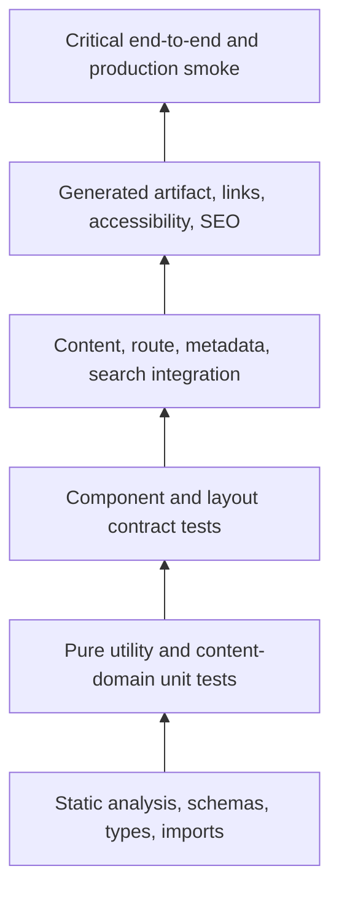
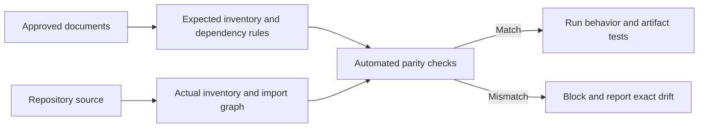
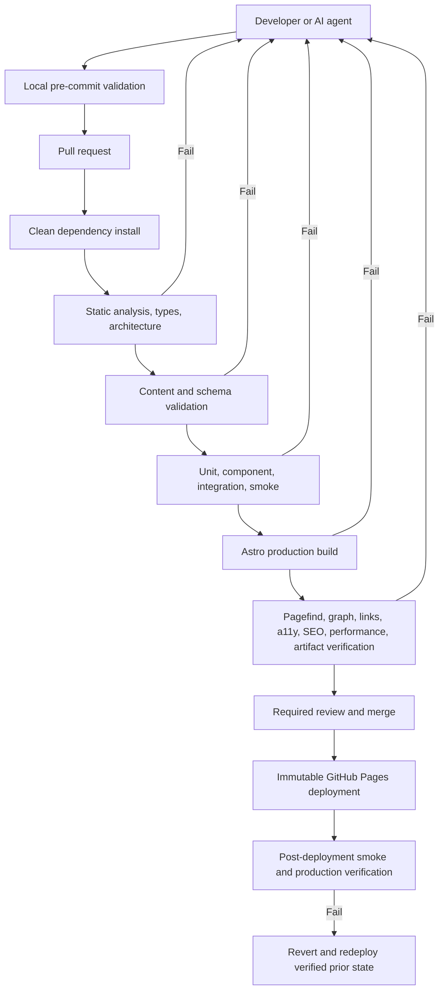

Atlas v0.6.0

# Public Personal Knowledge Garden and Living Portfolio Test Strategy

## Document Status

- **Status:** Authoritative repository quality and testing strategy
- **Date:** 2026-07-21
- **Audience:** Engineers, QA architects, reviewers, maintainers, and AI coding agents
- **Authoritative inputs:** `01_Architecture.md`, `02_FolderStructure.md`, `03_ImplementationGuide.md`, `04_ComponentRegistry.md`, `05_ContentModel.md`, `06_CodingStandards.md`, and `07_MilestonePlan.md`
- **Deployment and operations:** `09_DeploymentGuide.md`
- **Decision record:** `docs/decisions/0001-public-personal-knowledge-garden-and-knowledge-graph.md`
- **Applies to:** Development, content authoring, pull requests, builds, releases, deployment, and production verification

## Strategy Authority

This document is the single source of truth for quality governance, test responsibilities, validation depth, test data, automation stages, release evidence, and regression expectations. It validates the approved architecture; it does not select or introduce a testing framework, change milestone order, or create implementation code.

Testing tools are selected and configured only inside the milestone that introduces the corresponding command or quality gate. Tool choice must satisfy this strategy and the approved technology/dependency constraints. No requirement in this document authorizes Playwright, Vitest, Jest, a browser framework, a hosted testing service, or any other unapproved package.

When a requirement conflicts with an approved source, testing stops and reports the conflict. A test must never redefine the architecture merely because a different design is easier to automate.

## 1. Purpose

### Goals

The quality strategy must provide confidence that:

- The implementation preserves static Astro generation and GitHub Pages behavior.
- Folder ownership, dependency direction, routes, layouts, components, and content collections do not drift.
- Every registered component fulfills its public contract and accessibility obligations.
- Content and relationships remain valid, public-safe, searchable, and SEO-ready.
- Domains, typed connections, graph identity, prerequisite DAG, manifest, static fallback, and visual enhancement remain valid and deterministic.
- Every milestone leaves a reproducible, warning-free, deployable build.
- Regressions are detected at the cheapest reliable layer before production.
- Tests remain deterministic, maintainable, diagnostic, and proportional to risk.

### Scope

This strategy governs static analysis, type checking, builds, units, components, layouts, integrations, content, accessibility, SEO, performance, end-to-end behavior, smoke tests, regression, manual exploration, CI/CD validation, test data, and production verification.

It does not prescribe test implementation syntax, generate test cases, or replace the milestone-specific command matrix.

### Relationship to source documents

| Document | Quality relationship |
| --- | --- |
| `01_Architecture.md` | Defines architecture compliance, quality gates, accessibility/performance targets, static output, Pagefind, Knowledge Graph, Pages deployment, and security constraints. |
| `02_FolderStructure.md` | Defines test folders, source ownership, import rules, routes, generated paths, and prohibited structures to validate. |
| `03_ImplementationGuide.md` | Defines contracts, pipelines, error behavior, layer-specific test targets, build verification, and Definitions of Done. |
| `04_ComponentRegistry.md` | Defines the closed component/layout inventory and the exact contract each registered item must satisfy. |
| `05_ContentModel.md` | Defines field semantics, relationships, URLs, taxonomy, lifecycle, assets, search, SEO, and content governance invariants. |
| `06_CodingStandards.md` | Defines type safety, deterministic code, testing expectations, accessibility, performance, PR validation, and AI rules. |
| `07_MilestonePlan.md` | Defines when each quality capability is introduced, cumulative commands, milestone gates, and exit criteria. |

### Why tests validate architecture

A page may look correct while violating the approved system: a component may query collections, a graph controller may import build-time code, an edge may form a prerequisite cycle, a link may fail under `/engineering-lab/`, or a visual graph may replace accessible semantic HTML. Feature-only tests would miss these defects. Quality therefore validates user-visible behavior, architectural ownership, graph semantics, dependency direction, static output, content integrity, and reproducibility.

## 2. Quality Philosophy

### Adopted principles

| Principle | Application | Reason |
| --- | --- | --- |
| Test pyramid | Many fast static/unit/content checks, fewer component/integration checks, and a small critical E2E layer. | Keeps feedback fast while reserving expensive checks for cross-system risk. |
| Testing trophy | Integration and generated-artifact checks receive strong emphasis because Astro routes combine schemas, content domain, layouts, metadata, and base paths. | Confidence comes from validating contracts at real boundaries, not maximizing isolated unit count. |
| Shift left | Schema, types, imports, relationships, accessibility semantics, and URL rules are validated during authoring/development. | The cheapest defect is one rejected before a full build or review. |
| Fail fast | Run the narrowest relevant check first, then broaden to milestone gates. Stop on invalid source or architecture drift. | Shortens diagnosis and prevents dependent failures from obscuring the cause. |
| Continuous validation | Every milestone and pull request repeats all applicable earlier checks. | The repository remains cumulatively buildable and regressions cannot hide between phases. |
| Automation first | Automate deterministic rules that can block builds; reserve human review for meaning, usability, and exploratory risk. | Repeated objective decisions should not depend on reviewer memory. |
| Risk based | Depth scales with blast radius, user impact, architectural centrality, and change frequency. | High-risk URL, schema, layout, metadata, and deployment changes receive more evidence than copy-only edits. |
| Regression prevention | Every defect adds the cheapest reliable failing check when practical. | The repository learns from failures instead of relying on repeated manual caution. |
| Deterministic testing | Explicit fixtures, stable ordering, fixed locale/time inputs, no network dependency, and clean artifacts. | Flaky tests erode trust and create unsafe bypass pressure. |
| Confidence driven | Coverage is judged by contract/risk coverage, not raw test or line percentages. | A small set of meaningful assertions is stronger than duplicated shallow tests. |
| Single ownership | One test layer owns each invariant; higher layers verify integration without repeating all lower-layer permutations. | Prevents duplicated coverage and inconsistent expectations. |

### Test portfolio

The pyramid is not a quota. Static and unit checks carry exhaustive deterministic permutations; integration and artifact checks carry architectural composition; E2E carries only journeys whose risk cannot be proven cheaply below.

## 3. Quality Gates

### Gate matrix

| Gate | Required validations | Blocking conditions | Expected artifacts | Definition of Success |
| --- | --- | --- | --- | --- |
| Development | Focused static/type/schema check; focused unit/component/content validation; current milestone build command where available. | New diagnostic, warning, failing focused test, architecture/folder violation, nondeterminism, or broken build. | Local diagnostics and focused test/build output; no committed generated files. | Changed behavior passes focused checks and existing relevant regressions before broader work continues. |
| Pull Request | Clean install as required; `npm run check`; content validation when introduced; focused and cumulative tests; production build; applicable links/a11y/SEO/artifact checks; documentation parity. | Any project warning/error, failed test, missing evidence, future-milestone scope, undocumented API/component, draft leakage, or generated artifact in source control. | CI logs, test reports, production artifact for validation, accessibility/SEO evidence, and visual evidence when relevant. | All active-milestone commands and PR review checklist pass from a clean runner. |
| Merge | Required reviews resolved; PR gate green on current revision; source documents synchronized; no unresolved blocker/flaky waiver. | Stale approval/check, unresolved review, failing branch protection, architecture ambiguity, incomplete milestone exit criteria. | Approved PR, immutable commit, complete validation record. | Protected default branch receives only a reviewed, validated, milestone-compliant change. |
| Release Candidate | M11 clean command sequence; full regression; internal links/assets; artifact verification; graph manifest/bundle parity; accessibility; Lighthouse; SEO/feed/sitemap; no-warning policy. | Any quality budget miss, unresolved severity blocker, flaky gate, local/CI artifact mismatch, inaccessible graph/critical flow, or missing Pagefind/graph artifact. | Immutable candidate `dist/`, reports in ignored test-result locations, release validation summary. | One warning-free clean sequence produces the exact candidate eligible for deployment. |
| Production Deployment | M12 protected workflow repeats release gates, uploads one immutable artifact, uses minimal permissions/concurrency, and performs post-deploy smoke. | Failed prerequisite, artifact mutation/mismatch, wrong base path, deployment race, missing required route/search/graph/feed/sitemap, or failed production smoke. | Pages deployment record, source commit/artifact identity, post-deployment result, rollback reference. | Verified candidate, including same-build graph HTML/manifest/controller, is served beneath `/engineering-lab/` and rollback remains executable. |

### Severity and blocking policy

| Severity | Definition | Gate behavior |
| --- | --- | --- |
| Blocker | Architecture corruption, build/deploy failure, secret/private/draft exposure, inaccessible critical journey, missing production route/artifact, data/reference loss. | Blocks development completion, merge, and release. |
| High | Incorrect URL/canonical, broken navigation/search, schema/reference defect, WCAG failure, major SEO/performance regression. | Blocks merge and release; normally blocks milestone exit. |
| Medium | Noncritical rendering, responsive, metadata, or content-quality defect with a usable workaround. | Must be fixed in active milestone unless explicitly accepted with owner and deadline; cannot be silently deferred. |
| Low | Minor polish or documentation defect with no contract/user impact. | Tracked and resolved according to milestone/PR scope; does not justify weakening a gate. |

Project-controlled warnings are failures, not a lower severity category.

## 4. Testing Levels

| Level | Purpose and scope | Owner | Frequency | Success criteria |
| --- | --- | --- | --- | --- |
| Static analysis | Enforce formatting/lint policy, prohibited patterns, warning policy, and basic source consistency. | Implementer; CI is enforcement owner. | After relevant edits; every PR/build. | Zero project-controlled errors/warnings and no prohibited source pattern. |
| Type checking | Verify strict TypeScript, Astro props, shared contracts, discriminated unions, and no `any`/unsafe suppression. | Implementer and module owner. | After typed contract changes; every PR. | Strict compiler/Astro diagnostics are zero; negative type expectations remain intentional. |
| Import/architecture checking | Verify folder ownership, allowed dependency direction, no cycles, one MDX barrel, no reverse/browser-build imports. | Architecture owner; automated CI. | Every structural/API change; full PR/RC. | Import graph matches approved documents and topological checks pass. |
| Build validation | Prove clean static generation, base-path correctness, required outputs, and warning-free compilation. | Implementer; build/platform owner. | Every milestone; every PR; RC/deploy. | `npm run build` succeeds and produces deterministic approved output. |
| Unit testing | Exhaust pure/content-domain rules: URLs, slugs, domains/tags, dates, sorting, references, series, graph IDs/edges/cycles/manifest, and SEO transformations. | Module owner. | With behavior change; cumulative in PR/CI. | Normal, boundary, invalid, immutability, cycle, and deterministic cases pass. |
| Component testing | Verify each registered component/layout contract: props, slots, semantics, optional states, responsive behavior, and no forbidden hydration. | Component owner; accessibility reviewer for interactive output. | With component/layout change; cumulative by milestone. | Registry Definition of Done and category risk scenarios pass. |
| Integration testing | Verify schemas, content/graph domain, routes, layouts, metadata, graph fallback/manifest, Pagefind metadata, RSS/sitemap, and base-path composition together. | Feature/module owner and QA. | At collection/route/search/graph changes; PR/RC. | Boundaries exchange the same normalized public model and failures surface at the owning layer. |
| Content validation | Verify frontmatter, schemas, IDs, slugs, domains/tags, assets, typed connections, prerequisite DAG, series, drafts, graph readiness, orphan rules, and publication readiness. | Content author and content/graph platform owner. | Every content/schema change; PR/build. | All `05_ContentModel.md` invariants pass with actionable diagnostics. |
| Accessibility testing | Verify WCAG 2.2 AA semantics, keyboard, focus, names/states, reflow, contrast, motion, forms, media, dynamic search, and graph fallback/controls/details. | Implementer plus accessibility reviewer. | With UI/content changes; representative full suite at M11/RC. | Automated checks and required manual graph/screen-reader evidence have no unresolved violation. |
| SEO validation | Verify metadata, canonical, robots, structured data, social cards, headings, links, sitemap, RSS, and 404 behavior. | Route/metadata owner and QA. | With route/content/metadata change; build/RC. | Unique valid metadata and crawler artifacts match visible content and approved URLs. |
| Performance testing | Verify Lighthouse budgets, generated JavaScript, graph manifest/bundle, images/fonts, layout shift, lazy loading, caching, and route-local client scope. | Performance/build owner. | Risky UI/asset/script changes; M11/RC/production profile. | Approved budgets and graph-route baselines pass without threshold relaxation or unexplained regression. |
| End-to-end testing | Verify critical journeys across generated pages, navigation, search, graph, topics, content, 404, and deployed base path. | QA/system owner. | M9 onward for affected journeys; full RC/production smoke. | Critical static and enhanced journeys complete using public behavior with no internal implementation dependency. |
| Smoke testing | Rapidly verify required route families and critical artifact health. | Implementer locally; CI/deployment automation. | Every production build from M9; post-deploy. | All required entry points load, essential links work, and no blocker is observed. |
| Regression testing | Re-run accumulated relevant checks based on change impact and full suite at release. | Implementer and QA. | Every PR by impact; full M11-M13. | Previously approved contracts and critical journeys remain unchanged unless intentionally updated. |
| Manual exploratory testing | Discover usability, content, responsive, assistive-technology, and integration risks not captured by deterministic automation. | QA, designer/content reviewer, accessibility reviewer. | Risk-based before milestone exit/RC; after major visual/content changes. | Findings are recorded, reproducible, prioritized, and resolved or explicitly accepted before gate success. |

## 5. Architecture Validation

### Architecture compliance matrix

| Surface | Invariant | Validation method | Blocking result |
| --- | --- | --- | --- |
| Folder structure | Every source/test/config file uses an approved path; no generic or generated folder is committed. | File inventory against `02_FolderStructure.md`; ignored-path/status scan. | Unknown folder/file owner or committed generated output. |
| Routing | Exactly the approved route files/logical URLs; static paths exclude drafts and preserve `/engineering-lab/`. | Route-file inventory; build artifact route manifest; direct deep-link/refresh smoke. | Missing/extra/duplicate route, path collision, root-only link, or draft route. |
| Layouts | Exactly five layouts; specialized layouts compose `SiteLayout`; article/note share `KnowledgeLayout`. | Registry/file parity; import graph; representative rendered fixtures. | Sixth layout, duplicate shell, wrong consumer, or broad collection query. |
| Components | Exactly 36 Astro components plus two browser controllers; each appears once in registry and assigned milestone. | Registry/file/export parity; orphan/duplicate check; lifecycle validation. | Unregistered, duplicate, orphaned, moved, or renamed component. |
| Content collections | Exactly `articles`, `notes`, `projects`, `series`; separate strict schemas. | Collection registration/folder inventory; valid/invalid fixtures. | Fifth collection, permissive/merged schema, or handwritten conflicting model. |
| Knowledge Graph | Every public entry has stable node identity; domains/connections validate; prerequisites are acyclic; `GraphManifest` and static fallback match. | Graph-domain unit tests, cycle detection, deterministic serialization, HTML/JSON parity, draft/private allowlist checks. | Invalid edge/domain, cycle, nondeterminism, duplicate model, draft/private leakage, or graph HTML/manifest mismatch. |
| Navigation | Config-driven, base-safe, crawlable, accessible without JavaScript. | Config/link assertions; keyboard/no-script smoke; active-state cases. | Hard-coded duplicate source, inaccessible target, script-only navigation, or base failure. |
| Dependency rules | Pages→layouts/domain; layouts→components; components→utilities/types; no reverse/cycle. | Static import graph and topological sort; prohibited import scan. | Cycle, reverse import, browser→build-time dependency, or hidden dynamic cycle. |
| Import/export rules | Direct component imports; only MDX barrel; named utility/domain exports; type-only imports where appropriate. | Source scan and module graph. | Second barrel, hidden alias, broad export, or runtime type dependency. |
| Configuration | Typed site/navigation config; static site/base; no secrets; local/CI parity. | Config contract tests; build output; secret/value scan. | Conflicting base/origin, runtime secret, mutable/public drift, or workflow-only build config. |
| Static/client boundary | Complete static HTML; no React/framework/client directives; browser code only search, graph, and minimal mobile navigation. | Generated HTML/script inventory; route-local bundle scan; no-script search/graph journeys. | Unapproved hydration/framework, raw collection data shipped to browser, graph code on other routes, or client-only content. |
| Documentation parity | Numbered documents, registry, model, standards, milestone plan, and source remain synchronized. | Exact inventory/reference checks in CI. | Stale name, undocumented API/schema/component, or source-document conflict. |

### Architecture drift control

Architecture checks run before expensive browser/performance checks. Drift is never accepted by updating expectations automatically; source changes require prior approval and synchronized documents.

## 6. Component Validation

### Universal component contract

Every one of the 43 registered items must be validated against its unique `04_ComponentRegistry.md` record.

| Contract area | Required validation |
| --- | --- |
| Rendering | Valid required props produce semantic static output; optional regions appear only with valid data. |
| Props | Required/optional/default/readonly behavior matches registry; invalid discriminants fail type or boundary validation. |
| Slots | Approved default/named slots render in correct semantic regions; absent optional slots leave no empty wrappers/landmarks. |
| Events | Only registered native/browser events exist; no hidden custom event bus or focus side effect. |
| Accessibility | Native semantics, names, states, keyboard, focus, headings, contrast, reflow, and reduced motion pass as applicable. |
| Responsive behavior | Long titles, labels, domains/tags, skills/tools, graph controls/details, code, tables, media, and search results do not clip, overlap, or reorder incoherently. |
| Error/empty/loading state | Valid absence uses approved omission/`EmptyState`; invalid required data fails before render; search/graph states are distinguishable and accessible. |
| Fallback | Static/no-script behavior remains useful; Pagefind, Cytoscape/manifest, and mobile-nav enhancement failures preserve navigation/content/connections. |
| Reusability | All approved consumers use the same component; no route-specific duplicate or consumer-only hidden assumption. |
| Composition | Direct dependencies match registry and do not exceed approved depth/cycle rules. |
| SEO | Visible semantic data/links agree with metadata ownership; non-metadata components emit no duplicate head tags. |
| Hydration | Static items ship no hydration; browser controllers load only on search/graph; Cytoscape.js is lazy/graph-route-local; mobile script remains minimal/local. |

### Registered-item validation matrix

This matrix adds the risk-specific focus to the universal contract; it does not replace it.

| Registered item(s) | Required risk scenarios |
| --- | --- |
| `SiteLayout` | One document shell/main/H1 contract, language, skip target, metadata placement, no duplicate chrome, base-safe assets. |
| `ListingLayout` | Populated/empty, optional intro/filter/pagination, result count, long summaries, canonical pagination context. |
| `KnowledgeLayout` | Article/note variants, TOC on/off, series first/middle/last/none, related empty/mixed, dates/tags/status, long MDX. |
| `ProjectLayout` | Full/minimal facts, optional external links, TOC/related content, project structured-data consistency. |
| `SeriesLayout` | Mixed article/note order, nonempty sequence, entry labels, introduction, no-script navigation. |
| `SiteIdentity`, `PrimaryNavigation`, `MobileNavigation`, `Header`, `Footer`, `SkipLink` | Current-route states, desktop/mobile, keyboard/Escape, no-script navigation, focus order, external profiles, long labels, one landmark identity. |
| `ArticleSummary`, `NoteSummary`, `ProjectSummary`, `SeriesSummary` | Full/minimal view model, long title/description/tags, no nested link, status/maturity/count, every approved consumer. |
| `ExternalLink`, `HeadingAnchor`, `Prose`, `TableOfContents` | Safe external behavior, fragment uniqueness/base path, heading-depth variants, empty TOC, code/table/media overflow, zoom/reflow. |
| `Breadcrumbs`, `CollectionNavigation`, `Pagination`, `TagList`, `TopicLink` | Current state, first/middle/last/single page, normalized tags/counts, base-safe URLs, narrow overflow, accessible navigation labels. |
| `EmptyState`, `RelatedContentList` | Valid empty/action/no-action, mixed content types, no empty landmark, no collection query, duplicate/self exclusion. |
| `SearchForm`, `SearchResults` | No-script query submission, initial/loading/results/empty/unavailable states, labels/live region, no focus theft, long excerpts. |
| `ContentStatus`, `PublicationDates` | Every allowed value, text not color-only, same/no update, machine-readable dates, compact/full modes. |
| `DocumentHead`, `StructuredData` | Unique tags/canonical, optional image, robots states, valid safe JSON, visible-content parity, no duplicate serialization. |
| `ProjectFacts` | Full/minimal period/status/role/skills/tools/URLs, missing optional rows, chronology, secure external links. |
| `SeriesEntryList`, `SeriesNavigation` | Mixed ordered members, first/middle/last, no-series, descriptive links, current state, exact resolved order. |
| `Callout`, `Figure` | Every allowed callout variant, non-alert semantics, informative/decorative image, caption/alt nonduplication, dimensions and missing asset failure. |
| `ConnectionList` | All seven edge types, incoming/outgoing/symmetric labels, context, deterministic grouping, empty/isolated state, base-safe direct links, no color-only meaning. |
| `GraphControls`, `GraphNodeDetails`, `GraphExplorer` | Search/filters, no-selection/selected/isolated/empty states, semantic fallback, stable visual mount, keyboard/focus, reduced motion, long data, no-script and manifest-failure behavior. |
| `pagefind-search` | Direct query, input/submit, debounce, history/back-forward, Pagefind unavailable, no results, result mapping, base-safe URL, script loaded only on search. |
| `graph-explorer` | Lazy Cytoscape import, manifest version/parity, bounded ego graph, filters/selection/history, empty/isolated/error states, reduced motion, no focus theft, base-safe links, route-local bundle. |

### Component Definition of Done evidence

- Registry item/file/milestone parity passes.
- Focused tests cover universal and risk-specific scenarios.
- Representative rendered output passes automated accessibility and manual keyboard/reflow checks where applicable.
- No forbidden imports, hydration, duplicated styles, dead props, warning, or undocumented API exists.
- Current milestone commands and all relevant component regressions pass.

## 7. Content Validation

### Validation matrix

| Content concern | Required checks | Failure behavior |
| --- | --- | --- |
| MDX/Markdown | Parseability, one frontmatter-owned H1, body starts H2, valid heading hierarchy, language-tagged code, approved MDX components only. | Fail authoring/build with file and construct. |
| Collection schema | Exact shared/collection fields, domains/connections, types, defaults, enums, URLs, dates, conditional pairs, unknown/obsolete-field rejection. | Fail `check`/schema validation with collection/entry/field/rule. |
| Metadata | Required title/description/publishedAt/domains/tags, no duplicate summary/author/category/keywords, valid image/canonical. | Block publication. |
| Slug/identifier | Lowercase kebab segments, unique ID/resolved URL, reserved-path safety, stable path behavior. | Block build and identify all collisions. |
| Domains/tags/taxonomy | Controlled domain values, canonical tag normalization, no duplicate/synonym collision, useful graph/search/topic membership. | Block content validation. |
| Dates | Valid ISO publication/update; update not before publication; valid project month period/chronology. | Block validation. |
| Relationships/graph | Seven typed resolvable non-self unique connections; related symmetry; prerequisite DAG; stable node IDs; one published series per member; article reverse order parity. | Block validation with source/type/target or full cycle path. |
| Draft isolation | No draft route/index/topic/related/series/search/graph/RSS/sitemap/structured-data output. | Block artifact verification/deploy. |
| Orphan prevention | Every published entry has detail route, collection index entry, and derived topic membership. | Block publication/artifact verification. |
| Internal links | Generated internal links and fragments resolve under `/engineering-lab/`. | Block build/PR; report source and destination. |
| External links | HTTPS and editorially valid; deterministic builds do not depend on live external availability. | Invalid URL blocks; transient availability is reported under an approved separate policy. |
| Images/assets | Source exists, belongs to entry/shared owner, safe public type, dimensions/optimization, alt/caption rules, descriptive attachment links. | Block build/validation. |
| Search readiness | Public title/description/collection/domains/tags/URL and visible indexable content; chrome/drafts/noindex excluded. | Block M10 artifact verification. |
| Graph readiness | Deterministic public-field-only nodes/edges, sorted manifest, static fallback/JSON parity, route/base/canonical correctness, no draft/private/integration metadata. | Block M4 validation, M9 build, or M10 artifact verification. |
| Publishing readiness | Factual/privacy/licensing review; schema/content/links/assets/SEO/a11y/build all pass. | Do not merge/publish. |

### Fixture expectations

Each collection has minimal valid, complete valid, and focused invalid fixtures. Invalid fixtures isolate one rule when practical: missing domain/tag/required field, unknown/obsolete field, invalid date/URL/enum/connection, broken target, duplicate/reverse-related edge, prerequisite cycle, duplicate route/tag/series member, self-reference, draft target, missing asset, and reverse-series mismatch.

Content fixtures are not production portfolio claims and must not be deployed or indexed.

## 8. Accessibility Validation

WCAG 2.2 AA is mandatory. Automation catches machine-detectable defects; manual validation covers behavior and meaning.

### Accessibility matrix

| Area | Automated validation | Manual validation | Success criteria |
| --- | --- | --- | --- |
| Semantic HTML | Landmark/element/role/name rules; duplicate IDs; invalid nesting. | Confirm elements match meaning and reading order. | One main/H1, valid landmarks, no semantic misuse. |
| ARIA | Invalid/redundant attributes, missing names, state/target relationships. | Confirm ARIA is necessary and announcements are understandable. | Native semantics preferred; all states/names valid. |
| Keyboard | Focusable controls and obvious traps where detectable. | Tab/Shift+Tab, Enter/Space, Escape, skip link, mobile menu, search, graph filters/node links, pagination. | Complete logical operation with visible focus and no trap. |
| Screen readers | Accessible tree/name checks and live-region markup. | Spot-check representative layouts, dynamic search/graph status, connection direction/context, external context, series navigation. | Content/order/graph relationships/state understandable without visual cues. |
| Focus management | Focus indicator and target existence. | Route load, menu open/close, search/graph updates, error/empty states, node selection, history navigation. | No unexpected focus movement; selected graph state is announced textually with sensible context. |
| Heading hierarchy | Count/order and skipped levels. | Confirm headings describe content hierarchy rather than visual scale. | One H1; MDX starts H2; logical sequence. |
| Contrast | Automated text/control/focus contrast where computable. | Verify states, images/text overlays, every supported theme/viewport. | WCAG 2.2 AA; meaning never color-only. |
| Forms/search | Label, name, description, status/error associations. | Submit without JS, edit query, result updates, unavailable/no-results recovery. | Visible labels and complete keyboard/no-script behavior. |
| Images/media | Alt presence and figure structure. | Validate alt quality, decorative decisions, captions, diagram prose, external media context. | Equivalent purpose/context is available. |
| Reflow/responsive | Viewport and overflow checks. | 320 CSS px equivalent, 200% zoom, long content, code/tables/navigation. | No content/control loss or incoherent overlap. |
| Motion | Reduced-motion CSS/state scan. | Verify nonanimated equivalent and no essential motion dependency. | Reduced preference respected. |
| Knowledge Graph | Semantic connection list/details, labeled filters, visual-region name/instructions, edge label text, stable dimensions. | Navigate/search/filter/select without pointer; disable animation; compare visual and textual relationships; simulate engine/manifest failure. | No canvas-only information; all graph discovery remains usable without visual engine or motion. |

### Representative page set

At minimum, automated and manual coverage includes home, every listing layout state, article, note, project, series, topic, search states, graph static/enhanced/failure states, about, and 404. Use fixtures to cover optional regions without multiplying equivalent full-page tests.

Accessibility regressions are release blocking. A tool exception requires a documented false-positive explanation and a semantic/manual assertion; it is not a blanket rule suppression.

## 9. SEO Validation

| SEO surface | Validation |
| --- | --- |
| Title/description | Present and unique on indexable routes; derived from approved source; no empty/duplicate boilerplate. |
| Canonical | Exactly one absolute canonical; correct origin and `/engineering-lab/`; external canonical only when authored validly; query states do not create variants. |
| Open Graph | Valid type/title/description/URL/site name and absolute reachable image when supplied. |
| Twitter Card | Derived from normalized metadata; image card only with valid image; no conflicting duplicate tags. |
| Structured data | Valid safely serialized JSON; correct schema semantics; values match visible content; no unsafe characters or duplicate entities. |
| Headings | One visible H1; body hierarchy logical; title/H1 represent same content identity. |
| Internal links | Crawlable descriptive anchors; base-safe; collection/topic/series/related links resolve; no draft/private target. |
| Sitemap | Contains canonical public routes only; correct production URLs; excludes drafts, 404, search query variants, and noindex pages. |
| RSS | Valid feed; published articles/notes only; correct absolute links/dates; no drafts. |
| Robots | Index/follow public pages; 404/diagnostics/local drafts/duplicates noindex; robots file points to production sitemap and is not used for secrecy. |
| Graph | `/graph/` has one canonical/indexable metadata set; selected/filter queries do not create canonicals; `/graph/graph.json` is excluded from sitemap/Pagefind documents and contains no SEO duplication. |
| 404 | Generated `404.html`, noindex, clear title, no misleading canonical, base-safe recovery links. |
| Redirect/retirement | Published URL changes require approved retirement/replacement/external redirect behavior; destination/canonical/sitemap/internal links are consistent. |

SEO checks run against generated HTML, RSS, sitemap, and robots output, not only source metadata. Search snippets and social previews are manually reviewed for representative content types because syntactic validity does not prove editorial quality.

## 10. Performance Validation

### Performance targets

| Metric/surface | Target | Enforcement |
| --- | --- | --- |
| Lighthouse performance | At least 90 under the agreed deterministic CI profile. | Blocking at M11/RC; investigate regressions earlier. |
| Lighthouse accessibility, best practices, SEO | 100 under the agreed CI profile. | Blocking at M11/RC. |
| LCP lab target | At most 2.5 seconds on representative pages/profile. | Blocking when measured deterministically; diagnose image/font/render delays. |
| CLS | At most 0.1; avoidable layout shift is a defect even below threshold. | Blocking for avoidable UI/media shifts. |
| Total Blocking Time lab proxy | At most 200 ms. | Blocking when client work exceeds approved scope. |
| INP field objective | At most 200 ms when approved field data becomes available. | Informational until privacy-approved field measurement exists; lab interaction checks remain mandatory. |
| Non-search/non-graph application JavaScript | Zero except approved minimal mobile-navigation behavior. | Source/artifact inventory blocks unapproved script. |
| Search JavaScript | Pagefind/controller only, route-local to `/search/`. | Any unrelated/shared browser payload blocks completion. |
| Graph JavaScript | `graph-explorer` plus lazy Cytoscape.js only, route-local to `/graph/`. | Any graph code on non-graph routes, eager shared engine, or unexplained bundle increase blocks completion. |
| Graph manifest | Deterministic public-field-only data; size baseline established from fixture corpus. | Nondeterminism, body/private fields, or unexplained growth blocks completion. |
| Layout stability | Intrinsic dimensions/aspect ratios for visual media and stable control geometry. | Visual/artifact checks. |

### Validation areas

- **Bundle size:** Record generated JavaScript/CSS/assets by route. Any new browser bundle or material unexplained increase requires owner review. After M10, search- or graph-route baseline increases greater than the stricter of 5 KiB compressed or 10% require explicit investigation; this is a review trigger, not permission to exceed architecture constraints.
- **Hydration:** Assert no framework runtime and no `client:*` directives. Verify complete static content before scripts execute.
- **Images:** Validate dimensions, responsive variants, format, loading priority, alt, and no unoptimized content image in `public/`.
- **Fonts:** Validate only required local files/weights, limited preload, swap behavior, and no third-party font script.
- **Code splitting:** Search/graph/mobile scripts remain feature-local; Cytoscape.js is lazy; no convenience shared client bundle.
- **Lazy loading:** Below-the-fold media may be lazy; primary navigation/text/critical image is not incorrectly deferred.
- **Caching:** Fingerprinted assets are immutable/cacheable; HTML remains artifact-versioned; production artifact is not mutated after upload.
- **Rendering:** Build output and graph manifest are deterministic and complete; no client rendering of collection content and default graph scope is bounded.

Performance tests use the same representative pages, content fixtures, environment profile, and throttling configuration for baseline comparison. Network variance is not masked with retries until a pass appears.

## 11. Build Validation

### Build contract

| Stage | Required verification |
| --- | --- |
| Install | `npm install` locally when intentional; `npm ci` for clean release/CI. Lockfile and Node version are reproducible. |
| Static/check | Formatter/lint policy, strict TypeScript, Astro diagnostics, architecture/import checks, and no project warnings. |
| Content | Schema and cross-entry validation, assets, links, domains/tags, dates, connections/prerequisite DAG, drafts, URLs, and orphan rules. |
| Compile/generate | Astro static generation succeeds for approved route inventory and `/engineering-lab/` base. |
| Search/graph | From M9 graph HTML/manifest are static; from M10 Pagefind indexes completed public HTML and Cytoscape/controller enhance graph output. |
| Artifact | Required routes, `404.html`, RSS, sitemap, robots, search assets, graph HTML/manifest/controller/Cytoscape parity, base-safe references, metadata, and no draft/private leakage. |
| Links/assets | Internal/fragment/asset links resolve in generated output; external syntax is valid without making build determinism depend on network. |
| Tests | All milestone-required focused and accumulated regression suites pass. |
| Deployment readiness | One immutable artifact, no secrets/source-only files, local/CI parity, and successful preview/smoke. |

### Milestone command progression

The command contract and introduction milestones are owned by `07_MilestonePlan.md`. Tests must not call a command before its milestone introduces it, and no unavailable command may be represented by a passing no-op script.

| Capability | Introduced | Required thereafter |
| --- | --- | --- |
| `npm run check`, `npm run build` | M0 | Every milestone. |
| Unit tests | M2 | Changed utility/domain behavior and cumulative regressions. |
| Schema fixtures | M3 | Every schema/content contract change. |
| `npm run validate:content` | M4 | Every content/domain/build gate. |
| Focused component/accessibility tests | M5 | Every component/layout milestone and later regression. |
| Smoke tests | M9 | Every production build from M9 onward. |
| `npm run verify:build`, link checks, Pagefind/graph artifact | M10 | Every complete artifact and later gate. |
| Full a11y/Lighthouse/regression profile | M11 | Release candidate, CI, deployment, and final validation. |

Build failures stop the pipeline. Partial output is never uploaded or treated as a usable result.

## 12. Regression Strategy

### Regression scope by change

| Change trigger | Minimum regression scope |
| --- | --- |
| Documentation only | Document links/numbering/parity, Markdown diagnostics, architecture references, whitespace. |
| Pure utility | Focused unit permutations plus all direct consumer tests and build. |
| Shared type/schema | Type checks, valid/invalid domain/connection fixtures, all content/graph consumers, route build, metadata/search/graph regressions. |
| Component | Component contract, approved consumers, owning layouts/routes, accessibility/responsive scenarios. |
| Layout | All route families using layout, semantics/metadata/accessibility, long/empty/optional states. |
| Content entry | Schema/content/links/assets, route/index/topic/connections/graph node, search/SEO/feed where applicable. |
| Content model/domain | Full fixtures, queries/references/series/graph IDs/edges/cycles/manifest, all route families, search/RSS/sitemap. |
| URL/base/config | Full route/link/canonical/search/graph/feed/sitemap/404/artifact suite. |
| Browser search/graph/mobile script | Unit where pure, integration, keyboard/focus/history/failure, route-local payload, no-script fallback. |
| Dependency/build/workflow | Clean install, full build/test/artifact pipeline, local/CI parity, deployment safety. |

### Smoke versus full regression

- **Smoke:** Fast critical route/artifact health; no exhaustive variants. Runs from M9 on every production build and post-deploy.
- **Impact regression:** Focused change surface plus direct/transitive consumers and architecture checks. Runs on every PR.
- **Full regression:** All deterministic suites, representative accessibility/SEO/performance, and complete artifact validation. Runs at M11-M13 and when shared contracts/base/build pipeline change.

### High-risk areas

- `/engineering-lab/` URL construction, canonicals, and generated links.
- Content schema evolution, draft isolation, references, and series ordering.
- `SiteLayout`, metadata components, navigation, and shared view models.
- Pagefind post-build ordering, result URLs, history/focus, and index absence.
- Knowledge Graph ID/edge semantics, prerequisite cycles, manifest determinism, Cytoscape bundle scope, history/focus, and static fallback parity.
- RSS, sitemap, robots, 404, and deployment artifact composition.
- Accessibility semantics and responsive behavior of global/knowledge layouts.
- Build/CI commands, dependency lockfile, workflow permissions, and deployment concurrency.

### Critical journeys

1. Open home beneath project base and navigate to each collection.
2. Browse a topic and open each represented content type.
3. Read article/note, use TOC, series previous/next, tags, and related links.
4. Inspect project facts and optional repository/live links.
5. Open a series and traverse ordered article/note entries.
6. Search by direct query and input, navigate results, use browser back/forward, and recover from unavailable/no-results state.
7. Explore `/graph/` without JavaScript, filter/select a node with enhancement, follow typed connections, use back/forward, and recover from manifest/engine failure.
8. Reach and recover from `404.html`.
9. Load graph manifest, RSS/sitemap/canonical URLs and confirm no drafts/private/integration content.

### Baseline and visual regression

- Baselines are generated from an approved deterministic artifact, viewport set, fixture set, fonts, and environment.
- Visual regression is risk-based for global chrome, five layouts, summary cards, search states, graph controls/details/bounded neighborhoods, and responsive/long-content scenarios.
- No visual testing framework is selected by this document. Screenshot automation may become a gate only when configured in an approved milestone/tooling decision with stable baselines and diagnostic review.
- Pixel differences never replace semantic/accessibility assertions. Intentional visual changes update baselines only after review; automated baseline regeneration is prohibited.

### Content regression

Compare route inventory, IDs/slugs, domain/tag counts, series membership/order, graph node/edge/type counts and manifest digest, metadata/canonical sets, RSS/sitemap membership, Pagefind document count/metadata, and draft count against approved expectations. A count change must be explainable by the content change, not blindly accepted.

## 13. Test Data Strategy

### Data classes

| Data class | Purpose | Location/lifecycle |
| --- | --- | --- |
| Minimal valid fixtures | Prove required fields/defaults and minimal rendering for each collection. | `tests/fixtures/content/`; stable and version controlled. |
| Complete valid fixtures | Exercise all optional fields, assets, relationships, metadata, and rendering regions. | Same fixture root; changed only with approved contracts. |
| Invalid fixtures | Isolate one schema/domain failure per case when practical. | Same fixture root; expected diagnostic documented by test name/assertion. |
| Route/page fixtures | Build representative content combinations for home/list/detail/topic/search/404 tests. | Test-only content; never deployed or indexed in production. |
| Performance/a11y fixtures | Stable long title, domains/tags/skills/tools, code, table, image, series, graph topology, and search-result data. | Reused across relevant tests to make comparison deterministic. |
| Production content | Real authored entries. | Not used as the only test basis; validated as corpus in build/content checks. |

### Determinism and isolation

- Use fixed explicit dates, IDs, slugs, tags, URLs, locale, and sorting tie-breakers.
- Do not depend on current time, network, Git history, execution order, random data, or machine-specific paths.
- If unique values are required, derive them deterministically from the test case name.
- Each test creates/uses isolated inputs and does not mutate shared fixtures.
- Build tests start from a clean output directory; generated output goes only to ignored locations.
- Browser/storage/history state is reset between scenarios.

### Naming

Use `<subject>--<condition>--<expected>` for fixture directories/files where verbose names improve diagnosis, in lowercase kebab-case. Examples of conditions include `valid-minimal`, `valid-complete`, `invalid-missing-title`, `invalid-broken-reference`, and `invalid-draft-series-target`.

### Mocks and fakes

- Prefer real pure/domain modules and controlled fixture data.
- Mock only unstable external/browser boundaries such as Pagefind unavailable, graph manifest/Cytoscape failure, or browser history state.
- Do not mock the unit under test, Astro content semantics, or URL builder when validating integration.
- Network calls are not part of deterministic core tests.

### Lifecycle and cleanup

- Fixtures evolve with schema changes in the same milestone.
- Obsolete fixtures are removed only after their rule/consumer is removed and regression coverage is preserved elsewhere.
- Temporary files, screenshots, reports, coverage, and generated sites are cleaned or written to ignored paths.
- A test must pass when run alone, in any order, and after another test fails.

## 14. CI/CD Validation Pipeline

### Pipeline stages

| Stage | Responsibility |
| --- | --- |
| Developer | Implement only active milestone scope; add focused tests and documentation. |
| Local pre-commit validation | Run focused check immediately after changes, then active milestone command row. This is a workflow stage, not authorization for a new hook tool. |
| Pull request | Execute clean automated gates, attach evidence, review architecture/content/component impact. No production deployment. |
| Clean install | Restore exact lockfile/Node environment and prove reproducibility. |
| Static analysis | Reject lint/type/Astro/import/architecture drift before expensive tests. |
| Content validation | Reject schema, domain/connection/graph-cycle, taxonomy, URL, asset, draft, and orphan defects. |
| Testing | Run focused and cumulative deterministic suites according to milestone/risk. |
| Build | Generate the static artifact with the production site/base. |
| Artifact validation | From M10/M11, verify Pagefind, graph HTML/manifest/controller/Cytoscape parity, routes, links, metadata, a11y, SEO, performance, RSS/sitemap/robots, and no drafts/private data. |
| Review/merge | Require green current-revision checks and resolved reviews under branch protection. |
| Deployment | Re-run required gates, upload one immutable artifact, serialize production deployment, use minimal permissions. |
| Post-deployment | Verify critical routes/journeys/base/search/feed/sitemap/404 and source-to-artifact identity. |

CI invokes package scripts; workflow YAML does not duplicate application validation logic. Failed stages stop downstream artifact upload/deployment.

## 15. AI Testing Rules

AI coding agents must follow these rules exactly:

1. Read all nine numbered documents plus the approved graph ADR and identify the active milestone before test or source changes.
2. Never bypass, skip, disable, quarantine, retry-until-pass, or weaken a quality gate.
3. Never change architecture, schema meaning, registry contract, threshold, or test expectation merely to make a failure pass.
4. Run the cheapest focused check immediately after the first substantive edit, then broaden to milestone validation.
5. Add tests for new public behavior, bug fixes, schema rules, domains/connections, graph cycles/manifest, error states, and architectural boundaries.
6. Search existing tests and ownership before adding coverage; never duplicate the same invariant at multiple layers without an integration reason.
7. Keep tests deterministic: no network, implicit current time/locale, random values, execution-order dependency, or machine-specific path.
8. Never use production content as the only fixture or invent professional facts as test data.
9. Update valid/invalid fixtures and content validation in the same change as an approved schema/content-model change.
10. Validate every changed registered component against its registry record, approved consumers, and accessibility obligations.
11. Preserve no-script/static behavior and verify Pagefind, graph manifest/Cytoscape, and mobile enhancement failure states.
12. Do not add a testing framework, browser framework, hosted service, package, folder, or command outside the active milestone and approved dependency process.
13. Do not create a no-op package script to satisfy a milestone command before its implementation exists.
14. Do not overuse snapshots; prefer explicit assertions that identify the broken contract.
15. Do not update visual baselines automatically or accept unexplained route/content/graph count, manifest digest, bundle, or performance changes.
16. Treat warnings, flaky behavior, unhandled console errors, and accessibility violations as failures.
17. When a test fails, identify whether source, fixture, expectation, environment, or architecture is wrong before editing.
18. If an architecture change is approved, update validation rules and source documents before implementation expectations.
19. Report commands run, exact results, skipped/not-yet-introduced gates, residual risks, and whether milestone exit criteria pass.
20. Stop and report ambiguity or conflicting quality ownership instead of guessing.

## 16. Coverage Expectations

Coverage is qualitative and risk-based. Line/branch metrics may identify untested code, but no universal percentage is a substitute for contract coverage.

| Layer | Expected confidence |
| --- | --- |
| Pure utilities | Exhaustive normal, boundary, invalid, deterministic, immutability, and project-base cases for every exported behavior. |
| Content/graph-domain modules | Exhaustive production filtering, stable sorting, references, series, graph IDs/edges/symmetry/cycles/neighborhood/manifest, duplicate/self/draft failures, and diagnostics. |
| Shared types/schemas | Every required/optional/default/domain/connection/enum/conditional rule has valid and invalid evidence; discriminated unions have exhaustive consumers. |
| Components | Every registry record has universal contract coverage plus its risk scenarios; every public prop/slot/state is exercised meaningfully. |
| Layouts | All five layouts cover populated/minimal/empty/optional regions, semantics, metadata, responsive behavior, and approved route consumers. |
| Routes/integration | Every approved route family and data endpoint, graph HTML/JSON parity, 404, base path, draft exclusion, metadata, and content flow is represented. |
| Content validation | Every rule in `05_ContentModel.md` has positive and negative validation where machine-testable; production corpus is validated as a whole. |
| Accessibility | Every representative page/layout type automated; interactive patterns manually keyboard/focus checked; screen-reader spot checks cover global, knowledge, project, series, search, and graph fallback/details. |
| SEO | Every route class has title/description/canonical/robots/structured-data assertions; RSS/sitemap/404/search/graph variants verified. |
| Performance | Representative pages and high-risk asset/script/graph-manifest changes measured under one profile; client-script inventory checked on all routes. |
| Build/artifact | Clean install, production build, required files/routes, Pagefind, graph artifacts, links/assets, no drafts/private data, and local/CI parity fully covered. |
| Critical flows | Each critical journey has one reliable end-to-end path plus lower-level coverage for permutations and failures. |

Duplicated assertions that fail for the same cause at multiple layers should be consolidated unless each layer protects a distinct contract.

## 17. Testing Checklist

### Architecture and repository

- [ ] Active milestone and predecessor gates are confirmed.
- [ ] Folder/file inventory matches `02_FolderStructure.md`.
- [ ] Route, layout, component, collection, and numbered-document inventories match approved sources.
- [ ] Import/dependency graph is acyclic and obeys layer direction.
- [ ] Static/no-framework/no-unapproved-hydration boundary passes.
- [ ] Graph module/browser dependency boundary and prerequisite DAG are acyclic.
- [ ] Generated output and test reports remain ignored.

### Types, build, and errors

- [ ] Formatting/lint, strict TypeScript, and Astro diagnostics pass without warnings.
- [ ] Clean install/lockfile and production build are reproducible.
- [ ] Broken imports, unsafe assertions, `any`, suppressions, dead exports, and debug logging are absent.
- [ ] Expected absence, validation failure, browser fallback, 404, and unexpected build failure behave correctly.
- [ ] Required artifact files/routes/assets exist and no partial artifact is accepted.

### Components and responsive behavior

- [ ] Every changed component matches one registry record and assigned milestone.
- [ ] Required/optional props, defaults, slots, events, states, and consumers are covered.
- [ ] Composition/reuse and dependency-depth rules pass; no duplicate component/style logic exists.
- [ ] Long text, domains/tags, skills/tools, graph controls/details, code, tables, media, mobile widths, and 200% zoom pass.
- [ ] Static and enhancement-failure behavior remain usable.

### Content

- [ ] MDX/frontmatter/schema and four-collection boundary pass.
- [ ] IDs/slugs/routes/domains/tags/dates/URLs/assets and graph node IDs are valid and unique.
- [ ] Connections, edge direction/symmetry, prerequisite DAG, series order/membership, related content, draft isolation, and orphan rules pass.
- [ ] Internal/fragment/asset links resolve; external URL syntax and editorial validity are reviewed.
- [ ] Search indexing, graph manifest/fallback parity, and publication readiness checks pass.

### Accessibility

- [ ] Semantics, landmarks, H1/headings, ARIA, names/states, and reading order pass.
- [ ] Keyboard, focus, skip link, mobile navigation, search, graph controls/details, pagination, and series navigation pass.
- [ ] Contrast, color-independent meaning, reduced motion, images, tables, code, forms, and reflow pass.
- [ ] Automated results and required manual/screen-reader evidence are recorded.

### SEO and performance

- [ ] Unique metadata, canonical, Open Graph, Twitter Card, structured data, headings, and internal links pass.
- [ ] Sitemap, RSS, robots, 404, and approved retirement/redirect behavior pass.
- [ ] Lighthouse and Core Web Vitals lab targets pass under the agreed profile.
- [ ] JavaScript inventory, graph manifest/bundle, hydration boundary, images, fonts, lazy loading, caching, and layout stability pass.

### Regression and release readiness

- [ ] Focused, impact, and required full regression scopes were selected from risk, not convenience.
- [ ] New defect behavior has the cheapest reliable regression test.
- [ ] Fixtures are deterministic, isolated, public-safe, and cleaned/ignored appropriately.
- [ ] No failing/flaky test, warning, weakened assertion, threshold change, or unexplained baseline update remains.
- [ ] ADR, architecture, folder structure, implementation guide, content model, registry lifecycle, coding standards, milestone plan, test strategy, and deployment guide are synchronized.
- [ ] PR gate, release-candidate gate, immutable deployment, post-deploy smoke, and rollback evidence pass where applicable.