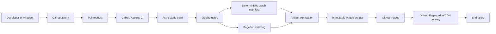
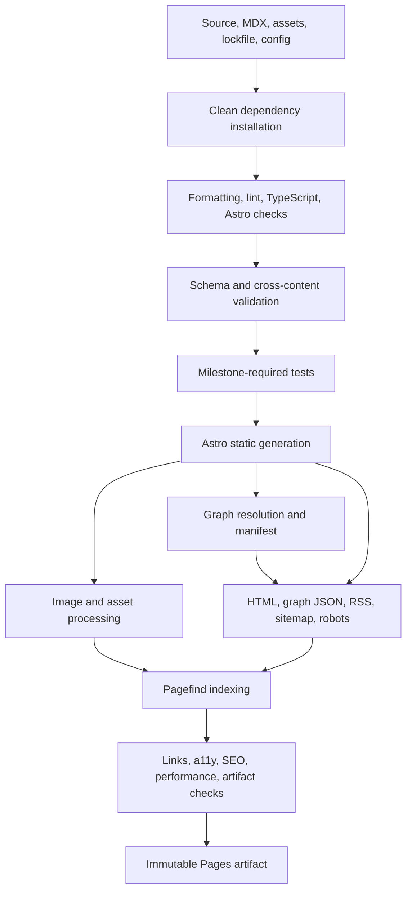
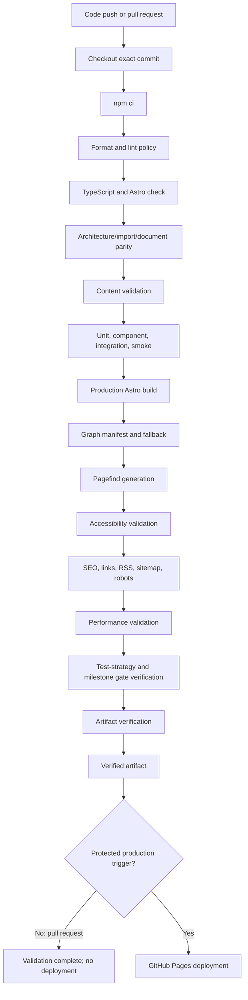
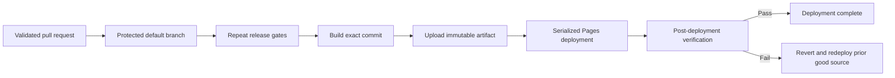
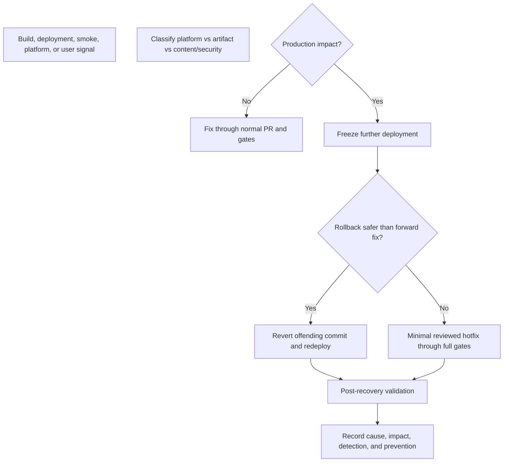

Atlas v0.6.0

# Public Personal Knowledge Garden and Living Portfolio Deployment Guide

## Document Status

- **Status:** Authoritative deployment and operational strategy
- **Date:** 2026-07-21
- **Audience:** Engineers, DevOps engineers, repository administrators, reviewers, operators, and AI coding agents
- **Authoritative inputs:** `01_Architecture.md`, `02_FolderStructure.md`, `03_ImplementationGuide.md`, `04_ComponentRegistry.md`, `05_ContentModel.md`, `06_CodingStandards.md`, `07_MilestonePlan.md`, and `08_TestStrategy.md`
- **Hosting platform:** GitHub Pages project site
- **Production base path:** `/engineering-lab/`
- **Decision record:** `docs/decisions/0001-public-personal-knowledge-garden-and-knowledge-graph.md`

## Operational Authority

This document is the single source of truth for build-to-production flow, environments, continuous integration and delivery governance, hosting, configuration, caching, operational security, observability, rollback, disaster recovery, and deployment checklists.

It does not generate or prescribe GitHub Actions YAML, shell scripts, infrastructure code, or a new service. Workflow implementation belongs to Milestone 12 and must implement these contracts through package scripts and approved GitHub Pages actions. If this guide conflicts with an approved architectural source, deployment stops and the conflict is reported.

The current platform is intentionally low-complexity: a statically generated Astro artifact, built in GitHub Actions and deployed to GitHub Pages. There is no runtime application server, database, API, container, multi-region application stack, remote preview service, staging site, monitoring vendor, or analytics vendor in the approved baseline.

## 1. Purpose

### Goals

The deployment strategy must ensure:

- The same source commit and lockfile produce a repeatable static artifact.
- Graph HTML, deterministic manifest, browser controller, and Cytoscape.js asset come from that same artifact.
- Invalid source, content, accessibility, SEO, performance, or architecture cannot reach production.
- Production deploys are immutable, serialized, traceable, and reversible.
- Repository configuration and workflows require no per-release manual reconstruction.
- Secrets and private content never enter the public artifact.
- Operational responsibilities and platform limitations are explicit.
- Recovery uses source history and the same validated pipeline rather than ad hoc server changes.

### Scope

This guide covers local build/preview, pull-request validation, protected production deployment, GitHub Pages hosting/CDN behavior, build-time configuration, permissions, cache behavior, security posture, deployment monitoring, incident handling, rollback, and disaster recovery.

It does not define application implementation, content schema semantics, coding style, test case syntax, project schedules, or runtime operations that do not exist in a static site.

### Relationship to approved documents

| Document | Operational relationship |
| --- | --- |
| `01_Architecture.md` | Defines static generation, GitHub Pages, project base, environment model, artifact immutability, workflow permissions, and rollback by revert/rebuild. |
| `02_FolderStructure.md` | Defines workflow files, scripts, generated/ignored output, configuration ownership, routes, and artifact boundaries. |
| `03_ImplementationGuide.md` | Defines build, Pagefind, Knowledge Graph, metadata, rendering, error, performance, and deployment pipeline contracts. |
| `04_ComponentRegistry.md` | Defines the static/browser boundary and ensures only approved browser components affect deployment payload. |
| `05_ContentModel.md` | Defines public content, draft exclusion, URLs, assets, search, SEO, and content recovery requirements. |
| `06_CodingStandards.md` | Defines dependencies, supply-chain hygiene, secret/privacy rules, deterministic builds, PRs, and AI deployment constraints. |
| `07_MilestonePlan.md` | Defines M10 artifact completion, M11 release gates, M12 CI/deployment, M13 production validation, and exact command introduction. |
| `08_TestStrategy.md` | Defines deployment-blocking gates, release evidence, production smoke, performance/accessibility/SEO validation, and rollback verification. |

### Deployment as architecture

Static hosting does not make deployment separate from software design. URL base, asset paths, Pagefind/graph generation order, graph manifest parity, canonical origin, draft/private isolation, cache behavior, workflow permissions, and rollback determine whether the architecture works in production. Deployment therefore validates and preserves the same contracts as source code and content.

## 2. Deployment Architecture

### End-to-end flow

### Stage responsibilities

| Stage | Responsibility | Must not do |
| --- | --- | --- |
| Developer/AI agent | Implement active milestone, run focused/full required validation, preserve docs and rollback. | Deploy locally generated files directly or bypass protected workflow. |
| Git repository | Store source, content, lockfile, workflows, configuration, docs, and history as the system of record. | Store `dist/`, Pagefind output, secrets, dependencies, or private content. |
| Pull request | Provide isolated review, clean validation, artifact generation for verification, and evidence without production deployment. | Publish to production or weaken checks for convenience. |
| CI pipeline | Restore exact dependencies, run package-script quality gates, build and verify the artifact. | Duplicate application validation logic in workflow YAML. |
| Astro build | Validate/load content, generate static routes/HTML/assets/RSS/sitemap with production site/base. | Depend on runtime server state or mutate authored source. |
| Quality gates | Enforce architecture, types, content, tests, accessibility, SEO, performance, links, and no-warning policy. | Continue after blocking failure. |
| Pagefind | Index final reader-visible public HTML after Astro generation. | Index source MDX, drafts, chrome, or private content. |
| Knowledge Graph | Resolve/serialize public nodes and typed edges, then package static fallback and route-local visual enhancement. | Expose raw MDX/frontmatter, drafts/private/integration metadata, nondeterministic ordering, or a cross-build manifest. |
| Artifact verification | Check required files/routes, links/assets, base path, metadata, feeds, search assets, graph HTML/manifest/controller/Cytoscape parity, and draft absence. | Accept partial or post-upload-modified output. |
| Pages artifact | Package one immutable deployable `dist/` result associated with source commit/workflow run. | Become the source of truth or be manually edited. |
| GitHub Pages | Publish the verified project-site artifact over HTTPS. | Host server-side logic, secrets, APIs, or runtime configuration. |
| GitHub delivery edge | Serve static files with platform-managed compression/caching/distribution. | Provide repository-controlled custom edge logic in the baseline. |
| End user | Request static HTML/assets and run only approved optional browser enhancement. | Require authentication, server session, or runtime API to read content. |

### Trust boundaries

- Repository content is trusted reviewed source but remains public after deployment.
- Pull-request code is untrusted until reviewed and validated; workflows must not expose production secrets to untrusted changes.
- Build output is trusted only after all quality and artifact gates pass.
- The uploaded artifact is immutable; production changes require a new validated deployment.
- GitHub Pages is an external managed platform; platform availability and response-header capabilities are operational dependencies.

## 3. Environments

### Environment matrix

| Environment/context | Status | Purpose | Configuration | Access/data | Trigger | Promotion strategy |
| --- | --- | --- | --- | --- | --- | --- |
| Local development | Approved | Fast authoring and focused validation; optional explicit draft visibility. | Local Node/npm from pinned versions; Astro dev settings; production base-path behavior must also be testable. | Contributor machine; repository/test content; no production secrets. | Developer commands. | Source is proposed through a pull request after active milestone checks. |
| Local production preview | Approved local context | Inspect the exact locally generated static artifact before merge/release. | Production `site`/`base`; clean `dist/`; static graph endpoints from M9; Pagefind/Cytoscape enhancement from M10. | Localhost only; generated public-safe artifact. | `npm run build` followed by short `npm run preview`. | Evidence supports PR/release; artifact is not promoted or uploaded directly. |
| Pull-request validation | Approved CI context | Clean-room validation of source changes without deployment. | Pinned Node, `npm ci`, production site/base, milestone-required commands. | GitHub Actions runner; test fixtures and public-safe source; no production deployment permission. | Pull request update. | A reviewed commit is merged; PR artifact is validation evidence, not production promotion. |
| Remote preview deployment | Not provisioned | No approved remote per-PR site exists. | Not applicable. | Not applicable. | None. | Requires architecture/operations approval, privacy review, URL/base strategy, access rules, cost, cleanup, and workflow changes. |
| Staging | Not provisioned | Static Pages baseline has no separate staging origin. | Not applicable. | Not applicable. | None. | Requires demonstrated need and an approved environment/configuration/promotion design. |
| Production | Approved | Public canonical Personal Knowledge Garden, Living Portfolio, and Knowledge Graph. | Production origin and `/engineering-lab/`; drafts disabled; immutable Pages artifact. | Public read access; protected deployment environment/branch write access. | Protected default-branch push or approved manual dispatch after all gates. | Build and deploy the validated source commit in the protected production workflow. |

### Environment consistency

- Local production preview, pull-request build, release candidate, and production use the same package scripts, lockfile, Node version, Astro static mode, site origin rules, and base path.
- Environment differences are explicit inputs, not hidden branches in application code.
- Draft visibility may differ only in approved local development behavior; production-like builds exclude drafts everywhere.
- There is no runtime environment configuration because GitHub Pages serves immutable static files.

### Access rules

- Repository write, branch protection administration, production environment approval, and Pages deployment permissions follow least privilege.
- Pull-request workflows from untrusted sources must not receive production secrets or deployment permissions.
- Production changes occur only through protected workflow identity; no manual file upload or Pages branch editing.
- Public content requires no user authentication.

## 4. Build Strategy

### Build sequence

### Build responsibilities

| Build concern | Strategy |
| --- | --- |
| Dependency installation | Use pinned Node.js LTS and committed npm lockfile. Local intentional changes use `npm install`; clean CI/release uses `npm ci`. |
| TypeScript/Astro | Strict checks run before artifact acceptance; no `any`, suppression, broken import, or project warning. |
| Content processing | Load exactly four collections; validate frontmatter, domains, typed connections, prerequisite DAG, taxonomy, dates, assets, URLs, drafts, and orphan rules. |
| Static generation | Generate complete HTML for every approved route with production origin/base; no SSR/server endpoint. |
| Graph generation | Produce deterministic public-field-only `GraphManifest`, `/graph/` semantic fallback, and `/graph/graph.json`; no timestamp, raw body, draft, private, Obsidian, or NotebookLM data. |
| Metadata/feed | Generate canonical metadata, structured data, RSS, sitemap, robots behavior, and 404 output from validated content. |
| Images/assets | Process imported assets through Astro, preserve intrinsic dimensions, fingerprint processed assets, and copy approved `public/` files byte-for-byte. |
| CSS/JavaScript | Generate optimized CSS; emit no application JavaScript outside Pagefind, lazy route-local graph controller/Cytoscape.js, and approved minimal mobile navigation. |
| Search | Run Pagefind after final HTML exists; write index/assets into completed `dist/`. |
| Packaging | Upload the verified `dist/` directory as the Pages artifact; do not rebuild or mutate after upload. |

### Determinism

- Build inputs are source commit, lockfile, pinned toolchain, approved public configuration, and workflow definition.
- Do not generate content from network calls, random values, implicit current time, Git timestamps, or machine-specific paths.
- Stable sorting uses explicit typed rules and identifier tie-breakers.
- Workflow/build identity provides operational traceability; it must not be injected into reader content in a way that changes deterministic pages unnecessarily.

### Failure conditions

The build fails and no artifact is uploaded when any of these occurs:

- Clean install or lockfile mismatch.
- Formatting, lint, TypeScript, Astro, architecture, import, test, or project-warning failure.
- Invalid content, relationship, URL, asset, draft isolation, taxonomy, or duplicate route.
- Invalid graph domain/type/target, duplicate edge, reverse-related duplicate, prerequisite cycle, nondeterministic manifest, or graph HTML/JSON mismatch.
- Missing/extra approved route, broken internal/fragment/asset link, or base-path defect.
- Missing Pagefind, graph HTML/manifest/controller/Cytoscape asset, RSS, sitemap, robots, 404, metadata, or required artifact output once introduced.
- Accessibility, SEO, performance, or test budget failure at the active gate.
- Secret/private/draft content or unexpected source map in public output.
- Artifact verification or packaging failure.

## 5. CI Pipeline

### CI workflow

### Stage purpose

| Stage | Purpose | Output |
| --- | --- | --- |
| Checkout/install | Reproduce exact source/dependencies on a clean runner. | Commit identity, installed lockfile-exact dependencies. |
| Lint/type/Astro | Reject code-quality and compile-time defects early. | Diagnostic result with zero project warnings. |
| Architecture/import/docs | Reject unknown files, routes, components, reverse/cyclic imports, stale docs, and unapproved client/runtime behavior. | Parity and dependency report. |
| Content | Enforce `05_ContentModel.md`, assets, links, drafts, and publishing invariants. | Content validation report. |
| Tests | Run commands introduced by current milestone and cumulative regressions. | Deterministic test reports. |
| Build/graph/Pagefind | Produce complete static HTML/assets, deterministic graph manifest/fallback, route-local Cytoscape enhancement, and search from production settings. | Candidate `dist/`. |
| Accessibility/SEO/performance | Apply `08_TestStrategy.md` release gates to representative/generated output. | Quality reports and thresholds. |
| Strategy/milestone | Confirm required commands/evidence and no future-milestone bypass. | Gate compliance result. |
| Artifact verification | Confirm required output, graph same-build parity/public allowlist, source safety, base paths, feeds, metadata, and no drafts/private data. | Deployment-eligible artifact result. |
| Artifact creation | Upload immutable Pages artifact only after all blocking gates pass. | Artifact associated with commit/run. |
| Deployment | Publish only on protected production trigger with minimal permissions/concurrency. | Pages deployment record. |

### Workflow rules

- CI YAML invokes package scripts and approved actions; validation logic remains in source-owned modules/scripts.
- Pull requests run all applicable validation but never deploy to production.
- Failed or cancelled jobs prevent artifact upload/deployment.
- Production repeats required gates; it does not trust a stale PR result.
- Workflow action references follow repository security policy and are reviewed as supply-chain dependencies.
- Logs and reports must not expose secrets or private environment values.

## 6. CD Strategy

### Baseline deployment decision

| Concern | Current decision |
| --- | --- |
| Preview deployment | No automatic remote preview. PR builds validate artifacts without publishing them. |
| Production deployment | Protected default-branch push or approved manual dispatch after full required gates. |
| Artifact | One immutable verified `dist/` artifact per successful production workflow. |
| Promotion | Source commit is promoted through review; production workflow rebuilds and deploys that exact commit using the same commands. |
| Approval | Branch protection and production environment approval follow repository policy; no ad hoc bypass. |
| Concurrency | Production deployments are serialized; a stale run cannot overwrite a newer release. |
| Version identity | Full Git commit SHA plus GitHub workflow run/deployment identity is authoritative. |
| Release tags | Optional immutable annotation after successful deployment; not required for routine deployment and not an alternate source. |
| Deployment window | No fixed window is needed for the static baseline. High-risk changes deploy only when an authorized responder can verify and roll back. |

### Delivery flow

### Release governance

- There is no manual promotion of local/PR `dist/` files.
- A production artifact is never modified after verification/upload.
- Release notes are proportional to impact and identify source commit, content/route/schema changes, operational risk, validation, and rollback reference.
- A manual dispatch uses the same workflow, source, gates, permissions, and artifact contract as automatic protected-branch deployment.
- Hotfixes remain pull-requested, reviewed, fully validated, and revertible; urgency does not authorize bypass.

## 7. Hosting Strategy

### Hosting architecture

GitHub Pages hosts the generated project site. GitHub-managed delivery infrastructure serves HTML and static assets over HTTPS. Scalability comes from precomputed files and managed edge distribution rather than application servers.

| Artifact class | Source/build behavior | Hosting behavior |
| --- | --- | --- |
| HTML | Generated by Astro for approved routes. | Served statically beneath `/engineering-lab/`; no server rendering. |
| CSS | Generated from Tailwind/global/scoped styles; fingerprinted when processed. | Static cacheable asset delivered by Pages/CDN. |
| JavaScript | Pagefind on search, graph controller/lazy Cytoscape.js on graph, and minimal mobile navigation only. | Route/feature-local static asset; no UI-framework runtime. |
| Images | Astro-processed responsive/fingerprinted assets; approved passthrough exceptions. | Static assets with platform-managed transfer/caching. |
| Fonts | Small approved local subset/weights with fingerprinting where processed. | Static cacheable assets; no third-party font service. |
| Search index | Generated by Pagefind after final HTML. | Static files under Pagefind output path; fetched by search experience only. |
| Graph manifest | Deterministic `/graph/graph.json` generated from production-visible content. | Static public JSON fetched only by graph experience; semantic graph HTML remains available independently. |
| Public files | Copied byte-for-byte from `public/`, including robots when approved. | Stable static paths; not automatically fingerprinted. |
| RSS/sitemap/404 | Generated static files. | Public crawl/recovery endpoints under production origin/base rules. |

### Compression and transfer

- GitHub Pages/CDN manages HTTP transfer compression. The baseline does not precompress artifacts or deploy alternate compressed files unless platform support and benefit are approved and verified.
- Production verification confirms text assets are transferred efficiently; repository code must not assume a particular edge encoding.
- Optimize source images/fonts before and during build rather than relying on transport compression.

### Scalability

- Read traffic does not execute application compute or query a database.
- Build cost grows with content/routes/search index/graph nodes and edges rather than user requests.
- CDN/edge distribution absorbs traffic without repository-managed regions or autoscaling.
- If build duration or artifact limits become material, measure before proposing content partitioning, another host, or incremental generation.

## 8. Configuration Management

### Configuration classes

| Configuration | Owner | Storage | Visibility | Validation |
| --- | --- | --- | --- | --- |
| Site identity/origin/base/default metadata/social links | `src/config/site.ts` and Astro config | Git repository | Public by design | Typed config, production URL/base checks, metadata tests. |
| Navigation | `src/config/navigation.ts` | Git repository | Public | Typed destinations, route/base/link/accessibility checks. |
| Knowledge domains | `src/config/domains.ts` | Git repository | Public | Exact controlled values/labels, schema/filter/manifest parity. |
| Toolchain/build | `package.json`, lockfile, TypeScript/Astro/tool configs | Git repository | Public | Clean install, check/build parity, dependency review. |
| Workflow | `.github/workflows/` | Git repository | Public | Syntax, permissions, action pinning, command parity, concurrency review. |
| Repository/Pages settings | GitHub repository/environment settings | Managed platform; documented operational prerequisites | Administrative | Periodic checklist and deployment test; no per-release manual change. |
| Workflow identity/token | GitHub-provided token/OIDC identity | Ephemeral managed secret | Private | Least-privilege permissions; never logged or embedded. |

### Environment variables

- The baseline requires no private runtime or build-time application secrets.
- Public site/base/identity values belong in typed version-controlled configuration, not environment variables.
- Environment variables may be used by tooling only when the platform requires them and their owner/type/required environments/validation are documented.
- Browser bundles and generated HTML must not contain private environment values.
- Graph manifest/browser bundle must not contain raw frontmatter, MDX bodies, drafts, vault paths, Obsidian/NotebookLM metadata, or private values.
- Do not use environment variables to create hidden behavior that differs between local, PR, and production.

### Secrets

- Prefer GitHub-provided short-lived workflow identity and the default token with minimal permissions; do not use a long-lived personal access token for Pages deployment.
- If a future integration requires a secret, store it in the approved GitHub environment/repository secret store, scope it to the minimum workflow/environment, rotate it, and never expose it to untrusted pull requests.
- Secrets never appear in source, content, fixtures, workflow arguments echoed to logs, artifacts, or browser code.
- A secret requirement for application runtime conflicts with static Pages architecture and requires review.

### Zero-manual-configuration interpretation

Releases require zero manual file/configuration edits. One-time administrative settings such as enabling Pages, branch protection, production environment rules, and workflow permissions may require repository administrator action. Those settings are documented, verified, and changed through reviewed operational governance rather than repeated per deployment.

## 9. Caching Strategy

GitHub Pages controls response caching headers; the repository does not have baseline custom edge/header infrastructure. The strategy therefore combines content-addressed assets, immutable deployment artifacts, conservative assumptions for stable filenames, and production verification.

### Cache matrix

| Resource | Identity/change pattern | Desired behavior | Invalidation |
| --- | --- | --- | --- |
| HTML | Stable route path; content changes across deployments | Revalidate promptly; do not assume immutable long cache. | New Pages deployment replaces artifact; platform/CDN invalidation is managed by GitHub. |
| Fingerprinted CSS/JS/assets | Content hash in filename | Long-lived immutable caching is safe. | Content change produces a new filename referenced by new HTML. |
| Astro-processed images | Fingerprinted generated paths | Long-lived immutable caching is safe. | Source/transformation change produces new asset identity. |
| Fonts | Fingerprinted when processed; stable approved set | Long-lived caching with cross-deployment reuse. | File change creates new fingerprint. |
| Pagefind index/assets | Generated from each complete site artifact | Cacheable but must remain deployment-consistent with HTML/controller. | New deployment replaces index set; post-deploy search smoke detects mismatch. |
| Graph manifest | Stable `/graph/graph.json` path with deployment-varying content | Revalidate; must match graph HTML/controller/schema version from the same artifact. | New deployment replaces manifest; post-deploy parity and selected-node smoke detect mismatch. |
| Cytoscape.js/graph controller | Fingerprinted route-local asset | Long-lived immutable caching is safe. | Dependency/controller change produces a new fingerprint referenced by new graph HTML. |
| `public/` assets | Stable nonfingerprinted path by default | Use conservatively; do not assume immutable caching for frequently changed files. | Rename/version intentionally or rely on platform revalidation/deployment behavior. |
| RSS/sitemap/robots/404 | Stable paths, deployment-varying content | Revalidate; must reflect current artifact. | New deployment and production verification. |
| API responses | Not applicable | No runtime API exists. | Not applicable. |

### Cache rules

- Do not append arbitrary cache-busting query strings when fingerprinted assets are available.
- HTML must reference assets generated in the same artifact.
- Never deploy Pagefind index from a different build than HTML.
- Never deploy graph HTML, manifest, controller, or Cytoscape.js reference from different builds.
- Do not mutate a published artifact to “purge” or patch cache; deploy a new verified artifact.
- Any future custom `Cache-Control` policy requires a hosting/CDN capability decision because GitHub Pages does not expose general repository-controlled response headers.

## 10. Security

### Security control matrix

| Control | Baseline | Responsibility/limitation |
| --- | --- | --- |
| HTTPS | Required | GitHub Pages HTTPS is enabled/enforced according to platform configuration; production checks reject insecure canonical/external configuration. |
| Authentication/runtime authorization | Not applicable | Public static site has no accounts/private routes. Repository/admin access is controlled by GitHub. |
| Content Security Policy | Restrictive policy is a desired defense-in-depth control, but GitHub Pages cannot generally set repository-defined response headers. | Keep Pagefind, graph manifest, controller, and Cytoscape.js same-origin. A tested HTML meta CSP may be proposed, with known limitations, only through reviewed implementation; enforced header requirements may require hosting architecture change. |
| Permissions Policy | No sensitive browser APIs are used; custom response policy is not baseline-configurable on Pages. | Adding browser capabilities or requiring an enforced header needs operational review/hosting support. |
| Referrer Policy | Prefer `strict-origin-when-cross-origin` or stricter behavior compatible with approved external links. | May be expressed through supported HTML metadata after validation; response-header enforcement depends on platform capability. |
| MIME/nosniff, HSTS, frame controls | Platform-managed response behavior; not assumed configurable from repository. | Validate production posture; a hard requirement beyond Pages capability requires an architecture/hosting decision. |
| Secrets | No application secrets; ephemeral GitHub workflow identity only. | Least privilege, no logging/artifact/browser exposure. |
| Content safety | Reviewed trusted MDX; public-only content/assets/graph fields; no private/draft/integration leakage. | Content/graph validation, review, artifact allowlist scans. |
| Dependency/supply chain | Lockfile, pinned Node, reviewed minimal dependencies/actions including approved Cytoscape.js, update monitoring. | Clean install, license/transitive/bundle review, action pinning policy, no unapproved package/plugin. |
| Artifact integrity | Exact source commit/run, complete gates, immutable upload, no post-upload mutation. | Workflow and deployment record provide traceability. |

### Workflow permissions

- CI pull-request jobs receive read-only contents access unless another permission is explicitly required.
- Production deployment receives only contents read, Pages write, and deployment identity-token permissions required by approved Pages actions.
- Environment protections and branch rules prevent unauthorized production deployment.
- Untrusted pull requests never receive deployment identity or future integration secrets.
- Permissions are declared explicitly rather than inherited broadly.

### Supply-chain governance

- Use the committed lockfile and clean install; dependency changes are intentional and reviewed.
- Prefer platform/standard capabilities before adding a package.
- Review transitive risk, maintenance, license, bundle impact, and build permissions for each dependency.
- Cytoscape.js plugins are separate dependencies and require explicit need, license, bundle, accessibility, performance, and security approval.
- Pin GitHub Actions according to repository policy, favoring immutable references when required for high assurance.
- Automated update proposals run the full pipeline and do not merge solely because versions are newer.

### Incident-worthy security events

Secret/private/draft exposure, repository/workflow compromise, malicious dependency/action, unauthorized deployment, unsafe content injection, or incorrect public disclosure triggers deployment freeze, access/secret remediation, rollback/removal, and post-incident review.

## 11. Monitoring and Observability

### Baseline observability

| Signal | Current mechanism | Owner | Response |
| --- | --- | --- | --- |
| Build health | GitHub Actions status, logs, annotations, test reports. | Implementer/build owner. | Failed build blocks merge/deploy; diagnose owning stage. |
| Deployment health | Pages deployment/environment status and workflow result. | Repository/operations owner. | Failed deploy blocks completion; preserve prior good production where platform behavior allows. |
| Post-deploy availability | Approved production smoke against required routes/assets/search/graph/feed/sitemap/404. | Deployment workflow/operator. | Failure triggers incident triage and rollback decision. |
| Content/graph/SEO integrity | Artifact and production validation for drafts/private fields, graph parity, links, canonicals, structured data, RSS/sitemap/robots. | Content/graph/metadata owners. | Block or roll back based on severity. |
| Performance | Deterministic Lighthouse/Core Web Vitals lab checks in M11-M13. | Performance/build owner. | Budget regression blocks release. |
| Browser errors | Automated search/graph/mobile interaction tests and manual production checks. | Feature/QA owner. | Reproduce with deployed commit; rollback if critical. |
| Platform status | GitHub Status/Pages incident information. | Operator. | Distinguish platform incident from artifact defect; avoid unnecessary source changes. |

### Not provisioned in baseline

- No analytics, RUM, error-tracking SDK, server logs, uptime vendor, log aggregation service, pager, or monitoring database is approved.
- Static Pages produces no application server logs.
- Adding telemetry requires a clear operational need, privacy/legal review, performance/bundle analysis, retention/access policy, content-security impact, and architecture approval.

### Alerts and notification

- Required GitHub check/deployment failures notify responsible contributors through repository-native mechanisms.
- Production smoke failure is treated as a blocking deployment failure and surfaced in the workflow/deployment status.
- Without an approved external uptime service, continuous outage alerting is limited to platform notifications and human reports; this limitation is explicit, not silently assumed solved.

### Incident response

Incident records identify source commit/deployment, start/detection/recovery, user impact, classification, action, validation evidence, and prevention. Do not expose secrets or sensitive details in public logs/issues.

## 12. Rollback Strategy

### Rollback triggers

- Production route/base/asset/search/graph failure.
- Blocker/high accessibility, SEO, content-integrity, security, or performance regression.
- Draft/private/secret disclosure.
- Incorrect canonical/sitemap/robots behavior with material indexing risk.
- Unauthorized or wrong-source deployment.
- Pagefind/HTML artifact mismatch or widespread broken links.
- Graph HTML/manifest/controller/Cytoscape mismatch, invalid public edge data, or graph-only accessibility failure.

### Authoritative rollback workflow

```mermaid
flowchart LR
    Detect[Detect and confirm production defect]
    Freeze[Stop newer deployments]
    Identify[Identify offending commit and prior good commit]
    Revert[Create reviewed revert]
    Validate[Run full required pipeline]
    Deploy[Deploy new artifact from reverted source]
    Smoke[Post-rollback production smoke]
    Close[Document and add regression prevention]
    Detect --> Freeze --> Identify --> Revert --> Validate --> Deploy --> Smoke --> Close
```

Rollback is a forward deployment of reverted source through the same pipeline. Do not edit production files, force a stale artifact outside workflow, reset shared history, disable gates, or bypass review.

### Version and history

- Git commit SHA is the primary source version.
- GitHub Actions run, Pages artifact/deployment record, optional release tag, and timestamp provide operational history.
- Identify a prior good version by successful deployment plus post-deploy evidence, not commit age alone.
- Retained platform artifacts may aid diagnosis but are not the source of truth or an approved manual deployment path.

### Recovery objectives

These are engineering objectives, not contractual service-level guarantees:

| Objective | Target |
| --- | --- |
| Recovery point objective | Zero loss for committed source/content/configuration because Git history is authoritative. Uncommitted local work is outside the production recovery contract. |
| Recovery time objective | One complete validated pipeline cycle; operational target is recovery within 30 minutes after an authorized responder begins rollback, subject to GitHub platform availability and actual pipeline duration. |
| Data consistency | Reverted artifact, Pagefind index, graph HTML/manifest/controller/Cytoscape asset, RSS, sitemap, metadata, and assets all come from the same recovery commit/build. |

### Post-rollback validation

- Confirm deployment identity/source commit.
- Run required production route/base/search/graph/feed/sitemap/404 smoke.
- Confirm content/SEO/a11y/performance/security issue is absent.
- Confirm no later intended change was unintentionally lost; reapply through normal PR if needed.
- Add the cheapest reliable regression check and document root cause.

## 13. Disaster Recovery

### Recoverable assets

| Asset | Primary recovery source | Recovery method |
| --- | --- | --- |
| Source code/content/docs/workflows/config | Git repository history and distributed clones. | Restore/clone verified repository, select known good commit, run clean validation/build. |
| Dependencies | `package-lock.json` plus package registry availability. | `npm ci`; if registry outage occurs, wait/use approved organizational cache only if one exists. Do not vendor ad hoc. |
| Production artifact | Rebuild from known good commit/lockfile/workflow. | Same pipeline; artifact is reproducible output, not backup source. |
| Content assets | Git-tracked colocated/shared/public files. | Restore from repository history and validate links/licenses. |
| Workflow/configuration files | Git history. | Restore reviewed known good versions. |
| GitHub repository/Pages settings | Managed GitHub settings plus documented operational checklist. | Repository administrator reconfigures/validates branch protection, Pages, environment, permissions, and custom domain if ever approved. |

### Backup strategy

- Git history is the primary backup for committed source/content/configuration.
- Distributed authorized clones provide an additional recovery path if the primary remote is unavailable.
- GitHub Pages deployment artifacts are transient operational records, not backups.
- No database, user upload store, or runtime state requires backup.
- A managed repository backup/mirror may be adopted if organizational risk requires it; provider, access, encryption, retention, and restore testing need approval and do not change source authority.

### Recovery priorities

1. Secure repository and administrative access; revoke compromised credentials/permissions.
2. Recover authoritative source/content/workflow/configuration at a known good commit.
3. Restore validation and build reproducibility.
4. Re-establish GitHub Pages/environment/branch protection settings.
5. Build/deploy one verified artifact.
6. Validate production routes, content, search, Knowledge Graph static/enhanced states, SEO, accessibility, performance, and security.
7. Restore optional documentation/operational history and conduct review.

### Disaster scenarios

| Scenario | Response |
| --- | --- |
| Bad production deployment | Use Section 12 revert/redeploy rollback. |
| Default branch corruption | Freeze merges; recover from verified remote/local history; preserve forensic evidence; restore through reviewed Git operations. |
| Repository deletion/unavailability | Recover from authorized clone/backup into controlled repository; restore settings and re-run full M11-M13 validation. |
| GitHub Pages outage | Confirm platform status; do not change source unnecessarily; communicate limitation; redeploy/validate after service recovery. |
| Dependency registry outage | Do not bypass lockfile or substitute unreviewed packages; resume clean pipeline when dependencies are safely available. |
| Workflow compromise | Disable affected workflow/deployments, rotate/revoke credentials, review history/action references, restore known good workflow, full validation before release. |
| Content/security disclosure | Remove exposure through reviewed emergency change/revert, validate caches/platform behavior, assess impact, and add prevention. |

### Recovery validation

At least once after deployment capability exists, execute a controlled recovery exercise using a known good commit without affecting production, or document why a production-safe simulation is used. Validate source restoration, clean install, build, artifact, configuration checklist, and smoke procedure.

## 14. AI Deployment Rules

AI coding agents must follow these rules exactly:

1. Read all nine numbered documents and identify the active milestone before deployment/configuration work.
2. Never bypass CI, branch protection, production environment rules, review, or quality gates.
3. Never deploy a failing, warning-producing, partial, locally patched, or unverified artifact.
4. Never generate or edit production files manually; production changes come from version-controlled source and the approved workflow.
5. Never disable tests, content/graph validation, accessibility, SEO, performance, links, Pagefind, graph artifact, or smoke checks to make deployment pass.
6. Never add a hosting platform, preview service, staging environment, monitoring vendor, analytics, container, edge runtime, IaC tool, secret, graph plugin/service, or deployment dependency without approval. Cytoscape.js alone is approved by ADR 0001.
7. Never introduce runtime server/API/database configuration into the static Pages architecture.
8. Never hardcode environment-specific origins, base paths, tokens, repository IDs, or private values in source/workflow/browser output.
9. Never expose secrets in code, logs, artifacts, test reports, commands, or pull-request output.
10. Prefer GitHub-provided short-lived workflow identity and declare minimal permissions explicitly.
11. Always run the production build and active milestone validation locally when available before changing workflow/deployment behavior.
12. Keep workflow YAML as orchestration; validation logic belongs to approved package scripts/modules.
13. Preserve artifact immutability, source-commit traceability, deployment serialization, and rollback capability.
14. Never deploy PR artifacts or local `dist/` directly to production.
15. Never mutate, overwrite, delete, or reuse an artifact to hide a failed deployment.
16. Treat production base-path, canonical, search, graph, feed, sitemap, robots, 404, and draft/private isolation as deployment blockers.
17. Validate cache/search/graph/HTML consistency after production deployment.
18. For incidents, freeze unsafe deployment, classify cause, choose revert/redeploy versus minimal hotfix, and run full gates.
19. Update this guide and affected source documents before an approved deployment-architecture change is implemented.
20. Report exact source commit, workflow/run, artifact result, validations, production checks, rollback reference, and residual risk.
21. If platform capability or instructions are ambiguous, stop and ask; do not improvise infrastructure.

## 15. Operational Checklists

### Pre-deployment checklist

- [ ] Active milestone permits deployment work; predecessor gates pass.
- [ ] Architecture, folder, content model, registry, coding standards, test strategy, and deployment guide are synchronized.
- [ ] Source commit is reviewed, protected, and contains no uncommitted/generated/private content.
- [ ] Lockfile, Node version, dependencies, and action references are approved and reproducible.
- [ ] Static mode, production origin, and `/engineering-lab/` base are correct.
- [ ] Content schemas, domains, connections, prerequisite DAG, tags, URLs, assets, drafts, graph manifest, and orphan rules pass.
- [ ] Unit/component/integration/smoke/regression gates required by M11 pass.
- [ ] Accessibility, SEO, Lighthouse/Core Web Vitals lab, links, RSS, sitemap, robots, 404, Pagefind, graph fallback/manifest/controller/Cytoscape, and graph bundle baseline pass.
- [ ] Workflow permissions, environment protection, and concurrency are correct.
- [ ] Prior good commit/deployment and rollback owner/procedure are identified.
- [ ] No platform incident or unresolved blocker/high issue makes deployment unsafe.

### Release checklist

- [ ] Production workflow checks out the intended full commit SHA.
- [ ] Clean `npm ci` and complete M11 command sequence pass with no project warnings.
- [ ] Artifact is generated once from production settings and verified before upload.
- [ ] Artifact contains all required routes/assets/search/graph/feed/sitemap/robots/404 and no drafts/private integration/secrets/source-only files.
- [ ] Deployment is serialized and uses minimal permissions/approved Pages actions.
- [ ] Deployment record links source commit, workflow run, artifact, and environment.
- [ ] No manual artifact/configuration mutation occurs.

### Post-deployment checklist

- [ ] Pages reports successful production deployment over HTTPS.
- [ ] Home and every route family load beneath `/engineering-lab/`.
- [ ] CSS, images, fonts, JavaScript, fragments, and internal navigation are base-safe.
- [ ] Pagefind query/results/history/failure behavior and HTML/index consistency pass.
- [ ] `/graph/` static fallback, filters/selection/history, manifest version/data, lazy Cytoscape.js, visual failure, and direct content links pass.
- [ ] Canonicals, structured data, Open Graph/Twitter inputs, RSS, sitemap, robots, and 404 are correct.
- [ ] No draft/private/secret/Obsidian/NotebookLM integration data is discoverable in HTML, search, or graph manifest.
- [ ] Keyboard/focus and representative accessibility smoke pass.
- [ ] Production performance and transfer/caching behavior show no blocker regression.
- [ ] Deployment notifications/status are green and rollback reference remains available.

### Rollback checklist

- [ ] Confirm impact and rollback trigger; freeze newer deployments.
- [ ] Identify offending and prior verified good commits/deployments.
- [ ] Create reviewed revert; do not reset shared history or manually deploy old files.
- [ ] Run full required validation on reverted source.
- [ ] Build/upload/deploy a new immutable recovery artifact through the same workflow.
- [ ] Run post-rollback routes/search/graph/content/SEO/a11y/performance/security smoke.
- [ ] Confirm artifact components all come from the same recovery build.
- [ ] Record timeline, root cause, user impact, recovery, and regression prevention.

### Hotfix checklist

- [ ] Confirm forward fix is safer/faster than revert and scope is minimal.
- [ ] Use approved branch/PR/review; do not bypass protections due to urgency.
- [ ] Add focused regression evidence and run complete release gates.
- [ ] Preserve URL/content/schema compatibility and rollback path.
- [ ] Deploy through the same protected serialized workflow.
- [ ] Perform full post-deploy smoke and document follow-up only when approved.

### Security and cache readiness checklist

- [ ] HTTPS and public URLs are correct; no mixed/insecure source.
- [ ] No secret/private value is available to PR jobs, logs, artifacts, or browser output.
- [ ] Workflow permissions and action references pass review.
- [ ] External resources are minimal, approved, HTTPS, and consistent with security policy.
- [ ] Fingerprinted assets and current HTML reference the same deployment.
- [ ] Pagefind index, graph HTML/manifest/controller/Cytoscape asset, CSS, JS, images, fonts, RSS/sitemap/robots are current and not cross-build mixed.
- [ ] GitHub Pages header/caching limitations are acknowledged; no unsupported control is claimed active.

## 16. Future Scalability

Future capabilities are decision points, not current commitments.

### Evolution matrix

| Capability | Trigger/evidence | Migration considerations |
| --- | --- | --- |
| Remote preview deployments | Reviewers need accessible visual/content previews that local artifacts cannot provide. | Provider/access/privacy/cost, untrusted PR isolation, base/canonical/noindex behavior, automatic cleanup, secret policy, and no production promotion. |
| Staging environment | Production-specific integrations/configuration cannot be safely validated in PR artifacts. | Separate origin/base, content/data policy, promotion semantics, environment parity, access/noindex, cost and cleanup. |
| Custom domain | Branding/SEO requirement approved. | Astro `site`/`base`, CNAME/DNS/HTTPS, canonical/RSS/sitemap/search/assets, cache, old project URL compatibility, full regression. |
| Multiple regions/CDN expansion | Measured availability/latency exceeds GitHub Pages capability. | New hosting architecture, DNS, cache invalidation, headers, artifact promotion, observability, cost, rollback, data residency. |
| Custom edge headers/security | Required CSP/Permissions/Cache controls cannot be enforced by Pages. | CDN/host selection, header-as-code, compatibility with Pagefind/assets, security tests, ownership and rollback. |
| Incremental Static Regeneration | Build time/content scale makes full static builds unsustainable and freshness requirements demand it. | Changes runtime/hosting architecture; cache/revalidation consistency, preview/staging, monitoring, failure/rollback, content atomicity, ADR required. |
| Edge rendering | Personalized/request-time behavior has an approved unavoidable requirement. | Conflicts with current static-first model; privacy/security/runtime cost, observability, regions, caching, fallback, and major architecture revision. |
| Containerization | A new host/build platform requires a standardized runtime image beyond managed Actions. | Image supply chain, registry, scanning, patching, secrets, orchestration, cost; unnecessary for current Pages artifact. |
| Infrastructure as Code | Managed infrastructure/settings grow beyond documented GitHub configuration. | Select tool only after scope/ownership/state/backend/security/review plan; import existing settings; drift detection and recovery testing. |
| Blue/green deployment | Hosting supports two atomic production versions and measured risk justifies controlled switch. | Dual artifact/origin, health checks, traffic switch, cache/canonical consistency, cost and rollback. |
| Canary deployment | Representative traffic and telemetry can safely validate partial rollout. | Requires privacy-approved observability, traffic control, statistical criteria, cache/content consistency, automated rollback; not meaningful in baseline Pages setup. |
| External observability | Availability/error/field performance risk justifies vendor telemetry. | Privacy/legal review, consent, retention, access, bundle/CSP impact, sampling, alert ownership, cost, removal plan. |
| Large graph optimization | Measured node/edge/manifest size or graph-route interaction exceeds approved budgets. | Preserve canonical manifest semantics and fallback; consider build-time partitioning, neighborhood endpoints, or engine layouts only after measurement and ADR; do not add runtime graph service by default. |
| Obsidian publishing adapter | Curated one-way authoring provides clear value and public/private controls are defined. | Adapter runs before canonical validation; no vault metadata/private content; mapping, review, rollback, and failure isolation required. |
| NotebookLM export | Selected-source synthesis has an approved editorial workflow. | Export only validated selected public sources; privacy/retention review; no direct production write or source-of-truth role. |
| Repository backup/mirror | Organizational continuity requires recovery beyond GitHub plus distributed clones. | Provider, encryption, retention, access, restore drills, branch/tag/LFS/settings coverage, and source-of-truth rules. |

### Evolution rules

- Measure the current limitation before proposing infrastructure.
- Prefer managed static capabilities and lower operational complexity.
- Record material changes in an ADR and update architecture, folder structure, implementation guide, content model, coding standards, milestone plan, test strategy, and this guide before implementation.
- Define migration, compatibility, security, observability, cost, rollback, disaster recovery, and decommissioning.
- Preserve static readability, graph semantic fallback, stable public content/graph identifiers, and private/public separation unless an approved replacement strategy explicitly supersedes them.