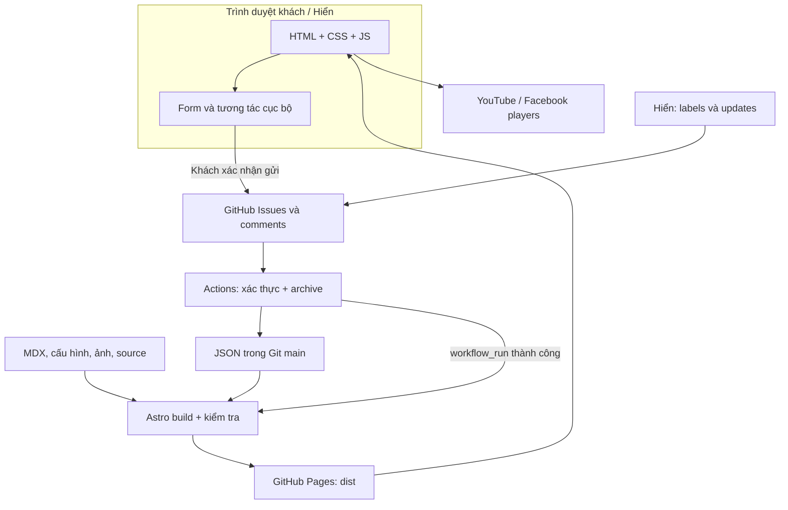
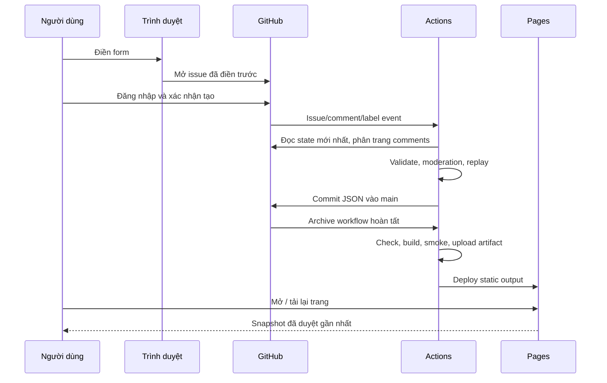

# Kiến trúc hiện tại và sơ đồ

## Quyết định triển khai

Astro 5 static + TypeScript + MDX, Tailwind/CSS, Pagefind, GitHub Actions và GitHub Pages. Git là nguồn dữ liệu bền vững; GitHub Issues là cửa nhập và thảo luận có đăng nhập. Không có backend application server, relational DB, storage bucket hay service trả lời tự động đang chạy. Functions trong `scripts/` là batch worker chạy trong Actions, không phải endpoint HTTP cho khách.

Luồng owner upload ảnh khác: trình duyệt Hiển dùng fine-grained GitHub token do Hiển nhập tại máy mình, tạo asset + metadata trong một commit. Token chỉ ở memory, không dùng cho visitors và không được gửi vào issue/archive/log. Source commit chạy Pages như bình thường. Ảnh Home cần featuredOrder; thêm file asset riêng lẻ không đủ.

## Luồng ghi và đọc dữ liệu

Archive dùng `GITHUB_TOKEN` nên commit từ workflow không được dựa duy nhất vào push trigger. `deploy-pages.yml` còn nghe **workflow_run của đúng tên `Archive guestbook`** và chỉ deploy khi workflow đó thành công. Đây là coupling có chủ đích, phải sửa đồng thời nếu đổi tên. Các issue khác nhau ghi file khác nhau; commit step rebase + retry để giảm xung đột. Đây không phải transaction DB, GitHub Actions concurrency không phải hàng đợi lưu toàn bộ mọi trạng thái trung gian. Luôn đồng bộ state mới nhất nên website có thể bỏ qua trạng thái trung gian bị sửa trước khi snapshot.

## Ranh giới các layer

| Layer | File chính | Được làm gì / không được làm gì |
| --- | --- | --- |
| Presentation | `src/pages`, `src/components`, `src/layouts` | Render escaped text, accessibility, dùng URL utilities; không tự quyết định approval/transition |
| Domain | `src/lib/requests.mjs`, `knowledge-submissions.mjs`, `media-links.mjs`, `photo-record.ts` | Validate và business thuần; không gọi GitHub, không chứa token |
| Read model | `request-data.ts`, `guestbook.ts`, `media.ts`, `shared-knowledge.ts`, `photos.ts`, content queries | Chọn published data lúc build; không ghi file hoặc làm mutation |
| Integration | `scripts/archive-*.mjs`, `photo-upload.ts` | GitHub I/O, dữ liệu đầu vào/đầu ra xác định; không nới quyền để “sửa nhanh” |
| Delivery | `.github/workflows`, `astro.config.mjs`, `site-settings.mjs` | CI, archive, Pages/base; không nhét business transition vào YAML |

Không gom các marker/schema khác nhau thành một parser “generic” nếu chưa có test compatibility. Tái sử dụng validator/tag helper là tốt; thay đổi schema v1 âm thầm làm hỏng archive cũ là không hợp lệ.

## Bốn đường nội dung

| Kho | Người ghi | Consumer | Phạm vi |
| --- | --- | --- | --- |
| `src/content` | Tác giả/reviewer qua Git | Astro collections + queries + graph | MDX có thể chứa component: chỉ source tin cậy |
| `data/guestbook`, `media`, `knowledge`, `requests` | Archive worker | Published read models | Dữ liệu text từ Issues, escaped; từng feature có approval riêng |
| `src/data/photos` + `src/assets` | Owner uploader hoặc Git thủ công | Photos model | Schema, file reference, metadata, featuredOrder |
| `src/data/music-performances.json` | Hiển qua Git | Music page | Video biểu diễn cá nhân, tách khỏi link cộng đồng |

## Tin cậy và bảo vệ business

- Không tin form client: validate lại trong worker và tại read model phù hợp. UI validation để giúp nhập liệu, không phải cấp quyền.
- Chỉ token Actions ở worker; visitors xác nhận ở GitHub. Không nhúng credential vào website static.
- Nhờ vả: so sánh login owner từ repository; visitor tự ghi marker trong comment không đổi được state. Labels do người có quyền GitHub điều khiển. Người có quyền sửa main vẫn có quyền sửa canonical data; code không thể bảo vệ trước chính quản trị repository ác ý.
- Guestbook vẫn dùng trusted replies OWNER/MEMBER/COLLABORATOR theo contract cũ; không mở rộng quyền tác nghiệp Requests theo cơ chế đó.
- Media URL kiểm tra HTTPS, host chính xác, video ID/path. Player URL dựng nội bộ, không render HTML nhận từ issue. Nền tảng có thể từ chối nhúng video riêng tư/không cấp quyền.
- LocalStorage chỉ dùng preference menu; không lưu token ảnh. Native details/dialog và link gốc giữ khả năng sử dụng khi JS thiếu.

## Bilingual và base path

`site-settings.mjs` sinh repository/base, `src/utils/url.ts` dựng URL, `i18n.ts` xác định locale, middleware `localize-html.ts` xử lý UI. `src/pages/en/[...path].astro` tái sử dụng view và enumerate routes. Khi thêm dynamic route VI phải enumerate EN tương ứng; không copy text authored thành bản dịch giả. `data-original-content` bảo vệ vùng nội dung gốc khỏi dịch UI. Base `/hiens-nha/` phải có ở internal links/assets; không hardcode đường root `/requests/` trong markup final.

## Mở rộng backend trong tương lai

Chưa implement. Nếu cần ẩn danh, dữ liệu riêng tư, upload nhiều người hoặc realtime: thiết kế ADR mới về authentication, authorization theo owner/visitor, DB schema, object storage, moderation, rate limiting, backup và hosting. Giữ issue number/version hoặc có bảng mapping khi migrate; có export/import và rollback. Không thêm secret vào client để biến static site thành backend.
