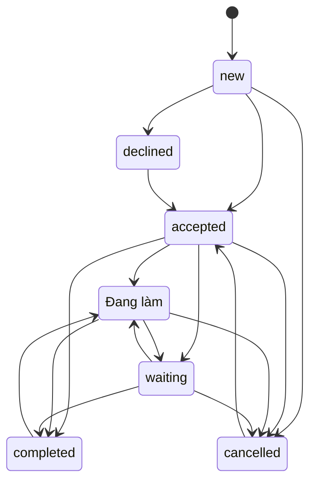

# Tiệm Nhờ Vả — cách dùng và contract

“Tiệm Nhờ Vả — Tích Công Đức. Việc của bạn, công đức của tui!” Người tiếp nhận hiện tại: Hiển, tức tài khoản chủ repository. Route `/requests/`, detail `/requests/<issue-number>/`; bản EN dùng `/en/requests/…`.

## Khách gửi yêu cầu

1. Vào Tiệm → Gửi nhờ vả. Nhập tiêu đề, category, mức ưu tiên mong muốn, bối cảnh, kết quả mong đợi và tags tùy chọn.
2. Chọn Tiếp tục trên GitHub, đăng nhập và tạo issue. Form chưa tạo issue khi chỉ nhập dữ liệu. Chỉ gửi thông tin có thể công khai.
3. Trong thời gian chờ duyệt, xem issue của mình trên GitHub. Sau khi chủ tiệm gắn `request-approved`, archive và Pages thành công, yêu cầu hiện trên board và có trang detail.
4. Người gửi thảo luận/bổ sung bằng comment GitHub. Comment thường không đổi trạng thái website. Ưu tiên “Cần sớm” là mong muốn, không phải lịch hẹn đã được chấp nhận.

## Anh duyệt và cập nhật

- Vào repository → Issues → mở `[Nhờ vả] ...` → Labels → `request-approved`. Label tự tạo khi có request đầu tiên; có thể tự tạo qua Issues → Labels nếu cần. Label chỉ quyết định publication.
- Để đổi trạng thái: dùng **tài khoản chủ repository** (hiện tại `sugia279`) viết một comment bắt đầu đúng marker bên dưới, sau đó JSON. Không bọc cả nội dung vào code fence khi dán lên GitHub. Các code fence trong tài liệu chỉ để minh họa.

```text
<!-- hiens-nha:request-update:v1 -->
{"status":"accepted","message":"Anh đã nhận việc này và sẽ xem xét phạm vi hỗ trợ."}
```

Sau khi đã nhận, có thể bắt đầu:

```text
<!-- hiens-nha:request-update:v1 -->
{"status":"in-progress","message":"Đang thực hiện phần đã thống nhất."}
```

Khi xong, **result bắt buộc**:

```text
<!-- hiens-nha:request-update:v1 -->
{"status":"completed","message":"Đã hoàn tất và kiểm tra kết quả.","result":"Mô tả kết quả, cách sử dụng hoặc địa chỉ tài liệu công khai."}
```

Bổ sung thông tin dùng `waiting`, không nhận dùng `declined`, hủy dùng `cancelled`; luôn có `message`. Cập nhật cùng trạng thái được phép để ghi tiến độ. Sau mỗi thay đổi chờ **Archive guestbook** rồi **Deploy to GitHub Pages** thành công. Đóng/reopen issue không tự đổi trạng thái Tiệm.

## Chuyển trạng thái hợp lệ

| Từ | Có thể sang |
| --- | --- |
| new — Chờ tiếp nhận | accepted, declined, cancelled |
| accepted — Đã nhận | in-progress, waiting, completed, cancelled |
| in-progress — Đang làm | waiting, completed, cancelled |
| waiting — Chờ bổ sung | in-progress, completed, cancelled |
| completed — Hoàn thành | in-progress (mở lại) |
| declined — Không nhận | accepted (xem xét lại) |
| cancelled — Đã hủy | accepted (nhận lại) |



Cập nhật owner không hợp lệ bị bỏ qua, ID ghi vào `rejectedUpdates` trong archive, workflow log báo số lượng. Tất cả comment được sắp theo ID và replay từ `new`. Sửa/xóa comment sẽ tính lại cả chuỗi; cập nhật tiếp theo có thể trở nên không hợp lệ nếu mất bước trước. Khi sửa một comment cũ, timestamp hiện ngày chỉnh sửa của comment đó; timeline vẫn theo thứ tự tạo ID. Cách an toàn để mở lại việc hoàn thành là thêm comment mới `in-progress`, không sửa quá khứ. Result hiện tại xóa khi việc được mở lại; kết quả cũ vẫn còn trong timeline.

## Schema v1

| Trường đầu vào | Quy tắc |
| --- | --- |
| title | 3–120 ký tự, trim |
| description | 10–4000 ký tự, trim |
| expectedResult | 3–1000 ký tự, trim |
| category | technology, creative, information, other |
| priority | low, normal, high |
| tags | Tối đa 12, mỗi tag tối đa 40 ký tự, bỏ trùng; không bắt buộc |

Body bắt đầu `<!-- hiens-nha:request:v1 -->` rồi JSON. `submissionUrl()` giới hạn URL 7500 ký tự; form giữ text và báo rút gọn nếu vượt, có thể bổ sung trong GitHub. Update có `status` trong enum, `message` 1–2000 ký tự, `result` tối đa 4000, bắt buộc không rỗng khi completed. Không chạy HTML/MDX từ request/update.

Archive `data/requests/issue-N.json`: `version`, `number`, `approved`, `deleted`, `request`, `status`, `result`, `timeline`, `rejectedUpdates`, `author`, `createdAt`, `updatedAt` và `scopeChangedAt` tùy chọn. Issue number là identity, không dựa vào title. URL issue được dựng từ repository tin cậy + number, không dùng URL tùy ý do khách nhập.

## Thay đổi phạm vi sau khi đã gửi

Khi worker phát hiện payload yêu cầu khác bản đã lưu, nó ghi `scopeChangedAt` bằng thời điểm đồng bộ, reset state về new và bỏ các cập nhật owner tạo trước hoặc bằng mốc đó. Vì vậy kết quả cũ không bị gán nhầm cho phạm vi mới. Owner xem lại và thêm accepted rồi cập nhật tiếp bằng comment mới sau mốc đồng bộ. Cơ chế cố ý thận trọng: comment tạo sau lúc khách sửa nhưng trước lúc worker phát hiện cũng cần gửi lại. Sửa comment tiến độ không đổi phạm vi request. Approval label vẫn giữ publication, không tự nhận lại việc. Nội dung ngoài payload JSON được xem là thảo luận, không sửa scope canonical.

## Thu hồi, phục hồi, giới hạn

- Gỡ approval hoặc xóa marker: lần build kế tiếp bỏ request khỏi board và không tạo detail route. Request bị xóa: tombstone `deleted:true`, request null, timeline rỗng. Không xóa Git history.
- Workflow luôn đọc state mới nhất, lấy hết các trang comment. API lỗi thì không ghi archive mới, snapshot website cũ còn nguyên. Chạy lại Actions → Archive guestbook → Run workflow với issue number.
- Chủ repository là phần trước dấu `/` trong `GITHUB_REPOSITORY`. Chuyển sang organization cần một quyết định mới về operator allowlist; không tự coi mọi collaborator là người nhận việc.
- Không phân công nhiều người, upload file riêng tư, email, deadline đảm bảo hoặc tự làm công việc được nhờ. Những điều đó là mở rộng tương lai.
