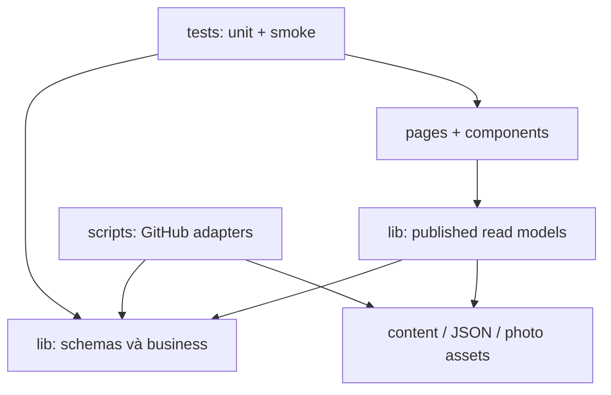

# Cấu trúc và bản đồ source

Đường dẫn tương đối root repository. Đây là bản đồ trách nhiệm, không phải bản sao mọi file/chương truyện.

| Đường dẫn | Vai trò / khi nào sửa |
| --- | --- |
| `src/pages/index.astro` | Home, ảnh featured và lối vào các phòng |
| `src/pages/requests/index.astro`, `[number].astro` | Board/form nhờ vả và detail static |
| `src/pages/en/[...path].astro` | Enumerate tất cả routes EN từ shared views/data |
| `src/pages/knowledge`, `articles`, `notes`, `series`, `topics`, `graph` | Các view tri thức, graph; shared Knowledge ở hub |
| `src/pages/novels`, `articles/folders` | Genres, truyện/chương và URL tương thích |
| `src/pages/music`, `photos`, `guestbook` | Các phòng cộng đồng, gallery/uploader |
| `src/components/requests/RequestForm.astro` | Form → validated prefilled issue |
| `src/components/site/Header.astro`, `sidebar.ts`, `NavigationBranch.astro`, `NavigationIcon.astro` | Header, menu tree, icon, persistence/mobile behavior |
| `src/components/site/GuestbookForm.astro`, `MediaForm.astro`, `KnowledgeForm.astro`, `SharedKnowledge.astro` | Các form và library dữ liệu chia sẻ |
| `src/components/photos` | PhotoLink, dialog xem ảnh, owner uploader |
| `src/components/cards`, `content`, `discovery`, `graph`, `metadata` | Cards, nội dung authored, search, graph, SEO |
| `src/layouts` | Shell chung, content layouts; chỗ gắn page comments/viewer |
| `src/lib/requests.mjs` | Request/update schema, transitions, owner-only replay, labels hiển thị |
| `src/lib/request-data.ts` | Read model cho requests đã được duyệt |
| `src/lib/guestbook.ts`, `media.ts`, `shared-knowledge.ts`, `photos.ts` | Read model của từng phòng |
| `src/lib/submission-fields.mjs` | Tags và URL issue có giới hạn độ dài |
| `src/lib/media-links.mjs`, `knowledge-submissions.mjs`, `photo-record.ts` | Validators dùng ở client/worker/build |
| `src/lib/photo-upload.ts`, `src/lib/music.ts` | Owner GitHub upload transaction; metadata biểu diễn |
| `src/lib/content/*`, `src/content.config.ts` | Queries, references, series, graph và authored schemas |
| `src/lib/i18n.ts`, `localize-html.ts`, `src/middleware.ts` | Locale, dịch UI phía prerender |
| `src/config` | Site identity, menu, novel genres, domain config |
| `src/utils`, `src/types` | URL, SEO, tag helpers và type contracts |
| `src/content/articles`, `notes`, `projects`, `series` | MD/MDX tin cậy, gồm thư mục 84 chương import |
| `data/requests/issue-N.json` | Request snapshot/timeline/tombstone |
| `data/guestbook`, `data/media`, `data/knowledge` | Archive cộng đồng theo marker và version |
| `src/data/photos/*.json`, `src/assets/home`, `src/assets/gallery` | Photo metadata và binary assets; phải đi cùng |
| `src/data/music-performances.json` | Các biểu diễn riêng của Hiển |
| `public` | Static assets giữ nguyên đường dẫn, gồm tài liệu/CV |
| `scripts/archive-*.mjs` | GitHub event → state mới nhất → JSON |
| `scripts/validate-content.ts`, `verify-build.ts`, `check-links.ts`, `check-lighthouse.ts` | Quality gates content/output/links/budgets; budget không thay thế Lighthouse runtime audit |
| `tests/unit`, `tests/smoke` | Domain/I/O contracts và output HTML sau build |
| `.github/workflows/ci.yml` | Kiểm tra pull request |
| `.github/workflows/archive-guestbook.yml` | Tất cả luồng archive; tên workflow vẫn giữ để trigger deploy |
| `.github/workflows/deploy-pages.yml` | Quality gates + static artifact + Pages |
| `site-settings.mjs`, `astro.config.mjs`, `.nvmrc`, `package*.json` | Repository/base, framework, runtime và dependency lock |
| `AGENTS.md`, `docs/project` | Entry point cho AI, sổ tay hiện trạng |
| `01_Architecture.md`–`09_DeploymentGuide.md` | Baseline ban đầu, tham khảo chi tiết nền tảng |
| `dist`, `.astro`, `node_modules` | Generated/local, không dùng làm source hoặc commit feature |

Sửa trạng thái nhờ vả bắt đầu ở `requests.mjs`, không bắt đầu ở CSS hay YAML. Sửa bố cục bắt đầu ở component/page, không đổi archive. Sửa loại dữ liệu cần kiểm tra writer, validator, read model, VI/EN, tests và tài liệu cùng lúc.
